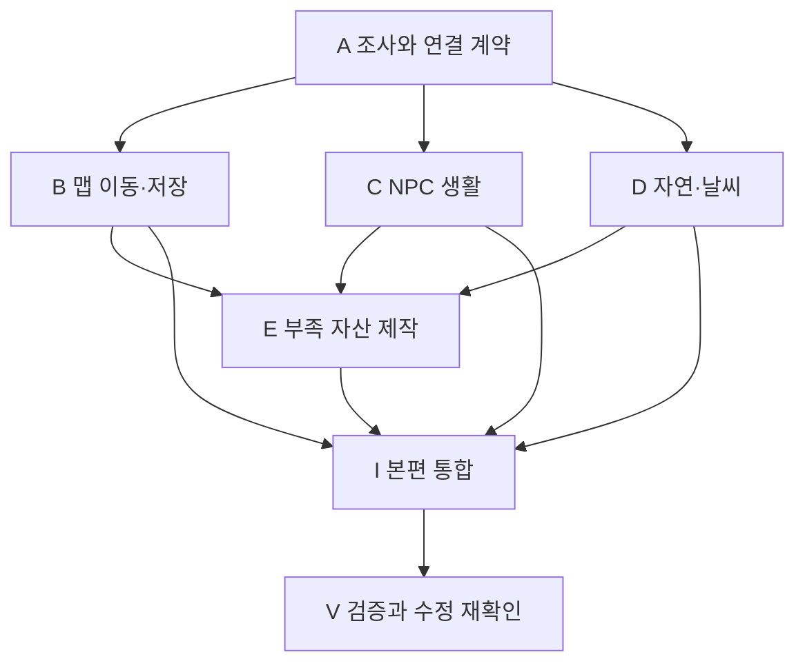

# 생명의 호수 생활 확장 — 단계별 작업 분할과 에이전트 지시서

> 작성일: 2026-10-22 / 상태: 작업 분할 초안
> 기반: [생활 공간·가뭄 마을 확장 기획](LAKE_OF_LIFE_LIVING_WORLD_PLAN.md)
> 이 문서는 다음 구현 작업을 요청하기 위한 지시서다. 현재 에이전트 배정·구현·검증을 완료했다는 뜻이 아니다.

## 1. 실행 순서

**공통 조사 → 맵·NPC·환경의 병렬 제작 → 부족 자산 제작 → 본편 통합 → 검증** 순서로 진행한다. 처음부터 각 에이전트에게 본편 씬을 자유롭게 수정하게 하지 않는다.

| 순서 | 작업 ID / 역할 | 산출물 | 시작 조건 |
|---|---|---|---|
| 0 | A / 조사·계약 정리 | 현장 배치, R04~R09 참조표, 저장 이관표, 파일 소유권, 공용 연결 계약 | 기반 기획과 현재 작업 트리 확인 |
| 1 병렬 | B / 맵 이동·저장 | 작은 피해 마을 씬, 왕복 이동, 구 저장 대응, 대표 사건 이관안 | A의 맵·ID·소유권 결정 |
| 1 병렬 | C / NPC 생활 | 작업·이동·휴식, 점유·중단·재개, 주민 6명용 설정 | A의 NPC·작업점·환경 입력 계약 |
| 1 병렬 | D / 환경 표현 | 바람·먼지·날씨 설정, 물/흙 표현, 실내 억제, 환경음 연결 | A의 환경·조명·저장 계약 |
| 2 | E / 부족 자산 | 필요한 모델·텍스처·재질·프리팹과 제작 기록 | B/C/D의 부족 자산 명세. 슬롯이 나면 앞당겨 진행 가능 |
| 3 | I / 통합 담당 | 본편 두 맵과 주민·환경·퀘스트·지도 연결 | B/C/D의 연결 가능 산출물, 해당 구간에 필요한 E 자산 |
| 4 | V / 검증 담당 | 정적/자동 검사 결과, 사용자 테스트 명세, Player 검증 범위·결과 | 통합 버전 고정 |

통합 담당을 유지하고 B/C/D를 동시에 맡기면 총 4개 에이전트로 운영할 수 있다. A는 통합 담당이 먼저 수행해도 된다. E와 V는 작업을 마친 에이전트에 새 역할로 맡길 수 있으며, 모든 역할을 동시에 실행할 필요는 없다.



## 2. 공통 작업 규칙

각 요청에는 본 문서 경로와 작업 ID를 반드시 포함한다. 에이전트는 본 문서와 기반 기획, 저장소 AGENTS.md, 자기 작업에 해당하는 저작·검증 지침을 읽는다. 이미 조사한 내용도 현재 코드·데이터와 다른 부분은 실제 상태를 우선 확인한다.

### 파일 소유권

| 대상 | 수정 담당 | 다른 담당의 전달 방식 |
|---|---|---|
| `LakeOfLifeScenario.unity`와 기존 본편 프리팹 배치 | I | 배치 명세·프리팹·참조 변경 목록 전달 |
| 새 피해 마을 씬 | B, 통합 착수 때 I에 인계 | 인계 뒤 B는 직접 저장하지 않고 수정 요청 |
| 맵 전환·도착·저장 이관 코드 | B | 기존 계약 확장 요청은 I와 조율 |
| NPC 상태·작업·생활 상호작용 코드 | C | B는 사건 바인딩 요구만 전달 |
| 환경·조명·날씨 코드와 셰이더 | D | C는 환경 신호를 소비, 별도 날씨 생성 금지 |
| 신규 모델·텍스처·미술 재질 | E | D와 경로·프로퍼티 계약 합의 후 제작 |
| 공용 Contracts·Data 타입, asmdef | I | B/C/D가 필요한 최소 변경안 전달 |
| Map/Quest 데이터베이스, Addressables, BuildSettings | I | 등록할 ID·주소·GUID·대상 경로 전달 |
| 기존 R04~R09 Flow/대화/퀘스트 에셋 | I | B가 씬별 소유·참조 교체 명세 전달 |
| 각 작업 전용 신규 테스트·프리팹·데이터·보고서 | 해당 담당 | A에서 정한 전용 경로 사용 |

A가 실제 수정 파일 목록을 적어 위 분류를 구체화한다. 파일명이 다른 경로에 있거나 한 파일에 여러 책임이 섞여 있으면 단일 소유자를 정하고 필요한 변경을 전달한다. 같은 파일의 서로 다른 줄을 각자 고치는 방식은 사용하지 않는다.

### 실행 환경과 사용자 변경

- 현재 사용자 수정, 특히 `LakeOfLifeScenario.unity`의 미커밋 변경을 먼저 기록하고 보존한다. 요청 없이 커밋하지 않는다.
- 같은 작업 폴더에서는 소유 파일만 수정한다. 소유권 이전은 담당자와 시점을 기록하고 이전 담당의 쓰기를 끝낸 뒤 진행한다.
- Unity의 씬 저장·에셋 생성/이동·Play Mode·빌드와 Blender 씬 변경은 한 번에 한 담당만 수행한다. 여러 에이전트가 같은 Editor를 동시에 조작하지 않는다.
- 컴파일·테스트 구간에는 관련 코드 쓰기를 잠시 마치고 고정된 파일 상태로 검사한다. 변경 중인 결과를 최종 검증으로 기록하지 않는다.
- 별도 체크아웃을 쓰는 경우 .meta를 포함해 변경을 전달한다. 연결된 Unity/Blender MCP가 어느 프로젝트를 가리키는지 확인하며, 폴더를 나눴다고 Editor도 분리됐다고 가정하지 않는다.
- 본편 진행 사실을 임의로 켜서 완주 성공으로 처리하지 않는다. 테스트용 주입은 별도 표기하고 실제 플레이 결과와 구분한다.

### 공통 인계 형식

작업 보고서는 아래 순서로 남긴다. 아직 작성하지 않은 보고서를 존재하는 산출물로 표시하지 않는다.

1. 완료 범위와 남은 범위.
2. 변경 파일 및 새 ID/GUID/주소 목록.
3. 소비할 공개 계약과 데이터 설정 방법.
4. 프리팹·씬에 연결할 컴포넌트/필드/참조와 예상 배치.
5. 수행한 검사, 실패, 미수행, 사용자 테스트 대기.
6. 다른 담당에게 필요한 변경 요청과 기존 사용자 변경 보존 여부.

보고서 후보 경로는 `Assets/docs/design/LivingWorld/` 아래 `A_BASELINE.md`, `B_MAP_HANDOFF.md`, `C_NPC_HANDOFF.md`, `D_ENVIRONMENT_HANDOFF.md`, `E_ASSET_HANDOFF.md`, `I_INTEGRATION.md`, `V_VALIDATION.md`다. 실제 작업 시 해당 담당이 필요한 문서와 .meta를 생성한다.

## 3. A — 현장 조사와 연결 계약

### 복사해서 보낼 요청

```text
Assets/docs/design/LAKE_OF_LIFE_LIVING_WORLD_TASKS.md의 A 작업을 수행해줘.
기반 기획을 읽고 생활 확장의 현장 명세와 병렬 작업 계약을 작성해줘.
이번 A 작업에서는 본편 씬·런타임 코드·콘텐츠 데이터를 변경하지 마.

현재 LakeOfLifeScenario의 사용자 변경을 보존하면서 다음을 확인해줘.
1. R04~R09의 피해 지역/호수 지역/공통 진행을 구분한 참조·저장 소유 표.
2. 새 피해 마을의 출입구, 핵심 구역과 기존 사건 대응. 실측과 제안 좌표 구분.
3. 기존 ID/GUID/SceneEntityId/ownerKey와 구 저장 위치의 이관 요구.
4. 주민 6명, 대표 상호작용 6곳, 작업 모션과 사용 가능한 자산 후보.
5. B/C/D/E/I가 수정할 정확한 파일/폴더 소유권.
6. 맵·도착 ID, 작업점·점유·취소, 환경 상태 소비, 저장 소유자 계약.
   현재 코드로 가능한 계약을 우선하며 미구현 API를 기존 기능처럼 쓰지 마.
7. 확인 가능한 성능 기준선과 미측정 항목, 각 구현 작업의 선행 조건.

A_BASELINE.md에 기록하고 B/C/D를 시작할 수 있는 항목과 해결이 필요한 항목을 구분해줘.
기획의 일상적인 세부사항은 근거를 적어 정하되, 기존 서사와 사용자 변경을 바꾸지 마.
```

완료 조건: 기존 저장/참조를 잃는 위험이 식별되고, B/C/D가 같은 파일이나 같은 책임을 중복 구현하지 않고 시작할 수 있다. 이름·수치·좌표가 모두 확정돼야 하는 것은 아니다. 실제 배치와 시각 품질이 미확인인 곳은 그대로 표시한다.

## 4. B — 별도 맵과 왕복·저장

```text
Assets/docs/design/LAKE_OF_LIFE_LIVING_WORLD_TASKS.md의 B 작업을 수행해줘.
A_BASELINE.md의 맵/저장/파일 소유권 계약을 기준으로 구현해줘.
A의 선행 산출물이 없다면 현재 구조 읽기와 이관 목록 작성까지만 하고,
공용 Map ID나 저장 계약을 독자적으로 확정하지 마.

목표는 작은 가뭄 마을 씬과 호수 왕복을 성립시키는 것이다.
새 맵에 안전한 도착점·귀환 출구·우물 조사·식수 인계 지점을 준비하고
기존 PortalActor/SceneTransition/도착점/저장 체계를 재사용해줘.
중복 이동, 로드 실패, 입력 잠금 해제, 도착 직후 재전환을 처리해줘.
R04~R09를 씬별로 나눈 참조 이관안을 만들고 기존 사건·ID 의미를 보존해줘.
구 저장의 피해 마을 위치와 엔티티 상태를 새 맵으로 대응하는 최소 이관을 설계·구현해줘.
원본 저장 대신 복사 슬롯으로 확인해줘.

본편 씬과 공용 데이터베이스/Addressables/BuildSettings는 I가 연결한다.
필요한 등록값과 연결 변경을 정확히 전달해줘.
관련 자동 검사와 LW-T01~04/T10의 재현 절차, 미검증 항목을 B_MAP_HANDOFF.md에 남겨줘.
새 맵 씬의 수정 소유권을 I에 넘긴 뒤에는 직접 저장하지 마.
```

첫 완료는 작은 왕복 구간이며 모든 건물과 NPC가 완성될 필요는 없다. 실제 두 맵 연결 이전에는 왕복 검증 완료로 보고하지 않는다.

## 5. C — NPC 생활 행동

```text
Assets/docs/design/LAKE_OF_LIFE_LIVING_WORLD_TASKS.md의 C 작업을 수행해줘.
A_BASELINE.md의 NPC/작업점/환경 입력/파일 소유권 계약을 기준으로 구현해줘.
A의 계약이 없으면 기존 NPC 상태·모션·점유 요구 조사까지만 진행해줘.

호수 4명과 피해 마을 2명의 작업→이동→휴식을 표현할 최소 구조를 만들어줘.
기존 NpcBrain·상태 머신·NpcMovementController·KCC·MotionSet과
NpcLifeInteractable/Presentation을 재사용해줘.
작업점 점유·도달 실패·막힌 길·취소·대화 중단/재개·소품 해제를 처리해줘.
서사 배치와 반복 일과를 구분하고, 대화 중 일과 이동이나 물자 무한 생성을 막아줘.
기존 시간 서비스와 D가 소유한 환경 입력을 소비해 시간대 변경·피신을 연결해줘.
환경 구현이 미완료라면 독립 테스트 입력으로 검증하고 통합 대기를 명시해줘.
퀘스트 NPC가 밤이나 날씨 때문에 사라져 진행이 막히지 않아야 해.

본편 씬을 직접 배치하지 말고 작업 전용 프리팹/설정과 연결 설명을 전달해줘.
실제 모션이 부족하면 필요한 클립/소품을 명시하고 확보된 것으로 처리하지 마.
관련 자동 검사와 LW-T03/T05/T08의 재현 절차, 미검증 항목을 C_NPC_HANDOFF.md에 남겨줘.
```

완료 조건: 각 행동을 재생하는 것뿐 아니라 중단·재개·자리 경쟁·저장 복원 후 접근 가능성이 설명되고 검증 범위가 기록된다. 주민 6명의 최종 본편 배치는 I가 수행한다.

## 6. D — 자연·먼지·날씨

```text
Assets/docs/design/LAKE_OF_LIFE_LIVING_WORLD_TASKS.md의 D 작업을 수행해줘.
A_BASELINE.md의 환경/조명/저장/파일 소유권 계약을 기준으로 구현해줘.
A의 계약이 없으면 기존 셰이더·조명·FX 조사와 재사용안까지만 진행해줘.

기존 LakeWater.shader·CreekGround.shader·WorldLighting과 ExternalAssets를 조사하고
공통 바람, 가뭄 지역 먼지, 비·실내 억제, 일시적 젖음과 환경음을 연결해줘.
기존 셰이더를 우선 보완하고 필요한 부분만 ShaderGraph 또는 HLSL로 제작해줘.
퀘스트의 물길 회복과 날씨를 분리하고 NPC가 읽을 환경 상태를 제공해줘.
조명 중복 제어, 씬 종료 후 전역 셰이더 값 잔류, 재입장 날씨 재추첨을 다뤄줘.
가뭄 마을의 회복 전 기본 날씨는 맑음/흐림/건조한 바람으로 구성해줘.
대화·단서·전투 가독성과 실내 비 관통을 검사해줘.

본편 씬과 공용 등록 데이터는 I가 연결한다.
프로필·효과 프리팹·재질·필드 연결 설명을 전달하고 원본 외부 자산은 수정하지 마.
E가 제작할 텍스처는 경로·UV·채널·색공간·재질 프로퍼티 요구를 먼저 전달해줘.
관련 검사와 LW-T06/T07/T09의 재현 절차, 미측정 성능을 D_ENVIRONMENT_HANDOFF.md에 남겨줘.
```

완료 조건: 같은 환경 상태에서 식생·물·먼지·소리·NPC 입력이 일관되고, 상태 소유와 조명 반영이 중복되지 않는다. 본편에 연결하기 전의 효과 미리보기는 통합 성능 통과와 구분한다.

## 7. E — 부족한 모델·텍스처 제작

```text
Assets/docs/design/LAKE_OF_LIFE_LIVING_WORLD_TASKS.md의 E 작업을 수행해줘.
A의 자산 조사와 B/C/D가 전달한 구체적인 부족 자산 목록을 기준으로 제작해줘.
목록이 없으면 먼저 후보 조사·실제 부족 여부를 정리하고 무관한 자산을 생성하지 마.

ExternalAssets와 프로젝트 기존 자산으로 해결 가능한지 확인하고,
없는 모델은 BlenderMCP, 필요한 텍스처는 ImageGen으로 만들어 연결해줘.
실제 사용 크기·피벗·UV·분리 부품·단순 충돌 메시·근접 카메라 거리를 맞춰줘.
기존 TGV 중심 생활 공간과 색·형태·재질이 어울리게 제작해줘.
생성 이미지를 검증된 PBR 세트로 취급하지 말고 각 맵을 실제 재질에 적용해 확인해줘.
외부 원본과 기존 Blender 작업은 보존하고 본편 씬을 직접 수정하지 마.
프로젝트용 모델/텍스처/재질/프리팹과 .meta를 전달해줘.

E_ASSET_HANDOFF.md에 사용처, 기존 자산을 못 쓴 이유, 파일·GUID, 임포트 설정,
근접/원경 확인 결과와 아직 확인하지 못한 항목을 남겨줘.
```

완료 조건: 이미지와 모델 파일 생성에서 끝내지 않고 Unity에서 재질이 연결된 기물로 전달한다. ImageGen/BlenderMCP 연결 실패는 사실대로 기록하며 임시 도형을 완성 자산으로 보고하지 않는다.

## 8. I — 본편 통합

```text
Assets/docs/design/LAKE_OF_LIFE_LIVING_WORLD_TASKS.md의 I 작업을 수행해줘.
A/B/C/D/E 산출물과 기존 사용자 변경을 확인하고 본편에 순서대로 연결해줘.
아직 오지 않은 산출물을 완성됐다고 가정하지 말고 연결 가능한 범위부터 진행해줘.

먼저 작은 두 맵 왕복과 우물 조사·식수 인계를 연결한 뒤,
주민 6명·생활 구역 4개·대표 상호작용 6곳을 배치해줘.
그다음 바람·먼지·날씨와 NPC 피신을 연결하고 R04~R09 나머지 사건을 이관해줘.
Map/Quest 데이터베이스, 지도·마커, Addressables, BuildSettings, 도착점,
NavMesh, 조명, 기존 Flow/대화/카메라 참조를 빠짐없이 확인해줘.
기존 ID/GUID와 저장 사실을 보존하고 두 맵의 중복 주민·러너·물자를 제거해줘.
기존 씬의 피해 구역을 정리할 때 사용자의 미커밋 배치를 덮어쓰지 마.

I_INTEGRATION.md에 반영 산출물·버전·변경 파일·남은 항목을 기록해줘.
테스트 지침에 따라 관련 검사와 사용자 플레이 테스트 명세를 준비해줘.
새 씬/로딩/셰이더 포함 정책 변경에 필요한 Player 검증을 별도로 계획하고,
필수 검증이 남았으면 구현 반영과 검증 완료를 구분해줘.
```

통합 중 발견한 결함은 파일 소유자에게 돌려보낸다. 급하게 통합 담당이 수정했다면 해당 담당에게 변경을 전달하고 동시에 같은 파일을 고치지 않는다.

## 9. V — 검증과 완료 판정

```text
Assets/docs/design/LAKE_OF_LIFE_LIVING_WORLD_TASKS.md의 V 작업을 수행해줘.
먼저 TEST_VALIDATION_GUIDE.md를 읽고 통합 버전과 변경 범위를 고정해줘.
기반 기획의 LW-T01~10을 실제 통합 결과에 맞춰 구체적인 테스트 명세로 정리해줘.
관련 기존 자동 검사·컴파일·참조 검사를 수행하고 결과를 기록해줘.
씬/Addressables/셰이더 포함 변경에 필요한 Windows Player 검증도 구분해줘.
사용자 직접 플레이 항목은 실행 가능한 절차와 기대 결과로 전달하고
사용자 결과가 없는 항목은 테스트 대기로 남겨줘.

기존 저장 복사본, 역순 조사, 중단·로드, 밤/날씨, NPC 작업점 경쟁,
R09 재방문, 전투·대화 가독성, 프레임 비용을 빠뜨리지 마.
과거 단일 씬 통과나 테스트 상태 주입을 실제 새 맵 완주로 간주하지 마.
V_VALIDATION.md에 통과/실패/미수행/사용자 테스트 대기와 근거를 기록해줘.
발견한 결함은 담당·파일·재현·기대 결과를 붙여 전달하고,
수정된 범위만 재검증한 뒤 남은 위험을 분명히 보고해줘.
```

## 10. 한 번에 총괄 에이전트에게 맡기는 요청

아래 요청은 조사뿐 아니라 후속 구현과 에이전트 분할까지 지시한다. 조사만 먼저 원하면 3절 A 요청을 사용한다.

```text
Assets/docs/design/LAKE_OF_LIFE_LIVING_WORLD_PLAN.md와
Assets/docs/design/LAKE_OF_LIFE_LIVING_WORLD_TASKS.md를 기준으로 구현을 진행해줘.

너는 총괄·통합 담당이다. 먼저 A 현장 조사와 연결 계약을 완성하고,
파일 소유권과 공용 계약을 정한 뒤 별도 에이전트에 B 맵·C NPC·D 환경 작업을 병렬로 맡겨줘.
작업 슬롯이 나면 E 부족 자산 제작을 맡기고, 이후 I 통합과 V 검증을 진행해줘.
동시에 작업할 에이전트는 너를 포함해 최대 4명으로 유지해줘.
각 에이전트는 본 문서의 작업 지시와 공통 규칙을 읽고 인계 보고서를 남겨야 해.

같은 본편 씬·공용 데이터·Editor를 여러 에이전트가 동시에 변경하지 않게 관리해줘.
기존 사용자 수정과 ID/GUID·저장을 보존하고 요청 없이 커밋하지 마.
에셋은 기존 ExternalAssets를 우선 쓰고 부족할 때 BlenderMCP와 ImageGen을 사용해줘.
각 단계의 완료 조건을 확인하며 연결 가능한 작업을 계속 진행하고,
실제 검증이 남은 항목은 구현 완료와 구분해 보고해줘.
```
