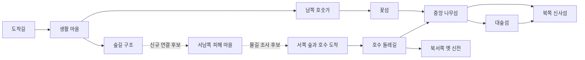

# 생명의 호수 — 붉은 나무의 축복 R00 조사

> 조사일: 2026-10-17 / 상태: **파일·기존 이미지 조사 완료, Unity 실물 확인 대기. R00 전체 미완료**
> 상위 기준: [확정 기획](LAKE_OF_LIFE_RED_TREE_STORY_PLAN.md), [제작 명세](LAKE_OF_LIFE_RED_TREE_IMPLEMENTATION_SPEC.md), [테스트 명세](../guide/LAKE_OF_LIFE_RED_TREE_TEST_SPEC.md).
> 세부 참조: [파일 근거 부록](LAKE_OF_LIFE_RED_TREE_R00_EVIDENCE.md). 이번 작업은 조사와 명세 보강이며 새 서사 구현이 아니다.

## 1. 조사 범위와 증거 수준

AGENTS.md와 스토리·대사·콘텐츠·전투·검증 가이드를 읽고 현재 파일과 대조했다. 충돌하는 보물·같은 얼굴·회차 서사는 기술 이력으로만 취급한다. 루시아의 생사·처우는 결정하지 않았다.

| 수행 | 결과와 한계 |
|---|---|
| git 변경·미추적 확인 | 시작 시 다수 사용자 변경 확인. 전투 코드, CombatTestMap, SceneManager/SceneContext, 훈련장, 모델/모션, 기존 시나리오 문서와 새 확정 명세 포함. 기존 변경을 복구·삭제·커밋하지 않음 |
| 파일 조사 | 두 씬 YAML, layout/world JSON, 모델·화자·파티 데이터, GUID 역조회, Flow/Quest/Dialogue, 저장·저작 코드 확인. 부록에 실제 참조와 주요 입력 SHA-256 기록 |
| 이미지 직접 확인 | 현행 PartyMemberData가 가리키는 12명 전신 이미지, 주요 NPC 13명 초상화, 기존 MapBackground.png를 열어 확인. 임시 축소 모음으로 비교했으며 원본 경로를 아래에 기록 |
| Unity 씬·프리팹 로드 | **미수행**. 이 세션에 Unity 호출 도구가 없고 컴퓨터 도구의 네이티브 앱 제어가 비활성이다. Unity 프로세스 존재는 확인했으나 열린 프로젝트·씬·미저장 상태는 확인 못 함. 같은 프로젝트의 두 번째 Editor를 실행하지 않음 |
| 직접 이동·전투·카메라 | **미수행**. JSON 경사·기존 미니맵을 플레이 결과로 대체하지 않음 |
| 테스트·컴파일·Player 빌드 | **미수행**. 문서 변경 검사는 링크·내용·diff로 수행. R00에 필요한 실물 검사까지 통과했다는 뜻이 아님 |

`rg` 실행이 불가능해 PowerShell과 일회성 Node 읽기 명령으로 조사했다. 신규 Unity 검증 도구·런타임 코드는 만들지 않았다. 실제 저장 슬롯은 읽거나 수정하지 않았다. 기존 P00/P05/P06 산출물·이미지는 과거 이력이며 이번 실행 결과로 승계하지 않는다.

초기 변경 파일 110개의 SHA-256을 임시 기준선으로 기록했다. 마무리 비교에서 본 작업의 제작 명세 외에 PlayerCombat.Finish, PlayerTargetingController, PlayerAttackState, PlayerDashAttackState, EnemyDetectionTests, COMBAT_TEST_MAP_VALIDATION, TEST_VALIDATION_GUIDE도 변경되어 있었다. 본 작업이 수정한 파일이 아니므로 원복하지 않았고, 검증 가이드의 현행 운영 원칙을 다시 확인했다. 따라서 전체 작업 트리가 조사 내내 고정돼 있었다거나 모든 파일의 해시가 불변이었다고 보고하지 않는다.

## 2. 현재 구현 / 목표 / 차이 / 근거 / 조치

| 영역 | 현재 구현 | 목표 | 차이 | 실제 근거 | 후속 조치 |
|---|---|---|---|---|---|
| 진입 | 기본 시작 맵은 LakeOfLifeScenario | 두 주인공 선택 후 혼자 운송 의뢰 도착 | 씬 연결은 있음. 도입 내용은 구 서사 | MapConfigDatabase._defaultStartMapId, UI_Scene_TitleMenu.StartNewGame | R03은 새 진입 시스템 대신 기존 경로의 콘텐츠 교체 |
| 진행 등록 | RegionInfo.flowGraphs는 비어 있음. 씬 FlowGraphRunner 7개 | 새 사건의 단일 실행 연결 | 원본 FLOW_Lake 파일만 바꾸면 현행 복제본이 남음 | 부록 3절, 씬 `_graph` 참조 | R02에서 러너·상호작용·NPC·생성기를 함께 전환 |
| 맵 규모 | layout routes 26 / clearings 17 / placements 183 / scatters 20 | 기존 맵 발전·재사용 | 상위 배열만으로 전체 배치량을 알 수 없음 | 현재 JSON 직접 계수 | district props 34 / terrainPads 30 / lakeExploration props 298까지 소유권에 포함 |
| 월드 배치 | zones 30 / routes 46 / monsters 28 / props 32 / portals 4 / interactions 10 | 피해 지역·이동한 몬스터·구조로 | 기존 40마리 문서와 다름. 28은 선언 수 | 현재 world JSON | 새 배치 전 ID별 보존·이전·신규 구분 |
| 중심 공간 | 호수 중심 (1067,77,836), 중앙 고목 (1081,*,842), 중앙 신사 Heart_BaseShrine (1095,*,831)와 문 (1095,*,820). 북쪽 섬에 별도 신사 (1084,*,976) | 신사·붉은 나무·루시아 대치가 한 중심으로 읽힘 | 중앙 신사 기물이 이미 있음. 고목과 XZ 거리 약 17.8m. 기물 존재가 최종전 구도 완성을 뜻하지 않음 | lakeExploration.props와 씬의 Heart_BaseShrine/Heart_ShrineGate 프리팹 override | 중앙 기물 보존·발전 우선. 실제 시야·보스 가용면적 확인 후 R07 확정 |
| 피해 마을 | 외곽 전투 구역·길은 있으나 새 서사 피해 마을의 생활 사건 연결 근거 없음 | 한 마을의 우물·집·경작·생존자 직접 경험 | 외곽 전투장을 그대로 피해 마을이라고 부를 수 없음 | world zones, layout district 생활 배치는 남쪽 마을 중심 | 서남쪽 외곽 후보를 R04에서 생활 공간으로 저작 |
| 출연진 | 12명 정의·모델 주소·파티 이미지 존재. H09 정의도 별도 존재 | 지정 12명만 영입, 일반 NPC 제외 | 자산 존재가 12명 합류 사건 구현을 뜻하지 않음 | enum, PlayerCharacterCatalog, PartyMemberData, 부록 1절 | R01에서 각자 사건·결정·후반 기여. R06 명단 검사 |
| 이름 | Reine=3의 실제 PartyMemberData 표시는 **렌느** | 확정 기획의 **레이네** | 표시명 불일치 | PartyMemberData.asset type 3 | R01 표기는 확정 기획 우선. R02/구현에서 표시명만 정합화, enum·GUID·Reien 파일명 유지 |
| 화자 | 고정 라온→MonsterBokusei, 화린→MonsterHonoka, 묘령→MonsterSiuha | 선택 주인공과 동료가 올바른 몸·얼굴로 발화 | 고정 이름 화자와 Protagonist는 다름. 나머지 다수 동료의 고정 화자 바인딩 없음 | SpeakerActorBindingTable, DialogueSpeakerResolver | 장면별 고정 인물/선택 주인공/활성 캐릭터 구분, 필요한 대역 바인딩 추가 |
| 영입 | 기존 화린·리안 구조와 묘령 대결 Flow | 새 사건 11명 개별 합류 | 구 이벤트 의미와 새 합류 동기가 다름 | FLOW_Scenario* 및 RecruitmentEncounter 정의 | 보유 상태는 보존, 새 장면 완료는 새 사건으로 기록 |
| 최종전 | 골렘 3변형·4공격, 엔트 MotionSet 공유 | 루시아가 받아들인 힘으로 싸움 | 변신·뿌리 공격·꽃 낙하·목소리·책임 연출은 이 체인으로 확인되지 않음 | 부록 4절 | R08 전용 구성·표현 설계. 공용 골렘/엔트 일괄 수정 금지 |
| 저장 | 버전 3.4, Party/Quest/Flags/Story/World/Flow 저장 | 과거 저장 보존과 새 사건 재개 | 붉은 나무 사건 버전·구 분신 분리 이관은 현재 migration에 없음 | SaveManager.MigrateToCurrentVersion, GameSaveData | R02 별도 이관표와 복사 슬롯 검사 |

MapConfigDatabase는 이번 시작 git 상태에서 수정 파일이 아니었다. 제작 명세 예비 조사의 ‘사용자 변경’ 예시는 당시 기록이며 현재 변경 목록과 동일시하지 않는다.

## 3. 맵 확인 자료와 배치 후보

### 3.1 확인한 이미지와 현행 파일의 관계

이 이미지는 **기존 생성 미니맵**이다. 이번에 Unity에서 새로 촬영한 캡처가 아니다. 남쪽 생활 마을, 서쪽 숲, 동쪽 호수와 연결 섬, 중앙 붉은 수관, 북서쪽 별도 큰 나무·구조물을 눈으로 확인했다. JSON의 대응 좌표 및 씬의 같은 이름 참조와 대조했으나 픽셀 전체가 현행 씬과 동일하다고 인증하지 않는다. 촬영 시각의 코드·씬 해시 연결 자료가 없어 현재 플레이 시야의 증거로 사용하지 않는다. 수면은 `CaptureMapBackground`에서 정사영용 단색 재질로 임시 대체하므로 실제 수면 표현도 이 이미지로 판정할 수 없다.

원본 `Ingame/LakeOfLife.unity`와 시나리오 `Scenario/LakeOfLifeScenario.unity`는 서로 다른 파일로 존재한다. 원본을 현행 플레이 지형으로 취급하지 않는다. `BuildOrOpen`은 시나리오 씬이 있으면 열고 검사만 하며, 없을 때 원본을 출발점으로 지형·배경·NavMesh를 새로 만든다. 원본 씬 직접 화면 확인은 대기다.

두 씬의 현재 GUID 참조를 비교하면 원본 지형은 `DreamscapeEastLands/Scenes/Terrain/Terrain_Eastlands.asset`, 시나리오 지형은 `World/ScenarioMaps/LakeOfLifeScenario/Terrain.asset`이다. 원본 씬 텍스트에 Flow 에셋 직접 참조가 없더라도 원본 `MapRegionInfo_LakeOfLife.asset`에는 `FLOW_IngameBase`와 `FLOW_LakeSearchQuestLine`이 등록되어 있다. SceneContext는 `ApplyMapFlowGraphs(MapID, regionInfo.flowGraphs)`를 호출하므로 씬 텍스트만 보고 원본 실행선이 없다고 판단하면 안 된다. 시나리오의 비어 있는 RegionInfo와 개별 러너 구조를 원본과 구분한다.

### 3.2 공간별 사실과 제안

좌표는 별도 표기가 없으면 layout 선언 좌표다. `*`는 높이를 지형에 맞추는 배치의 y=0 입력으로, 월드 높이 0을 뜻하지 않는다. 반경은 지형 조형용 값이며 충돌 없는 전투 반경이 아니다.

| 구역 | 실제 근거 좌표·경로 | 활용 후보 | 미확인·필요 작업 |
|---|---|---|---|
| 도착길 | Start (1118.367,51.768,391.17) → Guide (1085.91,57.91,420.8) | S00 운송 도착. 기존 짐·마을 입구 이용 | 시작 방향에서 마을과 현재 목적이 보이는지, 경사/턱 |
| 생활 마을 | Courtyard (1036,62,416), Well (1044,61.5,408), Bakery (1028,61.8,392), GuestHouse (1064,59,440) | 조이 식사·헤이즐 돌봄·루시아 거처/일 배정, S13 반환 | NPC 접근·패드 상호작용·밀집 카메라. 생활 역할과 NPC 위치를 함께 조정 |
| 주민 현 배치 | 씬 직접 Transform: 루시아 (1052,61.61521,453.06), 조이 (1033,62.114754,410.06), 헤이즐 (1005.22455,62.47076,411.52457) | 생활 동선을 만드는 기존 근거 | 값은 직렬화 localPosition. 부모 변환을 Unity로 확인 후 월드 좌표 확정 |
| 숲길 | Hwarin (985,62.3,470), OldRoad (1021,62.31,495), Lian (962,67.594,522), MyoRyeong (914,80,576) | 구조·운송 조사·물길 접근을 분담 | 옛 세 영입의 순서를 새 시나리오에 그대로 강요하지 않음 |
| 호수 도착 | LakeArrival (885.688,86.206,651.38), LakeViewWindow (933,85,727), Village_LakeRoad | 첫 풍요 조망과 후반 같은 장소의 변화 | 수관/절벽의 시야 차폐, 실제 캐릭터 눈높이 조망 |
| 중앙 섬 A — 우선 후보 | Heart_Core (1073,83,829), 조형 반경 33. 고목 (1081,*,842), 크기 목표 (47,40,49). Heart_BaseShrine (1095,*,831), 크기 (9,8,8), Heart_ShrineGate (1095,*,820) | 이미 있는 나무·신사·문을 유지하고 루시아 대치/전투 공간으로 발전 | 큰 수관·줄기·물가 바위가 락온과 회피 공간을 가릴 위험. 나무 크기와 신사 주변 유효 공간 검토 |
| 북쪽 섬 B — 대안 | Shrine_Core (1080,85,960), 반경 25, Shrine_Sanctuary (1084,*,976), Gate (1074,*,941) | 중앙 섬에서 안전한 전투 공간 확보가 불가능할 때만 나무·섬 지형 재구성을 비교 | 중앙성 약화와 신규 조형 비용. 북서쪽 보물터와 혼동하지 않게 구도 확인 |
| 기존 북서 신전 | TempleEntry (823.562,99.817,1052.658), Treasure (818,102.98,1082), 반경 55 | 기물·공간 보존, 새 용도는 R01 이후 | 기존 최종전 장소라고 그대로 루시아를 배치하면 중앙 호수 콘셉트와 충돌 |
| 피해 마을 A — 우선 후보 | 남쪽 고목 world zone (815,*,425), 어린 식물 (859~871,*,457~468), 옛 채석장 (885,*,385), 외곽 길 연결 | 남쪽 마을 서편 바깥의 별도 작은 생활권. S03 방문→S04 물길 북상→S08 표식 재방문 | 현재는 전투 구역이다. 집·마른 우물·경작지·생존자·마을 경계 신규 저작 및 몬스터 이격 필요. 정확한 마을 중심/고도 미확정 |
| 피해 마을 B — 예비 후보 | 서쪽 숲길 포털 (765,*,630), 뿌리 군락 (805,*,533), 거미 동굴 (805,*,613) | 서쪽 길을 따라 물길·운송 흔적과 연결 | 마을에서 멀어져 도입 이동 부담 증가. 포털 개방 이전에도 도보 접근 보장 필요 |

실선은 선언 경로 연결, 점선은 새 배치 제안이다. 실제 통행 검증 결과가 아니다. R01은 모든 사건을 긴 주도로 왕복시키지 말고 마을→서남 피해 지역→물길→호수의 루프를 활용한다. 구조와 기록 조사 사이에 같은 전투를 반복 배치하지 않는다.

부록의 선언 치수상 주도로는 약 878.7m, 호수 둘레는 1359.6m, 마을→호수길은 183.6m다. 섬 남쪽 진입 135.7m + 꽃섬→중앙 118.9m, 중앙→신사섬은 147.6m다. 이는 이동 시간이나 안전한 실제 길이를 측정한 값이 아니다. 주도로 최대 선언 경사는 약 12도이며 실제 지형의 순간 경사·발판·충돌을 보장하지 않는다.

### 3.3 소유권과 재생성 영향

| 소유 소스 | 담당 내용 | 씬 수동 편집에 미치는 영향 / R02 원칙 |
|---|---|---|
| layout JSON | 지형 영역 600×850, 경로·조형·상위 기물·scatter·removeRoots | 원본 재생성 시 제거 대상과 지형 생성이 적용됨. 기존 씬이 있을 때 BuildOrOpen은 재생성하지 않음 |
| layout.district | 생활 건물·terrainPads·NPC 접근/보행 검사·제거 기물 | District/Landscape 적용 코드를 함께 확인. 씬에서만 집을 옮기면 입력과 불일치 |
| layout.lakeExploration | 섬 나무·신사·바위·등불 등 298 선언 | LakeExploration 적용이 생성 소유자. 물가 경계·지형·NavMesh까지 함께 재검사 |
| world JSON | 외곽 구역·몬스터 28·소품·포털·상호작용과 고유 ID | ScenarioMapAuthoring.World 계열이 생성. y=0을 지형에 투영함. 생존자/루시아 사건을 기존 몬스터 ID에 덧씌우지 않음 |
| ScenarioMapAuthoring.Integration | 지도 DB·빌드 씬·RegionInfo 연결 | `includeSourceFlows=false`는 새 RegionInfo 생성 시 원본 Flow 복사를 막음. 이미 존재하는 개별 씬 러너를 제거하는 스위치가 아님 |
| FirstRecruitment / Reunion / OptionalEvents / Herb | 현행 구 사건 전용 데이터·배치·NPC 참조 | 복제 원본까지 퇴역 목록에 기록. PrepareFirstRecruitmentData는 기존 결과가 있으면 덮어쓰지 않고 실패함. 무조건 재생성된다고 단정하지 않음 |
| ScenarioResidentAuthoring.* | 생활 주민 모델·소품·배치 | 새 역할은 외형을 유지해 연결. P09 파괴적 경로를 조사 단계에서 실행하지 않음 |
| 씬 / Terrain / Navigation / MapBackground | 현재 생성 결과와 후속 수동 배치 | 수정 전에 JSON·저작 메서드·직접 배치 중 권위 소스를 정함. Terrain/NavMesh/미니맵 일괄 재생성은 이번에 실행하지 않음 |

## 4. 플레이어블·NPC 캐스팅 결론

### 4.1 플레이어블 12명

전체 정의·모델·무기 enum·AbilitySet·파티 초상화 링크는 부록 1절에 있다. 모델은 모두 `Player/Model/<현행 enum>` Addressables와 `PlayerModel_<enum>.prefab`의 GUID 대응을 확인했다. 현재 미추적 모델들도 사용자 작업으로 보존한다. 실물 리그·장비·얼굴 표정은 아직 확인하지 않았다.

| 인물 / enum(정수) | 무기 | 직접 본 파티 이미지의 시각 단서 | 화자·대역 상태 |
|---|---|---|---|
| 라온 / Raon(1) | 카타나 | 검은 머리, 안경, 긴 어두운 외투 | 선택 시 Protagonist. 고정 ‘라온’은 구 적 ActorId/초상화 바인딩이므로 미선택 아군 경로에 그대로 쓰지 않음 |
| 아린 / Arin(13) | 카타나 | 긴 어두운 머리, 검은 재킷·청록 장식 | 선택 시 Protagonist. 고정 아린 바인딩은 현 테이블에 없음 |
| 화린 / Hwarin(2) | 쌍도끼 | 검정·주황 머리, 붉은 장식 의상 | 고정 화린→MonsterHonoka. 구 초상화와 새 파티 이미지가 다른 경로 |
| 리안 / Lian(4) | 채찍 | 보라색 머리, 흰 앞치마형 의상 | 리안→MonsterLian. 파티 전신과 별도 대화 이미지 사용 구분 |
| 릴리 / Lili(11) | 대검 | 짙은 청색 머리, 보라색 겉옷 | 고정 화자 바인딩 없음 |
| 설아 / SeolA(5) | 활 | 짧은 회청색 머리, 흰색·청색 의상 | 고정 화자 바인딩 없음. 별도 SeolA_Dialogue_Portrait 존재와 등록 여부는 다름 |
| 묘령 / MyoRyeong(9) | 검방패 | 회색 머리, 머리 위 고글, 녹색 겉옷 | 묘령→MonsterSiuha. 테이블 기본 초상화 없음; 노드 override 확인 필요 |
| 레이네 / Reine(3) | 창 | 검은 머리, 검정·붉은 긴 의상 | 실제 표시명 렌느, 이미지 파일 Player_Reien_Full. 이름 정합화 대상 |
| 유라 / Yura(8) | 쌍검 | 긴 보라색 머리, 어두운 자주색 의상 | 고정 화자 바인딩 없음 |
| 묘묘 / Myomyo(10) | 지팡이 | 밝은 머리, 토끼 귀 형태 장식, 밝은 치마 | 고정 화자 바인딩 없음 |
| 연화 / YeonHoa(7) | 지팡이 | 분홍색 머리, 흰색·검정 의상 | 고정 화자 바인딩 없음 |
| 세라 / Sera(6) | 대검 | 밝은 회색 머리, 보라색 모자·의상 | 고정 화자 바인딩 없음. Npc_Sera 이미지와 플레이어 파티 이미지 혼동 금지 |

시각 단서는 열어 본 이미지의 특징만 기록한 것이다. 연령·성격·존대/반말·Voice Profile을 외형에서 추정해 확정하지 않았다. 사용하지 않는 H09=12는 정의·모델·Staff Set이 있어도 새 본편 영입 대상이 아니다. 현행 enum 파서가 H09를 특별히 막는 것은 아니므로 콘텐츠 허용 목록 검사가 필요하다.

`PartyManager.ApplyNewGameStartingCharacter`는 선택 인물로 Roster와 BattleOrder를 각각 비우고 1명만 넣으며 StoryProtagonistType도 설정한다. 반면 Editor에서 씬을 직접 시작하면 카탈로그 기반 폴백 명단을 만들 수 있으므로 직접 씬 실행을 단독 시작 검증으로 쓰면 안 된다. 모델 준비 실패 시 라온 등으로 폴백하는 오류 경로도 있다. RT01/02에서 실제 선택 적용을 확인한다.

Roster는 보유, BattleOrder는 출전이며 현재 PartyConfig.maxBattleSize=4다. 12명 영입 때문에 출전 제한을 12로 늘릴 이유가 없다. 선택 라온→미선택 아린, 선택 아린→미선택 라온의 S07 사건을 별도 저작하고, 이미 보유한 구 저장에서는 합류 사건과 중복 해금을 분리한다.

### 4.2 주요 NPC 13명

아래 화자 ID는 이름 문자열이다. 일반 NPC의 무기·AbilitySet은 영입 기준이 아니며 새 본편 영입은 전부 금지한다. 초상화 전체 경로는 `Assets/04.Images/UI/Portrait/Npc/` 아래 표의 파일명이다. 씬 직접 배치 8명의 데이터는 부록 2절, 별도 프리팹 5명은 아래 경로 규칙으로 확인했다.

| 화자 / Actor ID | 모델·배치 근거 | 직접 본 초상화 | R01 배역 경계 |
|---|---|---|---|
| 안내인 / NPC_Story_Guide | 씬 직접 배치, NPC_Guide_Scenario | Npc_Vardan_Dialogue_Portrait.png: 수염·금속 갑옷 | 도착·운송 안내 후보. 길잡이 별칭과 동일 Actor |
| 조안 / NPC_Joan | 씬 직접 배치, NPC_Joan 데이터 | Npc_Joan_Dialogue_Portrait.png: 붉은 짧은 머리·갈색 갑옷 | 기존 관계는 새 역할 확정 근거로 자동 승계하지 않음 |
| 미아 / NPC_Mia | 씬 직접 배치, NPC_Mia_Scenario | NPC_Mia_Dialogue_Portrait.png: 훼손된 옷·팔을 모은 자세 | 피난·생활 피해 역할 후보. 나이·가족관계 미확정 |
| 준 / NPC_Jun | Story_NPC_Jun 정의→ScenarioResidents/Npc/NPC_Jun/NPC_Jun.prefab | Npc_Jun_Dialogue_Portrait.png: 흰 셔츠·갈색 부츠 | 구조 후 귀환/잔류 역할 후보 |
| 헤이즐 / NPC_Hazel | 씬 직접 배치, NPC_Hazel_Scenario | Npc_Hazel_Dialogue_Portrait.png: 밝은 머리·녹색 의상 | 돌봄 확정. 치료·고통 이전을 축복 원리로 추가하지 않음 |
| 페니 / NPC_Penny | 씬 직접 배치, NPC_Penny_Scenario | Npc_Penny_Dialogue_Portrait.png: 긴 붉은 머리·갈색 작업복 | 등불·작업도구 후보 |
| 모건 / NPC_Morgan | 씬 직접 배치, NPC_Morgan_Scenario | Npc_Morgan_Dialogue_Portrait.png: 갈색 피부·갑옷과 도구 | 운송·수선 후보 |
| 조이 / NPC_Joy | 씬 직접 배치, NPC_Joy 데이터 | Npc_Joy_Dialogue_Portrait.png: 짧은 자주색 머리·청록 의상 | 식사와 후반 배급 확정 |
| 루시아 / NPC_Lucia | 씬 직접 배치, NPC_Lucia 데이터 | Npc_Lucia_Dialogue_Portrait.png: 자주색 머리·보라색 긴 의상 | 관리자·거처/일 배정·최종 대립 확정. 전투 후 처우 미정 |
| 상인 / NPC_Shop | ScenarioResidents/Npc/NPC_Shop/NPC_Shop.prefab | Npc_Shop_Dialogue_Portrait.png: 청색 머리·청록 의상 | 물자 반환 비용과 생계 입장 후보 |
| 연목 / Npc_Yeonmok | ScenarioResidents/Npc/Npc_Yeonmok/Npc_Yeonmok.prefab | Npc_Yeonmok_Dialogue_Portrait.png: 흰 머리·수수한 작업복 | 운송 수선 후보 |
| 소담 / Npc_Sodam | ScenarioResidents/Npc/Npc_Sodam/Npc_Sodam.prefab | Npc_Sodam_Dialogue_Portrait.png: 회색 머리·녹색 겉옷 | 돌봄 물품 배분 후보 |
| 다온 / Npc_Daon | ScenarioResidents/Npc/Npc_Daon/Npc_Daon.prefab | Npc_Daon_Dialogue_Portrait.png: 갈색 머리·갑옷·보라색 천 | 주민 보호/반환 갈등 후보 |

프리팹 경로 공통 접두사는 `Assets/03.Prefabs/Characters/`이다. 이 표의 모델 확인은 직렬화·참조 확인이며 3D 화면 확인은 아니다. 실제 모델과 이미지가 다르면 모델 기준·이미지 수정 여부를 확인한 뒤 Voice Profile을 작성한다.

### 4.3 화자와 대역 계약

- `Protagonist`는 최초 선택 주인공, `Player`/`당신`은 현재 활성 캐릭터다. DialogueSpeakerResolver가 PartyMemberData로 이름·전신 이미지를 해석한다. 선택 테이블 portrait=0만으로 대화 초상화 누락이라고 판단하지 않는다.
- 선택 UI 자체도 UI_Scene_CharacterSelect.ResolveCardSprite가 PartyMemberData.GetHeadSprite로, ResolveLargeSprite가 GetFullBodySprite로 폴백한다. UICharacterPreviewRenderer가 있으면 3D 프리뷰를 요청한다. 실제 프리뷰 로드·실패 폴백 화면은 미확인이다.
- 고정 화자는 노드 portrait override → SpeakerPortraitTable 순서다. 파티 이미지가 있어도 고정 이름 대사의 초상화가 자동 제공된다고 가정하지 않는다. 신규 동료 고정 화자·대역을 R01 장면 카드에 명시한다.
- DialogueManager.Stage는 Main 대화에 주인공 표시 lease를 걸고 해제한다. StageCast는 월드에 없는 화자를 ActorSpawnManager와 바인딩으로 임시 생성하고 전투에서 제외한 뒤 종료 때 정리한다. 기본 `_maxStandInCount=3`은 12명 집합 장면을 보장하지 않는다.
- 대역은 상시 추종 AI나 Roster 구성원이 아니다. 동일 인물의 활성 모델·현장 NPC·대역 중 누가 화면에 남을지 RT04/12에서 확인한다. 미선택 주인공을 분신 ActorId로 스폰하지 않는다.

## 5. 실행 연결과 구 서사 퇴역

### 5.1 현재 실행선

| 단계 | 실제 연결 | 새 제작 시 주의 |
|---|---|---|
| 타이틀 | UI_Scene_TitleMenu.OnCharacterSelected → StartNewGame → Save.ResetForNewGame → Party.PrepareNewGameStartingCharacter → LoadStartScene | 인메모리 초기화와 기존 슬롯 삭제는 다르다. 새 게임은 ActiveSlot=null로 이전 슬롯 귀속을 끊음 |
| 씬 진입 | MapConfigDatabase.DefaultStartMapId=LakeOfLifeScenario → SceneManager → SceneContext/배치·플레이어 준비 | SceneManager/SceneContext는 사용자 수정 중. 현재 연결 재사용, 이번에 변경 안 함 |
| 첫 실행 | FlowGraphRunner.Start가 Player 등록 대기 후 MapReady 발화 → FLOW_ScenarioFirstQuest (`flow_lake_search_quest_line`) | 원본 파일명보다 실제 씬 러너와 graphId가 중요 |
| 도입/퀘스트 | DLG_Lake_NewGameOpening → quest_sub_lake_missing_villagers 및 연쇄 영입 퀘스트·quest_main_lake_shrine | 현 도입 continueWhenCancelled=1. 새 합류/진실 공개에 이 설정을 복제하지 않음 |
| 영입 3개 | HwarinRescue / LianRescue / MyoRyeongDuel → TriggerVolume Enter·Resume → RequiredDialogue → CommitRecruitmentEncounter | 정상 대화 증명으로 commit하는 계약은 재사용 가능. 구 사건 내용·전투 영입 조건은 새 장면으로 교체 |
| 선택 사건 | OptionalFacts는 Start Resume·Loaded·플래그 변경으로 사실 재동기화. JunRescue/HerbRoute는 상호작용·그룹 처치 이벤트 이용 | 선행 발견 사실을 보존하는 패턴 재사용. 새 진실 공개 순서는 별도 조건 |
| NPC 대화 | 씬 `_data`의 Scenario NPC 데이터와 공용 NPC 데이터가 혼재 | Flow만 꺼도 공용 NPC 대화에서 구 서사가 나올 수 있음. 각 NPC의 대화 참조 함께 감사 |
| 스폰·월드 | world JSON 고유 ID → 씬 배치/SceneEntityId, ActorSpawnManager 정의·프로필 → 런타임 구성, WorldState에 처치/소모 상태 | 새 루시아는 새 사건 Entity ID. 기존 일반 골렘 ID를 보스 승리 ID로 전용하지 않음 |
| 포털 | RegionInfo에 4개 등록. destination/arrival ID가 world JSON과 연결, 모두 같은 시나리오 씬 | 포털 ID 유지. 신규 피해 마을 접근을 미활성 포털에만 의존하지 않음 |
| 저장 | GameSaveData의 Party/Quest/Flags/Story/World/Flow 등 → SaveManager 등록 서비스 저장/복원 | 새 배치는 저장 위치 안전성까지 포함. 실행 중 Flow 코루틴은 저장되지 않음 |

부록 3절에 7개 러너의 GameObject·graphId·자동 시작 설정, 퀘스트·플래그·이벤트·대화 경로를 기록했다. `FLOW_LakeShrineChapter1`은 현재 시나리오 씬 직접 GUID 참조와 비어 있는 RegionInfo 목록에서 발견되지 않았다. 따라서 현재 씬에서 구 분신전이 자동 완주된다고 단정하지 않는다. 반대로 구 도입과 신전 퀘스트 참조는 현행 Scenario Flow에 남아 있으므로 새 본편으로 전환됐다고 볼 수도 없다.

### 5.2 퇴역·보존·신규 경계

| 분류 | 대상 | 조치와 이유 |
|---|---|---|
| 새 본편 실행 연결 퇴역 | FLOW_ScenarioFirstQuest의 구 도입·구 퀘스트 연결, 현행 3영입 Flow의 구 사건 의미 | 원본 FLOW_LakeSearchQuestLine/Test 영입 복제 소스와 FirstRecruitment/Reunion 저작 코드까지 연결 해제 설계. 이번에는 삭제 안 함 |
| 퇴역 또는 의미별 분리 | FLOW_ScenarioHerbRoute / JunRescue / OptionalFacts 및 원본 LakeSideQuestRoute / LakeJunRescue | 주민·조사 시스템은 재사용 가능하나 모든 과거 완료를 새 사건으로 승계하지 않음 |
| 구 본편 퇴역 | FLOW_LakeShrineChapter1, DLG_Lake_ShrineTreasureReveal, DLG_Lake_AlternateSelfVictory, AlternateSelfVariantSet_LakeOfLife | 새 실행 등록에서 제외. 원본 씬/타 소비자의 참조는 별도 보존 |
| 새 ID 필요 | quest_main_lake_shrine의 새 대체 메인 사건, `obj_defeat_alternate_self`를 대체할 루시아 승리, 세 진실 공개, 표식 중단·대피·공급·재건 | 기존 완료 의미와 다름. 제목만 바꿔 기존 저장을 새 완료로 읽지 않음 |
| 퇴역 생성 경로 | LakeAlternateSelfAuthoring.Build/BuildVariant, 구 테스트·스토리 재배선 저작 경로 | 분신 모델 생성 도구를 루시아 생성기로 이름만 바꿔 재사용하지 않음. 기존 도구와 GUID는 보존 |
| 보존 | 원본/시나리오 씬 GUID, 재사용 지형·기물·모델·모션·무기, 표시 변경 가능한 캐릭터 정의 | 삭제·전체 재직렬화·GUID 재발급 금지 |
| 보존 | CharacterActorType 정수 및 Bokusei/Honoka/LianLian/Nenmir/Inori/Hichi/Siuha/Komoe 저장 별칭 | 현재 이름과 구 저장을 연결하는 호환 계약 |
| 보존 후 의미 대조 | `lake.story.honoka_joined`, `lake.story.lian_joined`, `lake.story.siuha_joined`, 기존 Roster | 보유 사실과 새 장면 완료는 다름. 이미 보유 분기로 보상 중복 방지 |
| 보존 | 기존 월드 포털·SceneEntityId, 구 퀘스트/대화 GUID·과거 검증 기록 | 보존 자체가 계속 실행 허용을 뜻하지 않음. R02 이관표에서 실행 대상만 분리 |

새 ID의 최종 문자열은 R01 사건 분해 후 R02에서 정한다. `lake.red_tree.*`처럼 구 의미와 구별되는 이름공간은 제안일 뿐 이번에 생성한 런타임 계약이 아니다. QuestDatabase 등록과 추적 퀘스트 정리를 함께 수행한다.

구 분신 경계의 정확한 감사 키는 `flow_lake_shrine_chapter1`, `lake.story.alternate_self_defeated`, `lake.story.chapter1_completed`, `lake.story.treasure_reached`, `lake.story.guardian_defeated`, `lake.story.farewell_completed`다. 원본 Flow는 `lake.shrine.arrival/entry/treasure` 볼륨과 Resume 진입을 갖고 Variant의 ActorId를 spawn/wait/dialogue partner에 전달한다. 이 키들과 `quest_main_lake_shrine/obj_defeat_alternate_self`를 루시아/새 엔딩 완료로 매핑하지 않는다.

## 6. 몬스터·골렘 지원 범위

부록 4절은 식물 3계열 각 3변형, 엔트 2변형, 거미 소형/여왕 각 3변형, 골렘 기본·3변형, Dryad의 정적 참조표다. world JSON에 실제 배치되는 대상과 프리팹 후보 전체는 다르다. Payload는 별도 파일만 있는 것이 아니라 GA 안의 subasset으로 존재한다. 따라서 파일 개수로 공격 수·Payload 수를 세지 않는다.

| 계열 | 확인한 정적 체인 | 판단 |
|---|---|---|
| ChildPlant | AbilitySet_ChildPlant → 2개 선택 Ability → ChildPlant_MotionSet | 식물 조우 후보. 클립/판정은 부록, 이동·추적·피격은 미실행 |
| MainPlant | 공격·소환·발사 Ability 3개 → MainPlant_MotionSet → 충돌/SpawnSkillEvent/SingleShotPattern | 소환·투사체 이벤트 참조가 있다는 수준. 소환 대상·투사체 실제 생성/명중은 별도 확인 |
| PlantRoot | 2개 공격 → PlantRoot_MotionSet → 충돌 이벤트 | 뿌리 주변 위협 후보. 환경 뿌리 확장 연출을 지원한다는 뜻은 아님 |
| Ent | 4개 공격+치유 → Ent_MotionAsset → 손/발 공격·HealSkillEvent | 조우 후보. 골렘과 공유 MotionSet 수정 영향 주의 |
| SpiderMinion / SpiderQueen | 소형 1공격 / 여왕 6개 선택 Ability(일반 2·강공격 2·소환·거미줄) → 각 MotionAsset → 클립·판정/소환/투사체 이벤트 | 서식지 이동 위협으로 사용 가능성 검토. 신의 부하 설정 불필요 |
| Dryad | 공격 키 3개는 해당 MotionSet 직접 매핑 없음. Fly.Move는 Griffin 모션 연결 | 과거 문서의 미해결 공격 3건과 현행 파일도 일치. 필수 조우로 선택하지 말고 Unity 검사에서 확인·보고 |
| Golem | 3변형 모두 AbilitySet_Golem / Ent_MotionAsset. `Golem.Attack.1.01`~`4.04` 키가 엔트 손·발 공격에 실제 매핑됨 | 정적 연결이 있다는 사실 확인. 리그 호환·전투 가능 판정은 보류 |

골렘 4공격의 BeginCollisionEvent는 각각 약 1.1875–1.6375초(왼손), 1.3125–1.8125초(오른손), 1.0625–1.5375초(왼발), 1.0250–1.3625초(오른발)다. 각 Payload HitPhase는 1개이고 이벤트 hitPhaseIndex=0을 실물 로드에서 재확인한다. 숫자는 모션 원본 시간이며 실제 재생 속도·전환·판정 지연을 측정한 값이 아니다.

`MonsterActor_Golem` 기본 프리팹은 ActorId와 behaviorData가 비어 있다. Normal/Black/Inferno에는 ActorId와 BehaviorData_golem 참조가 있다. `_behaviorTreeRunner=0`만으로 AI가 없다고 단정하지 않는다. MonsterActor는 GetComponent 경로로 runner를 찾고 EnemyAIController/정의 주입도 있으므로 Unity에서 실제 컴포넌트·BT 준비를 확인해야 한다.

EnemyAIController.EnsureBehaviorTreeRunner에는 behaviorData.behaviorTree가 있을 때 GetComponent 후 AddComponent로 runner를 준비하는 경로가 실제로 있다. 정적 필드 0과 런타임 미생성을 혼동하지 않는다.

첫 골렘 Payload는 `useTelegraph=0`, `useDangerRing=0`, 자동 반응 프로필의 `hasAutoReactionGenerated=0`이다. 기존 애니메이션 예고나 런타임 피드백까지 없다고 단정할 수는 없지만, 최종전 텔레그래프·히트스톱 완성 근거로 쓸 수 없다.

R08에 넘길 범위:

1. Normal을 시각 비교의 기준 후보로 두고 Black/Inferno와 크기·소켓·락온·재질을 비교한다. 아직 변형을 확정하지 않는다.
2. 기존 손·발 타격을 기본 후보로 두고 신규 뿌리 휘두르기·변신 애니메이션·음성 녹음이 있다고 가정하지 않는다. 붉은 뿌리/신사 장식, 꽃 낙하, 표식 비활성화, 루시아 화자·카메라 연속성은 추가 저작이다.
3. 루시아의 선택→힘 수용→전투 발화→승리 사실을 같은 사건으로 유지한다. NPC_Lucia를 일반 골렘 사망 처리에 그대로 합치지 않는다.
4. MonsterActor의 기본 사망·디졸브·처치 보상·월드 처치 기록을 그대로 적용하면 루시아 사망을 암시하거나 보상을 중복 지급할 수 있다. 기존 치명 피해 정책/조우 수명 계약을 검토하되 처우 결정은 유보한다.
5. BT=판단, GAS=비용·수치·조건, MotionSet=타이밍·판정·연출 경계를 유지한다. 기존 공용 Ent 자산을 최종전 전용으로 덮어쓰지 않는다.

## 7. 저장 전환과 진행 복구

현재 SaveManager는 `Application.persistentDataPath/saves/save_slot_<번호>.sav`에 암호화 바이너리를 사용한다. ProjectSettings는 DefaultCompany/UPlayground이므로 Windows 기본 경로 후보는 `%USERPROFILE%/AppData/LocalLow/DefaultCompany/UPlayground/saves`다. **실제 런타임 경로·슬롯 내용은 이번에 확인하지 않았고 열거나 수정하지 않았다.** R02는 런타임 경로 확인 후 원본 백업과 복사 슬롯으로 검사한다.

| 저장 소유 | 현재 보존 데이터 | 전환 위험 / 필요한 계약 | 검사 |
|---|---|---|---|
| Party | roster, battleOrder, activeIndex, storyProtagonistType, members level/exp/skillTree, ASC 상태 | 12명 보유와 출전 4명 분리. 구 별칭 유지. ‘이미 보유’여도 새 사건은 별도 | RT02/04/10, RS09/10 |
| Inventory | 재화·아이템·성장 옵션·캐릭터별 장비 | 새 본편 시작/이관이 성장·장비 초기화로 번지면 안 됨 | RS09 |
| Quest | 완료/실패 ID, 활성 questId, objectiveId별 카운트, trackedQuestId | 구 신전 완료를 새 사건 완료로 해석 금지. 퇴역 퀘스트가 HUD에 남거나 추적 해제가 무시되지 않게 처리 | RS07/09 |
| Flags | 문자열→bool | 구 발견/영입 사실을 새 진실 공개로 재사용 금지. 증거 발견과 공개 장면 완료 분리 | RT06/07/09, RS07 |
| Story | progress, completedStories, recruitmentEncounters | 기존 영입 조우 완료와 새 합류 사건이 다름. 전투 승리 후 대화 취소 시 보상 중복/영입 소진 방지 | RT03, RS03/05 |
| Flow | dataVersion=1, firedKeys, graphId:nodeId의 fireCount/completeCount | 실행 중 코루틴 위치는 저장하지 않음. 새 노드를 구 graphId/nodeId에 덮으면 이미 발화한 사건으로 잠길 수 있음 | RS01/02/04/06 |
| World | 맵별 killedMonsters(SceneEntityId), respawnStates, consumedInteractables, elementRandomSeed | 구 분신/일반 골렘 GUID가 루시아 승리·표식 중단으로 해석되지 않게 새 Entity ID 사용 | RT13/15/17, RS09 |
| Party 위치 | loadSceneName, mapId, playerPos/Rot, hasLocation | 지형 재배치 후 수면·벽 안·보스 한가운데 복원 위험. 안전 재개 위치 필요 | RQ01, RS06/09 |

SaveManager.MigrateToCurrentVersion은 누락 컨테이너 보정과 LianPersistentIdMigration 등을 호출하고 버전을 3.4로 맞춘다. 조사한 migration 경로에는 새 붉은 나무 사건 전환이 없다. 컨테이너 버전 3.4만으로 구 서사/새 서사를 구분할 수 있다고 가정하지 않는다. R02는 콘텐츠 버전 또는 명시적 이관 완료 표식을 정하고 재실행 멱등성을 검증한다.

대화 경계에서 재사용할 계약과 보완점:

- PlayDialogueRequiredNode는 시작 거부/취소를 Rejected로 보내며 정상 종료 때만 조우 대화 증명을 확인한다. CommitRecruitmentEncounterNode가 이를 소비한다. 새 영입에서 이 경계를 유지한다.
- 일반 PlayDialogueNode의 `continueWhenCancelled`는 Cancel을 명시적 건너뛰기로 취급할 수 있다. 현 도입은 true, 여러 조사 대화는 false다. ‘대사 한 줄 넘기기 / 장면 스킵 / 취소’를 R01 카드에서 각각 정의하고 진실/전투승리를 자동 확정하지 않는다.
- OptionalFacts처럼 발견 플래그에서 목표를 다시 동기화하면 퀘스트 수락 전 발견을 보존할 수 있다. 새 세 진실은 발견 사실과 결론 공개 조건을 분리한다.
- OncePerSave 발화 기록과 정상 완료 기록이 다르므로, 볼륨 안 로드·대화 중단 후 재진입·승리 직후 로드에 Resume 경로를 둔다. 보스 체력/진행 중 모션 저장 지원은 확인되지 않았으므로 전투 전 안전 체크포인트 재시작을 제안한다.

구 저장 이관의 제안 상태표(최종 확정은 R02):

| 구 저장 | 보존 | 새 본편 재개 제안 | 금지 |
|---|---|---|---|
| 도입 전 | 선택 주인공·성장·장비 | 새 도입 또는 승인된 도착 체크포인트 | 원본 슬롯 덮어쓰기 |
| 구 동료 보유/진행 중 | Roster·성장·장비, 구 사건 기록은 이력 | 새 사건의 ‘이미 보유’ 분기, 안전한 생활 마을 시작점 | 합류 보상 재지급·새 진실 자동 공개 |
| 구 분신 처치/구 신전 완료 | 동일 보존, 구 처치 ID는 구 사건에만 귀속 | 새 루시아 사건은 미완료. 새 준비를 거쳐 최종전 | obj_defeat_alternate_self·구 killed GUID를 루시아 승리로 매핑 |

## 8. 직접 확인 인계 — R00 잔여 작업

새 도구 제작 없이 기존 통합 툴 런처의 `시나리오 P00 기준선 조사`(InspectScenarioBaseline), `시나리오 맵 원본 조사`(InspectSources), 기존 Ability Editor/MonsterAbilitySetIntegrationTests와 Scene/Prefab 뷰를 사용한다. 과거 `output/ScenarioGameplay/P00`·`output/ScenarioMap` 결과를 덮으면 이력이 사라질 수 있으므로 별도 보관 후 실행한다. 미저장 씬을 자동 저장하거나 재생성·배치 정리 도구를 조사 대신 실행하지 않는다.

| ID | 직접 확인 절차 | 남길 증거와 완료 기준 |
|---|---|---|
| R00-V01 | 저장된 두 씬을 각각 열고 도착·생활 마을·숲·호수·섬·신전·외곽을 Scene 뷰/플레이 높이로 확인 | 씬 경로·해시·카메라 위치가 있는 캡처. 기존 지도와 현재 배치 차이 기록 |
| R00-V02 | 중앙 섬 A와 북쪽 섬 B에서 남/서/동 진입 방향 조망, 나무 뒤·신사 앞·물가에서 락온 구도 확인 | 유효 전투 공간·탈출 방향·나무/바위 카메라 장애물. 후보 선택 근거 |
| R00-V03 | 서남 피해 마을 A와 서쪽 B까지 왕복. 주도로·우회로·물길 후보 경사와 출입 확인 | KCC 발 빠짐/미끄러짐/막힘, 주민 거처를 놓을 지면, 생활 마을과 구분되는 조망 |
| R00-V04 | 12개 PlayerModel과 NPC 13명 실제 모델을 열고 부록 이미지·무기·장비·화자와 대조 | 인물별 모델 캡처/경로·불일치 목록. 확인한 인물부터 Voice Profile 작성 |
| R00-V05 | 골렘 3변형, 식물·엔트·거미 대상 Prefab/Definition/Profile/Ability/Motion 클립을 Unity에서 로드 | MotionKey 해석·subasset·HitPhase·콜라이더·BT 참조 검사. Dryad 누락을 숨기지 않음 |
| R00-V06 | Boot 새 게임으로 라온/아린 각각 짧게 진입, 실제 첫 Flow 추적 | 단독 시작·서사 주인공·현재 구 도입의 실행 증거. 전체 플레이 자동화 불필요 |
| R00-V07 | R08 전투 시점에 기존 전투 검증 절차로 골렘 후보를 실행 | Player 자동 실행/계측과 실제 감각을 분리. R00에서는 후보 지원 범위를 확정하는 데 필요한 로드·짧은 모션 확인부터 수행 |
| R00-V08 | 성능 목표 문서/대상 기기 확인 후 최종 공간 측정 조건 결정 | Windows 대상 외 정확한 CPU/GPU·해상도·FPS/메모리/로딩 예산은 이번 조사에서 확정 못 함. 임의 합격 수치 금지 |

실패·미수행은 `ID / 씬·해시 / 관찰 위치 / 확인 방식 / 결과 / 캡처·로그 / 후속 조치`로 기록한다. 직접 플레이는 사용자 테스트 대기이며, 자동 데이터 로드 검사와 별도 판정한다.

## 9. R01 착수 결론

지금 작성 가능한 것은 S00~S13의 인과, 증거 발견/공개 분리, 12명 개별 합류·후반 기여, 기존 실행선 교체 목록, 정상/취소/스킵/저장 복구 조건이다. 확정 기획의 세 진실 순서를 유지하고 구 세 동료 영입 순서나 분신 대결을 골격으로 남기지 않는다.

해당 공간·인물의 R00-V01~V05 결과가 필요한 것은 정확한 장면 블로킹·카메라 구도·말투 확정·보스 모션 선정이다. R01 전체 완료의 선행 조건을 충족했다고 보지 않는다. 먼저 확인된 인물/공간의 카드부터 작성하고 미확인 카드에는 좌표·대사 확정 대신 확인 항목을 붙인다.

미확정 사항은 중앙 섬 최종 배치, 피해 마을의 정확한 위치/생활 배역, 실제 모델 대응과 Voice Profile, 골렘 변형·연출 지원, 구 저장 재개 지점/콘텐츠 버전, 성능 대상·예산이다. **루시아의 전투 후 생사·처우는 별도 결정 대기**이며 물자·노동 반환과 회복 시작의 공통 결말 저작을 막지 않는다.

R00 판정: 파일 조사와 기존 이미지 열람, 후보·실행선·저장 위험·후속 절차 문서화는 완료했다. 현행 Unity 공간·3D 외형·에셋 로드 확인이 남았으므로 **R00 전체 완료는 아니다**. 구 스토리·맵·배치는 삭제하지 않았고 새 시나리오는 아직 구현하지 않았다.

문서 검수: 조사 본문·부록·제작 명세의 로컬 링크 279개 존재 확인, 신규 두 문서의 표 열 수·후행 공백·문자 인코딩 확인, 신규 meta GUID의 기존 인덱스 충돌 없음 확인. 테스트 실행 수는 0이며 이 문서 검사 결과를 Unity 검사 통과로 바꾸지 않는다.
