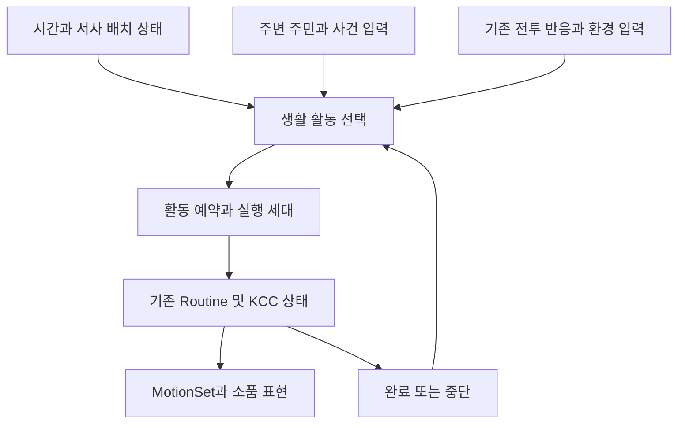

# NPC 생활 AI 확장 설계

작성일: 2026-11-07 · 상태: 구현 전 설계

다른 세션에서 순서대로 실행할 요청문은 [단계별 구현 요청 프롬프트](NPC_LIFE_AI_IMPLEMENTATION_PROMPTS.md)를 사용한다.

주민이 시간과 장소에 맞는 일을 하고, 다른 사람과 짧게 교류하며, 주변 상황에 반응한 뒤 자기 생활로 돌아가게 한다. 플레이어가 한 주민을 잠시 관찰했을 때 **어디로 가는지, 왜 멈췄는지, 무엇 때문에 행동이 바뀌었는지**를 화면에서 이해할 수 있어야 한다.

현재 대기·배회·제스처 개선 위에 기존 `NpcRoutine`과 작업점 예약을 확장한다. 생활 AI 전체를 새 BT나 별도 군중 매니저로 교체하지 않는다. 이 문서의 신규 타입·필드·수치와 동작은 제안이며, 구현되거나 플레이 검증된 기능을 뜻하지 않는다. 이번 작성 범위는 설계 문서이며 코드·씬·콘텐츠 데이터 변경은 포함하지 않는다.

## 1. 적용 범위와 완료 기준

첫 적용 대상은 `LakeVillageWorld`의 기존 일과 주민과 배치 로더가 생성하는 일반 주민이다. 기존 이야기·대사·퀘스트·상점·보상·Actor ID·SceneEntity GUID는 유지한다. 새 대사나 관계 성장 시스템은 별도 콘텐츠 작업으로 둔다.

| 경험 | 필요한 행동 | 화면에서 판정할 기준 |
|---|---|---|
| 자기 일이 있다 | 작업 준비 → 이동 → 실제 대상에 작업 → 정리 → 휴식 | 허공 작업 없이 목적지와 작업 대상이 연결됨 |
| 다른 사람을 안다 | 서로 접근 → 짧은 교류 → 각자 다음 일로 이동 | 두 주민의 방향·타이밍이 맞고 한쪽만 계속 몸짓하지 않음 |
| 주변을 알아차린다 | 가까운 플레이어·국소 사건·날씨·위험에 반응 | 전원이 같은 순간 같은 반응을 하지 않으며 원인을 알아볼 수 있음 |
| 방해받아도 살아간다 | 대화·위험·길막 중단 → 정리 → 상황 재평가 → 생활 복귀 | 영구 정지·소품 잔존·예약 고착·순간이동 없음 |
| 반복 방문이 자연스럽다 | 시간대별 역할 유지, 시작 위상과 활동 선택 분산 | 재입장·로드 때문에 주민이 복제되거나 보상이 다시 생기지 않음 |

완료는 선택 알고리즘 구현과 실제 콘텐츠 승인을 모두 요구한다. 제스처 종류 수, 상태 전이 횟수, 컴파일 성공만으로 생활감 완료를 판정하지 않는다.

## 2. 확인한 기반과 선행 문제

| 현재 기반 | 코드 또는 근거 | 확장 방향 |
|---|---|---|
| 배회·시선·인사·생활 제스처 | `NpcBrain`, `NpcIdleState`, `NpcWanderState`, `NpcActorState` | 주 활동을 방해하지 않는 보조 표현으로 유지 |
| 시간대별 작업·이동·휴식 | `NpcRoutine`, `NpcRoutineState` | 고정 순서 실행 위에 활동 선택·복귀 판단 연결 |
| 1인 작업점 예약·실행 세대 | `NpcWorkPoint` | 기존 예약을 유지하고 대체 작업점 선택 연결 |
| 환경 생산자·맵·revision 검증 | `NpcRoutineEnvironmentBinding`, `NpcRoutine.ApplyEnvironment` | 날씨 단일 생산자 유지, 안전한 보호점에만 이동 |
| 전투 위협 감지와 BT 반응 | `NpcThreatScanner`, `NpcCombatReaction`, `NpcReactState`, `NpcReturnState` | 생활 선택기는 기존 반응을 소비하고 중복 공포 AI를 만들지 않음 |
| 대화·서사 제어 | `NpcActor.PauseRoutine`, `OnRoutineInterrupted`, `NpcLifePresentation` | 현재 중단 계약을 모든 신규 활동에 확장 |
| 일반 주민 생성 | `RuntimePlacementLoader → ActorSpawnManager`, SceneEntity GUID | 생성 후 배치별 생활 바인딩 연결, 외형 프리팹과 역할 분리 |
| 거리별 시뮬레이션 | `AgentTickManager`, `IActorSimulationService` | 기존 활성/중단 정책 안에서 판단 빈도 분산 |

`LivingWorld/E_MOTION_HANDOFF.md`에는 운반과 작업 모션 검수 이후에도 조리 용기·수선 대상·끈과 짐·분류 대상·보호 장소가 미완성이며 배치 게이트를 유지한 기록이 있다. 이전 `I_INTEGRATION.md`보다 후속 모션 기록을 함께 보아야 한다. 실제 현재 씬에서 어떤 항목이 해결됐는지는 구현 착수 때 다시 확인한다.

`P09_NPC_POPULATION_CONNECTION_TEST_SPEC.md`는 288종 전체를 동시에 배치하는 구성이 아니라 8종의 일반 주민 연결을 명시한다. 외형 수를 활성 주민 수로 취급하지 않는다. 과거 문서의 `LakeOfLifeScenario` 맵 ID와 통합 월드의 논리 맵 대응도 확인한다. 씬 이름을 기준으로 런타임 예외 분기를 만들거나 맵 ID를 일괄 치환하지 않는다.

직전 대기 동작 수정은 보조 컴파일까지만 확인됐고 Unity 테스트·화면 검수는 남아 있다. 이 설계의 기반 검증에 포함하며 완료로 간주하지 않는다.

## 3. 행동 선택과 실행 소유권

### 3.1 하나의 선택기와 기존 실행기

Actor 모듈에 `NpcLifeController`를 추가한다. 현재 상황에서 실행할 활동을 선택하고 중단 이유·실행 세대를 관리한다. 이동·작업 자체는 기존 `NpcRoutine`과 KCC 상태가 수행한다. `NpcBrain`은 시선·인사·대기 표현을 맡는다.

일과 진입점은 최종적으로 `NpcLifeController` 하나로 모은다. `NpcIdleState`와 `NpcWanderState`가 선택기와 별개로 `Routine.TryStart()`를 호출하지 않게 이관한다. 프로필이 없는 기존 주민은 기존 동작을 유지한다. 프로필이 있는 주민만 새 선택기가 실행 권한을 가진다. 두 판단 경로를 동시에 켜 두지 않는다.

### 3.2 우선순위

| 우선순위 | 제어 주체 | 생활 AI의 처리 |
|---|---|---|
| 1 | 비활성화·디스폰·씬 종료·로드 복원 | 실행 취소, 예약·세션·소품·활성 lease 해제 |
| 2 | 서사 배치·연출 홀드, 플레이어 대화·상점 상호작용 | 즉시 생활 활동 중단, 기존 제어권 존중 |
| 3 | 기존 전투 반응 | 생활 예약 해제 후 React/Return에 양도 |
| 4 | 승인된 날씨 피신 | 외부 작업·교류 종료 후 보호점 이동 |
| 5 | 역할의 필수 작업·시간대 이동 | 작업 연속성과 접근 가능한 위치 유지 |
| 6 | 선택 휴식·이웃 교류·국소 사건 관찰 | 여유 시간과 조건이 맞을 때 실행 |
| 7 | 주변 살피기·인사·자세 변형 | 상위 활동이 허용한 표현만 실행 |

현재 대화 우선 계약을 유지한다. 위험이 발생해도 생활 AI가 대화를 강제 종료하지 않는다. 대화를 끊어야 하는 연출은 기존 Flow/대화 소유자가 취소 계약으로 처리하고 그 뒤 위험 반응으로 넘긴다. 대화가 끝나면 이전 작업을 무조건 재개하지 않고 현재 위험·날씨·시각을 다시 평가한다.

한 프레임에 이동과 기본 레이어 모션의 소유자는 하나다. 머리 시선은 해당 활동의 허용 마스크 안에서만 덧붙인다. 소품을 다루는 작업·인사 동작 중 고개 IK가 모션을 덮어쓰지 않게 한다.

### 3.3 선택 규칙

먼저 우선순위와 실행 가능 조건으로 후보를 거른다. 같은 우선순위 후보 안에서 역할 가중치·시간대 적합성·최근 반복·이동 부담·자리 이용 가능성을 평가한다. 범용 Utility AI 프레임워크 대신 유한한 활동 후보 목록과 명시적인 선택 이유를 사용한다.

- 활동 시작 시 최소 유지 시간을 둬 작은 거리 변화만으로 작업과 휴식이 왕복하지 않게 한다.
- 교류·제스처·관찰에는 개별 재사용 대기와 최근 활동 기록을 적용한다. 단일 종류뿐인 필수 작업은 연속 실행을 허용한다.
- 작업 종료, 시간대 변경, 예약 실패, 환경/위험 변경 때 우선 재평가한다. 안정적인 작업 중 매 틱 추첨하지 않는다.
- 무작위는 같은 조건 안의 편차에만 사용한다. 역할이나 위험 우선순위를 뒤집지 않는다.
- 첫 구현은 배고픔·피로·친밀도 같은 가상 욕구 수치를 추가하지 않는다. 역할과 시간대만으로 목적이 읽히는지 먼저 검증한다.

## 4. 데이터와 저작 구조

아래는 신규 제안이다. 기존 필드를 한 번에 삭제하거나 프리팹을 재생성하지 않는다.

| 데이터 | 소유 모듈·위치 제안 | 내용 |
|---|---|---|
| `NpcLifeProfileSO` | Data / `Assets/10.Datas/NpcLife/Profiles/` | 역할별 활동 후보, 시간대, 가중치, 유지 시간, 반응 거리·지연·대기 범위 |
| `NpcLifeActivitySO` | Data / `Assets/10.Datas/NpcLife/Activities/` | 활동 종류, 허용 작업점 종류, 체류 범위, 중단 정책, 필요한 모션·소품 구성 |
| `NpcLifeBinding` | Actor / 씬의 고정 배치 묶음 | 프로필, 기존 Actor 또는 SceneEntity GUID, 생활권, 작업점·휴식점·접근 경로 연결 |
| 기존 `NpcWorkPoint` 확장 | Actor / 씬 컴포넌트 | 기존 pointId·mapId·예약 세대 보존, 용도·접근 방향·유효 자세·이용 가능 조건 |
| `NpcSocialPoint` | Actor / 씬 컴포넌트 | 두 자리의 위치·방향, 각 접근 경로, 교류 허용 역할, 통로 여유 |
| 런타임 실행 문맥 | Actor / 비직렬화 | 현재 활동, 실행 세대, 소유 예약, 상대, 중단 이유, 최근 활동·대기 시간 |

역할 예시는 조리·수선·운송·일반 주민이다. 역할별 차이는 데이터로 정하고 캐릭터 이름으로 분기하지 않는다. 각 주민의 생활권·작업점·사회적 상대 허용 범위는 바인딩에서 정한다. 외형이 같은 두 주민도 서로 다른 생활을 가질 수 있다.

SO에는 씬의 Transform·NpcActor·구체 Manager를 넣지 않는다. 모션은 현재 허용된 MotionSet Core 데이터 참조 범위에서 연결하고 Data→Actor 역참조를 추가하지 않는다. `NpcLifeBinding`과 환경 연결부가 프로젝트 조립을 맡는다. 신규 공용 계약이 실제로 필요한 경우에만 Contracts에 추가한다.

`NpcRoutine.Step`의 씬 작업점·경유점 연결은 유지하고, 공통 정책 수치만 SO로 분리한다. 동일 값의 SO와 인스턴스 필드를 둘 다 활성 원본으로 두지 않는다. 기존 데이터는 명시적 프로필 없음 모드로 유지하고, 새 프로필 적용 시 변환 전후 연결 검사와 Undo 가능한 적용을 제공한다. P09 에셋 재생성 경로는 이 작업에 포함하지 않는다.

### 생성 주민 연결

생활 바인딩은 로더의 정상 생성 완료 후 SceneEntity GUID로 기존 몸에 연결한다. Actor ID는 외형/정의 조회에 사용하고 동일 외형 인스턴스 식별에는 사용하지 않는다. 같은 GUID에 중복 바인딩·중복 몸이 발견되면 새 생활 실행을 거부하고 진단한다.

스폰 전에는 주민을 새로 만들지 않고 바인딩 대기 상태를 유지한다. 디스폰 시 바인딩과 세션을 해제하고 재스폰된 몸에 다시 연결한다. GUID가 없는 기존 주민에 영구 식별자를 임의 생성하지 않고 기존 씬 바인딩 경로를 사용한다. 원본 시나리오와 통합 월드의 동일 논리 주민 대응을 보존한다.

## 5. 목적이 보이는 이동과 일과

일과는 `준비 → 목적지 예약 → 이동 → 정렬 → 작업 → 정리 → 다음 활동` 순서다. 출발 전 필요한 자리·이동 자세·운반 소품이 준비돼 있어야 한다. 도착만 했다고 작업을 시작하지 않고 접지·높이·방향·소품 접점을 확인한다.

| 역할 | 첫 수직 슬라이스의 행동 예시 | 필요한 현장 자산 |
|---|---|---|
| 조리 | 준비대 작업 → 배식 자리 → 정리 → 휴식 | 실제 용기·그릇, 손 동선과 맞는 높이 |
| 수선 | 공구 준비 → 작업대 수선 → 공구 정리 → 휴식 | 손에 맞는 도구, 실제 타격 대상 |
| 운송 | 짐 확인 → 짧은 운반 → 내려놓기 → 돌아오기 | 짐의 출발·도착 위치, 운반 및 정지 자세 |
| 일반 주민 | 생활 장소 방문 → 짧은 체류 → 이웃 교류 또는 휴식 | 방문 용도가 보이는 장소, 안전한 교류 자리 |

이는 구현용 행동 구성 예시이며 새 퀘스트·인물 사건을 추가하는 플롯이 아니다. 반복 운반 소품은 장식이며 실제 아이템·물자 재고·보상을 생성하지 않는다.

### 경로와 막힘 처리

기존 KCC가 유일한 실제 이동기다. 첫 단계는 검증된 짧은 경유점 구간을 사용한다. NavMesh가 유효한 구간에서는 경로 가능성과 접근점을 보조 검사하며 NavMeshAgent로 Transform을 동시에 움직이지 않는다.

- 중간 대화 후 첫 경유점으로 무조건 되돌아가지 않는다. 현재 위치에서 안전하게 연결 가능한 합류점을 선택한다. 검증할 수 없으면 재접근을 보류한다.
- 일시적인 사람 길막은 감속·정지 후 제한된 횟수로 재시도한다. 벽·불가능한 경사·닫힌 경로는 조기 취소하고 대체 장소를 고른다.
- 작은 목적지 변화마다 반대 방향으로 돌아서지 않도록 목표 유지 시간과 도착 히스테리시스를 둔다.
- 예약 실패는 대체 작업점 → 허용 휴식점 → 현 위치의 안전 대기 순으로 처리한다. 같은 실패점을 매 프레임 재요청하지 않는다.
- 제자리 걷기·무한 재시도·KCC 밖 위치 보정·화면 안 순간이동을 금지한다. NavMesh가 없는 곳은 승인된 경유점 이동만 허용한다.
- 문·좁은 길의 양보 지점을 저작한다. 첫 단계에서 범용 군중 회피를 도입하지 않고 통로 병목이 확인된 구간에만 양방향 진입 예약을 추가한다.

필수 상호작용 NPC는 생활권을 좁히고 접근 가능한 위치에서 체류한다. 퀘스트 마커와 상호작용 대상은 같은 실제 Actor를 따라야 한다. 바쁜 모션이나 자리가 예약됐다는 이유로 플레이어 대화를 막지 않는다.

## 6. 주민 간 교류

첫 구현은 **두 주민의 짧은 비언어 교류**다. 별도 대사 채널이나 강제 카메라 전환 없이 서로 방향을 맞추고 한쪽의 표현에 다른 쪽이 반응한 뒤 각자 일로 돌아간다. 말하는 듯한 긴 제스처를 음성 없이 반복하지 않는다.

교류는 두 주민이 같은 생활권에 있고, 필수 작업·플레이어 대화·위험·피신 중이 아니며, 서로의 재사용 대기와 교류 장소 조건이 맞을 때만 제안한다. 일과를 버리고 멀리 있는 상대를 추격하지 않는다. 고정 작업자는 작업 종료의 허용 구간에서만 참여한다.

`NpcSocialSession`은 씬 수명의 임시 실행 객체로 제안한다. 두 참여자와 두 자리, 시작 기한, 실행 세대를 소유한다. 기존 단일 작업점 두 개를 서로 독립적으로 잡아 한쪽만 대기하게 만들지 않고, 양쪽 참여 동의와 두 자리 예약을 한 번의 승인으로 성립시킨다. 어느 하나라도 실패하면 이미 잡은 자리를 즉시 반환한다.

| 단계 | 처리 | 실패 시 |
|---|---|---|
| 제안 | 참여 조건 검사, 한쪽만 제안 소유 | 동시 제안은 안정적인 GUID 순서로 결정, 실패 측 대기 분산 |
| 승인 | 두 주민·두 자리의 유효성 재확인, 세대 발급 | 부분 예약 전부 반환 |
| 접근 | 각자 경로로 접근, 먼저 온 쪽은 자연 대기 | 상대 지연 기한 초과 시 둘 다 해제 |
| 교류 | 양쪽 도착·방향 확인 뒤 표현과 반응을 교대 | 한쪽 대화/위험/디스폰 시 양쪽 즉시 취소 |
| 종료 | 두 예약·상대 참조 해제, 쌍별 재사용 대기 시작 | 이전 콜백은 실행 세대로 무효화 |
| 복귀 | 각자의 시간대와 다음 활동 재평가 | 과거 경로·과거 모션 진행률 복원 금지 |

세션 시간 갱신은 지정된 진행자 한 명의 기존 틱에서만 한다. 양쪽 틱이 세션 시간을 두 번 진행시키지 않는다. 진행자가 비활성화되면 세션을 취소하며 상대를 영구 대기시키지 않는다. 쌍별 대기 기록은 씬 수명 안에서 제한된 최근 기록만 보관하고 퇴장 시 제거한다. 친밀도·관계 저장으로 확장하지 않는다.

## 7. 주변 사건과 플레이어 반응

감지는 같은 생활권의 등록 대상과 국소 입력을 사용한다. 이벤트 발생과 사건 의미를 분리한다. 생활 AI가 소리를 들었다고 퀘스트를 완료하거나 전투 위협을 직접 판정하지 않는다.

| 자극 | 원본/연결 방식 | 반응과 제한 |
|---|---|---|
| 플레이어 접근 | 기존 Actor 조회·시선 인식 | 짧은 시선, 허용 시 인사, 관심 해제 후 복귀 |
| 이동 경로의 플레이어 | KCC 이동과 접근 감지 | 먼저 정지·양보, 긴 추적/밀기/인사 연타 없음 |
| 큰 충격·국소 소란 | 기존 이벤트 생산자가 필요한 의미·위치를 제공하도록 어댑터 연결 제안 | 작업을 멈출 수 있는 주민 일부만 잠깐 관찰, 원인으로 돌진하지 않음 |
| 비·강풍 | 기존 환경 생산자와 히스테리시스 | 실제 승인된 지붕·보호점으로 이동, 날씨 안정 뒤 일과 재평가 |
| 전투 위협 | 기존 NpcThreatScanner와 BT 반응 | 생활 제어권 양도, 위험 해제 후 기존 복귀와 연결 |
| 서사상 장소 변경 | 기존 플래그·배치 홀드 | 장소 목록을 갱신한 뒤 유효한 현재 활동 선택 |

국소 사건 입력에는 맵/생산자, 사건 식별자, 위치, 발생 시각, 유효 기간, 중요도가 필요하다. 현재 이벤트 계약에 이 의미가 있는지 확인하고 필요한 DTO만 확장한다. 별도 범용 이벤트 버스를 만들지 않는다. 같은 사건의 재전달은 한 번만 소비하고 만료·다른 맵·교체 전 생산자의 입력은 버린다.

거리뿐 아니라 시야각·높이·가림 여부를 단계적으로 거른다. 비싼 가림 검사는 저주기 감지에서 통과한 가까운 후보에만 수행한다. 가까운 충격음처럼 시야가 필요 없는 자극은 시각 자극과 구분한다. 발생지에 벽이 있더라도 주민이 사건을 본 것처럼 몸 전체를 꺾지 않는다.

반응 지연·관심 지속·재사용 대기·역할별 참여 확률은 프로필에서 조정한다. 작은 사건은 생활권 내 반응 인원 상한을 둔다. 전투 위험 반응은 이 인원 상한으로 제한하지 않는다. 비가 내렸다고 물 부족이나 서사 회복 플래그가 바뀌지 않는다.

## 8. 모션과 소품 저작

활동마다 시작·유지·종료·긴급 중단의 표현 계약을 명시한다. 작업 체류 시간은 루프 유지 구간을 제어하며 시작 동작을 반복하지 않는다. 정상 종료는 정리 동작 후 출발하고 대화·위험은 정리 완료를 강제로 기다리지 않는다. 강제 중단의 소품 숨김 시점과 손 비움 자세를 함께 저작한다.

`E_MOTION_HANDOFF.md`에 준비만 된 종료 모션은 실제 연결 여부를 확인한 뒤 사용한다. MotionSet 완료 이벤트와 실행 세대를 기준으로 다음 단계에 진입하며 첫 클립 길이만으로 다단 작업 종료를 추정하지 않는다. 취소한 실행의 늦은 완료 통지가 새 활동을 끝낼 수 없어야 한다.

같은 생활 동작을 모든 주민의 일반 대기 목록에 넣지 않는다. 땀 닦기는 조건을 정한 작업 후 표현 후보로만 검토하고, 사고·시선·자세 변형도 실제 클립을 확인한 뒤 역할별로 배정한다. 실제 몸/손/도구/대상물/카메라 거리 조합에서 허공 작업·관통·발 미끄러짐·목 꺾임을 확인한다.

필요한 모션·소품·대상이 없는 활동은 후보에서 제외한다. 누락을 무관한 제스처로 대체해 성공 처리하지 않는다. 동작은 승인된 기본 대기로 안전하게 복귀하고 저작 오류를 진단한다. 발소리·도구 접촉음은 실제 접점에 맞추고 주민 수가 늘어도 가까운 소리만 남도록 기존 Sound 정책을 사용한다. 생활 반응이 게임플레이 카메라를 강제로 가져가지 않는다.

## 9. 중단과 저장 복원

실행 취소는 예약·사회 세션·소품·모션 완료 구독·임시 활성 lease를 함께 정리하는 단일 경로를 사용한다. 중복 취소는 안전해야 한다. 모든 비동기 완료와 지연 통지는 Actor 생존, 바인딩 세대, 활동 세대를 확인한다.

| 상태 | 일반 저장/로드 | 회차 재시작 |
|---|---|---|
| 기존 퀘스트·관계·해금 사실 | 기존 저장 소유자 정책 유지 | 기존 회차 정책 유지 |
| 역할 프로필·배치 GUID·생활권 | 콘텐츠 참조 유지, 바인딩 재구성 | 동일 저작 데이터 사용 |
| 작업점 점유·교류 세션·소품 인스턴스 | 저장하지 않고 취소 후 재예약 | 비움 |
| 현재 클립 프레임·배회 위상·제스처 진행률 | 복원하지 않음 | 비움 |
| 최근 활동·교류/자극 대기 | 초기 버전은 세이브 대상 아님, 로드 후 초기 반응 지연으로 동시 재생 억제 | 비움 |
| 시간·날씨·서사 배치 | 기존 소유자가 복원한 결과를 기다림 | 기존 지역 초기화 정책 소비 |

로드 순서는 서비스/시간/플래그 준비 → 서사 배치 복원 → 기존 몸 생성·GUID 연결 → 생활 바인딩 준비 → 지연 분산 → 활동 재선택이다. 특정 프레임 수만 기다리고 준비 완료로 간주하지 않는다. 복원 중 예약·교류 제안을 시작하지 않는다.

현재 저장 시스템이 소유하는 Actor 위치를 생활 AI가 덮어쓰지 않는다. 저장 위치에서 새 활동에 안전하게 합류하고, 유효하지 않은 위치 복구는 기존 스폰/로드 정책으로 요청한다. 생활 AI가 별도 위치 세이브나 순간이동 복구를 만들지 않는다. 실제 보상·물자 인계 완료는 기존 NpcLife/Flow가 소유한다.

회차 경계의 기존 안내 문서 `Assets/docs/cycle/10_CYCLE_STORY_STATE_BOUNDARY_SPEC.md`는 이번 파일 조사에서 찾지 못했다. 본 설계는 새 영구 사실을 추가하지 않는다. 추후 생활 호감도·기억·보상을 넣는 경우 현행 회차 저장 정책의 실제 소유 문서를 먼저 확정해야 한다.

## 10. 성능과 저작 도구

KCC 이동·회전은 기존 상태 틱에서 갱신한다. 생활 판단과 주변 후보 조회는 이벤트 및 저주기로 나눈다. 초기 조정안은 근거리 판단 0.25~0.5초, 교류 제안 1~2초이며 주민별 시작 시점을 분산한다. 이 값은 측정 전 제안이며 프로필에서 조정한다.

기존 시뮬레이션이 중단한 원거리 주민은 새 개별 Update나 무조건 유지 lease로 다시 깨우지 않는다. 원거리 일과의 모든 모션을 계속 돌리지 않고 재활성 시 현재 시각으로 재평가한다. 보이는 동안 재배치하지 않으며, 화면 밖 재배치도 초기 범위에는 포함하지 않는다. 필수 대화·짧은 교류 접근 등 lease가 필요한 구간은 수명과 동시 수를 제한하고 취소 시 반환한다. 기존 Routine의 전 구간 lease 정책은 확장 전에 영향 범위를 검토한다.

생활권별 등록 목록을 재사용하고 후보 탐색·경로 검사 횟수를 제한한다. 핫패스의 Find/GetComponent/LINQ·배열 반환 물리 질의·매 프레임 할당을 추가하지 않는다. NPC 수 증가에 따른 전수 쌍 비교를 하지 않는다. 씬 정리와 Domain Reload 비활성 환경에서도 등록·정적 캐시가 남지 않아야 한다.

성능 검증은 현재 실제 활성 주민 수와 별도 16/32/64명 부하 구성을 구분한다. 기준 PC·Unity 설정·관찰 위치를 고정해 변경 전후 CPU p50/p95, 생활 판단 시간, 경로 검사 수, 활성 lease 수, 안정 상태 GC Alloc을 기록한다. 60FPS 기준 16.67ms 프레임 예산 안에서 생활 AI 증분 예산은 기준선 측정 후 확정한다. 안정적인 틱의 관리 할당 목표는 0B다. 스폰·소품 교체 할당과 안정 틱을 분리해서 보고한다.

사람이 반복해서 사용하는 생활 검수 도구는 기존 툴 런처 정책에 맞춰 제공한다. 선택 이유·후보 제외 이유·현재 실행자·상대·작업점·예약 세대·중단 이유·다음 평가 시점을 확인할 수 있어야 한다. 배치별 역할 누락·경로 단절·중복 GUID·모션/소품 누락·휴식점 부족을 검사한다. 특정 씬 일회성 배치·AI 검수용 촬영 도구는 런처에 등록하지 않는다.

## 11. 구현 단계와 인수 조건

| 단계 | 작업 범위 | 완료 조건 |
|---|---|---|
| A 현장 기반 | 현재 씬의 기존 6명과 생성 주민 8종 연결 확인, 작업물·지붕·경로·논리 맵 대응 조사 | 미커밋 데이터 보존, 활성 가능/보류 활동 목록, 실제 현장 부족 자산 명세 |
| B 목적 이동 | 대표 작업자 2명과 일반 주민 2명, 프로필·바인딩·선택기 연결, 기존 일과 진입 이관 | 실제 작업→휴식→복귀 3회, 대화와 길막 후 복구, 허공 작업 없음 |
| C 이웃 교류 | 승인된 교류 장소 1곳, 2인 세션·접근·취소·쌍별 대기 | 동시 제안·상대 소실·대화 선점에서도 예약/한쪽 대기 누락 없음 |
| D 주변 반응 | 기존 전투/환경 연결, 국소 자극 한 종류, 양보와 관심 해제 | 같은 자극 중복 무시, 원인 없는 집단 반응 없음, 안전한 피신/복귀 |
| E 생성·로드·확장 | 생성 주민 생활 바인딩, 저장/재입장, 거리별 중단, 주민 수 확대 | 동일 GUID 중복 0, 진행도 영향 0, 비교 성능 측정, 초기 지연 분산 |
| F 콘텐츠 승인 | 기존 일과 주민과 일반 주민으로 적용 확대, 역할별 모션/접점/소리 조정 | 사용자 시각 검수와 필수 대화 접근성 통과, 보류 활동을 완료와 구분 |

B의 대표 작업자는 현장 조사에서 실제 도구·작업 대상·접근 경로가 준비된 역할로 선택한다. 미완성 조리/수선을 임의 제스처로 채워 수직 슬라이스 통과를 만들지 않는다. 각 단계는 자동 검사와 사용자 검수를 구분하고 선행 결함이 남은 장소만 보류한다. 전체 주민에 먼저 일괄 적용하지 않는다.

새 런타임 코드 후보는 `GameActor/Component/NPC/LivingWorld/`, 데이터는 `Data/Actor/NPC/`, 검사는 기존 `Tests/EditMode/LivingWorld/NPC/`와 관련 PlayMode 위치에 둔다. 파일 추가 전 현재 asmdef 포함 범위를 확인한다. 기존 직렬화 타입의 이동·이름 변경은 이 설계의 기본 범위가 아니다.

## 12. 검증 명세

### 자동 검사

기존 `NpcRoutineContractTests`, `NpcIdleBehaviourTests`, `NpcLifeActionTests`를 먼저 실행하고 실제 실행 개수와 실패를 기록한다. 과거 문서의 통과 개수를 현재 결과로 복사하지 않는다.

추가 회귀 검사는 우선순위 선점, 작업점 대체 선택, 부분 예약 롤백, 동시 교류 제안, 진행자 소실, 오래된 세대 콜백 거부, 자극 중복/만료, 준비 전 바인딩 대기, 디스폰/재스폰, 시간 점프·환경 전환·로드 중단에 집중한다. 프로필 검사는 모션·소품·시간 범위·작업점 종류와 실제 바인딩 연결을 확인한다. 문자열 검사와 실제 Unity 에셋 로드 검사를 구분한다.

### 사용자 Editor Play Mode 검수

준비: Unity 6000.3.21f1 URP, 기존 Boot/툴 런처의 호수·여울마을 도보 연결 진입, 테스트용 별도 저장 슬롯, 실제 사용 입력 장치 기록. 씬 직접 Play나 서사 플래그 강제 해금으로 본편 성공을 대신하지 않는다. 테스트용 시간/날씨 주입은 항목에 별도 표기하고 실제 자연 전환과 구분한다.

| ID | 실행 절차 | 기대 결과와 실패 기준 |
|---|---|---|
| LIFE01 | 대표 4명을 각각 90초 관찰하고 일과 3회 반복 확인 | 목적지·작업·휴식 연결이 읽힘. 허공 작업/같은 제스처 편중/영구 정지 실패 |
| LIFE02 | 이동 중 정면에서 길을 막았다가 비키기, 작업 중 대화 후 종료·취소 | 정지/양보 후 복귀, 대화 즉시 우선. 밀기·제자리 걷기·소품 잔존 실패 |
| LIFE03 | 교류 두 주민 중 한 명에게 접근해 대화, 상대가 떠나는 상황 관찰 | 두 주민 모두 세션 정리 후 생활 복귀. 한쪽만 반복 몸짓/빈 상대 대기 실패 |
| LIFE04 | 실제 전투가 가까워졌다 멀어지는 상황, 안전한 경로에서 피신 후 복귀 확인 | 기존 위험 반응 우선, 해제 후 현재 활동 재선택. 위험 중 작업 재개 실패 |
| LIFE05 | 비/강풍 진입·해제에서 주민 이동 관찰 | 실제 보호점 도착, 대화/통로 방해 없음. 허공 보호점·전원 동시 회전·복귀 진동 실패 |
| LIFE06 | 이동·작업·교류 중 각각 별도 슬롯 저장/로드, 맵 왕복 | 진행도 유지, 중복 몸/예약/소품 없음, 준비 완료 후 지연 분산 복귀 |
| LIFE07 | 일반 주민 스폰 구역 이탈·재진입, 같은 외형 인스턴스 관찰 | GUID별 올바른 생활 설정, 중복 생성/다른 주민 역할 혼입 없음 |
| LIFE08 | 필수 NPC를 낮/밤/날씨 변화 중 찾아 대화, 키보드와 게임패드 각각 확인 | 실제 마커·상대 일치, 대화 접근 가능. 긴 추격·예약에 의한 대화 불가 실패 |
| LIFE09 | 같은 구도에서 변경 전후와 16/32/64명 부하 측정 | 성능/할당 기록 제출, 설정한 예산 통과. 눈에 띄는 끊김은 수치와 별도 실패 |

각 항목은 행동 성공, 화면 자연스러움, Console 오류 유무를 따로 판정한다. 회신 형식은 `ID / 통과·실패·미수행 / 실제 결과 / 장치·시각·저장 시작 상태 / 화면 또는 첫 오류`다. 상태 주입 자동 검사를 실물 입력이나 자연스러운 화면 검수로 표시하지 않는다. 결과가 도착하기 전까지 해당 항목은 사용자 테스트 대기다.

현재 작업은 문서 작성만 수행한다. 후속 구현 검증은 Unity 컴파일·관련 EditMode·Editor Play Mode로 진행하고, 별도 지시 없는 Player/Addressables 빌드는 실행하지 않는다.

## 13. 관련 문서

- [생활 공간 확장 기획](LAKE_OF_LIFE_LIVING_WORLD_PLAN.md): 공간·서사·일회성 생활 도움의 상위 범위.
- [NPC 생활 행동 인계](LivingWorld/C_NPC_HANDOFF.md): 기존 예약·중단·시간대 일과 계약.
- [생활 모션 인계](LivingWorld/E_MOTION_HANDOFF.md): 후속 운반/작업 구현과 실제 접점·보호점 보류 항목.
- [본편 통합 기록](LivingWorld/I_INTEGRATION.md): 당시 통합 상태. 현재 활성 상태는 재조사 대상.
- [일반 주민 배치 연결 검수](../TODO/P09_NPC_POPULATION_CONNECTION_TEST_SPEC.md): 로더·GUID·원본/통합 월드 연결.
- [콘텐츠 저작 지침](../guide/CONTENT_SYSTEM_AUTHORING_GUIDE.md), [코드 저작 지침](../guide/CODE_AUTHORING_GUIDE.md), [테스트 지침](../guide/TEST_VALIDATION_GUIDE.md).
