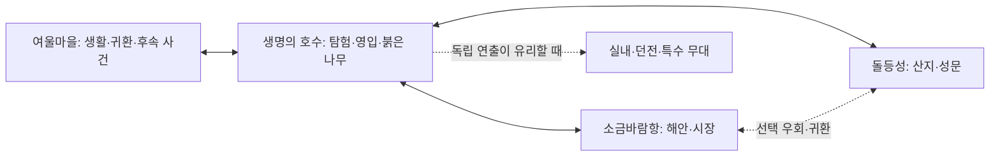

# 시나리오 지역의 연속 월드 통합

후속 도시 확장: 사용자가 기존 인수 미완료 상태에서 돌등성·항구 연결 진행을 명시적으로 요청했다. 이전 인수를 완료 처리하지 않고 생성본 확장을 진행했다. 배치 recipe는 `Tools/OpenWorld/city-layout.json`, 현재 인수 절차는 [도시 연결 인수 테스트](OPEN_WORLD_CITY_TEST_SPEC.md)다. 두 도시는 호수 남쪽에 180도 회전 배치하며 원본 씬과 mapId/GUID를 보존한다. 아래는 최초 설계 기준선이며 최신 수행 결과는 `output/OpenWorld/CITY_EXPANSION_RESULT.md`를 따른다.

조사일: 2026-10-25. **단계 1 설계 기준선. 월드 통합 완료 기록이 아니다.** 실행·검증 결과는 `output/OpenWorld/RESULT.md`에 별도로 기록한다. 원본 씬과 사용자 변경을 유지하고, 패키지 업그레이드·Player 빌드·Addressables 빌드는 하지 않는다.

## 1. 확인된 사실과 문서 우선순위

`ProjectSettings/ProjectVersion.txt`, `Packages/manifest.json`, `Packages/packages-lock.json`의 실제 버전은 Unity **6000.3.21f1**, URP **17.3.0**, Addressables **2.9.1**, AI Navigation **2.0.14**다. 과거 온보딩의 Unity 6000.0, 고정 캐릭터명, 테스트 개수는 현황으로 사용하지 않는다.

루트 AGENTS와 코드·콘텐츠·검증·카메라 가이드, 모듈 온보딩·작업 이력, ScenarioGameplay 문서 및 `LAKE_OF_LIFE_RED_TREE_STORY_PLAN.md`를 조사했다. 붉은 나무 이후의 최신 이야기와 실제 Flow/씬을 우선한다. 콘텐츠 가이드의 과거 사이클 설명을 지역 언로드나 재방문에 적용하지 않는다. `output/WorldResume/RESULT.txt`의 최신 작업 인계도 참고하되 과거 검증을 이번 통과로 옮기지 않는다.

시작 시 LakeOfLifeScenario/SaltwindHarbor/StonegateCitadel 씬, 카메라·모션·전투 코드, 데이터·초상화·문서 등에 사용자 변경이 있었다. 해당 파일을 기준선으로 취급하며 HEAD로 복원하지 않는다. 최초 열린 씬은 `Test/MotionTestMap.unity`, Edit Mode, 미저장 변경 없음이었다. 아래 에디터 조사는 원본을 저장하지 않는 Preview Scene으로 수행했다. 상세 정적 자료는 `output/OpenWorld/scene-inventory.json`, 참조는 `references.json`, 실제 컴포넌트 조사는 `editor-inventory.txt`, 지형 자료는 `terrains.txt`다. 직렬화 개수는 렌더링 부하나 메모리 측정치가 아니다.

## 2. 지역 목록과 저작 원본

좌표는 Unity 단위다. Terrain 범위는 X/Z 외곽이며 모든 보행 가능 영역을 뜻하지 않는다. 높이 범위는 TerrainData bounds와 Transform 합산 근사치다.

| 씬 경로 (Assets/01.Scenes/) | mapId / 현재 진입 | 지형·좌표·출입 | 역할 / 통합 판정 |
|---|---|---|---|
| Scenario/LakeOfLifeScenario.unity | LakeOfLifeScenario / MapDB 기본 새 게임, 마을·도시 포털 | Terrain 원점 (680,20,300), 크기 600×160×850, X680–1280/Z300–1150, 높이 약46–151. 마을 출구(984,62.81,449), 항구(1125,52.07,380), 성채(1005,62.68,430) | 현재 본편 중심. 채택 |
| Scenario/DroughtVillage.unity | DroughtVillage / 호수 포털 | 코어 원점(930,20,435), 크기70×160×110, 높이 약62–77. 호수 출구(985,62.97,451). 배경 Terrain은 원점(440,20,-335), 크기1120×200×1760, **Collider 없음** | 표시명 여울마을. 첫 연결 대상. 코어가 호수 Terrain과 중첩됨 |
| Scenario/SaltwindHarbor.unity | SaltwindHarbor / 호수·성채 포털, 지도 거점 | 원점0, 크기360×65×360. 호수 도착(180,10.35,55), 성채 도착(186,10.29,70), 시장(180,10.25,144) | 소금바람항. 2차 확장. 20km 수면 범위 문제 별도 정리 필요 |
| Scenario/StonegateCitadel.unity | StonegateCitadel / 호수·항구 포털, 지도 거점 | 원점0, 크기360×65×360. 호수 도착(180,10.24,55), 항구 도착(214,10.24,102), 광장(180,10.25,204) | 돌등성. 2차 확장. 항구와 같은 좌표를 사용하므로 그대로 동시 로드 불가 |
| Scenario/RedTreeR03Verification.unity | **LakeOfLifeScenario와 같은 mapId** / 검증용, Build Settings 미등록 | 별도 지형·시나리오 사본 | 서비스 대상에서 제외. 동일 진행/개체 ID 중복 위험 |
| Ingame/LakeOfLife.unity | LakeOfLife / 기존 세이브·레거시 진입 | 기존 Terrain, 다수 옛 포털·모집 흐름 | 시나리오 저작의 원본 및 기존 세이브 복귀용. 파생 씬과 중복 편입하지 않음 |
| Ingame/ForgottenWatchpost.unity | ForgottenWatchpost / 기존 맵 | 직접 직렬화 Terrain 없음, 다수 메시/프리팹 | 기존 서비스 경로 보존. 현 본편과 연결 근거 미확인, 통합 보류 |
| Ingame/HarvestOfPlain.unity | HarvestOfPlain / 기존 맵 | Terrain 포함 | 현재 시나리오 인과·출입 계획 미확인, 통합 보류 |
| Ingame/Platform.unity | SceneContext 없음 / 테스트·원본 성격 | 메시/프리팹 | 현재 서비스 진입 근거 없음, 제외 |

MapDB의 실제 기본 맵은 이미 `LakeOfLifeScenario`다. 오래된 P10 전환 대기 설명으로 되돌리지 않는다. 호수의 항구·성채 출구에는 현재 `lake.red_tree.return.common_ending` 조건이 있다. 지리적 통합 시 이 조건을 무조건 삭제하지 않는다. **지리 접근 허용**과 **도시의 후속 사건 발화 조건**을 분리한 뒤 기존 결말 인과의 회귀를 검증한다.

| 지역 | 저작 원본·도구 | NavMesh/환경 | 콘텐츠·ID·지도 |
|---|---|---|---|
| 호수 | `Tool/Editor/Map/ScenarioMapAuthoring.*.cs`, `10.Datas/World/ScenarioMaps`의 layout/quality/world 및 사건 JSON. 최신 붉은 나무 저작 자료도 대조 | AuthoredEnvironment의 Children 수집 NavMeshSurface, Navigation.asset. sun 1.9, ScenarioLighting은 WorldLighting 비활성·Volume 연결 | RuntimePlacementLoader 1, FlowGraphRunner 14, TriggerVolume 76, SceneEntityId 142 (Preview 시점). 도착점7. 배치 레코드는 절대좌표 |
| 여울마을 | `output/LivingWorld/I/01_ConnectMaps.cs.txt` 및 B/I 후속 저작 스크립트·LivingWorld 데이터. 분리 당시 RedTreeR04 자식만 이동 | VillageGeometry의 Children 수집 Surface, NavMesh.asset. sun1.9. WorldLightingBinding과 EnvironmentController가 모두 존재 | Runner4, TriggerVolume26, SceneEntityId9. **호수와 RedTreeR04 그래프를 공유**. RunnerSceneCondition으로 현장 분기. 도착 `livingworld.drought.from_lake` |
| 항구 | `ArtSource/WorldCities/build_region.csx`, connect_regions/configure_fast_travel 및 EastStyle·후속 .csx/배치 CSV | Terrain/도시 NavMesh, sun1.15, WorldLighting 비활성. 수면 크기 재검수 필요 | 호수/성채 도착 및 시장 거점. 최신 좌표는 과거 보고서와 다름. 도시 주민·대화 원본 함께 유지 |
| 성채 | 같은 WorldCities 계열 및 EastStyle | Terrain/도시 NavMesh, sun1.05, WorldLighting 비활성 | 호수/항구 도착 및 광장 거점. 동양풍 재배치 사용자 변경 유지 |

각 서비스 씬에 PlayerActor·Camera·SceneContext·광원이 있다. UI/EventSystem은 프리팹 및 전역 UI 초기화에서도 생길 수 있으므로 루트 이름만으로 제거 대상을 찾지 않는다. 컴포넌트와 소유권 목록으로 분리한다. 모든 씬의 Missing Script 검사는 Preview 자료에 개별 기록한다. 환경의 풍향 전역 셰이더 쓰기와 SICS WindSettings 중복 방지도 필요하다.

실제 MapDB 참조를 GUID로 해석한 자료는 `output/OpenWorld/map-inventory.json`이다. 호수 미니맵의 captureWorldSizeXY는600×850, 마을70×110, 두 도시360×360이다. 이 값은 카메라 캡처 범위이며 플레이 가능 경계나 선행 로드 거리로 대신 사용하지 않는다. 호수·원본·R03 검증 씬의 RuntimePlacementLoader는 모두 `Assets/10.Datas/Map/Placement/PlacementData_LakeOfLife.asset`을 참조하며 현재 내용은 `Player_Main` 레코드1개다. 원본/파생을 함께 서비스하면 같은 저장 GUID를 두 번 생성할 위험이 있으므로 이 공유 관계도 생성 manifest에 포함한다.

## 3. 현재 실행 구조의 실제 충돌

| 경로 | 현재 동작 | 통합 시 필요한 변경 |
|---|---|---|
| SceneManager.Load | Loading Single → 목적지 Single, 단일 pending 목적지/도착점, 입력 억제, SceneAssets 일괄 해제 | 월드 진입/종료·독립 공간에 유지. 일반 지역 경계에서 호출하지 않음 |
| SceneManager.NotifySceneContextReady | 목적지 이름 검증 **전에** CurrentMapID/전역 OnSceneChanged 갱신 | 잘못된 준비 신호는 상태 변경 전 거절. 지역 준비와 전체 월드 준비 분리 |
| SceneContext.Start | GameManager 부팅 대기, 전역 통지, 마커 설치, 지역 Flow 목록 교체 | 스트리밍 지역의 전역 통지 금지. 지역 단위 준비/해제 계약 필요 |
| GameManager/OnSceneChanged | 모든 매니저에 방송 | 월드 진입·종료에만 방송. RegionReady/Leaving/LogicalRegionChanged는 별도 |
| PartyManager | OnSceneChanged 시 플레이어 준비·대역/잔류 공격 초기화. 저장은 Active Scene 이름+CurrentMapID+월드 좌표 | 플레이어/파티/카메라 상주. 논리 지역 변경으로 재초기화하지 않음. 저장 지역은 Active Scene에서 추론 금지 |
| AssetManager | Global/Scene 두 범위, Scene 일괄 Release | 지역의 Scene handle·자산 lease 별도 소유. 기존 단일 씬 자산을 임의 해제하지 않음 |
| SceneArrivalRegistry | 전역 ID 유일성만 검사 | 로드한 대상 Scene 범위로 조회. 같은 ID가 다른 씬에 있어도 목적지를 혼동하지 않음 |
| RuntimePlacementLoader | 절대좌표, 플레이어/그룹 전역 검색, Start 자동 스폰, 일부 실패도 완료 | 지역 준비 전 Spawn 성공 여부 집계, 같은 씬 그룹 조회, 생성 씬 명시 |
| ActorSpawnManager | OnSceneChanged 전체 레지스트리 비움, parent 없으면 Active Scene 생성 | 지역 unload은 해당 개체만 해제, 생성 객체의 소유 씬 명시 |
| WorldState/MonsterRespawn/InteractionRespawn | 사망·채집·복원에서 CurrentMapID 사용, 일부 전역 검색/전체 레지스트리 초기화 | 개체의 **원래 소유 mapId** 기준 기록. 로드된 지역만 실체화하고 미로드 상태 유지 |
| FlowGraphManager/Runner | ApplyMapFlowGraphs가 이전 맵 목록 전체 해제; 동일 graphId 여러 러너; OnDisable 구독/코루틴 정리 | 지역별 러너 수명, 완료 상태는 전역 저장. 공유 R04의 이벤트 fan-out·현장 조건을 검사 |
| Quest/Story/Dialogue/Trigger | 퀘스트는 전역 진행; Story는 씬 타입 기반; Dialogue OnSceneChanged는 대화 중단 | 경계 이동으로 종료시키지 않음. 실행중 무대와 대상 지역을 pin, 종료/취소 시 해제 |
| ActorSimulation/AgentTick | 거리 단계·participant·active lease 및 묶음 tick 존재 | 그대로 재사용. 원거리 렌더링과 AI 휴면을 분리 |
| WorldLighting/Environment | 전역 Find, 단일 컨트롤러 파괴/생성, 전역 셰이더 쓰기 | 상주 태양·하늘·날씨 작성자 하나, 지역은 보간할 설정·국소 Volume/음향 |
| 지도·빠른 이동 | MapDB mapId/RegionInfo·arrivalId, 미니맵 OnShow에 현재 맵 조회 | 데이터 ID 유지. 논리 지역 이벤트로 표시 갱신; 도착 지역 Ready 후 위치 이동 |

좌표 변경 영향: Terrain/TerrainCollider, NavMeshData와 Link, 베이크 Lightmap/Probe, Flow의 직접 Vector3·앵커, WorldPlacementDataSO, 스폰/리스폰 저장 pose, 대화/카메라 이동점, SceneArrivalPoint, MapConfig의 bounds·marker/PortalEntry.worldPosition. 루트 Transform만 이동하는 방법은 불충분하다.

## 4. 공간·경험 제안

첫 구간은 호수↔여울마을이다. 출입구가 약2m 간격인 같은 생활권이고 R04 이후 왕복 인과가 이미 있다. 마을이 단순 로딩 복도가 되지 않게 기존 생활 사건과 휴식을 유지한다. 호숫가 외곽길→수목에 가린 짧은 굽이→마을 지붕/생활 소리→광장의 순서로 시야를 설계한다. 기존 NPC·의뢰·관찰 단서를 사용하며 이동시간을 채우는 적 웨이브나 새 대사를 추가하지 않는다.

**중요:** 현재 마을은 호수 내부에 겹친 작은 Terrain이다. 첫 슬라이스는 공유 월드 좌표를 유지하고, 겹친 지형의 표면 소유권과 배경 중복을 먼저 해결한다. 마을을 멀리 옮겨 빈 연결 지형을 생성하는 안은 기각한다. 호수 외곽의 환경은 마을에서 보이는 동안 유지해야 하므로 첫 구현의 메모리 이득이 작을 수 있다. 마을 코어와 호수 배경의 의존성을 숨기지 않는다.

TerrainData 직접 샘플85개를 비교한 `output/OpenWorld/terrain-seam.csv`에서 최대 높이 차이는 출입구 내부 `(985,450)`의 약0.4974m다. 외곽 샘플은 거의 일치하지만 이것이 KCC 통과 검증은 아니다. 호수 복제 Terrain의 마을 영역을 잘라내고 마을 표면을 단일 소유자로 삼는 후보를 검토할 수 있다. 잘라낸 바닥이 마을 언로드 시 사라지지 않도록 표면은 상주/의존 지역으로 유지하고 생활 콘텐츠만 분리할지 먼저 결정한다. 원본 지형을 즉시 깎지 않았다.

항구는 호수 남동측 낮은 길과 해안 조망, 성채는 산기슭의 굽은 접근로와 성문 조망을 후보로 한다. 두 도시 간 횡단로는 주 시나리오를 우회하는 선택 탐험·귀환 경로다. 구체 오프셋·회전·교량 길이·물 높이는 현장 시야/KCC 검수 뒤 확정한다. 이 설계만으로 출입구 좌표를 임의 변경하지 않는다. 먼저 짧고 명료한 주 동선, 다음으로 기존 자산으로 표현 가능한 지름길을 확보한다.

자유 방문은 후속 사건 선행 완료와 다르다. 결말 전 도시 접근을 허용하더라도 결말 보고/영입/보상은 기존 완료 플래그를 요구한다. 역방향 접근은 도착한 사실만 기록하고 퀘스트 완료를 추정하지 않는다. 미영입 동료의 실체를 필수 조건으로 두는 분기는 기존 대역/생존 정책을 사용한다. 이를 확인하기 전 기존 포털 게이트를 일괄 제거하지 않는다.

이동 컨트롤러의 코드 기본값은 걷기3, 달리기6.5, 질주10, 대시12m/s지만 프리팹 오버라이드와 워프(별도 상한)·외력을 포함한 실제 최대속도는 추가 측정 대상이다. `거리 / 실제 속도`로 보행시간을 추정하고 굽이·전투·관찰 시간은 별도 기록한다. 아직 이동시간을 확정하지 않았다.

## 5. 아키텍처 결정

| 후보 | 메모리/지연 | 저작·저장·변경 범위 | 판정 |
|---|---|---|---|
| A 단일 대형 씬 | 모든 콘텐츠 상주, 경계 로드 없음, 초기 최고점 큼 | 직접 편집 단순하나 원본 재생성/충돌/리그레션 범위 큼. 지역 진행 ID는 여전히 필요 | 현재 중복 지형/전역 객체 문제를 해결하지 못함 |
| B 상주+지역 Additive | 인접 지역 중첩 메모리, 활성화 비용 제어 필요 | 현재 지역/MapDB/저작 원본 단위를 살림. 준비·소유권 변경 필요 | 야외의 기본 구조 |
| C 작은 공간 청크 | 세밀한 메모리 제어 가능, 핸들/경계 수 증가 | 현재 사건이 여러 청크에 걸침, 대규모 저작·저장·NavMesh 재편 | 실측 병목 전 도입하지 않음 |
| D B+일부 독립 공간 | 야외 연속성, 독립 무대 부하 격리 | 기존 Single 로딩을 특수 무대에 재사용. 상태 전달 계약 필요 | **채택** |

새 그리드·DOTS/ECS·floating origin·HLOD·스트리밍 플러그인은 추가하지 않는다. 현재 좌표 범위만으로 필요성이 입증되지 않았다. `MapRegionInfoSO`는 지도/Flow/포털 의미를 유지한다. 공간 범위·인접성·안전 경계·로드 거리의 책임은 기존 데이터로 표현되지 않으므로 전용 월드 레이아웃 데이터가 필요할 때만 추가한다. 지역 이름에 따른 런타임 분기는 금지한다.

### 소유권과 준비 계약

- 상주 월드: GameManager와 서비스, 실제 PlayerActor, 파티 상태·대역 관리, 카메라 어댑터/리그, UI/EventSystem, 전역 시간·진행·조명 작성자. Unity Active Scene은 생성 기본 위치와 조명 기준이며 논리 지역과 독립이다.
- 지역: 지형/건물/Collider/NavMesh/Link/국소 Volume·Probe/사운드, 배치 NPC·적·채집·상자, 지역 러너·트리거. 식별은 기존 mapId, scene 주소는 별도 필드, 개체의 저장 GUID는 보존한다.
- 런타임 생성은 소유 지역 root/scene을 명시한다. 지역 밖으로 추격한 적은 최초 소유 mapId를 유지한다. 전투/대화/연출/투사체/드롭이 살아 있으면 원본 지역 pin을 잡는다. 파티는 상주. 고아 pin을 없애기 위해 종료·취소·파괴의 모든 경로에서 idempotent 해제한다.
- 지역 준비: 씬 로드 성공 → 비활성 콘텐츠의 필수 참조·지형 충돌·NavMesh 확인 → 상태 복원 → 배치 성공 → 마커 설치 → 러너/트리거 무장 → Ready. 준비 전에 저장된 적을 한 프레임 노출하거나 보상을 재발화하지 않는다.
- 지역 해제: 신규 진입/스폰 중지 → 활성 작업 pin 검사 → 마지막 변경 상태 반영 → 러너/이벤트·코루틴·비동기 요청 정리 → Link 비활성/관련 AI 재경로 → 씬 unload → 지역 자산 release. 지역 해제 자체는 퀘스트 완료·실패·리셋 신호가 아니다.
- Actor/공용 소비자는 Services/Svc/ActorSvc, UI는 UISvc/소비자 계약, 카메라는 기존 ICameraRuntimeAdapter를 사용한다. 하위 모듈에 새 매니저 싱글톤 호출을 추가하지 않는다.

## 6. 스트리밍과 실패 복구

상태: Unloaded → Loading → Preparing → Ready → Unloading → Unloaded. 모든 단계의 오류는 Failed로 기록하되 이미 살아 있는 소스 지역을 유지한다. Ready만 도보/빠른 이동의 목적지가 될 수 있다. 요청마다 세대 번호를 부여하고 늦은 완료는 현재 요청을 활성화하지 않는다. 실제 엔진 작업은 끝까지 받아서 필요 없어진 성공 씬을 unload한다. CancellationToken 취소를 Unity 로딩 취소로 표현하지 않는다.

중복 요청은 지역별 하나의 작업으로 합치고, 로딩 중 왕복은 desired 상태만 갱신한다. unload 도중 재요청은 unload 완료 후 재로드한다. pin과 현재 플레이어 지역은 거리 조건보다 우선한다. 선행 로드 거리는 `max(가시거리 요구, 최대 접근속도 × (관측 로드 P95 + 준비시간 + 여유시간))`로 설정한다. 방향 예측은 보조이며 순간 반전 시 반대편 안전 범위를 없애지 않는다. 이탈 거리는 진입보다 넓게, 이탈 유예시간도 별도로 둔다. 수치 기본값을 달성 성능으로 보고하지 않는다.

Addressables 씬은 활성화를 미루지 않고 `activateOnLoad:true`로 완료시킨다. **콘텐츠 활성화**는 씬 로딩 활성화와 분리하여 비활성 루트로 제어한다. 지역 런타임이 Scene handle을 정확히 한 번 소유하고 성공 unload 또는 실패 release로 정리한다. SceneAssets 전역 해제를 지역 unload에 재사용하지 않는다. 다른 씬으로 옮겨 살아남을 참조는 별도 asset handle을 갖거나 원본 지역을 pin한다.

도착 Ready가 늦으면 안전 경계 앞에서 이동만 제한하고 현재 바닥/카메라/입력을 유지한다. 실패는 재시도와 기존 안전 위치 복귀를 제공한다. 대시·워프·공중 접근까지 물리적 경계를 통과하지 못하는지 검수해야 한다. 단순 trigger의 사후 텔레포트로 낙하 방지를 완료 처리하지 않는다. 빠른 이동·사망 복귀는 목적지 Ready와 도착 검증 후 기존 안전 위치를 해제한다.

## 7. 좌표·저장·렌더링

첫 구간은 기존 공유 월드 좌표를 유지한다. 도시 이동이 필요한 단계에는 저작 시 source→world 변환을 기록한 manifest를 만들고 고정 좌표 참조를 모두 변환한다. Terrain은 복제한 데이터에서 접합하고 원본 TerrainData를 직접 수정하지 않는다. Tile LOD 연결과 실제 높이/Collider/KCC 접합은 별도 검증이다. NavMesh의 연결 가능과 실제 KCC 액터의 링크 통과도 별도다.

현재 저장 버전은3.4다. 초기 기반 수정은 버전을 변경하지 않는다. 월드 저장을 활성화할 때에는 원래 mapId/sceneName/지역 로컬 pose와 worldId/layoutVersion을 함께 기록하는 추가 스키마가 필요하다. 구버전은 등록된 sourceScene+mapId로 변환하고 모르는 씬은 기존 Single 경로로 로드한다. 알려진 지역이어도 레이아웃 불일치/바닥 없음이면 검증된 arrival로 복귀한다. 원본 슬롯을 자동 덮어쓰지 않고 복사 슬롯에서 변환 결과를 검사한다. 기존 RedTree/LivingWorld 이관을 재실행하지 않는다.

WorldState의 mapId→GUID 상태는 유지한다. 언로드된 지역의 처치/소비/리스폰 dueTime을 지우지 않고 재진입 때 현재 시간에 맞게 적용한다. reward/trigger 일회성 상태는 기존 전역 플래그에 둔다. 저장은 메인 스레드의 동기 Export 구간에서 논리 지역과 pose, 전역 진행을 같은 전이 세대로 채집한다. 준비중/이탈중에는 마지막 committed 지역+안전 pose를 사용하거나 명시적으로 저장을 지연한다. 씬 실체화 상태를 진행 상태의 원본으로 삼지 않는다.

대화·연출 중에는 무대와 배우의 지역을 유지한다. 강제 월드 종료는 기존 취소 계약을 거치고, 재진입은 완료 플래그에 따라 Resume 진입점부터 복원한다. 완료하지 않은 보상을 지급하지 않는다. R04처럼 그래프가 공유되는 경우 각 현장 효과와 전역 보상을 분리해 중복 fan-out을 검사한다.

전역 태양·달·하늘·날씨·노출 기본값 작성자는 하나다. 지역은 국소 Volume·반사 Probe·안개/음향 보간값을 제공한다. Active Scene 전환으로 날씨를 바꾸지 않는다. Lightmap·Probe는 함께 검토하고 additive/unload 뒤 필요한 tetrahedralization을 묶어서 요청한다. 독립 Occlusion 데이터가 합쳐진다고 가정하지 않으며 첫 슬라이스는 검증되지 않은 occlusion 사용을 피한다. 광역 배경 렌더 유지와 원거리 AI 휴면은 서로 다른 정책이다.

## 8. 단계·변경 범위·복구

1. 조사/설계 및 source snapshot. 사용자 변경 보존, 실제 버전·진입·의존성 기록.
2. 기존 Single 경로에서 준비 신호와 도착 조회 안전성부터 수정. 지역 소유권/준비/핸들 수명을 별도 계약으로 구현·검증. 그 뒤 원본을 건드리지 않는 대표 구간을 생성하고 보행·저장·진행을 검증한다. 두 씬 동시 열기만으로 완료하지 않는다.
3. 대표 구간 통과 후 WorldCities 원본/후속 recipe까지 연결하여 도시 확장. 경로·오프셋·수면·조명·NavMesh를 지역별 검수. 이름별 전환 스크립트를 복제하지 않는다.
4. 경험·성능·회귀 검수. Editor와 Player 검증 결과를 구분한다.

예상 변경 영역은 Manager/Scene·World·Save·Party, Contracts, SceneArrivalRegistry, RuntimePlacementLoader, FlowGraph 지역 수명, 지도 소비자, World 레이아웃 및 Editor 생성 recipe다. 카메라 내부 직접 프로젝트 의존은 추가하지 않는다. 모든 영역을 동시에 수정하지 않고 각 변경의 테스트 후 다음 경계로 진행한다.

대규모 재배치 전에는 대상 경로/GUID/SceneEntityId/기존·새 pose/참조/소유 source를 manifest에 기록한다. 기존 파일은 현재 작업트리 기준 백업, 새 파일은 별도 staging에서 생성·검증한다. 성공한 파일만 교체하고 중간 실패 시 이번 작업 파일만 복원한다. 반복 실행은 동일 GUID/ID와 동일 인스턴스 수를 보장해야 한다. 기존 씬을 삭제하거나 자동 저장/일괄 재직렬화하지 않는다.

## 9. 미확인 및 합격 조건

### 대표 구간 구현 결정 (후속 작업)

- 원본 두 씬은 보존하고 `Scenario/OpenWorld/`에 상주 월드와 지역 사본을 생성한다. 원본 씬의 현재 작업트리 내용을 입력으로 사용한다. 월드의 기존 좌표와 mapId/SceneEntityId는 유지한다.
- 호수 Terrain의 복사본에 마을 높이를 합성하고 외곽을 보간하여 **단일 TerrainCollider**를 만든다. 마을의 코어/배경 Terrain은 생성본에서 제외한다. 바닥·건물·물·조명·배경·공동 NavMesh는 월드에 상주한다. 생활 콘텐츠 언로드로 바닥이 사라지지 않는다.
- 실제 PlayerActor·카메라·환경 작성자는 상주 씬에 하나만 둔다. 지역 사본은 비활성 콘텐츠 루트로 저장하고 준비/저장 복원 후 무장한다. 원본 이름은 Flow의 현장 조건에 보존한다.
- 첫 슬라이스의 호수 콘텐츠는 상주 의존성으로 유지한다. 여울마을의 NPC·상호작용·러너만 Additive 대상으로 삼는다. 호수까지 언로드하는 메모리 최적화를 구현했다고 해석하지 않는다. 파티·대역·호수 전투 객체의 기존 수명은 상주 씬에 남는다.
- 마을 논리 경계는 생활 콘텐츠가 있는 X=930..984, Z=435..505다. 호수의 리안 조우(962,522)를 마을로 잘못 분류하지 않는다. 표면 합성 범위(원본 Terrain 전체)와 논리 지역 범위를 구분한다.
- 지역별 Addressables 작업은 단일 소유자가 직렬 처리한다. 원하는 상태와 진행 중 작업은 분리하며, 로딩 취소는 완료 후 회수한다. Ready 전 경계 접근을 차단하고 방향 반전·유예·실패 재시도를 처리한다.
- 저장 기록/복원은 `(소유 mapId, 개체 GUID)`로 구분한다. 생성 parent/scene을 지정한다. 지역 해제는 글로벌 `OnSceneChanged`나 `ReleaseSceneAssets`를 부르지 않는다.
- 파티 저장은 월드 진입 씬 이름, 논리 mapId, 공유 월드 pose를 기록한다. 기존 3.4 원본 씬 진입 경로는 그대로 둔다. 원본 저장 슬롯은 자동 변환/덮어쓰기하지 않는다.
- 영향 파일: SceneManager/SceneContext, WorldState/InteractionRespawn/MonsterRespawn, Party 저장, Flow 러너, 새 월드 runtime/recipe/생성 에셋, 관련 EditMode 검사. 카메라 내부·전투 데이터·이야기/대사는 수정하지 않는다.
- 재적용은 원본 hash/참조 manifest와 출력 백업을 만든 뒤 수행한다. 중간 실패 시 생성 파일만 복구하며 기존 출력 GUID를 보존한다. 빌드 실행 없이 Addressables 등록과 Editor 진입점을 제공한다.
- 공유 그래프의 `Resume`을 일괄 하드코딩하지 않는다. R04의 복원 진입점은 `MapReady`이며 각 러너에 저작된 시작 진입점과 기존 반복 정책을 사용한다. 비현재 지역의 새 진입 발화는 차단하고 이미 실행 중인 컨텍스트는 pin으로 유지한다.
- 이번 배치는 좌표 변환이 없으므로 저장 3.4의 `loadSceneName`, `mapId`, pose를 그대로 사용한다. 신규 월드 저장은 `LakeVillageWorld`로 진입하며 기존 `LakeOfLifeScenario`/`DroughtVillage` 저장은 원본 Single 경로로 남긴다. 본 문서 7절의 추가 layout 스키마는 좌표 변환이 생기는 후속 확장 조건이며 이번 작업의 필수 마이그레이션이 아니다.
- 복사 씬의 `SceneEntityId`는 `_ownerKey`의 씬 GUID만 복사본 GUID로 교체한 뒤 열어야 한다. 그렇지 않으면 OnValidate가 저장 ID를 다시 발급한다. 생성 후 원본118개 ID(Lake109/Village9) 보존·중복0을 검사했다. 출력4개의 GUID 보존과 중간 실패 후 SHA256 복구, 원본 두 씬 SHA256 보존도 실측했다.
- 기존 출입구의 Dirt02 지표를 연결하고 주변 풀·관목 일부를 생성본에서만 비활성화한다. 비활성 경로는 `output/OpenWorld/connector-vegetation.txt`에 기록한다. 새 이동거리나 지형 root 오프셋은 추가하지 않는다.
- Ready는 콘텐츠 복원뿐 아니라 상주 TerrainCollider의 두 도착점 지면과 공동 NavMesh 완전 경로를 확인한 뒤 선언한다. 생성본에서 실제 입력→KCC 왕복과 논리 mapId 전환을 검사했다. 사람의 시야·카메라·전투 판정은 아직 별도 대기다.
- 실제 왕복에서 R04의 MapReady 도착 대기가 누적되어 영구 pin이 되는 결함을 발견했다. 재시작 가능한 Always/WhileIdle 복원 진입점의 순수 도착 대기만 지역 이탈 시 취소하며 완료를 기록하지 않는다. 진행 중 연출과 일반 진입점은 pin을 유지한다. Resume와 Start의 중복 발화도 방지한다. 이 변경은 FlowNode/FlowContext/FlowGraphRunner/WaitPlayerInVolumeNode 및 관련 PlayMode 검사에 영향을 준다.

목표 하드웨어·FPS·메모리 예산, 최악 접근속도, 시야별 가시거리, Editor/Player 로드 P95·활성화 비용, CPU/GPU 프레임·메모리 최고점·왕복 잔류는 **미측정**이다. 구현 중 계측값은 환경·샘플 수와 함께 기록한다. Player/Addressables 빌드는 별도 사용자 지시가 있어야 한다.

위 실행 구조 표는 **조사 시점의 기존 동작**이며 후속 런타임/저작 코드의 수정 내역과 실제 에셋 생성·검증 결과는 RESULT에서 구분한다. 코드가 존재하는 것과 생성된 대표 구간에서 실제 보행이 검증된 것은 별개다.

필수 자동 검증은 컴파일과 변경한 계약의 실패/중복/범위 테스트다. 사람 검증은 `OPEN_WORLD_USER_TEST_SPEC.md`에 준비 상태/순서/기대/실패/로그를 명시한다. 진행 순서 역전·대화 중 경계·저장 복원·보상 중복·빠른 이동·사망을 포함한다. 대표 연결의 구조 검증과 실제 탐험 경험 합격은 분리한다. 검증용 씬의 성공을 원본 시나리오 완주로 보고하지 않는다.
