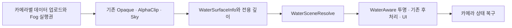

# 툰 워터 월드 — 기존 시스템과 렌더링 통합 계약

- 전체 요구사항: [상세 구현 설계](../../../docs/전달용/toon_water_world/toon_water_world_implementation_design.html)
- 구현·검증·미수행: [작업 상태](../../../docs/work-status/toon-water-world.md)

## 책임과 연결

기존 `PlayerMovementController.Swimming`·`PlayerSwimState`·KCC의 입수·부력·잠수·탈출을 재사용한다. `FootstepWaterSurface`는 원본 메시의 높이장, 우선순위, 체적, 건조 구역, 파도, 유속을 제공한다. `UnderwaterRegion`은 그 수역에 광학 프로필·시각 렌더러·강수 노출을 연결한다. 별도 Transform 이동기나 전역 날씨 생산자를 추가하지 않는다.

시각 메시 `surfaceMesh.sharedMesh`는 큰 파도용으로 세분화할 수 있다. 선택적인 `queryMesh`는 세분화 전 원본을 보존하며 CPU와 GPU 체적이 공유한다. queryMesh가 없으면 시각 메시를 사용한다. 평면 볼록 메시의 외곽을 축약하되 구멍·여러 섬·오목 영역·비평면 메시를 임의로 볼록화하지 않는다. 메시를 교체하거나 수정하면 `RefreshMesh`로 캐시를 갱신한다.

## 수역과 높이

`priority`가 큰 수역, 동률이면 해당 XZ의 높은 수면을 선택한다. 높이까지 같으면 먼저 등록된 수면이 유지되므로 중복 배치를 제거한다. 수역을 먼저 선택한 뒤 발소리 수심이나 수중 프로필을 판정하며, 선택한 수역의 프로필이 없다고 다른 높이의 효과를 가져오지 않는다.

`volumeBounds`·`dryVolumes`는 **FootstepWaterSurface 컴포넌트 Transform 기준 로컬 좌표**다. 메시의 별도 Transform 기준이 아니다. 경계는 포함한다. useVolumeBounds=false는 기존의 무제한 수직 투영을 보존하는 호환 설정이며 지하 동굴 보호가 완료된 설정이 아니다. 수직으로 겹친 수역은 실제 높이 범위와 건조 공간을 저작한다. 건조 구역은 해당 수역만 제외하므로 겹친 모든 수역에 적용해야 한다.

수면은 단일 높이장이다. 메시 로컬 수직축은 월드 Y와 일치해야 하고, 수직 벽이나 접힌 수면은 지원하지 않는다. 파도는 월드 XZ와 동일한 시계·파수·진폭·속도를 사용하는 두 사인파다. 큰 파도 경사 상한은 0.35이며 시각 메시 보간 오차의 보수적 상한은 2cm다. Validator가 이를 검사한다. 작은 노멀·접촉 파문은 시각 효과로만 사용하고 캐릭터 물리 높이에 더하지 않는다.

## 단일 광학 합성

기존 `UnderwaterRendererFeature`·`LakeUnderwater.shader`의 타입과 에셋 GUID를 호환 진입점으로 유지한다. 이전 전체 화면 수중 후처리는 실행하지 않으며 별도 Feature를 중복 추가할 필요가 없다.

1. Base Game/선택적 SceneView 카메라의 Render Graph Context가 실행권을 한 번만 취득한다. Preview·Reflection·Overlay UI는 제외한다. 명시적으로 별도 scene을 렌더하는 카메라는 그 scene의 수역만 수집한다.
2. 불투명 패스 전 기본 Fog 키워드만 해당 카메라의 명령 버퍼에서 끈다. RenderSettings 자체나 외부 툰 셰이더를 영구 변경하지 않는다. 원래 Fog 설정은 프레임 스냅샷에 저장한다.
3. SurfaceInfo는 Cull Off의 실제 변위 메시를 별도 깊이 attachment에 그린다. RGBA32F/Point에 eye depth·oct normal·signed Body ID를 기록한다. 부호는 수면의 앞/아랫면이다. ID를 MSAA 평균이나 Bilinear로 섞지 않는다. 큰 파도·노멀맵·접촉/비 기울기는 이 패스에서 한 번만 합성하며 Resolve에서 다시 더하지 않는다.
4. Resolve는 Opaque/Sky와 깊이를 읽고 별도 HDR 색 대상으로 출력한 뒤 cameraColor를 이어준다. 관리 수면의 기존 UniversalForward 색 패스는 이 카메라에서 clip하여 두 번 그리지 않는다. Feature가 없으면 기존 수면 색 패스가 복귀하지만 정상 통합으로 판정하지 않는다.
5. 광선과 삼각형 수직 프리즘을 교차하고 체적·높이장으로 제한한 뒤 같은 수역 구간을 합치고 건조 구간을 뺀다. 경계를 정렬해 우선순위와 높이로 매체를 선택한다. 물은 RGB 지수 감쇠·산란, 공기는 원래 Fog의 **공기 길이만** 적용한다. 수면 앞/뒤 구간의 공기 누적 거리를 이어 선형 Fog도 이중 적용하지 않는다. 하늘 자체는 지상 Fog로 덮지 않고 통과한 물 구간만 감쇠한다.
6. 원근·정사영을 분리하고 near plane 안의 경계를 최대 8개 bracket·8회 이분 탐색으로 보정한다. 굴절 UV를 회귀하면 색과 깊이를 함께 회귀한다. 코스틱은 수중 불투명 끝점에만 수심·깊이 불연속·주광원 그림자를 적용한다.
7. 일반 투명 전 Fog 키워드를 복구한다. `Water Aware Particle`은 자기 fragment까지의 매체를 계산하고 가까운 수면 뒤 조각을 제외한다. 투명 후 물 전역 플래그를 복구하며 UI에는 수중 Fog를 적용하지 않는다.

수면 재질의 기존 깊이 Absorption/전체 화면 immersion crossfade는 관리 경로의 광학 길이를 대신하지 않는다. 반사·수면 포말·작은 노멀의 저작값은 기존 재질을 재사용한다. 수중 전반사는 임계각으로 제한하고 수면 아래 반사는 물의 원거리 방사휘도 근사값을 사용한다. 정확한 수중 장면 SSR이나 다중 경계 반사가 아니다.

## 반응·유속·강수

입수·발·수영은 고정 32개 `WaterContactStamps`에 기록한다. 낙하물에는 `WaterContactEmitter`를 붙인다. 이 등록부는 카메라 수와 무관하게 게임 프레임당 한 번만 수면 통과를 검사한다. 이벤트마다 GameObject를 생성하지 않는다. GPU에서 감쇠하는 원형 스탬프의 노멀·포말을 평가하며 파동 PDE나 실제 유체 전파를 구현했다고 표현하지 않는다. 예산 포화 시 오래된 파문을 교체한다.

`WaterfallLink`는 상류·하류 참조, 시각 ribbon, 지속 낙하 파문, 미스트만 연결한다. 실제 낙구 물살은 기존 `WaterfallCurrent`가 우선하고 일반 수역은 `currentVelocity`를 기존 수영 모터 속도에 더한다. 폭포 전체를 수중 체적으로 등록하지 않는다. ribbon은 AlphaClip 코어이고 미스트는 WaterAware 경로다.

비는 수역의 EnvironmentController에서 강도를 읽고 베이크된 선형 강수 노출 마스크를 적용한다. 마스크가 없으면 비 파문을 끈다. Baker는 기존 날씨의 차폐 계약과 실제 상방 Physics를 함께 조회한다. 비 한 방울마다 GameObject/Physics를 생성하지 않는다. 지붕 배치를 바꾸거나 마스크를 재사용할 수 없는 구조 파괴가 발생하면 해당 노출을 다시 저작해야 한다.

## 수명·예산·지원 범위

GPU Body/Cell/Dry/Stamp 버퍼는 Render Graph의 해당 카메라 프레임에서 생성·업로드·읽기 선언한다. 프레임 handle을 필드에 장기 보관하거나 다음 카메라에 재사용하지 않는다. SurfaceInfo·전용 깊이·합성 색도 그래프 소유이며 해상도 변경 때 그래프가 다시 할당한다. 실행 콜백은 프레임 PassData 스냅샷만 읽는다. Feature Dispose 시 자체 Material과 전역 플래그를 정리하고 Region 비활성화 시 등록과 렌더러 표식을 해제한다.

- 카메라당 Body 16, 축약 triangle cell 512, dry volume 128, 광학 구간 32, 접촉 stamp 32가 구현 예산이다. 기본 640×360 검사에서 여러 수역을 함께 렌더한다. 이 수치를 실제 기기의 프레임 예산 통과로 바꾸어 해석하지 않는다.
- 용량이 넘은 수역은 사라지게 두지 않고 기존 색 패스로 복귀하며 진단 카운터를 남긴다. 광학 구간 예산 초과는 자홍색으로 드러낸다. Validator가 입력 예산을 검사한다.
- Opaque/AlphaClip과 불투명 단계의 외곽선은 원래 툰 명암을 유지한 채 합성된다. 후처리 외곽선과 임의 AlphaBlend 전체의 자동 호환은 보장하지 않는다.
- 한 픽셀의 주 자유수면 하나를 V1로 한다. 서로 다른 수역이 화면에 나뉘어 보이는 것은 지원하지만 같은 광선의 여러 자유수면 반사/굴절은 별도 확장이다. 큰 파도 grazing ray의 제한 탐색, XR·모바일·TAA motion vector·planar reflection·PDE solver는 추가 검증/구현 범위다.
- 원본 설계의 CPU 자원 예약·원자 보상/저장과 GPU 생태계 전체는 이 렌더링 경로가 대신 소유하지 않는다. 기존 채집을 원자적 수중 자원으로 완료 처리하지 않는다.

## 저작과 검증 진입점

`Water/CreateLab`, `Water/CompleteLabFixtures`, `Water/CaptureLab`은 자동 제작·검사 진입점이며 런처에 노출하지 않는다. 반복 저작은 `Water/ValidateLoaded`·`Water/BakeSelectedExposure`를 사용한다. `Water/IntegrateLoadedScene`은 원본 메시를 보존하고 별도 시각 메시·노출 마스크를 연결하는 명시적 도구이며 미저장 씬을 거절한다. 제작·검사 결과와 사용자 테스트는 작업 상태 문서에서 관리한다.
### 수면 색과 날씨 차폐 계약

관리 수면도 기존 재질의 `_ShallowColor`/`_DeepColor`/`_DepthDistance`/`_SurfaceOpacity`를 사용한다. 수면 위에서는 광학 감쇠 후의 투과색과 깊이별 수면 색을 최소 불투명도로 혼합하고 Fresnel 반사·광원 반짝임·해안 포말을 더한다. 수면 아래의 매체 감쇠는 이 수면 색으로 다시 착색하지 않는다. 호수별 색·반사·파문·포말은 연결된 전용 재질에서 조절한다.

날씨 입자는 공기 중에서만 표시한다. Prepare는 기존 수영과 같은 수역 판정으로 해당 카메라의 `_WaterCameraSubmerged`를 설정하고 Cleanup/Dispose가 해제한다. Weather Particle은 잠수 카메라의 입자 전부와 가장 가까운 수면 뒤의 조각을 버린다. 카메라별 값이므로 Game/SceneView 간에 전역 잠수 상태를 유지하지 않는다. EnvironmentEffects는 기존 관측점이 잠기면 비/눈 방출을 중단하고 남은 강수·먼지 입자를 지우며, 재부상하면 현재 날씨의 방출률로 복구한다. 수면의 빗방울 파문과 전역 강수/젖음 시뮬레이션은 유지한다.
