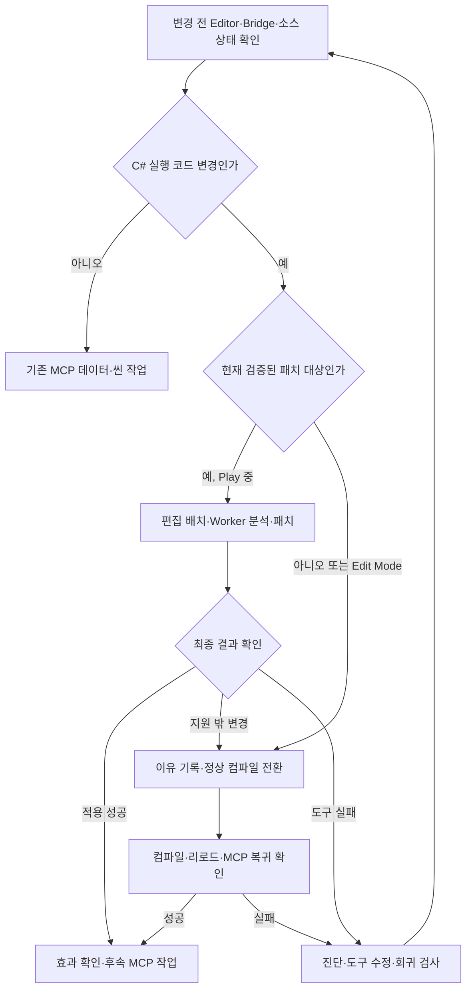

# Unity MCP 작업의 Hot Reload 우선 적용·컴파일 복구 설계

- 작성일: 2026-11-13
- 문서 상태: 설계. 아래 추가 API·상태·복구 자동화는 구현 예정이며 현재 제공 기능이 아니다.
- 적용 대상: UPlayground의 단일 Unity Editor, `Packages/com.uplayground.hotreload`, Unity MCP, 외부 Worker.
- 기존 백엔드 설계: [DESIGN_SPEC.md](../../../../docs/전달용/Unity_HotReload_Agent_Handoff/DESIGN_SPEC.md)
- 실제 구현·검증 상태: [unity-hot-reload.md](../../../../docs/work-status/unity-hot-reload.md)
- 운영 절차: [사용 가이드](../../guide/HOT_RELOAD_USAGE_GUIDE.md) · [개발 위키](../../../../docs/wiki/development.md)

## 1. 목적과 완료 기준

코드를 수정할 때마다 Editor나 플레이를 재시작하느라 작업 맥락을 잃는 일을 줄인다. 앞으로 Unity MCP를 이용한 C# 작업은 변경 전에 Hot Reload 적격성을 확인하고, 지원 범위에서는 우선 사용한다. 지원 밖 변경은 정상 컴파일로 이어간다. 코드 변경이 없는 MCP 조회·씬·데이터 작업 때문에 패치 세션을 새로 시작하지 않는다.

컴파일 또는 후속 MCP 작업이 막히면 재시작만으로 넘기지 않는다. 원인을 구분하고, 커스텀 도구의 결함이면 최소 수정과 회귀 검사를 남긴 뒤 원래 막힌 작업을 다시 수행한다. 게임 코드의 컴파일 오류나 의도된 미지원 경계는 도구 버그로 오인하지 않는다.

완료 기준은 다음과 같다.

1. 지원 본문 수정은 같은 플레이 세션에서 적용 결과와 세대를 확인하고 후속 MCP 작업을 수행한다.
2. 지원 밖 변경은 이유를 명시하고, Editor 재시작 없이 정상 컴파일·리로드·MCP 후속 조회까지 확인한다. 플레이 상태 보존은 이 경로의 보장이 아니다.
3. 요청 접수, 실제 반영, 컴파일 성공, MCP 재연결을 각각 구분한다. 이전 코드가 실행되는 상태를 완료로 보고하지 않는다.
4. 반복 차단은 진단·수정·동일 시나리오 재검증으로 이어져 다음 작업에서 같은 수동 복구를 요구하지 않는다.

## 2. 웹 조사와 설계 판단

2026-11-13 열람한 제품·엔진 공식 문서를 사용했다. 상용 제품의 지원 설명은 공개 사용 계약이며 커스텀 구현의 지원 증거가 아니다. 다음 표의 프로젝트 채택 내용은 설계 결정이다.

| 공식 자료의 확인 내용 | 프로젝트에 채택할 판단 |
|---|---|
| 상용 Hot Reload는 본문 외에도 람다·async 등 넓은 수정 범위를 제공하지만, `.asmdef`·define 변경은 재컴파일 대상이며 인라이닝도 제약이다. [기능](https://hotreload.net/documentation/features) | 상용 기능 동등성보다 적격성 판정과 정상 컴파일 전환을 먼저 완성한다. `NoInlining` 검사를 우회하지 않는다. |
| 상용 필드 지원에도 Inspector·기존 인스턴스 초기화 관련 제한이 있다. [필드](https://hotreload.net/documentation/fields) | 필드·직렬화 구조 변경은 현재 미지원으로 유지한다. 객체 상태 마이그레이션은 별도 설계 없이는 도입하지 않는다. |
| 상용 제품은 일부 Burst Job을 지원하지만 ECS `ISystem`은 지원하지 않는다. [Burst/Jobs](https://hotreload.net/documentation/burst-compile-unity-jobs) | 커스텀 도구의 Burst/Jobs 거부와 미수행 T40 검증을 유지한다. 제품 지원을 근거로 검사를 완화하지 않는다. |
| 상용 제품은 Editor 스크립트 지원과 IL 재작성 라이브러리의 제한을 설명한다. [기술 질문](https://hotreload.net/documentation/technical-questions) | Edit Mode 지원은 생산성 가치가 있으나 새 게이트로 분리한다. ILPP가 있다는 이유로 모든 메서드가 불가능하거나 가능하다고 단정하지 않는다. |
| Unity의 `RequestScriptCompilation`은 컴파일을 요청하고 성공 뒤 어셈블리를 리로드한다. [Unity 6000.3 API](https://docs.unity3d.com/6000.3/Documentation/ScriptReference/Compilation.CompilationPipeline.RequestScriptCompilation.html) | 함수 반환을 작업 완료로 취급하지 않는다. 컴파일·리로드를 넘는 작업 추적이 필요하다. |
| `DisallowAutoRefresh`는 중첩 카운터이며 명시적 `Refresh`를 막지 않는다. [Unity 6000.3 API](https://docs.unity3d.com/6000.3/Documentation/ScriptReference/AssetDatabase.DisallowAutoRefresh.html) | 자신의 lease만 해제한다. Refresh 경쟁은 명령 경계에서 조정하며 무조건 `AllowAutoRefresh`를 반복하지 않는다. |
| Enter Play Mode 설정은 진입 시 domain·scene reload를 조절한다. [Unity 매뉴얼](https://docs.unity3d.com/6000.3/Documentation/Manual/configurable-enter-play-mode.html) | Domain Reload OFF를 코드 Hot Reload의 대체물로 간주하지 않는다. |
| 상용 제품도 동기화 컨텍스트 교체·파일 감지 문제를 진단 대상으로 다룬다. [문제 해결](https://hotreload.net/documentation/troubleshooting) | 감지→컴파일→메인 스레드 적용→통신 중 어느 단계가 멈췄는지 기록한다. 프로젝트에서 같은 원인이 재현된 것으로 단정하지 않는다. |

## 3. 현행 구현과 차이

| 항목 | 현재 코드·설정 | 추가 설계 |
|---|---|---|
| 패치 | Harmony transpiler, Worker의 전체 어셈블리 컴파일·IR 검증, 메서드 본문 교체 | 백엔드 재작성 없이 기존 coordinator 재사용 |
| 진입 | `HotReloadCoordinator.Start`는 Play 전용, 시작 시 디스크·로드 원본 parity 확인 | 시작 전 변경 분류, 불일치 시 정상 컴파일로 기준선 갱신 |
| 대상 | Actor/Camera 어셈블리의 세 메서드 allowlist, Editor `NoInlining` | 실제 반복 작업의 대상부터 검증하여 점진 확대 |
| 에이전트 | 파일 `Bridge`의 inbox/outbox, 토큰·세션·revision·generation 검사 | Bridge 클라이언트의 일관된 접수/완료 처리, 선택적인 MCP 어댑터 |
| 정상 컴파일 | `recompile_and_stop`은 정리 후 delayCall에서 Refresh·컴파일 요청, 즉시 `Ok` 반환 | 리로드 후에도 조회 가능한 컴파일 작업 결과 |
| Play 종료 | `allowPlayModeExitFromAgent=false`, 명령 플래그와 함께 허용돼야 종료 가능 | 기존 제한 유지. 전환 불가 사유를 반환하고 다른 MCP 명령으로 우회하지 않음 |
| import 충돌 | `HotReloadBootstrap`이 컴파일 시작·코드 import 시 세션 무효화 | 패치와 import/컴파일의 배타적 전환 |
| MCP | 설치본 `ManageScript`는 import/compile 예약. Unity 6 `RefreshUnity`는 compile 요청 시 전체 완료 대기 생략 | 버전별 능력 확인, 완료 추적·재연결 후 후속 조회 |
| 정리 | 자신의 Worker·watcher·Harmony owner·Refresh lease 정리 | 정리 오류를 정상 종료와 구분하고 잔여 상태를 확인 |

소스 기준: `Editor/Core/HotReloadCoordinator.cs`, `RefreshLease.cs`, `HotReloadCommands.cs`, `Editor/AgentBridge/Bridge.cs`, `Editor/Bootstrap/HotReloadBootstrap.cs`, `Editor/Compilation/WorkerClient.cs`(모두 커스텀 패키지 내부). MCP 대조 파일은 설치된 `Library/PackageCache/com.coplaydev.unity-mcp@da7b9ae4aeeb/Editor/Tools/ManageScript.cs`, `RefreshUnity.cs`다. PackageCache는 수정 대상이 아니며 업데이트 후 재확인한다.

직전 점검의 Bridge `status=Ok`는 통신 확인이다. 실제 Play 패치·일반 컴파일·MCP 복귀 성공을 입증하지 않는다. 전체 기존 도구 판정 `IMPLEMENTED_UNVERIFIED`와 신규 설계의 미구현 상태를 분리한다.

## 4. 변경 경로 선택

- 기존 플레이를 유지하는 편집인지 먼저 확인한다. Edit Mode에서 Hot Reload를 쓰기 위해 불필요하게 월드 Play를 시작하지 않는다.
- 세션은 소스 수정 전에 시작한다. 이미 수정한 소스가 원본과 다르면 parity 검사를 생략하지 말고 정상 컴파일로 새 기준선을 만든다.
- 한 작업 배치에 지원·미지원 변경이 섞이면 전체 정상 컴파일로 보낸다. 일부만 적용하고 전체 완료로 취급하지 않는다.
- SO 수치·씬·프리팹 수정은 해당 시스템의 갱신 절차를 사용한다. Hot Reload를 위해 밸런스 값을 C# 상수로 옮기지 않는다.

## 5. Hot Reload 실행 계약

현행 파일 Bridge 프로토콜 1을 유지한다. 새 편의 도구도 다음 순서를 그대로 호출한다.

1. Editor 인스턴스와 `bridge-info.json`의 프로젝트·PID·시작 시각을 대조한다. 세션 토큰은 읽되 로그·문서·커밋에 남기지 않는다.
2. `status`를 읽고 활성 세션의 소유·배치 상태를 확인한다. 다른 작업의 세션을 종료하거나 열린 배치를 가로채지 않는다. 비활성이면 적격한 Play 작업에서 `start`한다.
3. 동일 `batchOwner`로 `begin_edit_batch`를 연 뒤 파일 도구로 소스를 수정한다. 이 경로에서는 자동 import를 일으키는 MCP 스크립트 수정·Refresh를 호출하지 않는다.
4. `end_edit_batch`의 최종 receipt까지 기다린다. `accepted`를 완료로 취급하지 않는다. 실패하면 진단을 분류하고, 소스·잔여 배치 상태를 확인한다.
5. 분석 완료의 `planId`, `SourceRevision`, `EffectiveGeneration`, 현재 `sessionId`로 `apply`한다. stale 결과는 재분석하며 오래된 plan을 강제 적용하지 않는다.
6. 최종 적용 결과와 세대 증가·적용 메서드 수를 확인한다. 무변경 계획은 적용 0개로 기록한다. 실제 효과를 확인한 뒤 후속 MCP 작업을 한다.
7. 패치 롤백은 소스·게임 상태 원복과 다르다. 디스크 소스가 최종 의도와 일치하는지 확인한다. 작업 종료·정상 컴파일 전환 시 원본 코드와의 차이를 남긴다.

요청 파일은 임시 파일에 UTF-8로 작성 후 GUID 이름으로 rename한다. 타임아웃 뒤 같은 작업을 무조건 새 ID로 재전송하지 않는다. 기존 requestId의 응답·현재 세션·세대를 조회하여 이중 적용을 피한다. 현재 중복 캐시는 domain 내부이므로 리로드 후 멱등성까지 보장한다고 가정하지 않는다.

## 6. 정상 컴파일 전환과 완료 추적

### 6.1 현재 사용할 수 있는 절차

활성 패치 세션의 소스·상태를 확인하고 정리한 뒤, 허용된 Play 종료를 완료하고 Edit Mode에서 정상 컴파일을 요청한다. 현재 Play 종료 제한에 걸리면 이유를 보고하며 설정을 자동 변경하거나 다른 MCP 명령으로 우회하지 않는다. 일반 Edit Mode 변경은 `refresh_unity(mode="force", scope="all", compile="request", wait_for_ready=false)`를 사용할 수 있다.

요청 전후 컴파일·리로드 시각을 비교한다. 새 컴파일 시작/종료 또는 그에 대응하는 리로드 증거, 오류 부재, 현재 Editor 인스턴스의 완전한 상태 응답을 함께 확인한다. `ready_for_tools=true` 단독, 이전 실행의 종료 시각, 내용이 비어 있는 응답, 호출 성공만으로 완료 판정하지 않는다. 새 타입이 필요하면 리로드 뒤 해당 타입을 조회하고 원래 후속 작업을 재개한다.

### 6.2 추가할 컴파일 작업 추적

기존 Hot Reload의 정상 컴파일 전환을 비동기 작업으로 확장한다. 거대한 범용 작업 엔진이나 MCP 서버 재구축은 하지 않는다.

- 요청 전에 `Library/ProjectHotReload/` 아래 컴파일 작업 레코드를 원자적으로 저장한다. `operationId`, 원래 requestId, 프로젝트·Editor 식별, 소스 입력 해시/컨텍스트, 시작 시각과 전환 이유를 기록한다.
- 단계는 `Requested → CleaningUp → WaitingForEditMode → CompileQueued → Compiling → ReloadPending → Verifying → Succeeded`로 구분한다. `Failed`, `Blocked`, `TimedOut`를 별도 종결로 둔다. 이 이름은 새 컴파일 작업 상태이며 기존 `HotReloadState` enum에 무조건 합치지 않는다.
- `recompile_and_stop`은 추후 `accepted + operationId`를 반환하도록 버전을 명시해 확장한다. 현행 `Ok` receipt를 조용히 완료 의미로 바꾸지 않는다. 동작 중인 프로토콜 1 클라이언트의 호환성을 유지한다.
- 컴파일 이벤트에서 어셈블리별 오류와 시작·종료를 기록하고, `beforeAssemblyReload` 이전 상태와 새 domain 부트스트랩 관측을 연결한다. 리로드 뒤 Bridge 토큰을 다시 읽는다. 이전 세션 패치를 자동 재적용하지 않는다.
- 시작 시 미완료 작업을 대조한다. 다른 PID/Editor 시작 시각의 레코드는 자동 재실행하지 않고 중단 상태로 표시한다. 결과 파일 존재만으로 새 소스가 반영됐다고 판정하지 않는다.
- `Succeeded`는 도구 내부 컴파일/로드 확인이다. 에이전트는 MCP가 같은 Editor에 재연결되어 실제 후속 조회가 성공한 시점까지 따로 확인한다. 통신 실패와 컴파일 실패를 분리한다.
- 제안 관측값: 요청 후 10초간 시작 미관측이면 진단을 수집하고, 컴파일/리로드 120초 무진행이면 시간 초과 후보로 둔다. 실제 대형 어셈블리 컴파일이 진행 중이면 중복 요청하지 않는다. 수치는 초기 제안이며 실측 뒤 조정하고 매 폴링마다 기한을 연장하지 않는다.

## 7. 차단 분류와 도구 개선 절차

| 관측 | 먼저 구분할 원인 | 처리·재발 방지 |
|---|---|---|
| Worker 컴파일 오류 | 실제 C# 오류 / Unity와 다른 rsp·define·참조 | 실제 오류는 소스 수정. 정상 Unity와 결과가 다르면 컨텍스트 재현을 수정하고 최소 재현 추가 |
| `BaselineParityFailed` | 편집 후 Start / 오래된 DLL / Worker 생성물·ILPP 불일치 | 정상 컴파일 후 새 기준선. 반복 불일치는 구체 메서드·지문으로 재현하고 resolver/compiler 수정 |
| `TargetNotAllowlisted`·구조 변경 거부 | 의도된 지원 경계 | 정상 컴파일. 자주 수정하는 적격 메서드는 별도 준비 단계에서 등록·검증 |
| 편집 감지 없음 | watcher 누락 / 저장 안 됨 / 원본 경로 불일치 | 내용 해시·최종 경로 재스캔. 실제 파일 저장·rename 시나리오 회귀 검사 |
| 분석 중 응답 정지 | Worker 종료·timeout / 메인 스레드 차단 | 자신의 Worker만 복구. Start의 동기 기준선 준비가 UI/MCP를 막는지도 측정 |
| 패치 직후 세션 비활성 | MCP import·Refresh와 경쟁 | 호출 경로를 수정하고 배치 경계에 충돌 진단 추가. 정당한 외부 컴파일을 영구 차단하지 않음 |
| 컴파일 시작 미관측 | Play 정책 / Editor busy / 테스트·import 중 / 도구 lease·요청 유실 | 진행 상태·정리 결과 확인 후 원인이 해소된 경우에만 새 요청. Refresh 연타 금지 |
| 컴파일 성공 뒤 MCP timeout | 리로드 중 연결 교체 / stale 인스턴스 / MCP 문제 | 동일 Editor 재연결·상태 재조회. 이를 이유로 다시 컴파일하지 않음 |
| 정리 후 패치·lease 잔존 | owner 해제·Dispose 실패 | 정상 종료로 표시하지 말고 격리·진단. 자신의 자원만 재정리 |
| 미지원 변경을 정상 컴파일해도 실패 | 도구 오류 / 프로젝트 소스 오류 / Unity 자체 문제 | 도구가 원인이면 수정. 원인이 외부라면 근거와 다음 행동을 남기고 무관한 도구 재작성 금지 |

각 차단 기록은 하나의 상태 문서 안에 `증상·변경 유형·요청/작업 ID·Editor 식별·소스 해시·기대/실제 결과·마지막 진행 단계·원인·수정 파일·회귀 검사·동일 작업 재시도 결과`를 남긴다. 로그에 세션 토큰을 포함하지 않는다.

같은 실패가 원인 변화 없이 반복되면 재시도 대신 조사·최소 수정으로 전환한다. 수정 → 관련 검사 → 원래 변경으로 재실행 → 후속 MCP 작업 성공 순서로 닫는다. 당장 수정할 수 없으면 차단으로 남기며 임의 재시작으로 해결 완료라 쓰지 않는다. Editor 메인 스레드 자체가 응답하지 않으면 Bridge도 이를 치료할 수 없으므로 근거를 보존하고 복구 한계를 보고한다.

## 8. 구현 순서와 소유 범위

| 단계 | 구현 범위 | 통과 조건 |
|---|---|---|
| D0 조사·운영 연결 | 이 설계·가이드·AGENTS·위키 | 현행/예정 구분, 출처·로컬 링크 확인 |
| D1 진단과 Bridge 사용 일관화 | 기존 `AgentBridge`, `Core` receipt·진단, 필요 시 `Tools/`의 얇은 클라이언트 | 접수/완료, stale token·plan, timeout 뒤 결과 조회, 다른 배치 보호 |
| D2 정상 컴파일 복구 | 기존 coordinator·bootstrap·lease + 컴파일 작업 레코드 | 리로드를 넘는 추적, 정리 오류 보존, 동일 Editor 후속 MCP 조회 |
| D3 실제 작업 대상 확대 | 검증된 메서드의 설정·조건부 `NoInlining` | 실제 반복 수정 대상의 저장→패치→원복→정상 컴파일 동등성 |
| D4 선택 확장 | Edit Mode 본문 패치, 필요성이 입증된 MCP 전용 어댑터 | Editor 콜백·도구 객체 수명 검증, 플레이 강제 진입 없는 반복 작업 |

D1~D2를 먼저 구현한다. D3는 기존 세 메서드의 실제 Play 검증과 T40 거부 검사를 선행한다. D4의 Editor 코드 패치는 도구 자신·MCP·컴파일 이벤트·초기화·직렬화 경로를 기본 제외한다. 자신의 패치/복구 코드를 고칠 때는 정상 컴파일 경로를 사용한다.

MCP 어댑터를 추가한다면 별도 Editor 전용 asmdef와 설치된 MCP 등록 방식으로 붙이고 기존 coordinator/Bridge 계약만 호출한다. MCP 의존성을 게임 asmdef나 Worker로 전파하지 않는다. 설치본의 등록 API를 실제 확인하기 전 가상의 tool 이름을 운영 지침에 쓰지 않는다. 초기 단계는 파일 Bridge로 충분하다.

필드·새 타입·async/iterator·람다·Burst의 지원 확대, Player 패치, 상용 패키지 구매·설치, .NET/Unity 업그레이드는 이 설계의 초기 구현 범위에 넣지 않는다. 기존 패키지의 백엔드·IR·Worker를 재사용한다.

## 9. 검증과 효율 지표

[테스트 작업 지침](../../guide/TEST_VALIDATION_GUIDE.md)에 따라 짧은 기존 자동 검사와 사용자 Play 확인을 구분한다. Player·Addressables 빌드는 별도 지시 없이는 실행하지 않는다.

| ID | 검사 | 기대 결과 |
|---|---|---|
| W01 | 기존 세 메서드 중 하나의 실제 파일 본문 저장→분석→적용 | 새 세대·변경 효과 확인, 같은 플레이어/카메라 참조·HP·입력 유지(사용자 확인) |
| W02 | 구조 변경·allowlist 밖 변경 | 부분 적용 없이 명확한 정상 컴파일 필요 진단 |
| W03 | 정상 컴파일 요청 직후 상태가 잠시 idle/ready | 이전 종료 시각을 완료로 오인하지 않음 |
| W04 | 컴파일 오류 후 수정·재요청 | 오류가 보존되고 성공·리로드 후 다음 MCP 조회 수행 |
| W05 | Hot Reload 활성 중 import·Refresh 경쟁 | 무효화/정리 이유 표시, 오래된 패치 재적용 없음 |
| W06 | Worker 종료·stale 응답·중복 요청 | 이중 적용 없음, 소유 Worker만 복구, 새 토큰 재획득 |
| W07 | 정상 컴파일/Domain Reload로 MCP 일시 단절 | 작업 레코드 유지, 같은 Editor 재연결 후 결과·후속 조회 확인 |
| W08 | 정리 해제 실패 주입·다른 도구 lease 공존 | 정상 종료로 위장하지 않음, 타 도구 자원 해제 없음 |
| W09 | Play 종료 제한·다른 소유자의 열린 배치 | 명확한 차단, 전역 설정 변경·세션 탈취 없음 |
| W10 | 패치 종료 후 같은 소스 정상 컴파일 | 패치와 원본 컴파일의 동일 동작(실제 Play는 사용자 확인) |
| W11 | 재현된 차단을 수정한 뒤 동일 입력 재실행 | 회귀 검사와 원래 후속 작업이 모두 통과 |

효율은 `저장→최종 적용`, `컴파일 요청→로드 확인→MCP 후속 작업`, fallback 비율/사유, 중복 컴파일 요청 수, Editor 재시작 수, 동일 차단 재발 수로 기록한다. Worker 컴파일만의 시간으로 전체 반복 속도를 대표하지 않는다. 초기에는 관련 작업의 journal/작업 레코드와 상태 문서로 충분하며 별도 대시보드를 만들지 않는다.

성능 비교는 같은 씬·변경 유형·포커스 상태에서 측정한다. 첫 기준선 준비와 이후 패치 시간을 분리하고 입력이 다른 과거 수치를 개선 증거로 쓰지 않는다. 첫 인수는 지원 본문 변경의 반복 적용, 미지원 변경의 정상 컴파일 전환, 주입 가능한 차단 복구 각각에서 후속 MCP 조회까지 성공하는 것이다. 사용자 Play 인수는 별도 대기 상태를 유지한다.

## 10. 향후 작업 운영 원칙

Unity MCP C# 작업의 기본 순서는 `상태·적격성 확인 → 지원 시 Hot Reload → 지원 밖이면 정상 컴파일 → 반영 확인 → 후속 작업`이다. 차단이 도구 결함이면 기존 사용자 변경을 보존하며 도구를 고치고 동일 작업을 재검증한다. 현행 미지원 경계를 없애기 위한 즉석 특수 분기는 만들지 않는다.

Editor 재시작은 기본 해결책이 아니다. 잠금 파일·Library·Temp 삭제, 다른 Editor 기동, 전체 프로세스 종료, 전역 Refresh 설정 변경, 타 도구 lease 해제는 복구 절차에 포함하지 않는다. 필요하지 않은 승인 단계나 자동 커밋도 추가하지 않는다.
