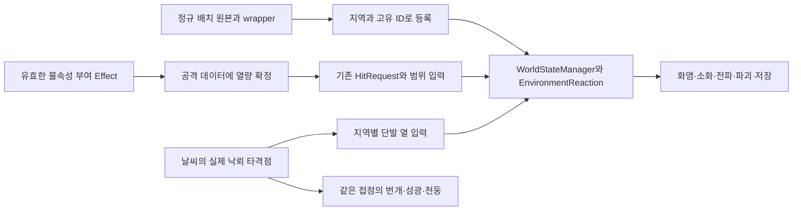

# 반응형 환경 통합 계약

상위 입력은 [전달 설계](../../../../../docs/전달용/environment_system_design_v1/environment_system_design_v1.html)다. [작업 상태](../../../../../docs/work-status/reactive-environment.md)에서 구현·자동 검사·사용자 인수를 구분한다. 반복 저작은 [저작 지침](../../../guide/REACTIVE_ENVIRONMENT_AUTHORING_GUIDE.md)을 따른다.

## 연출 개선 계약

[연출 개선 설계](REACTIVE_ENVIRONMENT_PRESENTATION_DESIGN.md)는 수관/목재 역할 분리, 국소 타격·벌목 단계, 화염·연기·소화 잔연, 비 소화 목표와 전파 연결을 정의한다. 아래 커스텀 툰의 균열/연료 coverage/연소 경계 발광은 현재 구현 계약이며 최종 미술 인수를 뜻하지 않는다. 후속 표현 변경은 이 개선 설계를 따른다. 구현과 사용자 판정은 [작업 상태](../../../../../docs/work-status/reactive-environment.md#연출-구현-최종-검증--2026-11-13)에서 구분한다.

## 지원하는 실행 경로

GAS HitPhase 환경 payload → 플레이어/잔상/몬스터 AttackData → 불변 HitRequest → ReactiveEnvironmentObject → WorldStateManager의 단일 작성자 → 반응 상태/파괴 전이/보상/저장 → 읽기 전용 툰 표면으로 연결한다. 새 패키지·런타임 asmdef·매니저는 추가하지 않는다.

- HitPhaseData.environment는 기계 입력 종류(Generic/Slash/Blunt/Explosion)와 열·물 impulse를 갖는다. Damage에서 원소를 계산하지 않는다. 기존 에셋의 새 필드 기본값은 원소 없음이며, 기존 스킬의 색·이름을 보고 자동으로 수치를 채우지 않는다.
- 근접·잔상·몬스터·조합형/레거시 투사체의 복사와 HitRequest 변환에서 같은 payload를 보존한다. 다중 발사로 페이즈 총량을 분할하는 기존 도구도 원소 총량을 나눈다.
- 기존 CombatHitDetector의 단일 대상 중복 제거를 유지한다. 외부 명중 API에는 실행 ID+sequence를 사용한다. 지속 열/물은 EnvironmentElementEmitter의 rate를 한 번 적분하며 dedup 키를 매 tick 생성하지 않는다.
- 구조 피해는 명중 직후 커밋한다. 화학은 중앙 고정 substep에서 수분 → 열 → 발화/소화 → 연료/그을림/구조 순서로 계산한다. 즉시 물 impulse와 지속 물 rate의 냉각 계수를 구분한다.
- 전파는 tick 시작의 연소 상태를 공간 해시에 넣고 거리·바람·벽·surfaceLayerId·소유 맵을 검사한다. 새로 점화된 대상은 다음 tick부터 전파한다. 모든 논리를 계산한 뒤 표현/충돌을 전환해 등록 순서에 따라 벽이 먼저 사라지는 결과를 피한다.
- 날씨는 EnvironmentController.Current를 읽고 비 노출은 EnvironmentEffects.IsRainSheltered를 재사용한다. 표면/열 샘플을 구분하고, 비활성 원형의 샘플 대신 활성 잔해의 샘플을 사용한다. 자체 Collider를 제외한다. 현재 수직 강수 차폐이며 비스듬한 비는 지원 범위 밖이다.
- 파괴는 원형/사전 파손 잔해 전환과 DirectionalFall이다. 낙하 궤적의 캡슐 substep으로 가림을 검사하고, 시작부터 막힌 후보는 짧은 붕괴로 분기한다. 진행 중 장애물은 직전 안전 포즈에서 정착시킨다. 액터를 회전 Collider로 강제 밀거나 접촉 피해를 임의로 생성하지 않는다.
- Collider·차폐 볼륨·NavMeshObstacle 전환을 같은 파괴 상태에 맞추며 충돌/차폐/길찾기 revision을 분리한다. NavMesh carving 반영 지연과 실제 KCC 접촉은 플레이 확인 대상이다.
- 잔해 여러 조각은 한 논리 엔티티의 형상이다. 부모의 연료·열·젖음·그을림을 그대로 유지한다. 개별 조각마다 초기 연료/보상을 다시 생성하지 않는다. 충격/화재 보상은 기존 IGroundDropService sourceId와 월드 저장에 한 번만 확정한다.
- 저장 키는 RegionOwnership + SceneEntityId다. 화학 잔여 시각, pending 원소/지속 물, 파괴 진행·방향과 보상 확정을 함께 보존한다. 로드 중 지급하지 않으며, 호환/수치 검증 후 환경 상태를 일괄 교체한다.

## 커스텀 툰

[ToonReactive.shader](../../../../06.Shaders/Environment/ToonReactive.shader)와 [EnvironmentSurface.hlsl](../../../../06.Shaders/Environment/EnvironmentSurface.hlsl)이 한 coverage/변형 함수를 공유한다.

- EnvState0 = Wetness/Char/Damage/Burning, EnvState1 = Heat/예약 0/예약 0/예약 0. CPU 상태를 읽으며 GPU가 연료·피해·보상을 작성하지 않는다.
- 합성은 기본 색/노멀 → 그을림/균열 → 젖음 색/제한된 하이라이트 → 툰 명암/그림자/간접광/추가 광원 → 연소 경계 발광 → Fog다. 소화하면 발광만 사라지고 그을림/손상은 유지한다.
- Body/Foliage/Interior 역할을 재질에 명시한다. 실루엣 소거는 명시적으로 허용한 잎만 사용한다. 일반 구조물의 Collider를 셰이더 구멍으로 대체하지 않는다.
- ForwardOnly, SRPDefaultUnlit 외곽선, ShadowCaster, DepthOnly, DepthNormalsOnly, DepthNormals, MotionVectors, Meta의 8개 패스다. 알파 clip·연료 coverage·LOD crossfade·바람을 공유한다. 모션 벡터는 이전 프레임의 바람을 기존 단일 날씨 작성자가 함께 공급한다.
- 기존 전역 젖음 작성자를 추가하지 않는다. 바람은 기존 _LW_Wind를 읽는다. 불투명/잎/절단면은 같은 셰이더의 명시 재질 설정으로 분리한다.
- ReactiveEnvironmentSurface는 명시한 Renderer/재질 슬롯의 MaterialPropertyBlock만 변경한다. 원본 재질을 복제하거나 수정하지 않고, 언로드/풀 반환 때 기존 블록을 복원한다. 모든 Renderer/LOD/슬롯에 반응 또는 제외 결정을 요구한다. 미지원 셰이더·잘못된 coverage/Collider 구성은 거부한다. LegacyTint는 제한된 명시 fallback이다.
- 상수는 UnityPerMaterial에 둔다. 개체 PropertyBlock의 SRP Batcher 영향은 실제 맵에서 측정한다. Terrain Detail은 Terrain별 공유 재질/상태 마스크와 기존 인스턴싱을 사용한다.

## 범위 경계

현재 완료 범위는 등록된 소품/풀 패치의 반응·전파·사전 파괴·보상·저장·커스텀 툰 경로다. 정규 씬 전체 전환·불속성 부여 점화·날씨 낙뢰 점화는 아래 [정규 월드 연결 확장 설계](#정규-월드-연결-확장-설계)의 후속 구현 범위로 추가한다. 구매 원본을 직접 덮어쓰지 않으며 새로운 관리 대상은 프로필·샘플·재질·레시피를 명시 저작한다.

전체 콘텐츠 closure의 Managed/Exempt 빌드 게이트, 전체 월드 셀 전환·성능 인수, 맵 경계 전파, 독립 자식 엔티티 분배, 원거리 proxy/catch-up/영속 입력 dedup, 낙목 접촉 피해와 최종 VFX/아트·성능 인수는 별도 범위다. 언로드/시간 점프 중에는 화학을 정지(SuspendDomain)한다. 이 경계를 전체 P0~P6 릴리스 완료로 바꾸어 표현하지 않는다.

## 일반 씬 오브젝트·식생 확장 검토안

이 절의 개체/Detail 연결 계약은 구현에 반영한다. 실제 자동 검사·미수행·사용자 인수의 현재 판정은 [작업 상태](../../../../../docs/work-status/reactive-environment.md#일반화-최종-판정)를 따른다. 과거 primitive 샘플 통과는 새 구현의 근거가 아니다.

### 상태 작성자와 표현 단위

- 기존 WorldStateManager + EnvironmentReaction이 유일한 상태 작성자다. IEnvironmentReactionTarget은 소유 Transform/ID/프로필/열 위치/날씨 샘플/표현만 연결한다. 개체와 셀 모두 동일한 고정 substep·원소 누적·전파 지연·벽·바람·저장 검증을 사용한다.
- 일반 소품/나무: ReactiveEnvironmentObject 한 개가 상태를 소유한다. 비파괴 프로필은 원형/잔해/레시피 없이 기존 Renderer로 젖음·그을림·연소를 표현한다. canIgnite/canBreak/scorchPerHeat 등은 프로필에 명시하며 외형이나 이름으로 추정하지 않는다.
- 파괴 프로필만 원형/잔해/레시피/ReactiveEnvironmentDestruction을 필수로 한다. 밑동·수관·통나무·모든 LOD는 같은 root의 표면 바인딩이며 독립 연료/보상을 생성하지 않는다. 절단/낙하 피벗·실제 길이/반경·Collider·fallback은 모델 기준으로 저작한다. 임의 자동 메시 절단은 하지 않는다.
- 구매 프리팹은 중첩 wrapper/variant에 연결하고 프로젝트 소유 호환 재질만 사용한다. 각 Renderer/slot은 반응 목록 또는 명시 제외 목록에 있어야 한다. 연결된 피격 Collider만 CombatHitDetector가 환경 대상으로 해석한다. 물리 통로 Collider와 반응 대상 Collider는 구분할 수 있다.
- GatheringActor 병용은 ownsGathering을 명시한 비재성장·비낚시 대상에 허용한다. 채집 애니메이션 입력도 환경 내구도에 전달하고 충격 보상은 기존 InteractableActorSO.dropItems, 화재 보상은 환경 프로필을 사용한다. GatheringActor의 별도 드롭/Destroy/소모 저장 경로를 실행하지 않는다. 구 consumedInteractables 기록은 같은 ID의 파괴/보상확정 상태로 인계한다. 낚시·시간 재성장은 연결 검사에서 거부한다.

### 저작과 안정 배치

반응 환경 저작 창은 변경 대상/Renderer/슬롯 수/Collider 후보·누락을 표시하고 프로필·날씨·열/비 샘플·피격 Collider·SceneEntityId를 연결한다. 구매 원본/프로젝트 프리팹 에셋 직접 변경을 거부하고 Prefab Mode 또는 씬 인스턴스를 편집한다. Undo 그룹 전체를 실패 시 되돌리며 기존 씬 GUID는 유지한다. 새 wrapper 저장은 기존 경로를 덮어쓰지 않고 생성 실패 시 새 파일만 제거한다. 프리팹 원본 배치 ID는 비운다.

씬 프리팹에는 기존 WorldPlacementMetadata의 DirectPrefab/RuntimeData 출처를 연결한다. Bake는 SceneEntityId를 sceneEntityGuid에 보존하고 RuntimePlacementLoader가 활성 등록 전에 같은 레코드 ID를 복원한다. 재생성기는 이 배치 레코드를 보존해야 한다. 원본 레코드를 버리고 위치 해시/새 GUID로 대체하는 재생성은 지원 정책이 아니다. Terrain도 한 배치 ID를 가진다.

### Terrain Detail 셀

정규 지면의 LakeVillageGroundDetailTool은 DetailPrototype/useInstancing/SetDetailLayer를 사용한다. 현재 LakeVillageWorld는 WorldThemesABC/Terrain.asset을 사용하며 원래 도구의 하드코딩 Terrain.asset과 경로가 다르다. 어댑터는 실제 Terrain에 연결된 데이터를 읽는다.

- Terrain당 TerrainDetailReaction 하나, 비어 있지 않은 셀당 순수 C# 객체를 둔다. 풀잎/셀마다 MonoBehaviour·Collider를 만들지 않는다. 명시 detailLayers/대응 호환 mesh prefab/셀 크기/구역/최대 셀 수/상호작용 높이를 저작한다. 구역 밖·제외 레이어는 상태 변경 대상이 아니다.
- 공용 근접/명시 형상 검출기는 IEnvironmentCellHitService로 셀 후보를 수집한다. Sphere/회전 Box/Capsule과 셀 부피의 교차를 검사한 뒤 기존 IDamageable 중복 제거와 HitRequest 환경 payload를 사용한다. EnvironmentElementEmitter도 같은 셀에 지속 열/물을 전달한다. 물리 Collider가 없는 영역에도 타격이 도달한다. 정규 ProjectileRuntime의 폭발/장판은 같은 셀 서비스와 대상별 쿨다운으로 연결한다. 셀의 원소 payload는 기존 물리 AOE 대상과 같은 입력이며 풀별 AttackData 복제는 하지 않는다. 범위 없는 직격 전용 투사체로 Terrain 풀을 태우려면 emitter/범위 입력을 별도로 저작한다.
- 같은 중앙 tick에서 셀의 비/차폐·전파를 계산한다. Terrain 전체를 자기 Collider로 제외하지 않으므로 지형에 의한 화염 차폐를 유지한다. 공용 source의 owner와 차폐 제외 계층을 분리한다.
- 런타임 TerrainData를 복제하고 TerrainCollider도 같은 복제본으로 연결한다. 원본 Detail 밀도를 셀별로 보관하고 연료 비율(표현용 8bit coverage) 변화 때만 해당 영역의 밀도를 재작성한다. 젖음/그을림/연소는 Terrain별 RGBA 상태 마스크를 기존 Reactive Toon에 전달한다. 마스크는 프레임/로드 커밋 후 한 번 업로드한다. 프로토타입별 재질/숨김 mesh 객체만 만들며 셀별 재질은 없다. 열/비 샘플은 interactionHeight의 중간 높이에 두어 지면에서 시작하는 자기 차폐를 피한다. 전파 반경/rate는 셀 중심 간격과 연소 시간에 맞는 별도 프로필을 명시한다.
- 저장 ID는 Terrain SceneEntityId + detail + 전역 셀 좌표다. persistenceSignature는 저작 원본 revision·partitionVersion·셀 크기·Detail 해상도·선택 레이어·셀 원본 밀도 hash를 포함한다. 재진입은 원본에서 복제 후 기존 저장을 재적용한다. 구획/원본 밀도와 저장이 맞지 않으면 초기화로 덮지 않고 실패시키고 Terrain 원본을 복원한다. 이관 없이 version만 올려 기존 저장을 자동 재사용하지 않는다. 의도적 초기화는 새 저장 슬롯 또는 검수한 저장 이관으로 한다. 언로드/시간 점프는 기존 SuspendDomain 정책이다.
- Terrain Tree는 읽기 전용으로 보존하며 GameObject로 자동 전환하지 않는다. 현재 정규 Terrain의 Tree 수는 0이다. 향후 Tree 인계는 원형 인스턴스/내장 충돌을 먼저 비활성화한 뒤 같은 저장 ID·보상 확정 원장으로 실물을 하나만 생성해야 한다. 이 인계 구현과 검증은 현재 범위 밖이다.

### 비용과 인수 경계

개체의 동일 상태는 형상/표면을 재적용하지 않는다. 표면 값 비교는 tick revision과 분리하고 할당을 만들지 않는다. 객체별 재질 clone을 없애고, 입력 대상/활성 키는 사전 조회한다. 비가 0이면 비 차폐를 조회하지 않는다. 중앙 시뮬레이션의 날씨/누적/전파/저장 결과를 바꾸는 거리 정지나 활동 대상 생략은 도입하지 않는다.

중앙 tick·저장은 ReactiveEnvironment.Tick/Export Profiler marker, 대상/저장/공급원/차폐 조회 카운터로 조사한다. 저장은 활성/언로드 엔티티의 기존 전체 기록 방식이며 대규모 sparse 압축이나 원거리 proxy가 아니다. TerrainData 전체 런타임 복제·프로토타입 재질·PropertyBlock의 CPU/GPU/메모리 비용과 저장량은 실제 맵 사용자 측정이 필요하다. 물 MSAA/RenderGraph 오류가 재현되면 렌더링 인수의 별도 제약으로 기록한다.

## MCP 실행 인계

고정 tick 등록과 실제 카메라 최대 거리 검사까지 포함한 현재 실행/수정·검증 결과는 [실제 실행 상태](../../../../../docs/work-status/reactive-environment.md#mcp-실제-실행-검증--2026-11-13)와 [사진·개별 판정](../../../../../output/ReactiveEnvironment/Live-20261113/REPORT.md)을 따른다. 화학/전파/보상 작성자는 그대로이며 표면 snapshot 촬영을 논리 성공으로 판정하지 않는다.

## 정규 월드 연결 확장 설계

사용자 요청인 **씬 배치 환경 모델 전체 전환 / 불속성 부여 공격의 점화 / 날씨 낙뢰 위치의 점화**를 추가한다. 아래는 후속 구현 계약이다. 현재 정규 씬 전체가 전환되었거나 플레이어/낙뢰 점화가 구현됐다는 뜻이 아니다. 진행·실행 근거는 [작업 상태](../../../../../docs/work-status/reactive-environment.md#정규-월드-연결-확장-설계--2026-11-13), 인수 항목은 [사용자 테스트](../../../../../docs/work-status/reactive-environment-tests.md#정규-월드-연결-확장-인수)를 따른다.

### 경험 목표와 완료 범위

불을 부여한 무기로 마른 나무·풀·목재를 때리면 맞은 곳에서 불이 시작되고 기존 전파로 이어진다. 번개가 지표에 닿으면 **화면의 접점과 같은 위치**가 열 입력을 받는다. 금속·석재·물이나 충분히 젖은 표면까지 불붙도록 강제하지 않는다. 비·차폐·연료·그을림·파괴·보상은 기존 반응 수지를 유지한다.

‘전체 교체’는 정규 월드에 배치되는 환경 모델의 반응형 전환을 뜻한다. 외형을 모두 FarmTree 같은 단일 모델로 바꾸지 않는다. 각 원본의 메시·LOD·배율·피벗·UV·재질 특징을 유지한 프로젝트 wrapper 또는 기존 배치 루트의 반응 구성으로 전환한다. **전수 목록에서 미처리 대상 0, 미분류 대상 0**이 완료 조건이다. 지원하기 어려운 대상을 임의로 제외 처리해 완료 수를 맞추지 않는다.

### 현재 구현과의 차이

| 영역 | 현재 코드·데이터에서 확인한 상태 | 추가할 연결 |
|---|---|---|
| 정규 배치 | wrapper/저작 도구/배치 ID 인계 경로는 있으나 앞선 MCP 확인의 LakeVillageWorld에는 반응 개체·Terrain 어댑터가 없었음 | 정규 씬·배치 원본·로드 경로의 전수 전환과 재생성 유지 |
| 불 부여 | `GE_ElementalImbue_Fire.grantedElement` → Effect의 `AddElementOverride` → `GameActor.CurrentElement`. 환경 열은 별도이며 앞선 Payload 조사에서 양수 입력이 없었음 | 유효한 부여 출처를 환경 열량으로 해석하고 공격 snapshot에 합성 |
| 번개 | `EnvironmentEffects.Storm.BeginStrike`가 관찰자 주위 원경의 공중 끝점을 그리며 지표 타격/환경 입력이 없음 | 지역 기준의 실제 타격점 결정 → 한 번의 환경 입력과 같은 좌표의 연출 |

기존 `AbilitySetSO`와 실제 무기/스킬 MotionKey, Effect 우선순위·수명·제거 정책, `WorldStateManager`의 단일 작성자, 날씨 서비스, 범위/Collider 검출, FX 풀, 채집/보상/저장을 재사용한다. 새 전역 매니저나 별도 연소·보상 계산기를 만들지 않는다.

### W. 씬 모델 전체 전환

**전수 조사 범위**는 실제 게임에서 사용하는 정규 씬/지역, 비활성 하위 오브젝트, 중첩 프리팹·풀린 키트, `WorldPlacementDataSO`와 `RuntimePlacementLoader`, 재생성 원본, 런타임 소환 환경 프리팹, Terrain Detail/Tree다. 폐기된 Sample·에디터 미리보기·보관 씬은 정규 목록과 분리한다. 대상 수와 씬 목록은 실제 조사 후 확정하며 임의 수치를 기입하지 않는다.

| 분류 | 전환 정책 |
|---|---|
| 나무·덤불·독립 풀·목재 소품 | 원본별 wrapper/구성. 가연성·파괴 가능 여부·연료·샘플·피격 범위·표면 역할을 명시한다. 모든 나무에 동일 벌목 잔해를 붙이지 않는다 |
| 석재·금속·건물·지붕·다리 | 재질과 진행 정책에 맞춘 비가연/비파괴 반응도 허용한다. 불이 안 붙는 것도 정상 반응이다. 콜라이더·비 차폐·카메라 가림·Nav·진행 필수 통로를 보존한다 |
| Terrain Detail | Terrain당 기존 어댑터. 실제 사용 레이어와 구역 전체를 조사해 저작한다. 기존 16셀 preset을 전체 맵 적용 완료로 간주하지 않는다. 셀/잎별 GameObject·Collider는 만들지 않는다 |
| Terrain Tree·GPU/결합 식생 | 실제 존재량과 소유 시스템을 조사한다. 개체형 전환은 원형 표시/내장 충돌을 끈 뒤 동일 ID로 실물을 하나만 인계한다. 대응 경로가 없는 대상은 미구현으로 남긴다 |
| 액터 몸체·장비·전투 VFX·물·지형 본체·하늘·환경 생물 | 각각 기존 전용 시스템이 소유하는 명시 제외 대상. 반응형 소품으로 중복 등록하지 않는다. 물·지형 위의 반응 대상 식생/소품은 별도로 전환한다 |
| 퀘스트·NPC 작업·진행 필수 구조물 | 환경 모델이면 전환 목록에 포함하되 기존 사용 조건·고유 ID·참조를 유지한다. 파괴로 진행이 막히는 경우 비파괴/비가연 프로필 또는 복구 가능한 정식 진행 계약을 저작한다 |

1. 원본 GUID→경로, 씬/지역, 배치 GUID, 논리 루트, 위치/회전/배율, 출처, 외부 참조, Renderer/slot/LOD, Collider/차폐/Nav, 채집·보상·진행 소유권을 목록화한다. 한 나무의 수관·줄기·잔해를 별도 보상 개체로 세지 않는다.
2. 원본 GUID와 데이터 분류로 원본→반응형 대응을 명시한다. 이름 문자열로 목재/가연성/보상 정책을 추정하지 않는다. 구매 원본과 meta는 보존하고 프로젝트 소유 구성만 저작한다.
3. 기존 배치 루트에 안전하게 구성을 추가할 수 있으면 루트/참조를 유지한다. wrapper 교체가 필요하면 Transform·형제 순서·활성 상태·override·씬 내부 참조와 `SceneEntityId`/placementGuid를 이관한다. 프리팹 자체의 배치 ID는 비우고 배치별 기존 ID는 재발급하지 않는다. ID가 없던 장식 배치는 편집 시 최초 한 번 발급해 씬과 배치 원본/베이크에 보존하며, 매 Play/재진입 때 새 ID를 만들지 않는다.
4. 기존 저작 도구의 미리보기/Undo 계약을 사용한다. 씬/구획 단위로 적용하고 실패한 변경 묶음은 전체 롤백한다. 사용자가 수정 중인 씬의 미저장 변경을 강제로 저장하거나 원본 프리팹을 Apply하지 않는다.
5. 씬 인스턴스만 바꾸고 끝내지 않는다. 원본 배치 레코드·생성기·런타임 소환 참조도 같은 대응으로 갱신해 재생성/지역 재진입 뒤 원본 장식이 되살아나거나 이중 배치되지 않게 한다.
6. 구조물은 기존 `CameraOccluderNameRules.asset` 분류와 비 차폐를 확인한다. 프리팹/씬에 CameraOccluder를 일괄 추가하지 않는다. 스케일·결합 슬롯·특수 셰이더·파괴 형상이 미확정인 대상은 미완료 목록에 남긴다.
7. 동일 배치의 새 게임/기존 저장/채집 완료/화재 잔해/재생성/언로드 재진입을 대조한다. 유효성 오류는 기존 저장과 진행을 보존하며 자동 초기화하지 않는다.

완료 표는 `전체 조사 대상 = 반응형 개체 + Terrain/기존 시스템 관리 대상 + 근거 있는 명시 제외`로 대조한다. 한 논리 루트의 자식 Renderer 중복을 제거하고, 적용/미적용/미분류/오류/제외 사유를 구획별로 남긴다. 기존 생성기 입력에 이 대응/분류를 연결하며 별도 범용 정책 엔진은 추가하지 않는다. 전환 후보 누락 검사는 이번 범위에 포함하되 Player/Addressables 빌드는 별도 지시 없이 실행하지 않는다.

### F. 불속성 부여로 불 지르기

**부여의 정본은 기존 활성 GameplayEffect**다. `CurrentElement == Fire` 하나만 검사하면 원래 불속성인 액터와 실제 부여 출처를 구분하지 못한다. 기존 ElementOverride의 우선순위와 출처 handle을 재사용해 최종적으로 유효한 Fire 부여 Effect를 선택한다. `GE_ElementalImbue_Fire`의 grantedTagIds는 현재 비어 있으므로 존재하지 않는 태그를 가정하거나 별도 FireBuff bool을 만들지 않는다.

- 제안 데이터: 기존 GameplayEffectSO에 선택적인 명중 환경 열량을, HitPhase에 부여 열량 수신 여부/분배 가중치를 저작한다. 이 추가 필드는 아직 구현되지 않았다. 열 수치는 `Assets/10.Datas/`의 GAS Effect/Payload가 소유하며 Character 이름·불꽃 색·Damage·트레일 VFX에서 추정하지 않는다. 기존 불 부여의 지속시간/비용/쿨다운을 이 작업에서 임의 변경하지 않는다.
- 기본 합성은 **`max(페이즈의 명시 heatImpulse, 유효한 불 부여 열량 × 저작한 페이즈 가중치)`**다. 같은 공격의 원래 불 입력과 부여 보너스를 중복 가산하지 않는다. 기계 타격 kind·물 입력·기존 Damage는 보존한다. 부여가 없거나 다른 속성 부여가 우선하면 부여분만 0이고 명시 페이즈 입력은 유지한다.
- 실제 공격의 AttackData를 확정하는 공통 지점에서 합성하고 불변 HitRequest로 전달한다. 명중 순간마다 공격자 상태를 재조회하지 않는다. 이미 발사한 투사체/잔상은 확정한 열량을 유지하며, 부여 만료·해제·스왑·재부여는 이후 새 공격에 반영한다. 분열/복제 투사체는 원래 snapshot을 이어받는다.
- 기존 근접·잔상·조합형/레거시 투사체·폭발/장판이 같은 값을 소비한다. 다중 발사/다단 히트는 기존 분배 규약에 맞춘 가중치로 페이즈 열 예산을 나누며, 이미 분배된 원본을 다시 나누거나 각 탄에 부여 원액을 더하지 않는다. 동일 명중의 다중 Collider·접촉+폭발 중복은 기존 검출/쿨다운/실행 키 계약으로 제거한다.
- 지속 장판은 같은 heatImpulse를 매 프레임 재주입하지 않는다. 별도 지속 열이 필요한 장판만 기존 EnvironmentElementEmitter의 heat/s·수명 적분을 명시한다. 일회성 명중과 지속 공급을 둘 다 사용할 때는 각각의 예산/역할을 저작한다.
- 빗나감·취소·부여 모션만 실행·허공 트레일은 열 입력을 만들지 않는다. 콜라이더 없는 풀도 기존 범위 입력으로 맞아야 하며, 지형 전체를 데미지 Collider로 만들지 않는다.
- 마른 가연성 나무·풀·목재는 실제 불 부여 공격으로 점화 가능한 수치를 저작한다. 젖음·비·부족한 연료·비가연성은 기존 코어가 판정한다. 부여가 켜져 있다는 이유로 Burning enum을 직접 쓰지 않는다.

저작 순서는 활성 Fire Effect/우선순위 출처 확인 → 실제 플레이어 AbilitySet/무기별 유효 HitPhase 목록화 → 수신/분배 저작 → 공통 공격 snapshot 연결 → 실제 입력/명중 검사다. 일반 공격 Payload 전부에 영구 heatImpulse를 채우는 방식으로 부여 기능을 흉내 내지 않는다. MotionKey와 공유 MotionSet은 변경 근거가 없으면 유지한다.

### L. 날씨 번개의 낙뢰 위치에서 발화

현재 원경 번개는 관찰자 기준의 공중 끝점이므로 그 좌표를 그대로 발화 지점으로 사용하지 않는다. **월드 타격 사건을 먼저 정하고 연출이 그 사건을 소비**하도록 연결한다. 화면 섬광 강도·LineRenderer 활성 상태·카메라·VFX 생성 성공은 열 입력의 작성자가 아니다.

1. 기존 EnvironmentController의 지역 날씨/게임 시간 경로에 낙뢰 스케줄을 연결한다. 후보 구역과 난수 진행은 활성 지역·월드 기준으로 정하고 카메라 observer나 실내 카메라 판정으로 바꾸지 않는다. 빈도·열 충격량·범위·지표 조회 높이·대상 레이어·구역별 허용/제외는 `Assets/10.Datas/Environment/`의 제안 낙뢰 SO에 둔다. 기존 원경 설정의 역할도 구분하고 두 타이머로 같은 낙뢰를 중복 생성하지 않는다.
2. 로드된 지역의 유효 후보에서 아래 방향으로 조회해 지형·지붕·구조물·나무의 실제 첫 타격면을 확정한다. 첫 면이 지붕이면 그 위를 맞히며 아래 나무에 직접 관통 입력하지 않는다. 표면을 못 찾았거나 소유 지역이 모호하면 환경 입력을 만들지 않는다. 구름 내부/장식 섬광은 지표 낙뢰와 구분한다.
3. 한 사건은 최소 `mapId + strikeId/지역별 순번 + 게임 tick + 타격점/법선 + 논리 surfaceLayerId + 반경 + 열량 + 프로필 ID`를 가진다. 위치는 기존 WorldCoordinates 변환을 따르고 논리 층은 타격면의 명시 연결/프로필에서 결정한다. 물리 LayerMask·Terrain Detail 번호를 논리 층으로 대입하거나 반경 안 모든 층에 관통 입력하지 않는다. 제안 계약이며 현재 코드의 기성 이벤트라고 간주하지 않는다.
4. 직접 맞은 등록 개체와 접점 주변 범위 내 개체/Detail 셀을 기존 검출 계약으로 수집한다. 직접 타격과 범위 수집에서 같은 논리 ID를 한 번만 입력한다. 점의 낮은 오프셋으로 표면 자기 차폐를 피하되 Terrain/지붕 전체를 차폐에서 제외하지 않는다. 이웃 전파의 map/layer·거리·벽 필터는 그대로 적용한다.
5. WorldStateManager의 같은 커밋 경계로 **단발 열 impulse**를 한 번 제출한다. 낙뢰는 지속 emitter가 아니며 연출 섬광의 반복 피크/가지 번개/재렌더가 추가 열을 만들지 않는다. 접점의 가연성 물체가 발화한 뒤 전파는 다음 tick 규칙을 따른다. 파괴 원인은 기존 Fire 보상 정책으로 합류하며 별도 낙뢰 보상은 만들지 않는다.
6. 번개 본선 끝점·접촉 섬광/불티·천둥 거리 계산은 확정한 타격점을 공유한다. 가지 번개는 시각 전용이다. 카메라 밖이거나 효과 cap에 도달해도 논리 타격은 유지하고, 미등록 장식이나 물 표면은 타격 연출과 실제 발화를 구분한다.
7. 마른 가연성 대상의 정상 타격은 점화 가능한 열량을 갖도록 저작한다. 강한 비/젖음으로 발화가 억제되면 기존 물 우선/소화 규칙을 따른다. 물/비가연 지붕에 영구 화염을 붙이거나 열을 가하기 전에 wet/fuel을 강제로 리셋하지 않는다. 폭풍 속 비 소화는 낙뢰 순간의 불티·증기와 권위 Burning을 구분해 촬영한다.
8. 이벤트 순번·난수 진행과 미커밋 단발 입력의 저장 경계를 정의한다. 커밋된 낙뢰는 로드/FX 재생 때 다시 가하지 않고, 저장 직전 대기 입력은 기존 월드 저장 DTO 확장으로 한 번만 이어받는다. 현재 영속 낙뢰 중복 제거/대기열은 미구현이므로 기존 일시 명중 dedup만으로 저장 왕복 완료를 주장하지 않는다. 지역 언로드 중 과거 낙뢰를 누적 재생하는 catch-up은 추가하지 않는다.
9. 기존 날씨 미리보기의 화면 시험과 실제 월드 입력 시험을 구분한다. 정적/표현 preview는 낙뢰 열을 제출하지 않으며, 테스트용 실제 낙뢰 요청은 같은 타격점 확정/중앙 입력 경로를 사용해 로그에 표시한다. 새 승인 절차나 별도 게임플레이 날씨 작성자를 추가하지 않는다.

이 범위는 낙뢰의 환경 발화다. 플레이어/NPC 피해·감전·강제 넉백·AI 대피·낙목 접촉 피해는 별도 요구가 없으면 추가하지 않는다.

### 구현 단계와 인수 순서

| 단계 | 변경 대상/산출물 | 단계 종료 조건 |
|---|---|---|
| W0 전수 목록 | 정규 씬·배치/재생성 원본·환경 프리팹·Terrain 사용 현황 | 누락/중복/보호 대상/실제 ID와 원본 대응을 목록화. 미확정 수량을 완료로 쓰지 않음 |
| W1 대표 구획 | 기존 wrapper/원형 유지형 구성·프로필·표면·Collider·샘플 | 실제 나무/풀/비가연 소품/진행 구조물로 실제 입력·비·벌목·저장/재생성 검증 |
| F1 부여 입력 | 기존 Effect 데이터·유효 부여 출처·공통 AttackData snapshot·HitPhase 분배 | 실제 불 부여→명중→발화, 만료/스왑/다중탄/잔상/Terrain·비 반례 통과 |
| L1 낙뢰 입력 | 기존 날씨 제어·제안 낙뢰 SO·실제 타격점 사건·중앙 단발 입력/저장 | 화면 접점=논리 접점, 차폐·비·카메라/FX 독립·저장 무중복 검증 |
| W2 전 맵 적용 | 대상별 대응 구성·정규 씬·배치 레코드/생성기 | 모든 조사 대상의 처리/기존 시스템 관리/근거 있는 제외 확정, 미처리/미분류0 |
| V 인수 | 아래 명세의 실제 플레이·화면·Profiler·회귀 근거 | 일반 입력/지역 왕복·KCC/Nav·밀집 숲·폭풍/화재 성능과 최종 미술을 별도 판정 |

씬 전체 전환은 논리 대상 수·차폐 Raycast·저장 크기·TerrainData 복제 비용을 늘린다. 기존 공간 해시·셀 어댑터·공유 재질/PropertyBlock·효과 cap을 재사용하고 목표 기기에서 구획별 예산을 측정한다. 성능을 맞추려고 카메라 밖의 화학/전파/저장을 멈추지 않는다. 단계마다 설계·상태·인수 명세·분야 위키를 연결하고, 문서 추가를 실제 씬 적용/플레이 통과로 보고하지 않는다.
