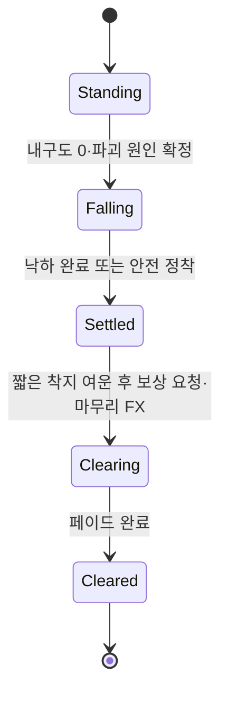

# 나무 낙하 완료·보상·잔해 정리 설계

- 방향 결정: 사용자 지시(2026-11-15) — “파괴 연출 - 부서진 나무가 넘어간다. 이게 끝나면 드랍아이템이 스폰되고 FX 를 뿌리면서 파괴된 나무줄기는 제거”.
- 상위 계약: [반응형 환경 통합](REACTIVE_ENVIRONMENT_INTEGRATION.md), [연출 설계](REACTIVE_ENVIRONMENT_PRESENTATION_DESIGN.md).
- 구현·검증 상태: [나무 파괴 작업 상태](../../../../../docs/work-status/tree-destruction.md#낙하-완료-뒤-드롭fx정리-설계--2026-11-15).
- 판정: 설계 정본. 구현·자동 검사·에셋 적용과 사용자 인수는 위 작업 상태에서 구분한다.

## 1. 플레이 경험과 적용 범위

한 번의 벌목이 **타격으로 파괴 → 나무가 쓰러짐 → 보상이 나옴 → 목재 파편/먼지와 함께 잔해가 사라짐**으로 완결되어야 한다. 쓰러지는 동안 보상이 미리 튀어나오거나, 큰 줄기·수관·밑동이 계속 통로와 화면을 막지 않는다. 통나무를 다시 패는 추가 채집 단계는 만들지 않는다.

기본 정리 대상은 넘어진 줄기·수관·큰 밑동·노출 뿌리·막힘 대체 통나무를 포함한 해당 나무의 전체 잔해다. 완결 후 지면에 남는 게임플레이 대상은 드롭 아이템이다. 파편은 짧은 비충돌 FX로 처리한다. 정적 장식 나무·보호 식생·기존 채집 소유권은 유지한다.

일반 수목5종4,767개의 레시피에 명시적으로 적용한다. 고사목3개의 추가 파괴 연결, 다른 소품·Terrain 식생의 수명 변경, 재성장, 통나무 재가공, 낙목 접촉 피해는 이번 범위에 포함하지 않는다. 런타임에서 맵·액터·오브젝트 이름으로 분기하지 않는다.

## 2. 상태와 완료 조건

여기서 종료는 시각·물리 표현의 종료다. 배치 ID와 파괴/보상 기록은 월드 저장에 남는다.

| 상태 | 플레이어에게 보이는 것 | 판정과 부작용 |
|---|---|---|
| Standing | 기존 나무·타격 반응 | 줄기 입력만 피해 수신. 내구도0에서 원인/방향을 한 번 확정 |
| Falling | 사전 절단 모델이 가속하며 쓰러짐 | 원형 입력/충돌 해제. 안전 궤적 검사 유지. 보상 지급·마무리 FX 금지 |
| Settled | 바닥/장애물에 안전하게 정착한 짧은 여운 | 잔해의 피격·물리 충돌·Nav 장애물 해제. 완료 원인과 위치 확정 |
| Clearing | 보상 출현, 목재 파편·먼지·가벼운 소리, 잔해 소거 | 보상은 멱등 요청. FX는 전이당 한 번. 같은 프레임부터 전체 잔해 페이드 시작 |
| Cleared | 큰 잔해 없음, 아이템만 남음 | 피격·충돌·차폐·Nav·연료/열 전파·반복 시각 갱신 종료. 파괴 기록·보상 재시도 책임 유지 |

### 낙하 완료는 다음 세 경우로 확정한다

1. **정상 완료:** 저작한 낙하 각도/진행 끝에 도달해 낙하 갱신을 마쳤다. 현재 사전 파손·회전 방식이므로 Rigidbody 속도0을 완료 조건으로 추가하지 않는다.
2. **도중 막힘:** 새 장애물 때문에 더 진행할 수 없으면 마지막 안전 포즈에서 정착한 것으로 처리한다. `progress==1`을 기다리며 무한 대기하지 않는다.
3. **처음부터 막힘:** 기존 안전 후보/fallback을 사용해 짧은 목재 붕괴 연출을 끝낸 뒤 Settled로 간다. 거대한 줄기를 플레이어나 건물 안으로 강제로 회전시키지 않는다. 긴 통나무가 갑자기 생겨 계속 남는 방식은 끝낸다.

초기화 이전의 `isFalling=false`를 낙하 완료로 해석하지 않는다. 완료는 명시한 상태 전이로 한 번만 생성하며, 카메라 거리·FX 풀 성공·낮은 LOD가 완료를 결정하지 않는다.

## 3. 보이는 순서와 초안 타이밍

아래 값은 첫 플레이 검증에 사용할 저작 초깃값이다. 확정 체감 수치가 아니며 SO에서 조정한다.

| 구간 | 초깃값 | 의도 |
|---|---|---|
| 정상 낙하 | 기존2.0초·가속2.2 유지 | 무게감이 있는 낙하를 먼저 읽게 함 |
| 처음부터 막힌 짧은 붕괴 |0.35초 | 접촉 위험 없이 벌목의 끝을 전달 |
| 착지 여운 |0.10초 | 착지·부러짐 소리를 읽을 최소 여유 |
| 아이템/정리 FX 시작 | 여운이 끝난 같은 전이 | 보상 요청 후 FX·소거 시작을 연결 |
| 잔해 소거 |0.45초 | 목재 파편/먼지 안에서 자연스럽게 없어짐 |

- 서 있는 나무와 낙하 모델의 절단 위치·외형 연결을 유지한다. 소거를 위해 모델 전체를 작게 줄이거나 땅속으로 밀지 않는다.
- 착지 먼지/낙엽은 Settled 진입 시, 목재 해체 파편/먼지는 Clearing 진입 시 각각 한 번 재생한다. 같은 큰 폭발 FX나 착지음을 두 번 겹치지 않는다.
- 줄기와 밑동 절단 부근에서 해체 파편이 시작되고, 수관은 낙엽으로 흩어지며 줄기·수관·밑동의 페이드가 같은 시간 안에 끝난다. 너무 큰 먼지로 전투 시야를 덮지 않는다.
- 가까운 나무는 짧고 명확한 착지/해체음을 제공한다. 여러 그루가 동시에 완료되어도 기존 거리·풀·음성 수 예산을 지킨다. 소리/FX가 생략돼도 보상과 정리는 진행한다.
- 시간은 게임의 기존 고정 갱신과 일시정지 정책을 따른다. 개체별 Update나 UI용 unscaled 타이머를 추가하지 않는다.

## 4. 보상 확정과 드롭 위치

현재 `WorldStateManager.CommitEnvironmentReward`는 `isBroken`이면 지급할 수 있다. 새 정책에서는 **낙하가 끝나고 Clearing 전이에 도달한 것**을 지급 가능 조건에 추가한다. `rewardCommitted`는 기존 일회 지급 원장을 유지한다.

1. Settled 진입 시 완료 위치와 파괴 원인(직접 타격/화재)을 고정한다. 원인별 기존 보상표를 유지하며 재타격·정리 FX가 원인을 바꾸지 않는다.
2. 착지 여운 후 기존 `IItemService`로 보상을 결정하고 `IGroundDropService`의 같은 `environment:<SceneEntityId>:0` sourceId로 요청한다. ID를 새로 발급하거나 낙하 조각별로 지급하지 않는다.
3. `SpawnItems`의 정상 반환과 드롭 원장의 멱등 규칙에 맞춰 확정한다. 서비스 미준비·실패는 pending으로 남긴다. 보상 없는 화재 표/0개 결과는 정상 완료로 처리한다.
4. 드롭 기준은 움직이는 수관 끝이 아니라 **배치 루트 아래의 고정 절단/보상 앵커와 유효 지면**이다. 기존 GroundDrop의 지면 투영·분산 규칙을 재사용하며, 아이템을 사라질 줄기의 자식으로 만들지 않는다. 플레이어가 가까이에서 찾고 주울 수 있어야 한다.
5. 같은 전이에서 마무리 FX와 시각 소거를 시작한다. 드롭 서비스가 지연돼도 큰 줄기를 화면에 계속 남기지 않는다. 별도 보상 pending 기록이 원래 위치와 sourceId를 유지해 재시도한다. FX나 낙하는 재시도하지 않는다.

`SpawnItems`는 현재 void 계약이다. 논리 완료·pending/확정 기록·드롭 원장의 저장 순서를 함께 검증해야 한다. 새 시각 컴포넌트에서 독자적으로 보상표를 굴리거나 서비스를 직접 호출하지 않는다.

## 5. 충돌·환경 반응·정리 경계

기존 “게임플레이 잔해에 TTL을 붙이지 않는다”는 영속 잔해 정책은 다른 소품에 유지한다. 일반 벌목에는 명시적 **낙하 완료 후 정리 정책**을 추가한다. 임의 시간에 루트를 Destroy하는 방식으로 구현하지 않는다.

- Falling 동안 기존 안전 검사와 KCC 보호를 유지한다. 기존처럼 플레이어를 Collider로 밀거나 임의의 낙목 피해를 주지 않는다.
- Settled부터 잔해의 타격 허용·Collider·차폐·NavMeshObstacle을 같은 권위 전이에서 끈다. 소거 중인 투명 줄기가 통행이나 보상 수거를 막지 않는다. Nav carving 반영 지연은 실제 플레이에서 확인한다.
- Clearing 진입 시 해당 나무의 연료 소비·열/화염·불 전파·비/물 입력·추가 피해 수신을 종료하고 대기 입력을 정리한다. 보이지 않는 나무가 계속 불을 옮기거나 불 소리를 내지 않는다. 외부의 독립 화염/장판 엔티티는 제거하지 않는다.
- 보상표는 전이 전에 확정한 파괴 원인을 사용한다. 연료 정리로 화재 보상을 타격 보상으로 바꾸지 않는다. 떨어질 때까지의 화재 반응은 유지한다.
- Cleared에서는 모든 시각 LOD·impostor·fallback·밑동·수관을 비활성화하고 바인더/공유 GPU 표현/효과 lease를 반환한다. 잔여 입자는 기존 풀에서 끝나도록 반환하며 새 보상/타격 Collider가 없다.
- 루트/기록은 동일한 SceneEntityId를 유지한다. 보상 pending이 있는 동안 논리 호스트를 먼저 비활성화해 재시도 경로를 잃지 않는다. 단말 상태는 화학·강수·공간 전파·매 프레임 표현 순회에서 제외하고 필요한 보상 재시도만 기존 중앙 작성자가 담당한다.

## 6. 저장·로드·지역 왕복

`EnvironmentDestructionSaveState`의 기존 진행/방향/fallback 포즈와 `ReactiveEnvironmentSaveEntry.rewardCommitted`를 재사용한다. 추가할 권위 데이터는 **완료 정책의 버전, 수명 단계, 단계 경과 시간, 정착 사유**다. 보상 기준 위치가 루트에서 달라질 수 있으면 고정한 위치도 저장한다. 표현 객체의 활성 여부를 저장의 원본으로 삼지 않는다.

| 복원 시점 | 복원 규칙 |
|---|---|
| Falling | 저장한 방향·포즈·진행부터 이어서 완료. 파괴 시작과 이전 burst 재생 금지 |
| Settled | 충돌 해제 상태와 여운 잔여 시간 복원. 이후 드롭은 미확정일 때만 한 번 요청 |
| Clearing | 소거 진행을 복원하고 지나간 FX/소리는 재생하지 않음. 보상 pending은 같은 sourceId로 재시도 |
| Cleared | 모든 잔해를 바로 숨김. 낙하/착지/소거 FX 재생 금지. 기존 드롭 아이템은 드롭 원장이 복원 |
| 지역 언로드 | 기존 SuspendDomain 정책으로 단계 잔여 시간을 보존. 언로드 시간을 임의로 가속해 보상/FX를 몰아서 재생하지 않음 |

### 기존 저장 이관

- 새 하위 버전의 **누락과 명시 값**을 구분해 읽는다. 기존 저장을 잘못된 새 상태로 취급하거나, 누락 필드를 새 버전 기본값으로 조용히 승격하지 않는다.
- 아직 서 있는 구버전 나무는 Standing이다. 구버전에서 실제 낙하 중인 나무는 기존 포즈로 Falling을 이어간다. 이미 지급된 보상은 다시 생성하지 않는다.
- 구버전의 이미 파괴·정착한 나무는 Cleared로 이관한다. 지역 진입 시 거대한 옛 잔해나 정리 FX를 한꺼번에 만들지 않는다. 지급이 미확정인 레코드만 기존 보상 원장으로 인계한다.
- 영속 잔해 정책의 다른 소품, 보호 대상, 다른 정의/저장 버전은 이 이관 대상이 아니다. 잘못된 enum·음수/NaN 시간·불가능한 상태 조합은 기존 데이터 보존 검증으로 거부한다.

## 7. 데이터와 구현 경계

| 위치 | 설계할 변경 |
|---|---|
| `EnvironmentDestructionRecipeSO` | `PersistentRemnant`/`ClearAfterSettlement` 완료 정책, 착지 여운·막힘 붕괴·소거 시간. 기존 에셋 기본은 영속 정책 |
| `EnvironmentPresentationProfileSO` | 마무리 목재 파편/먼지 FX·소리 및 기존 풀/거리 예산 연결 |
| `ReactiveEnvironmentObject` | 고정 보상 앵커, 전체 잔해/LOD 바인딩과 수명 표현. 게임플레이 상태와 보상은 작성하지 않음 |
| `ReactiveEnvironmentDestruction` | 기존 안전 낙하·정착 사유를 노출하고 수명 단계에 맞춰 포즈/소거/충돌 적용 |
| `WorldStateManager.Environment` | 수명 전이·보상 가능 시점·pending 재시도·단말 환경 참여 종료·저장/이관의 단일 작성자 |
| 표면 바인더·프로젝트 파생 셰이더 | 연료/그을림과 독립된 소거량. 모든 LOD와 그림자/깊이 패스의 일관된 dither/fade |
| 일반 수목5종의 SO/잔해/저작 도구 | 명시 정책과 시간·FX·앵커 적용. 구매 원본·배치 GUID·보호 식생 보존 |

현재의 `isFalling`과 새 수명 단계가 서로 다른 상태를 작성하지 않게 한다. 기존 필드는 포즈/호환 데이터로 정리하고 전이는 한 경로에서만 결정한다. `HasPendingFixedTick`은 낙하가 끝난 뒤의 Settled/Clearing도 깨워야 한다. 화학 revision이 안 바뀌었다는 이유로 수명 표현 갱신을 건너뛰지 않는다. Cleared 뒤에는 반복 고정 갱신을 종료한다.

소거는 `_FuelCoverage`나 연료0으로 대신하지 않는다. 나무껍질·잎의 다른 셰이더/슬롯 순서를 보존하고 같은 수명 소거량을 별도로 공급한다. 기존 공유 GPU 표현 구조를 사용하며 개체별 재질 복제·새 매니저·새 asmdef·Actor/Stage 이름 분기를 추가하지 않는다.

## 8. 구현 순서와 완료 조건

1. 완료 정책·저장 단계/이관과 보상 지연을 먼저 구현하고 독립 검사한다. 기존 영속 소품의 즉시 보상 경로를 회귀 검사한다.
2. 안전 낙하 완료/도중 막힘/fallback을 수명 전이에 연결하고, 충돌·열 전파·Nav 종료를 검사한다.
3. 전체 잔해 소거·FX·드롭 앵커를 저작한다. 정상 착지와 협소 공간을 Unity 화면에서 비교한다.
4. 일반 수목5종에 적용한 뒤 사용자 직접 플레이로 순서·무게감·시야·수거 동선을 인수한다. 다른 MCP의 Unity 점유 중에는 씬/에셋 쓰기·컴파일·테스트를 기다린다.

| 검사 | 통과 조건 |
|---|---|
| 정상 낙하 | 완료 전 드롭0, 완료 후 한 번 지급·FX·소거, 큰 줄기/밑동이 남지 않음 |
| 도중 막힘/처음 막힘 | 안전 정착 뒤 같은 마무리. 벽/플레이어 관통·무한 Falling·보상 누락 없음 |
| 재타격/다중 타격 | 낙하·정리·정리 완료 중 보상/FX 재실행과 이웃 나무 오탐 없음 |
| 드롭 서비스 지연/예외 | 정리는 끝나며 보상은 pending 보존. 서비스 복귀 후 같은 sourceId로 한 번 생성 |
| 단계별 저장·로드·지역 왕복 | 포즈/경과 복원, 보상 중복0, 과거 낙하/FX 폭발적 재생0 |
| 구버전 저장 | 서 있는 나무·낙하 중·이미 지급된 잔해·미지급 잔해를 구분해 기존 보상/진행 보존 |
| 불/물·강수 | 완료 전 반응 유지, 소거 뒤 보이지 않는 발화/전파/날씨 비용 없음. 원인별 보상 유지 |
| 표현·접촉·성능 | 모든 LOD/그림자 소거, 수거 가능·KCC/Nav 통로 복구, 다중 벌목의 시야/음향/CPU/GPU 예산 인수 |

자동 검사와 실제 입력/미술·청감 인수를 구분한다. 테스트 슬롯과 열린 Editor를 사용하며 사용자 지시 없이 Player/Addressables 빌드나 커밋을 하지 않는다.
