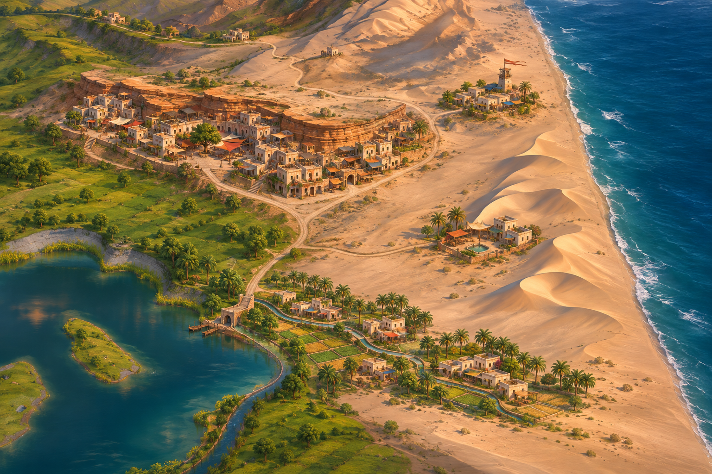

# River Basin 4KM 동부 사막 정착지 확장 설계

사용자 표시 지도에 맞춰 기존 우물 교역소를 절벽 마을로 확장하고, 호숫가·해안·사구의 거점을 기존 길과 연결한다. Unity 부지 실측, 블록아웃과 검증 범위는 프리뷰 작업 상태에 기록한다. [사용자 표시 지도](river_basin_desert_settlement_assets/user-marked-map.png) · [확장 전 교역소](river_basin_desert_settlement_assets/existing-market.png) · [프리뷰 작업 상태](../../../../../docs/work-status/river-basin-world.md#동부-사막-정착지-확장-설계)

## 경험과 규모

호숫가에 처음 들어서면 물길과 농경촌이 보인다. 사면을 오르면 절벽 마을의 지붕과 천막 지붕 사이로 시장 입구가 드러난다. 마을을 지난 뒤에는 기존 큰길을 따라 망루로 향하거나, 바위 뒤로 갈라지는 샛길에서 사구 쉼터를 발견한다. 중심 마을에서 물자와 도보 교통이 모이고, 농경촌에서 물과 작물이, 해안과 사구에서 외부 소식과 통행객이 들어오는 관계를 배치로 보여 준다.

현재 우물 교역소는 확장되는 마을의 시장 핵으로 활용한다. 규모감은 사람 크기의 건축을 유지하면서 주거 구역 세 덩어리, 시장 광장, 옹벽과 골목이 차지하는 가로 길이와 깊이로 만든다. 아래 치수와 동수는 블록아웃 시작값이다. 거주동과 작업동을 합한 수량이며, 사면과 개별 마당이 확보되는 범위에서 조정한다.

| 사용자 표시 기준 | 제안 규모 | 부지와 공간의 역할 |
|---|---:|---|
| 위쪽 사선에서 현재 교역소로 이어지는 띠 | 건축 띠 160–230m, 26–38동 | **절벽 교역 마을.** 화면 왼쪽 주거 단, 중앙 우물 시장, 오른쪽 도로 진입·하역 구역을 절벽 등고선을 따라 연결한다. 기존 시장 주변을 먼저 확장한다. |
| 아래쪽 사선의 호수·초지·모래 경계 | 취락 축 140–220m, 14–20동 | **호숫가 관개 농경촌.** 기존 R4 포구를 기점으로 완경사에 거주와 창고를 2–3곳 묶는다. 취수점과 수로가 이어지는 낮은 쪽에 밭을 두고, 수위보다 낮거나 급한 호안은 비운다. |
| 오른쪽 위 원 | 거점 폭 55–85m, 7–10동 | **해안 망루 마을.** R5 망루와 외해 전망 마당 사이의 안전한 안쪽 단에 경비 주거·작업장·그늘 마당을 묶는다. 망루를 다음 목적지로 먼저 읽을 수 있도록 건물 높이를 낮게 둔다. |
| 오른쪽 아래 원 | 쉼터 폭 30–55m, 4–6동 | **사구 발치 쉼터.** 원 안의 사구 서쪽 발치나 맞닿는 완경사에 우물 또는 저수조를 중심으로 숙영·창고를 둔다. 주요 사구 마루와 급사면은 모래 지형으로 유지한다. |

시안은 네 거점의 상대 크기, 식생 밀도와 빈 공간을 전달한다. 월드 좌표, 필지 경계, 수면 높이는 저장 씬에서 측정한다. 시안 왼쪽 상단의 원경 건축은 이번 확장의 배경이며, 구현 범위는 사용자가 표시한 네 구역이다.

## 부지와 생활 동선

- **절벽 단.** 기존 사암 사면을 첫 기준으로 삼는다. 등고선에 평행한 짧은 주거 줄과 층마다 필요한 길을 먼저 놓는다. 긴 석벽은 자연 암반이 드러나는 곳과 계단으로 끊고, 각 동의 기단은 지면·옹벽에 맞춘다. 직사각형 단 하나에 건물을 전부 올려 두는 구성을 피한다.
- **시장.** 큰길 진입에서 천막 또는 우물이 먼저 보이게 한다. 광장 양옆으로 주거·창고·제작 마당을 두고, 위쪽 주거 골목을 통해 아래 광장으로 돌아오는 순환을 만든다. 광장 중앙과 입구는 NPC와 TPS 카메라가 교차할 폭을 확보한다.
- **농경촌.** 수면보다 높은 관개장은 취수 높이부터 검증한다. 경사가 맞으면 높은 쪽 저수조에서 밭으로 물을 보낸다. 호수에서 직접 끌어올릴 경우 양수 시설과 저수조를 한눈에 연결한다. 담·배수로는 밭과 집의 경계를 설명하고, 야자수는 우물과 물길 근처에 모은다.
- **해안과 사구.** 망루에서 전망 마당까지 기존 경로를 우선 쓴다. 마을 안 길은 전망 지점과 작업장으로 갈라졌다가 돌아오게 한다. 사구 쉼터는 긴 바람맞이 사면을 피해 바위나 모래턱의 그늘에 두고, 본선에서 낮은 표식 하나와 야자수 군락으로 진입점을 알린다.
- **건축·식생.** 기존 모듈과 작물·소품을 먼저 검토한다. 밀집 주거 줄은 층수, 처마 깊이, 계단 방향, 작은 마당과 벽의 높이를 달리한다. 절벽과 옹벽은 서로 다른 층리와 줄눈으로 읽히게 하고 색이 강한 천은 시장과 큰길 입구에 집중한다.

## 사구 너머의 옛 취수장

시장 동쪽 하역 마당에서 모래 평원으로 나오면 붉은 사암 층과 옛 취수탑이 방향을 잡아 준다. 수메르 사막에서 넓은 모래 벌판과 암반, 매몰 유적을 번갈아 보여 주는 구성을 참고했다. 이 지역의 시설은 RiverBasin 정착지에 물을 대던 취수장으로 설계한다. 높이가 다른 바람탑 두 개와 가운데 그늘진 통로가 랜드마크의 실루엣을 만든다. [HoYoverse 수메르 지역 소개](https://genshin.hoyoverse.com/en/map) · [사막 공개 자료](https://genshin.hoyoverse.com/en/news/detail/104379)

| 구간 | 플레이어가 보는 것과 할 수 있는 것 |
|---|---|
| 하역 마당 → 붉은 사암골 | 도시의 포장과 천막이 끝나고 밝은 모래와 낮은 돌 표식이 나타난다. 암층 사이로 탑의 상부를 보며 남쪽으로 간다. |
| 사암골 → 사구 발치 | 암반을 따라 내려가는 길은 탑으로 향한다. 옆길은 사구 아래를 돌아 다른 각도에서 같은 취수장에 닿는다. 두 길 모두 일반 도보로 이어진다. |
| 옛 취수장 | 앞마당과 작은 물받이에서 물을 모으던 방식을 읽을 수 있다. 그늘진 중앙 통로로 반대편을 빠져나와 건물 바깥을 돌아갈 수 있다. |

모래 사구의 밝고 부드러운 마루와 사암 단애의 단단한 층리 사이에 높이와 형태 차이를 둔다. 동쪽 단애는 해안 쪽 사구 배후에서 취수장 뒤로 굽어 들어가고, 시장 쪽의 낮은 암벽은 길의 시작부만 가린다. 암벽 아래에 기존 EastLands 바위와 사암 재질 변형을 써서 커다란 낙석과 작은 박리가 섞이는 군락을 만든다. 취수장 옆의 붕괴한 제방은 건축과 단애 발치 사이를 잇는다. 물가에는 사막 야자를 두고, 취수장의 적갈색 층리와 청록 산화 금속을 이어 쓴다. 기존 모래 발자국과 주요 도로의 경계를 보존한다. [작업 상태](../../../../../docs/work-status/river-basin-desert-waterworks.md)

## Unity 인계

기준 씬은 `Assets/WorldBuilder/Worlds/6effd90b68ea4b3d8f8caa5197fcfe34/Preview/RiverBasin4km.unity`다. 기존 `RiverBasin · 사막 물길과 해안 전망대` 아래의 우물 교역소·호숫가·해안 루트부터 확인한다. 우물 교역소 부지 중심 X3632/Z1512와 R5 망루 X3911/Z1796을 기존 앵커로 사용한다. 원의 경계나 사선 끝점은 Unity 조감과 현재 Terrain을 대조한 뒤 기록한다. [기준 씬](../../../../WorldBuilder/Worlds/6effd90b68ea4b3d8f8caa5197fcfe34/Preview/RiverBasin4km.unity) · [이전 교역소 재구성 기록](../../../../../docs/work-status/river-basin-world.md#동부-사막-우물-교역소-재구성)

1. **부지 실측.** 표시 지도에 대응하는 후보 경계, R4/R5 및 샛길 좌표, 경사·수위·절벽 후퇴 거리를 기록한다. 기존 저장 변경, 지형 도색·타일 경계, 발자국 재질 및 배치 오브젝트를 대조한다.
2. **중심 마을 블록아웃.** 현재 교역소를 포함해 왼쪽 주거 단·중앙 시장·오른쪽 하역부의 폭을 먼저 잡는다. 양방향 입구, 계단과 같은 높이를 잇는 우회로, 시장 복귀 경로를 확인한다. 같은 조감과 TPS 눈높이에서 기존 소규모 배치와 차이를 비교한다.
3. **다른 세 거점 연결.** 농경촌 수로 단면과 R4 접속, R5 망루 및 전망 마당 접속, 사구 쉼터의 우회·복귀를 잡는다. 네 구역 사이의 거리와 빈 공간은 실제 걷기와 달리기 기준으로 조정한다.
4. **아트와 인수.** 기존 프리팹을 먼저 선별해 쓰고, 키트 변형이 필요한 건축과 자연 암반을 저작한다. 카메라 가림 이름 규칙, 지붕·계단 충돌, 보행과 NavMesh, 지형 이음과 도색, 기존 R4/R5 경로를 검사한다. 독립 아트 검수에는 사용자 지도와 같은 조감, 시장 진입과 역방향, 농경촌 수로, 망루 접근, 사구 쉼터의 TPS 시점을 함께 제공한다. 기술 검사와 미술 판정은 각각 기록한다. [오픈월드 맵 저작](../../../guide/OPENWORLD_MAP_AUTHORING_GUIDE.md) · [카메라 가림](../../../guide/CAMERA_OCCLUSION_FADE_GUIDE.md) · [테스트 지침](../../../guide/TEST_VALIDATION_GUIDE.md)

### 인수 기준

| 검사 | 합격 기준 |
|---|---|
| 전체 조감 | 중심 마을이 사선 띠를 따라 가장 크게 읽힌다. 네 거점은 지형과 물을 매개로 이어지며, 호수·해안·사구의 형태를 식별할 수 있다. |
| 시장 TPS 진입 | 어느 쪽에서 들어와도 우물 또는 천막으로 시장을 찾고, 주거 단의 입구와 복귀 길을 이해할 수 있다. |
| 물과 주거 | 수로가 취수·저수에서 밭까지 이어지며, 주택 기단과 담 아래에 틈이나 뜬 판이 보이지 않는다. |
| 외해와 사구 | 망루와 사구 쉼터가 각각 접근 가능한 목적지로 읽힌다. 사구 마루와 미끄럼 사면의 실루엣이 살아 있다. |
| 기술 | 기존 길과 물 경계를 보존하고 새 길의 충돌·카메라·NavMesh 및 타일 경계를 현행 씬에서 다시 확인한다. |

다음 세션 요청문 예시

> `RIVER_BASIN_DESERT_SETTLEMENT_EXPANSION_DESIGN.md`와 사용자 표시 지도를 기준으로 RiverBasin4km 사막 정착지를 확장해. 먼저 네 구역의 실제 좌표·경사·수위를 확인하고, 기존 우물 교역소 중심 마을의 세 구역을 블록아웃한 뒤 같은 조감과 TPS 화면으로 확인해. 나머지 거점을 연결하고 아트 작업과 독립 검수까지 이어서 진행해.

ImageGen 생성 프롬프트

기본 내장 ImageGen에 사용자 표시 지도 한 장을 지형 구성 참조로 입력했다.

Create ONE landscape 3:2 aerial environment concept painting for the original River Basin 4KM open-world game, a master layout for EXPANDING a coherent desert settlement network across the annotated areas in the attached Unity map. Use the image as a geographic composition guide: oblique high bird's-eye view, inland green basin and deep-blue lake at lower left, existing ochre escarpment curving through the middle, existing sinuous trunk track from lakeside foreground past the tiny central trading site into the upper hills, ocean always on right, north hills upper left. Retain the lake shape, coastal edge, overall landmass and relative locations of the original map. Remove the red markings, editor grid, and all UI. Design new rendering, not a screenshot repaint with labels. 
The upper diagonal marked band across the middle-left to central current site is the MAIN generously scaled desert market town, extending substantially along the contour (clearly 26-38 modest human-scale roof masses, 3 distinct dense neighborhoods linked by real narrow alleys and a prominent shaded square, terraced homes anchored into a continuous stratified ochre rock shelf, retaining walls with staircase landings). Existing center site forms one seam in this larger town, not an isolated set. Preserve an open trunk route alongside it, with short bends/spurs into town. The LOWER diagonal marked transition between the lake on left and desert on right is a second plainly visible broad linear garden settlement, 14-20 modest roofs in multiple groups, canal branching from a credible collection point just upslope of lake, small farm plots and date groves around feeder canals and gentle foothills, a little landing near the lake where slope allows. Keep it southeast of inland lake, never in water or on cliff face. The UPPER RIGHT circled ridge is a smaller but unmistakable coastal hamlet, 7-10 buildings huddled under a signal tower just inland of the cliff, no buildings on ocean or precarious ledges. The LOWER RIGHT circled dune zone has a modest caravan watering courtyard and 4-6 roofs tucked at the sheltered western foot of the dunes, reachable by a narrow spur; retain visible crescent dune crests and their open sandy slope. Those four neighborhoods are part of one trade and water system, with long open breathing spaces and readable local footpaths, village silhouettes at different elevations, and concentrated greenery around wells and irrigation. Keep the frame wide enough that all four groups, the lake and the ocean are clearly visible in the same shot. 
Art direction: professional hand-painted stylized 3D environment keyframe with credible terrain geometry, grounded stone and pale lime plaster, varied rooflines and intimate shadowed alleys, fabric colors used as navigation accents, visible warmth versus blue seawater. Soft late-afternoon sunlight with readable shadows. Original architecture and land forms. Make the settlements substantial at map scale without colossal landmarks, cloned grid rows, isolated rock cones, smooth floating plinths, or dense buildings scattered across every inch. No letters, numbers, symbols, map labels, compass, HUD, borders, inset panels or people close to camera.

