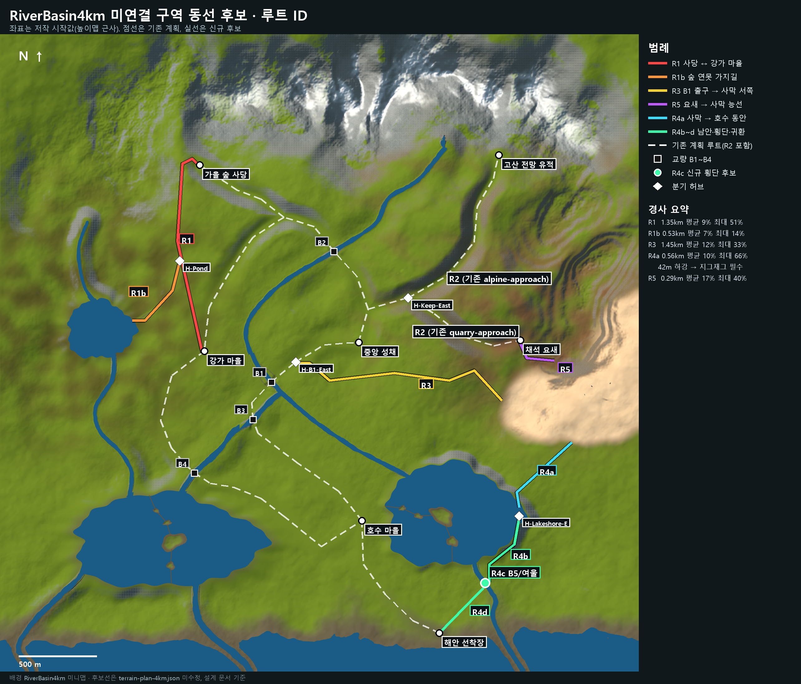

# 강 유역 미연결 구역 동선 설계

[강 유역 월드 재설계](RIVER_BASIN_WORLD_REBUILD_DESIGN.md) · [모래 분지 설계](RIVER_BASIN_SAND_FOOTPRINTS_DESIGN.md) · [오픈월드 맵 가이드](../../../guide/OPENWORLD_MAP_AUTHORING_GUIDE.md) · [휴식지점 설계](../../ui-player/PARTY_HEAL_REST_POINT_SYSTEM_DESIGN.md) · [작업 상태](../../../../../docs/work-status/river-basin-world.md#4km-미연결-구역-동선-설계)

> **상태: G2 블록아웃 반영(2026-11-22). 실제 입력·가독성은 사용자 테스트 대기.** 3절의 후보 좌표와 치수는 저작 시작값이다. `[X, Z, Y]` 순서, m 단위. 실제 씬에 저장한 중심선과 결정은 [8절](#8-구현-결정과-저작-원본)을 참조한다.

루트 ID 지도는 초기 후보와 기존 계획을 비교한 자료다. [초기 블록아웃 지도](../../../../../docs/work-status/river-basin-offroute-evidence/river-basin-offroute-blockout-map.png)는 육상 동선과 철거 전 B5 위치를 표시한다. [최신 미니맵](../../../../10.Datas/Map/RiverBasin4km/Minimap.png)에는 현재 호안과 수면이 반영돼 있다.

## 1. 배경과 범위

사용자 제보 지도(제작 구간 지도 위에 빨간 선으로 표시)는 거점은 있으나 이어지는 길이 없는 구역 다섯 곳을 가리킨다. 지도 픽셀을 거점 앵커 4개(성채·강가 마을·채석 요새·사당)로 월드 좌표에 맞춰 환산했다. 환산값은 근사이며 선의 위치를 확정값으로 쓰지 않는다.

| ID | 구간 | 기존 계획과의 관계 |
|---|---|---|
| **R1** | 가을 숲 사당 → 강가 마을 (+ **R1b** 숲 연못 가지길) | 계획에는 `keep-to-pass`(성채→사당)만 있다. 사당에서 서쪽 숲을 지나 강가 마을로 곧장 내려오는 길은 **신규** |
| **R2** | 성채 → 채석 요새 | 기존 `alpine-approach` 앞부분 + `quarry-approach`와 겹친다. **새 ID를 만들지 않고 기존 ID를 쓴다** (미니맵에 아직 그려지지 않았을 뿐) |
| **R3** | B1 출구 → 동부 사막 서쪽 | **신규** 저지대 길 |
| **R4** | 동부 사막 남쪽 → 동쪽 호수 → 호수 마을 | **신규**. 아래 4절의 막다른 길 문제를 함께 해결 |
| **R5** | 채석 요새 정문 → 사막 능선 | 기존 사막 설계의 "요새 정문을 거쳐 분지를 조망하는 능선길". 연결 좌표만 신규 |

북부 폭포 상류는 지도에 빨간 선이 없지만 동선이 본류 수영뿐이다. 폭포 전망 가지길은 기존 설계(고산 접근로에서 갈라지는 가지길)대로 두고 이 문서에서는 다루지 않는다.

## 2. 설계 원칙 (상용 수준 기준)

1. **길마다 목적이 다르다.** 모든 연결을 같은 도로로 만들지 않는다. 본선(안전·빠름)·탐험로(느리고 발견이 많음)·지름길(해금형)을 구분한다.
2. **양방향으로 읽힌다.** 각 길은 출발·도착 어느 쪽에서도 첫 조망, 중간 차폐, 재노출이 있다.
3. **분기점은 허브다.** 두 길 이상이 만나는 곳은 갈림길 표지·휴식 가능 지점·조망을 한 곳에 묶는다.
4. **이동 방식이 지형에 맞아야 한다.** 육상 구간은 걸어서 왕복한다. R4 남안은 양쪽 호안이 읽히는 수영 횡단으로 두고, 비행으로도 건널 수 있게 수면을 열어 둔다.
5. **막다른 길 금지.** 끝에는 풍경·서사·자원·지름길 중 하나가 있고 귀환 길이 읽힌다.
6. **기존 결정을 덮어쓰지 않는다.** 사막은 "요새가 서쪽 관문"이라는 기존 설계가 있다. 3절 R3·R5가 이를 어떻게 보존하는지 명시한다.

## 3. 구간별 설계

### 3.1 지형 실측 방법과 한계

저장 높이맵(`RiverBasin_4097_Joined_R16LE_SouthFirst.raw`)을 읽어 후보선을 찾았다. 16m 격자에서 경사 비용이 낮은 선을 탐색하고 수계 폴리라인·호수 타원을 회피했다. 거점 5곳의 높이는 계획값과 일치했다(호수 마을 36, 성채 89, 강가 마을 59, 사당 146, 요새 143).

- **한계.** 이 RAW는 B1 높이 패치와 북부 폭포 Sculpt보다 **이전** 상태다. 해당 주변(B1 X 1740 / Z 1860, 폭포 X 2844 / Z 3418)은 별도 실측이 필요하다. 열린 Editor로 Terrain을 직접 샘플링하는 것이 확정 측정이며 이번에는 Unity MCP 연결이 끊겨 수행하지 못했다.
- 경사는 10m 표본의 **평균·p90·최대**를 같이 적는다. 기존 설계의 접근 경사 기준은 8~12%다. 최대값이 높은 곳은 지그재그·계단·절개로 푼다.

| 후보 | 길이 | 평균/p90/최대 경사 | 고도 Y | 판단 |
|---|---|---|---|---|
| R1 사당→강가 마을 | 약 1.35km | 9% / 21% / 51% | 146→59 | 평균 양호. 최대 구간 지그재그 필요 |
| R1b 연못 동안 | 약 0.53km | 7% / 12% / 14% | 78→91 | 평탄. 그대로 가능 |
| R3 B1 출구→사막 서쪽 | 약 1.45~1.47km | 10~12% / 19~23% / 29~33% | 60→130 | 사막 직전 오르막이 지배 |
| R4 사막 남쪽→호수 동안 | 약 0.56km | 10% / 29% / 66% | 62→20 | **짧은 거리에 42m 하강. 지그재그·협곡 우회 필수** |
| R5 요새→능선 | 약 0.29km | 17% / 29% / 40% | 143→191 | 오르막. 계단형 암반길 |

### 3.2 R1 · 사당 ↔ 강가 마을 (가을 숲 길)

**Region Intent.** 주 감정: 숲에 스며드는 고요함과 하강의 안도. 발견: 연못 가지길, 낙엽 속 옛 이정표, 숲 아래에서 올려다보는 사당 능선. 행동: 탐색·선택·가벼운 조우.

- **후보선 [X, Z, Y]:** `[[1280,3248,146],[1232,3296,138],[1168,3264,113],[1136,2768,71],[1296,2048,59]]` 시작값. 사당에서 일단 북서로 돌아 능선을 타고 내려간 뒤 서부 순환로(`lake-loop`)의 강가 마을 접근부(1310, 2060)에 합류한다.
- 기존 `keep-to-pass`+`lake-loop`로 사당→마을을 가면 약 2.4km 우회다. R1은 약 1.35km의 **내리막 지름길**이다. 반대로 올라갈 때는 길고 가파르므로 "사당은 순환로 바깥의 도전·조망 보상"이라는 의도를 유지한다.
- **비트(마을에서 올라갈 때).** B0 강가 마을 출구에서 수관 터널 → B1 낙엽 쌓인 S자 굽이(차폐: 사당이 사라진다) → B2 연못 갈림길(R1b, 허브) → B3 수관이 열리는 능선 첫 조망(사당 실루엣 재노출) → B4 사당 앞 공터(원경에 호수·성채).
- 내려갈 때는 사당 앞에서 호수 방향 조망으로 시작해, 숲 입구에서 강가 마을 지붕이 보여 귀환 방향을 복구한다.
- **R1b 연못 가지길.** 허브(≈1152, 2640)에서 동안 `[[1152,2640,78],[1104,2448,82],[928,2256,99],[848,2256,91]]`. 평탄해서 전투 아닌 휴식·관찰 구간으로 쓴다. 끝은 연못 입수·상륙부와 맞은편이 보이는 열린 창이다(숲 식생 설계 준수). 막다른 길이므로 연못가에 **보상(휴식 가능 지점 또는 자원·서사 소품)**을 둔다.
- 수계 교차: 후보선은 `forest-spring`·`forest-creek` 폴리라인을 피하도록 탐색했다. 실제 교차가 있으면 징검돌·얕은 여울(수영 불필요)로 둔다.

### 3.3 R2 · 성채 ↔ 채석 요새 (기존 ID 연장)

기존 `alpine-approach`(2360,2330 시작)와 `quarry-approach`(2616,2402→3336,2130)를 그대로 쓴다. 이 문서에서 하는 일은 **성채 정문에서 첫 분기(2616,2402)까지 연결**을 도로 소켓으로 확정하고, 요새 앞에서 R3·R5가 합류하는 규칙을 정하는 것이다.

- 분기 허브 H-Keep-East(≈2616, 2402, Y 102): 북동 고산(`alpine-approach`)과 동쪽 요새(`quarry-approach`)가 갈라진다. 갈림길마다 보이는 것이 달라야 한다 — 북쪽은 설산과 폭포 방향의 물소리·안개, 동쪽은 마른 풀과 사암 절개면.
- 요새 접근로 X 2972 / Z 2152 부근부터 지면이 건조해지는 기존 설계를 따른다.

### 3.4 R3 · B1 출구 ↔ 사막 서쪽 (저지대 길)

**충돌 해결.** 기존 사막 설계는 요새를 서쪽 관문으로 하고 절개부를 돌면 분지가 드러난다. R3는 요새를 우회하므로 아래처럼 역할을 나눈다.

| 길 | 성격 | 사막 첫인상 |
|---|---|---|
| 요새 경유(R2→R5) | 본선. 정문을 통과하는 **높은 곳에서의 공개** | 능선에서 분지 전체를 내려다보는 한 장면 |
| R3 저지대 | 탐험로. 요새를 거치지 않는 **낮은 곳에서의 진입** | 마른 수로를 따라 들어가 올려다보는 사암 단구, 분지 바닥에서 요새 실루엣 |

두 길은 서로 다른 첫인상을 만들고 같은 지점에서 합쳐진다. R3 후반(≈3216, 1744, Y 130)의 마른 수로 굽이에서 암반 아치(가까운 소목표)를 지나, 요새 아래 사면의 계단길(R5)에 **합류**한다. 요새는 여전히 사막의 서쪽 관문이고, R3로 간 플레이어는 요새를 **올려다보며 접근**하는 경험을 한다.

- **후보선 [X, Z, Y]:** `[[1888,1984,60],[1984,1984,58],[2112,1872,70],[2528,1920,49],[2880,1872,48],[3040,1936,78],[3216,1744,130]]` (약 1.45km, 평균 12%). 대안 직선형 `[[1888,1984,60],[2224,1712,50],[2848,1664,71],[3056,1808,105],[3216,1744,130]]`(약 1.47km)도 있다. 북쪽 대안이 B1 출구에서 성채 아래 평원을 지나므로 먼저 검토한다.
- **이동 시간 가설.** 약 1.45km를 걷기 속도로 측정해 이동 구간별 시간을 기록한다(수치는 측정 전 미정).
- **리듬.** 초반 평원은 의도적으로 조용한 조망 구간(전투 직후 이완). 중반 마른 수로 입구에서 건조 식생이 시작되는 **첫 단서**, 후반 오르막에서 모래 색이 드러나는 **재노출**.
- 지나는 relief 언덕(3300, 1750)과 사막 서쪽 경계는 사막 설계의 보호 영역을 침범하지 않게 한다.
- 이 길은 B1 출구(1896, 1990)의 `lake-loop`에서 갈라진다. 분기 허브 H-B1-East를 만든다. 성채가 보이는 방향과 동쪽 길이 읽히게 해야 한다.

### 3.5 R5 · 요새 정문 → 사막 능선

- **후보선 [X, Z, Y]:** `[[3328,2128,143],[3376,2016,157],[3552,2000,191]]` (약 290m, 평균 17%, 최대 40%). 능선길은 기존 설계의 "분지를 조망하는 길"이므로 오르막을 보상으로 쓴다. 가파른 구간은 암반 계단으로 풀고 카메라 후퇴 여유를 확인한다.
- 능선 끝에서 모래 분지 전경과 R4 방향의 호수 쪽 하강이 함께 보이게 한다.

### 3.6 R4 · 사막 ↔ 동쪽 호수 ↔ 호수 마을 (순환 닫기)

**문제.** 호수 마을은 호수 **서안**(2320, 970)에 있다. R4를 동안(≈3328, 1056)에서 끝내면 돌아올 길이 없다. 북안은 본류 하구(2720, 1196)를, 남안은 유출 하천(3020, 800 이남)을 건너야 한다. 그래서 R4를 “사막 → 동안 → 남안 → 유출 하천 횡단 → `coast` → 호수 마을” 순환의 일부로 설계한다.

- **R4a 사막 남쪽 → 동안:** `[[3664,1472,62],[3312,1152,40],[3328,1056,20]]` (약 0.56km, 하강 42m, 최대 66%). 가장 가파른 구간이므로 직선으로 두지 않는다. 사막 가장자리에서 호수 동안까지 지그재그(약 8~12%)로 잡으면 실제 길이는 대략 2배 이상이 될 수 있다. 협곡을 하나 골라 절개길로 쓰는 안도 검토한다. 호수가 점차 드러나는 하강 전망이 이 구간의 보상이다.
- **R4b 동안 → 남안:** `[[3328,992,14],[3296,816,39],[3136,688,38],[3136,576,24]]` (약 0.48km, 최대 31%). 도중 한 번 능선을 넘는다.
- **R4c 유출 하천 수영 횡단.** X 3140→3088 / Z 564에 양쪽 입수·상륙면을 둔다. 강물 쪽으로 내려가는 중앙을 비워 두고, 바위와 갈대로 양쪽 진입부를 읽게 한다. 수영 또는 비행으로 건넌 뒤 `coast`를 따라 호수 마을로 돌아간다.
- **R4d 남안 → 호수 마을:** 기존 `coast`(2320,970 → 2816,248)를 연장해 호수 마을과 해안 선착장에 잇는다. 북안 대안은 하구 횡단이 추가로 필요해 후순위다.
- **Region Intent.** 감정: 건조한 땅에서 물로 내려오는 해방감. 발견: 호수가 열리는 하강 전망, 동안의 작은 야영 흔적, 선착장. 행동: 이동·관찰·보급.

## 4. 네트워크 요약

| 허브 | 위치 시작값 | 이어지는 길 | 역할 |
|---|---|---|---|
| H-Village | 호수 마을 (2320, 970) | 본선(B3·B1), `coast`(R4d) | 출발·귀환 |
| H-B1-East | B1 출구 (1896, 1990) | 성채, R3 | 동쪽 탐험 선택 |
| H-Keep-East | (2616, 2402) | 고산·요새(R2) | 북·동 갈림 |
| H-Fort | 요새 정문 (3336, 2130) | R2, R3(합류), R5 | 사막 관문 |
| H-Pond | (1152, 2640) | R1, R1b | 숲 연못 선택 |
| H-RiverVillage | (1310, 2060) | `lake-loop`, R1 | 서부 귀로 |
| H-Lakeshore-E | 호수 동안 (3328, 1000) | R4a, R4b | 하강 종점 |

이 구조로 기존 순환(호수 마을→성채→강가 마을→호수) 바깥에 **동쪽 대순환**(마을→성채→요새→사막→동안→남안→마을)과 **서쪽 소순환**(마을 ↔ 사당 지름길)이 추가된다.

## 5. 콘텐츠·난이도 배치 (시작 안)

| 영역 | 난이도 대역 | 조우·보상 |
|---|---|---|
| 서부 숲(R1, R1b) | 낮음→중간 (사당 근처 상승) | 소규모 짐승·산적 흔적. 사당 앞에서 중간 강적 1체 후보. 연못에 휴식 가능 지점 |
| 성채 동쪽 평원·R3 전반 | 중간 | 이동 중 조용한 구간 의도. 소규모 순찰 |
| 마른 수로·암반 아치(R3 후반) | 중간→높음 | 숨은 POI 후보 1곳(암반 아치 뒤) |
| 요새와 능선(R5) | 높음 | 요새 정문 전투 공간. 능선은 조망 보상이 지배 |
| 사막 분지 | 높음 | 분지 중앙 장거리 조우. 모래 발자국 연출 활용 |
| R4 하강·동안·남안 | 중간(귀환 이완) | 하강 구간은 낙하 위협 대신 전망 보상. 동안 야영 소규모 조우, 선착장 보급 |

- **휴식 가능 지점.** [휴식지점 설계](../../ui-player/PARTY_HEAL_REST_POINT_SYSTEM_DESIGN.md)(미구현)를 쓴다. 새 시스템은 만들지 않는다. 후보: 연못가(R1b), H-Fort 앞, 동안 야영지. 구현 전에는 위치만 예약한다.
- **사당 지름길.** R1은 양쪽에서 첫 방문부터 열어 둔다. 숲 굽이와 사당 쪽 오르막으로 접근의 속도를 구분한다.
- **숨은 POI.** 북부 폭포 측벽 동굴 후보, R3 암반 아치 뒤. 보이지 않아도 되지만 주변에 지형·소리·식생 흔적이 있어야 한다.

## 6. 제작 순서

1. **측정.** 열린 Editor에서 Terrain을 10m 간격으로 샘플링해 각 후보선의 경사·수계 교차·512m 타일 경계·relief 언덕 통과를 기록한다(3.1의 RAW 결과는 근사). B1·폭포 주변은 필수 재측정.
2. **블록아웃(G2).** 회색 도로·교대·갈림길 표지만 둔다. HUD 없이 마을에서 각 목적지가 읽히는지 본다.
3. **이동 계측.** 걷기·대시로 구간별 첫 단서/첫 선택/첫 상호작용 시간을 기록한다.
4. **P04 도로, P05 수계 저작.** R4 남안 수영 판정을 연결하고 수동 편집·GUID를 보존한다.
5. **P06 식생·지면.** 숲·사막 마스크를 도로 중심선에 맞춰 조정한다.
6. **본선 통합.** 카메라 가림 이름 규칙에 신규 구조물을 등록한다.

## 7. 인수 항목 (사용자 테스트 대기)

| 항목 | 확인 내용 |
|---|---|
| RB4-R01 | 사당↔강가 마을 양방향. 지그재그에서 카메라가 길을 가리지 않는지, 마커를 끈 채 연못 갈림길이 읽히는지 |
| RB4-R02 | B1 출구→사막 서쪽→요새 합류. 성채가 사라졌다 다시 보이는 지점, 사막 진입 시 첫 장면 |
| RB4-R03 | 사막→동안 하강. 최대 경사 구간에서 달리기·회피·카메라, 낙하·막힘 없음 |
| RB4-R04 | 유출 하천을 수영해 양방향 상륙. 이후 호수 마을 귀환. 비행 시 반대편 착지 확인 |
| RB4-R05 | 동쪽 대순환 일주. 전체 이동 시간, 길을 잃은 지점 기록 |
| RB4-R06 | 각 길을 양방향·낮/밤·락온 전투 후 복귀 카메라에서 확인 |

자동 검사는 높이맵 경사 재측정, NavMesh 연결, 도로 소켓 경계 확인에 한정한다. 실제 입력·미술·청감은 사용자 테스트로 따로 기록한다.

## 8. 구현 결정과 저작 원본

1. **R1**은 사당과 강가 마을 양쪽에서 처음부터 열린다. 연못 분기 X 1152 / Z 2640에서 시작하는 R1b는 마른 동안의 전망 표지 X 864 / Z 2256에서 끝난다.
2. **R2**는 `alpine-approach`와 `quarry-approach`로 이어진다. 성채 콜라이더를 피해 동측 X 2324 / Z 2116에서 B1 접근부와 접속한다.
3. **R3**는 저지대 탐험로로 둔다. B1 동쪽 X 1896 / Z 1992에서 갈라져 요새 아래 X 3376 / Z 2016에서 **R5**에 합류한다. R5는 요새에서 능선 전망을 지나 사막 분지와 남쪽 하강 입구까지 연결된다.
4. **R4**는 사막 남쪽에서 마른 동안 X 3392 / Z 1000을 거쳐 남안으로 향한다. X 3140→3088 / Z 564의 52m B5 교량은 사용자 피드백을 반영해 철거했다. 수심 1.2m 이상 구간은 약 22m, 양안 최대 종경사는 23.7°다. 해안 선착장은 `coast`에서 가지길로 연결된다. [남안 수영 검사](../../../../../docs/work-status/river-basin-world.md#4km-남부-호수-섬)

블록아웃의 [중심선 CSV](../../../../../Tools/RiverBasinWorld/Rebuild/offroute-blockout-4km.csv)는 현 지형에 맞춘 X/Z 좌표와 폭을 담는다. [초기 저작 스크립트](../../../../../Tools/RiverBasinWorld/Rebuild/offroute-blockout.cs.txt)로 길과 표지물을 만들고, [수변 저작 스크립트](../../../../../Tools/RiverBasinWorld/Rebuild/lake-islands-swim-art.cs.txt)로 남안 교량을 철거하고 수영 판정을 연결한다. 4km 지형 생성 JSON은 제작 지형을 넓게 재성형하는 입력으로 쓴다. R4a의 실측 경사는 p90 26.9%, 최대 38.2%로 접근로 목표 경사 8~12% 조정이 남아 있다.
