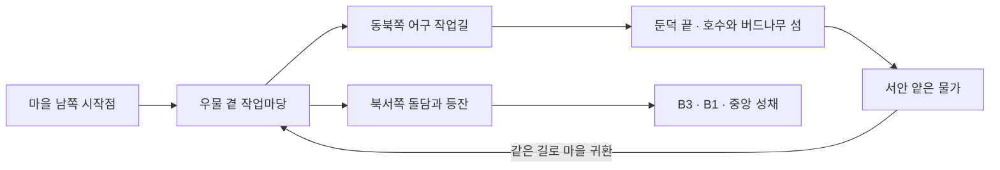

# 호수 마을 시작 필드

[강 유역 지역 설계](RIVER_BASIN_REGION_CONCEPT_DESIGN.md) · [작업 상태와 검증](../../../../../docs/work-status/river-basin-world.md#호수-마을-시작-필드-재설계)

호수 마을의 첫 5분을 **어부들이 일하는 마당에서 시작해, 스스로 호숫가를 발견하고, 다음 목적지를 고르는 경험**으로 설계한다. 첫 목표는 우물 곁 작업마당이다. 지역을 기억하게 할 풍경은 서안에서 보는 버드나무 섬이다. 설산은 세계의 규모를 보여 주는 배경으로 쓰고, 중앙 성채는 기존 B3·B1 본선을 따라 드러난다.

## 현재 첫인상

첨부 조감에서 집과 나무는 길을 중심으로 넓게 흩어져 있고, 초원과 갈림길이 마을의 생활 공간보다 먼저 읽힌다. 이전 무입력 TPS 화면에서도 설산과 큰 목서는 보이지만 우물은 오른쪽에 작게 보이고, 발밑의 회색 길과 흙길이 시선을 나눈다. 버드나무 섬은 내리막에서 훨씬 선명한 목표가 되지만, 우물에서 서안까지 현재 흙길은 약 207m다. 마을을 나선 직후부터 내리막까지 호숫가로 가고 있다는 단서를 보강할 여지가 크다. [기존 조감](../../../../../docs/work-status/river-basin-lake-village-evidence/final-fixed-map.jpg) · [기존 첫 TPS](../../../../../docs/work-status/river-basin-lake-village-evidence/final-nw-play-0.jpg) · [기존 섬 공개](../../../../../docs/work-status/river-basin-lake-village-evidence/final-bank-play-14.jpg)

## 시작 구간 사례

| 작품 | 초반 플레이에서 보이는 구성 | 호수 마을에 적용할 판단 |
|---|---|---|
| **원신 · 몬드 서장** | 페이몬을 따라가면 별이 떨어지는 호수의 신상이 목표로 드러난다. 플레이어가 물을 건너 대상에 닿고, 신상과의 상호작용이 여행자의 첫 원소 능력으로 이어진다. [서장 플레이 기록](https://www.youtube.com/watch?v=e0XfutE8_4E) · [HoYoverse 출시 소개](https://blog.playstation.com/2020/09/28/your-journey-in-genshin-impact-begins-now/) | 갈림길 다음에 보이는 대상과 실제로 걸어가 해볼 수 있는 행동을 연결한다. 섬은 풍경의 중심으로 놓고, 첫 접근의 도착점은 섬이 잘 보이는 서안 물가로 잡는다. |
| **젤다의 전설 브레스 오브 더 와일드 · 시작의 대지** | 첫 탑과 서로 다른 환경의 사당이 가까운 목표를 제공한다. 대지 안에서 여러 능력을 써 본 뒤 패러세일을 받아 바깥 하이랄로 이동한다. [Nintendo 공식 Explorer’s Guide](https://zelda.nintendo.com/breath-of-the-wild/assets/pdfs/ExplorersGuide.pdf) | 시작 일대 안에서 이동과 발견이 짧게 한 번 이어지고, 그 뒤에도 더 멀리 가는 길이 보이게 한다. 물가 탐색과 B3 진출은 처음부터 플레이어가 고를 수 있다. |
| **명조 · 1.0 황룡 도입부** | 방랑자가 일행과 합류한 뒤 야외 이동과 초반 전투를 경험하고 금주로 향한다. 크라운리스 조우는 도시 진입에 앞서 전투의 성격을 보여 준다. [1.0 초반 플레이 기록](https://www.youtube.com/watch?v=swyQskhiErM) · [Kuro Games 크라운리스 개발 노트](https://wutheringwaves.kurogames.com/en/main/news/detail/179) | 안전한 출발과 첫 위험을 떨어뜨려 둔다. 첫 전투를 연결할 때는 작업마당이나 물가 진입로 대신 북서 본선의 마을 바깥에서 위협을 미리 볼 수 있게 배치한다. |

## 첫 5분

좌표는 Unity 월드 X / Z(m)다. 시간은 기본 TPS에서 새로 시작한 플레이어의 목표 범위다. 기존 앵커와 후보 지점을 아래에 명시했으며 이동 시간과 가시선은 블록아웃에서 계측한다.

| 시점 | 위치 | 보이는 것과 할 수 있는 일 |
|---|---|---|
| **첫 5초** | 시작 **2317.4 / 958.8**, 기본 TPS 북향 | 가까운 목서와 돌담이 화면 한쪽을 잡는다. 발 앞의 다져진 지면이 **우물과 작업마당**으로 이어진다. 우물 뒤로 낮은 지붕과 설산이 보여 앞쪽이 사람이 사는 곳임을 알아볼 수 있다. |
| **5~25초** | 우물 **2321.3 / 965.6**, 서안길 접속 **2319.5 / 971.5**, 가게 **2337 / 963** | 집의 문, 가게 차양, 우물, 어구를 작업마당 주위에 둔다. 어부집 계단에서 마당으로 돌아올 수 있다. 마당에서 동북쪽 건조대와 어구 창고를 지나는 길이 보이고, 왼쪽 북서는 돌담과 등잔이 여는 별도 통행로로 읽힌다. |
| **25~90초** | 어구 창고 **2351.3 / 986.2**와 기존 서안길 중간 | 창고 옆 건조대와 바구니가 물가의 생활을 예고한다. 목서 군락이 낮은 사면의 양옆을 나누고 굽이를 돌아 나가면 초원이 다시 열린다. 목선은 서안 수선터에서 처음 보인다. |
| **1~3분** | 서안 조망 **2456 / 1079**, 얕은 물 **2472 / 1069** | 둔덕 끝에서 **잎이 늘어진 버드나무, 수면, 내려갈 수 있는 물가**가 한 화면에 열린다. 기존 목선 수선 자리까지 걸어가거나 얕은 물에 들어갔다 나오는 것으로 첫 탐색을 마칠 수 있다. 섬 횡단은 선택 탐색이며 실제 입수·복귀 검사 후 안내한다. |
| **3~5분** | 우물로 귀환하거나 북서 출구 **2277 / 1021** 쪽으로 먼저 진행 | 북서 출구에서 돌아볼 때 마을 지붕과 작업마당이 귀환 기준이 된다. 출구 너머 기존 본선에서 B3 방향을 읽는다. 물가를 건너뛰고 B3 쪽으로 가거나, 먼저 본선을 보다가 호수로 돌아올 수 있다. |

## 공간 제작안

| 장소 | 블록아웃 | 아트 패스 |
|---|---|---|
| **남쪽 출발과 작업마당** | 기존 70 × 56m 마을 부지 안에서 우물 주변 약 18 × 14m를 생활 중심 후보로 잡는다. 우물·어부집·가게의 출입면을 하나의 마당에 붙이고, 현재 집 사이 틈을 통행로와 뒷마당으로 쓴다. 우물의 목제 구조물이 겹쳐 보이면 가게 차양의 방향과 높이를 먼저 비교한다. 중심 마당은 보행·카메라 공간으로 비운다. | `LakeHouse_Fisher`, `LakeHouse_Shop`와 기존 돌담·등잔·목서를 쓴다. 우물 주변은 닳은 흙, 울타리와 수관 아래는 풀·낙엽, 어부집 계단부터 물가까지 목재와 어구를 이어 생활의 흔적을 만든다. 색 강조는 가게의 차양과 우물 근처 작업물에 모은다. |
| **초원과 호숫가** | 기존 서안길 중간에 낮은 사면과 수관 덩어리를 두어 긴 평지에서 한 번 구도가 바뀌게 한다. 안쪽은 호수 조망 방향까지 열어 둔다. 호수 첫 공개가 늦으면 소품 추가보다 중간 후보 지점의 차폐 높이와 방향을 먼저 줄인다. | 마을 가장자리의 목서 군락에서 열린 풀밭을 거쳐 습한 자갈과 갈대로 옮겨 간다. 물가에서는 기존 수선 자리와 버드나무에 시선을 모으고, 알려진 수면 명암 경계가 섬 조망을 가르면 수면 메시·셰이딩 원인을 확인한다. 생활 소리·잔물결은 해당 위치에서 기존 환경음으로 확인한다. |
| **북서 출구** | 우물에서 보이는 돌담 끝과 기존 등잔이 짝을 이루도록 하고, 폭이 다른 마당 통로와 본선 입구를 구분한다. 기존 B3 접속, 역방향 복귀, 출입면을 검증한다. | 마을 쪽에 수레·포대를 모으고 바깥쪽은 열린 초지로 넘긴다. 첫 전투는 이후 콘텐츠 연결 항목이다. 기존 전투 데이터를 사용할 수 있는 경우에만 마을 바깥의 시야가 열린 곳에서 선택 조우를 설계한다. 회피 공간과 뒤로 빠지는 경로를 확보하고, 마을과 물가까지 추격이 이어지지 않게 한다. |

## 제작과 인수

1. **블록아웃.** 격리 프리뷰에서 현재 시작 좌표의 기본 TPS와 조감 기준을 캡처한다. 먼저 작업마당과 마을 출구의 덩어리를 비교한다. 그다음 서안길의 중간 단서와 섬 공개를 잇는다. 시작, 우물, 중간 굽이, 섬 공개, 북서쪽 역방향을 같은 카메라 조건의 전후 화면으로 남긴다.
2. **지면과 배치.** 기존 동선과 수계를 기준으로 바깥 사면과 길 어깨를 접속한다. 높이 편집 시 지형 타일 경계·캡슐 보행·디딤면·배치물 재안착·해당 NavMesh를 확인한다. 새 구조물 이름은 [카메라 가림 가이드](../../../guide/CAMERA_OCCLUSION_FADE_GUIDE.md#신규-건물구조물-배치-체크리스트)의 규칙과 대조한다.
3. **기본 TPS 검증.** 주간에는 정면 첫 프레임, 두 경로의 선택과 호수 공개를 본다. 야간에는 밝기를 올리기 전에 우물·출구·내리막의 형태와 등잔 위치가 읽히는지 확인한다. 기존 출구와 되돌아오는 길에 충돌·카메라 당김·길막이 생겼는지 연속 입력으로 본다. 신규 퀘스트나 조우를 실제로 연결하는 단계에서는 서안 선방문·B3 선출발·재진입 순서도 검증한다.
4. **초견 테스트.** 지도·마커·경로 설명 없이 시작 화면에서 처음 가고 싶은 곳을 기록한다. 첫 30초 안에 마을 안쪽 목표를 찾고, 3분 안에 서안 조망 또는 의도적으로 선택한 북서 출구에 닿는 것을 비교 기준으로 삼는다. 섬을 본 플레이어가 기억한 특징과 최초로 멈칫한 위치를 받는다. 이동 시간은 실제 입력 기록으로 검토한다. 중앙 성채까지의 소요 시간은 별도 본선 검증 항목이다.
