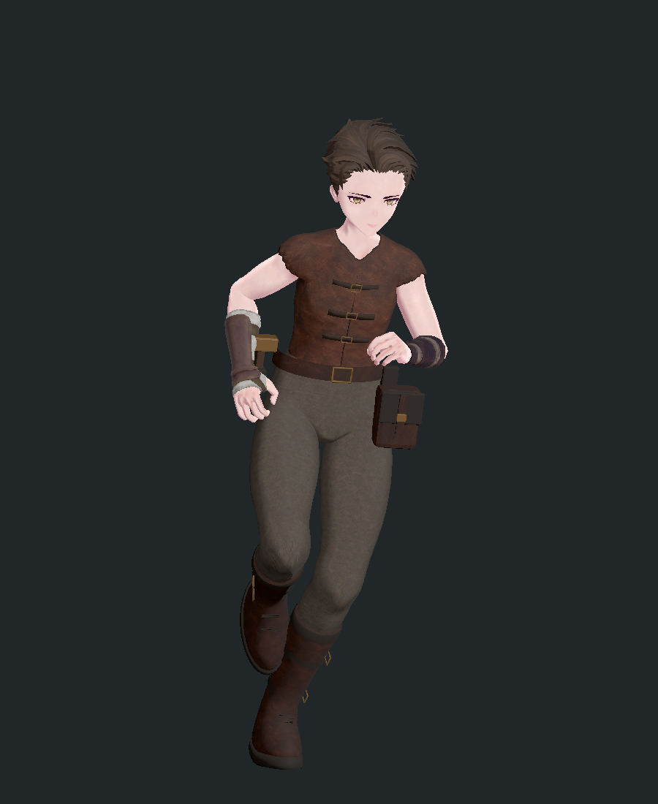
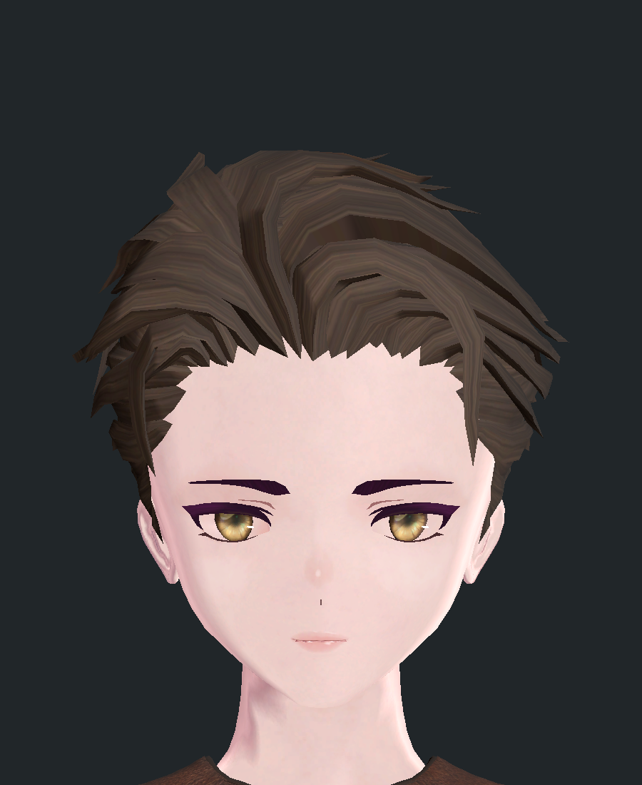

# P09 NPC 의상·외형 제작 지침

기준일: 2026-10-24. 사용자가 승인한 준의 작업복과 짧은 뒤넘김 머리를 외형 기준으로 삼는다. 이 승인은 화면에 보이는 외형에 대한 승인이다. 최종 수정본의 게임 내 Play Mode 검증과 다수 NPC 성능 검증까지 완료되었다는 의미는 아니다.

확장할 부품군·조합 규칙·제작 순서는 [NPC 의상·외형 확장 설계](../design/NPC_APPEARANCE_VARIATION_DESIGN.md)를 따른다. 검증 운영은 [테스트 작업 지침](TEST_VALIDATION_GUIDE.md)을 따른다.

## 1. 승인 기준과 적용 범위

ExternalAssets 모델의 얼굴을 새로 조형해 P09 바디·헤어·의상에 이식하는 작업은 [외부 모델 P09 제작 지침](../EXTERNAL_MODEL_P09_CONVERSION_GUIDE.md)을 함께 따른다. 정규 다온 적용 사례와 [요청 프롬프트](../EXTERNAL_MODEL_P09_REQUEST_PROMPT.txt)를 포함한다.

목표는 기존 P09 얼굴·몸체와 어울리면서, 플레이 중 누가 누구인지 구별할 수 있는 주민을 만드는 것이다. 의상 종류의 개수보다 인물의 인상, 역할을 읽을 수 있는 실루엣, 일상 동작의 안정성을 먼저 평가한다.

| 기준 | 현재 승인본 |
|---|---|
| 정규 NPC | `Assets/03.Prefabs/Characters/ScenarioResidents/Npc/NPC_Jun/NPC_Jun.prefab` |
| 식별 보존 | 프리팹 GUID `341055d8e1b1a5347aebedcc661c9322`, `Story_NPC_Jun.asset`의 기존 참조 |
| 의상 | 갈색 가죽 조끼, 회갈색 캔버스 바지, 가죽 부츠, 벨트·공구 주머니 |
| 무릎 | 평평한 가죽 타원 패치와 검은 테두리 제거. 천이 이어지는 표면 |
| 머리 | P09 `Hair_13` 원본 가닥 구조를 재가공한 짧은 뒤넘김 머리. 이마와 귀 노출 |
| 제작 구분 | 바지는 원본 다리 체형·웨이트 활용, 머리는 원본 메시 변형. 부츠·공구 장비는 신규 메시 |
| 텍스처 | ImageGen 생성 천·가죽·머리카락 알베도. 기존 승인 텍스처 재사용 허용 |
| 확인 범위 | Editor 21개 자세의 정점·컬링 검사, 기존 local fileID 1,973개·행동 컴포넌트 37개 보존 |

승인 시점 이미지는 재생성으로 바뀌는 `output/`과 분리해 보존한다.

| 전체 외형 | 머리 정면 |
|---|---|
|  |  |

신규 의상·외형은 이 기준과 같은 조명에서 비교한다. 모든 주민에게 준의 얼굴이나 갈색 옷을 복제하라는 의미는 아니다.

## 2. 작업을 시작할 때 확인할 것

1. 대상 정규 프리팹, 원본/Variant 관계, ActorDefinition, 배치 인스턴스와 외형 override를 확인한다.
2. 유지할 인물 특징을 적는다. 기존 인물의 얼굴형·피부·눈·대표 헤어는 별도 변경 요청 없이 함께 바꾸지 않는다.
3. 현재 표시되는 몸체와 의상 메시, 머티리얼, 본 루트, 표정 BlendShape를 기록한다. 이름이 비슷한 다른 체형을 기준으로 사용하지 않는다.
4. 기준 프리팹·메시·재질·텍스처·`.meta`와 직렬화 참조 목록을 보존한다. 검수본이 공유하는 에셋까지 변경 범위에 포함한다.
5. 열린 씬의 미저장 변경과 Play 상태를 확인한다. 미저장 씬은 작업을 위해 임의 저장하거나 닫지 않는다.
6. 아래 제작 카드에 변경 범위와 검증 상태를 적은 후 제작한다.

```text
제작 ID / revision:
대상 정규 프리팹 경로 / GUID / 원본 또는 Variant:
역할과 식별 특징:
유지할 얼굴·피부·눈·체형:
바꿀 슬롯 / 사용하는 원본 메시:
추가·교체 부품과 숨길 몸체 영역:
체형·리그·헤어·모자 조합의 호환 조건:
텍스처 경로 / ImageGen 프롬프트 / 재사용 출처:
제작 원본 / 독립 검수본 / 정규 적용 대상:
확인할 생활 모션 / 표정 / 목 회전:
외형 승인 / Editor 검사 / Play Mode / 성능: 각각 미수행·대기·통과·실패
알려진 한계 / 복구할 파일 목록:
```

## 3. 형태와 재질 기준

### 의상

- 역할은 먼저 큰 형태로 표현한다. 작업자는 팔과 허리의 움직임, 상인은 정돈된 여밈과 주머니, 여행자는 수납 위치처럼 기능이 보이게 만든다. 이 예시는 제작 방향이며 새 인물 설정을 확정하지 않는다.
- 같은 부품의 색상 변경은 팔레트 변형으로 분류한다. 별도 의상으로 세려면 옷 길이·여밈·소매·허리 장비 등 눈에 보이는 구조 차이가 있어야 한다.
- 손, 팔꿈치, 무릎, 발목의 가동 범위와 앉기·운반·수리 동작을 먼저 확보한다. 장식 때문에 손이 몸을 관통하거나 작업 대상에 닿지 않으면 수정한다.
- 패치에는 부착 이유와 두께·경계 처리가 있어야 한다. 단색 타원과 짙은 테두리만으로 보강천을 표현하지 않는다. 필요가 불분명하면 준의 수정본처럼 생략한다.
- 가죽·천·금속은 결, 색, 반사로 구별한다. 천 전체에 강한 사진 질감이나 큰 얼룩을 넣어 얼굴보다 시선을 끌지 않는다.
- 밑창·허리 여밈·커프는 몸체와 연결되어 보여야 한다. 검은 띠로 관통이나 틈을 가리지 않는다.

### 머리·얼굴

- 머리는 정면뿐 아니라 측면·후면·위쪽에서 본 실루엣으로 판단한다. 큰 반구 위에 일정한 굵기의 가닥을 반복해 얹는 방식은 승인 기준으로 사용하지 않는다.
- 우선 P09 원본 헤어의 흐름과 끝단을 활용한다. 이마·귀·구레나룻·목덜미가 어디서 드러나는지 정하고, 큰 가닥에서 작은 가닥 순으로 정리한다.
- 머리 폭을 줄여 두피가 삼각형으로 뚫고 나오지 않는지 확인한다. 두피를 가리려고 다시 큰 외피를 덧씌워 모자 같은 실루엣을 만들지 않는다.
- 짧은 머리는 고정 본으로 시작한다. 긴 머리·묶은 머리·망토는 움직임과 충돌 검증이 필요한 별도 제작군이다. 기존 MagicaCloth2 사용 가능 여부와 신규 부품의 검증 상태를 혼동하지 않는다.
- 얼굴 변형은 원본 UV·본·BlendShape 연결을 보존하는 방식을 우선한다. 주름을 늘리는 것만으로 연령을 표현하지 않고 눈매·볼·턱·헤어·수염의 조화를 본다.
- 얼굴을 바꾸면 눈 감기, 웃음, 입 벌림, 모음 표정과 목 회전을 함께 확인한다. 머리만 바꿔도 눈썹·수염 색과의 부조화를 확인한다.
- 원본에서도 보이는 턱 아래·목 이음새는 전후 비교에 남긴다. 기존 문제를 새 의상의 통과 근거로 숨기거나, 별도 범위 확인 없이 얼굴 전체를 다시 만들지 않는다.

## 4. 제작 도구와 책임

| 도구·파일 | 책임과 사용 경계 |
|---|---|
| P09 Builder | 원본 P09 조합과 NPC 기반 구성. 통합 툴 런처에서 `P09 캐릭터 빌더` 검색 |
| `CharacterBuildConfig` | 기존 체형·부위 선택과 `HairStyleSo`, `HairColorSo`, `FaceTypeSo`, `EyeColorSo`, `SkinColorSo`, 수염·표정 선택 |
| Blender | 체형 맞춤, 메시 제작, UV, 웨이트, FBX 내보내기 |
| ImageGen | 천·가죽·머리카락 등 래스터 텍스처 생성. 메시의 형태나 리깅을 대신하지 않음 |
| 프로젝트 아바타 머저 | `AvatarArmatureBakeTool`. 통합 툴 런처의 `아바타 Armature 베이크 도구` |
| Unity MCP | 임포트·연결·검수 작업 실행. 응답 실패 시 완료 기록을 확인한 뒤 재시도 |
| 기존 주민 외형 도구 | `ScenarioResidentAuthoring`의 노년·소담 외형 제작 및 리그 검수. 얼굴 변형은 이 경로를 먼저 검토 |

사용자가 말한 FitMerger는 프로젝트 아바타 머저를 뜻한다. 외부의 별도 FitMerger 패키지를 전제하지 않는다. 아바타 머저는 본 연결을 베이크하는 도구이며, 체형 자동 맞춤·관통 제거·품질 승인을 수행하는 도구가 아니다.

Blender MCP 연결이 정상일 때는 이를 사용할 수 있다. 응답 지연으로 진행이 어려우면 별도 백그라운드 Blender CLI로 같은 제작 스크립트를 실행하고 사용한 경로를 기록한다. 사용자가 열어 둔 Blender 작업을 초기화하지 않는다.

## 5. Blender 제작과 텍스처

### 체형·웨이트

1. 승인된 프리팹이 사용하는 P09 원본 메시와 골격을 읽는다. 준 제작 원본은 `ArtSource/P09JunWorkwear/`에 있다.
2. 원본 파일을 편집하지 않고 메시 데이터를 복제한다. 의상은 얼굴 표정 메시와 분리한다.
3. 바지는 원본 정점 그룹을 유지하고 세분화 시 보간된 웨이트를 사용한다. 이미 유효한 웨이트에 최근접 전송을 다시 적용하지 않는다.
4. 허벅지 안쪽은 의상 여유분을 크게 밀지 않는다. 준 제작 중 반대 다리의 웨이트가 섞여 가랑이가 찢어지는 문제가 있었으므로 수리·웅크리기 자세에서 반드시 확인한다.
5. 단단한 허리 장비는 골반, 짧은 머리는 머리 본을 기준으로 연결한다. 부츠처럼 관절을 가로지르는 부품은 적절한 스키닝을 유지한다.
6. UV 늘어짐, 겹면, 뒤집힌 면, 미할당 재질·웨이트, 비정상 좌표를 검사한다. 원본 모서리 노멀을 무조건 다시 계산하지 않는다.
7. FBX는 원본과 스케일·축·바인드 자세를 맞춘다. 현재 스크립트는 `axis_forward='-Z'`, `axis_up='Y'`, `add_leaf_bones=False`, `bake_anim=False`를 사용한다. 이 옵션만으로 다른 원본의 좌표 정합성을 보장하지 않는다.

### ImageGen 프롬프트와 재질

새 원단이 필요할 때 아래 요소를 포함하고 실제 프롬프트를 제작 manifest에 보존한다. 승인된 재질은 새로 생성하지 않고 재사용한다.

```text
용도: lilToon 기반 P09 NPC의 불투명 타일형 Base Color.
표면: [회갈색 캔버스 / 밤색 가죽 / 잿빛 갈색 머리카락].
색과 결: [주조색], 낮은 대비, 게임 거리에서도 과하지 않은 미세한 결.
조명: 평평한 알베도, 하이라이트·그림자·그라데이션을 굽지 않음.
제외: 옷이나 머리 전체 그림, 얼굴, 주름, 봉제선, 주머니, 테두리, 글자, 로고.
연속성: 양 축으로 반복 가능. 머리카락은 UV의 가닥 방향에 맞춘 평행 결.
```

현재 생성본은 2048 해상도, sRGB, Repeat, Mip Map을 사용하는 사례다. 2048을 모든 소품의 고정 규격으로 삼지 말고 실제 화면 점유율과 메모리를 기준으로 낮춘다. ImageGen 결과가 실제로 타일 연결되는지 Unity에서도 확인한다.

기존 lilToon 재질과 같은 조명에서 맞춘다. P09 원본 헤어 재질의 추가 색상 레이어를 남긴 채 텍스처만 제거하면 흰 머리처럼 나오는 문제가 있었다. 검증된 헤어 재질 설정을 출발점으로 삼고 전체 머티리얼 복사 후 무작정 텍스처를 비우지 않는다. 자동 생성 Normal·Mask 채널이 있다고 가정하지 않는다.

## 6. Unity 연결과 정규 모델 반영

### 본 연결

| 부품 | Target Root | 핵심 옵션 |
|---|---|---|
| 준의 하체·부츠·공구 장비 | `Skeleton_P09_Body/root` | Keep Source Root As Child 끔, Retarget 켬, 리타기팅 후 중복 본 제거 |
| 준의 짧은 머리 | 몸체의 `Head` | Keep Source Root As Child 켬. `JunHairRoot`와 자체 머리 메시 연결 유지 |

위 본 이름은 준의 실제 값이다. 다른 모델은 직접 확인한 본 경로를 사용한다. 베이크는 복제 작업본에서 진행하고, 본 참조가 최종 NPC 루트 내부에 있는지 검사한다. 같은 이름의 본이 여럿이면 임의의 첫 번째 본으로 연결하지 않는다.

### 현재 스크립트의 중요한 한계

`ArtSource/P09JunWorkwear/integrate.csx`의 `applyToCanonical=false`는 프리팹 저장 대상을 검수본으로 바꾼다. **공유 FBX·BakedMesh·Material까지 격리하는 옵션은 아니다.** Blender 빌드도 같은 FBX 경로를 덮어쓴다. 따라서 이 조합을 안전한 대량 검수 파이프라인으로 표현하지 않는다.

새 변형은 FBX·메시·재질·검수 프리팹을 revision별 독립 경로에 먼저 만든다. 기존 승인본이 참조하는 에셋을 수정하면 검수 프리팹만 저장했더라도 정규 모델이 바뀔 수 있다. 공통 재질을 의도적으로 수정하는 경우에는 사용 중인 NPC 전체가 검증 범위다.

### 반영 순서

1. 독립 검수본과 변경 목록을 만든다. 제거·숨김 대상은 제작표에 명시하고 다른 주민의 부품을 이름 추정으로 지우지 않는다.
2. 아래 검수 항목을 수행하고 결과 이미지·실패·미수행을 기록한다.
3. 정규 프리팹과 영향을 받는 공유 에셋의 백업을 확보한다. `.meta`, Variant 관계, ActorDefinition 참조도 포함한다.
4. 승인된 외형 부분만 기존 정규 프리팹에 반영한다. GUID와 외형 외의 local fileID·행동·대화·스탯·상호작용 데이터를 보존한다.
5. 이전 부품은 명시한 대상만 비활성화하고 중복 골격·이중 헤어·숨겨야 할 피부가 남지 않았는지 확인한다.
6. 저장 후 다시 로드해 참조와 실제 표시를 확인한다. 씬 override가 외형을 덮고 있는지도 확인하되 사용자 씬을 일괄 Apply/Revert하지 않는다.
7. 실패하면 변경한 프리팹뿐 아니라 메시·재질·텍스처까지 복구한다. 재생성 기준과 정규 모델이 같은 revision인지 기록한다.

P09Builder에는 백업·롤백 경로가 있지만 기존 에셋을 삭제·교체하는 경로도 있어 완전한 transaction으로 간주하지 않는다. 이 경로를 바꿀 때는 별도 스테이징·백업/복구·중간 단계 실패 테스트를 먼저 설계한다. 현재 추가 의상은 빌더가 자동 복원하지 않으므로 정규 모델의 재생성을 일상적인 외형 갱신 수단으로 사용하지 않는다.

### 재발 방지

- 기존 Mesh 에셋 갱신에 `EditorUtility.CopySerialized`만 사용하지 않는다. 과거 GPU vertex stride 불일치로 Play Mode에서 의상이 사라졌다. 현재 스크립트의 Mesh API 기반 버퍼 갱신과 실제 스키닝 검사를 참고한다.
- Prefab Variant의 자식을 직접 이동하는 무한 반복을 만들지 않는다. 정규 Variant 관계는 보존하고, 모델 전용 검수본에서만 Unpack한 후 유한 목록을 처리한다.
- `localBounds`는 해당 rootBone 좌표에서 검사한다. T 자세만으로 정하면 달리기 발끝이 잘릴 수 있다. bounds를 무한히 늘려 오류를 숨기지 않는다.
- MCP timeout은 작업 실패의 증거가 아니다. 보고서 시각·출력 파일·에디터 상태를 확인하고 중복 생성이나 정규 반영을 반복하지 않는다.

## 7. 품질 검수와 완료 조건

### 외형 검수

동일 카메라·조명·배경으로 승인 기준과 나란히 비교한다. 가까운 대화 거리, 일반 플레이 거리, 군중 거리에서 확인하고 흑백에서도 실루엣 차이가 남는지 본다. 거리별 실제 카메라 조건은 검수 기록에 적는다.

- 정면·좌우 측면·후면·사선, 부드러운 조명과 측광에서 확인한다.
- 이마·귀·목덜미, 겨드랑이·가랑이·무릎·발목, 벨트·주머니와 손의 접점을 확대한다.
- 의상은 걷기·달리기·웅크리기·공격·운반·짐 정리·수리 각 3시점을 기본 회귀 표본으로 삼는다. 해당 NPC가 쓰는 앉기·작업·대화 동작은 추가한다.
- 얼굴 변경은 표정과 목 회전 검수가 추가되어야 한다. Editor에서 수동으로 constraint를 맞춘 캡처는 실제 프레임 추종 검사를 대신하지 않는다.

### 기술 검수

| 항목 | 통과 기준 |
|---|---|
| 데이터 | Missing Script·누락 재질·외부 본 참조 0, 의도하지 않은 행동 데이터 변경 0 |
| 스키닝 | 유한 좌표·정규화 웨이트, 실제 SkinnedMeshRenderer 표시 정상. BakeMesh 수치 검사만으로 종료하지 않음 |
| 바인드 | 베이크 전후 형상 오차 기록. 준 스크립트의 허용 한계는 0.0001m이며 다른 단위계는 먼저 정합 확인 |
| 컬링 | 표본 동작의 rootBone 기준 bounds 이탈 0, 카메라 시야 진입·이탈 후 정상 표시 |
| 참조 | 정규 GUID·외형 외 fileID·Variant 관계·ActorDefinition 연결 보존 |
| 성능 | 전체 NPC의 삼각형·활성 렌더러·서브메시·재질·본·텍스처 메모리 기록. 신규 부품 수치만으로 판정하지 않음 |

외형 승인, Editor 검사, Play Mode, Player 검증, 군중 성능을 별도 상태로 남긴다. 한 항목의 통과로 나머지를 자동 통과시키지 않는다.

### 사용자 직접 테스트 명세

준비: 작업 씬을 사용자가 원하는 방식으로 보존한 뒤 검수 씬을 연다. 인게임 확인은 기존 시작 경로와 별도 테스트 저장 슬롯을 사용한다. Unity 버전, 대상 revision, 입력 장치를 결과에 적는다.

| ID | 절차 | 기대 결과·실패 기준 |
|---|---|---|
| N01 | `P09_JunWorkwear_Review.unity` 또는 해당 revision 검수 씬에서 Play, 전후 모델 비교 | 의상·머리 유지, 관통·탈락·소멸·분홍 재질 없음 |
| N02 | 정규 NPC 등장 경로로 진입해 접근·대화·이동·작업 관찰 | 검수본과 같은 외형, 기존 대화·생활 행동 유지 |
| N03 | 얼굴 근접 관찰과 고개 회전·눈 감기·입 움직임 확인 | 얼굴 틈·눈/입 내부 노출·헤어 지연 추종 없음 |
| N04 | 카메라를 돌리고 멀어졌다 복귀, 필드 재진입 | 부품 컬링 정상, 동일 인물의 외형 유지 |
| N05 | 목표 지역의 동시 표시 인원으로 전후 프로파일링 | 지정한 프레임·메모리 예산 충족. 인원·하드웨어·카메라·측정값 없으면 미검증 |

회신 형식: `ID / revision / 통과·실패·미수행 / 실제 결과 / 화면 또는 Console 로그`. 외형 결함은 문제가 보이는 각도·동작을 함께 적는다. Windows Player 빌드 여부는 테스트 지침의 고위험 변경·통합 기준을 적용한다.

## 8. 산출물과 현재 참고 파일

납품 단위는 제작 카드, 원본 `.blend`와 스크립트, FBX, 텍스처와 프롬프트, 머티리얼, 검수 프리팹, 정규 적용 기록, 비교 화면, 검증 결과다. `output/`은 작업 결과 폴더이므로 승인 근거를 그곳에만 두지 않는다. 원본 P09 에셋의 재배포 범위는 해당 에셋 라이선스를 따른다.

- [준 작업복 manifest](../../../ArtSource/P09JunWorkwear/manifest.json), [제작 스크립트](../../../ArtSource/P09JunWorkwear/build_workwear.py), [연결 스크립트](../../../ArtSource/P09JunWorkwear/integrate.csx), [포즈 검사](../../../ArtSource/P09JunWorkwear/capture.csx).
- [조끼 3종 제작표](../../../ArtSource/P09NpcOutfits/recipes.json), [조끼 검증 기록](../../../ArtSource/P09NpcOutfits/manifest.json).
- [P09 외형 설정](../../02.Scripts/Editor/P09Builder/Model/CharacterBuildConfig.cs), [P09 카탈로그](../../02.Scripts/Editor/P09Builder/Catalog/P09AssetCatalog.cs), [아바타 머저](../../02.Scripts/Editor/AvatarArmatureBakeTool.cs).
- [노년 외형 제작](../../02.Scripts/Editor/P09Builder/ScenarioResidentAuthoring.Elder.cs), [소담 외형 제작](../../02.Scripts/Editor/P09Builder/ScenarioResidentAuthoring.Sodam.cs).

현재 준 수정본의 외형은 사용자 승인, Editor 21개 자세 검사는 통과다. 게임 내 Play Mode·Player 빌드·군중 성능은 미검증이다. 조끼 3종의 이전 Play Mode 검사 결과를 준의 최종 헤어·하체 수정본에 그대로 적용하지 않는다.
