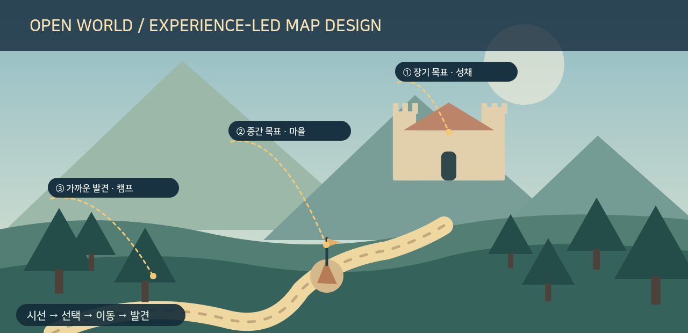
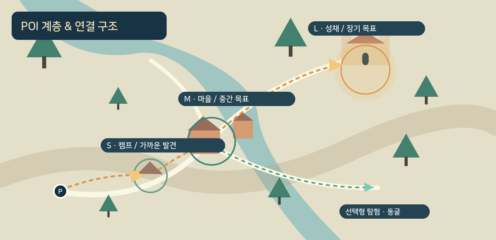
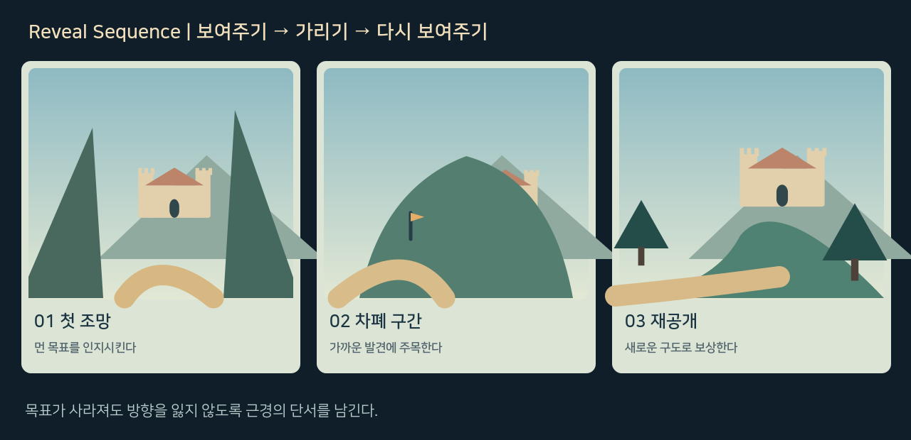
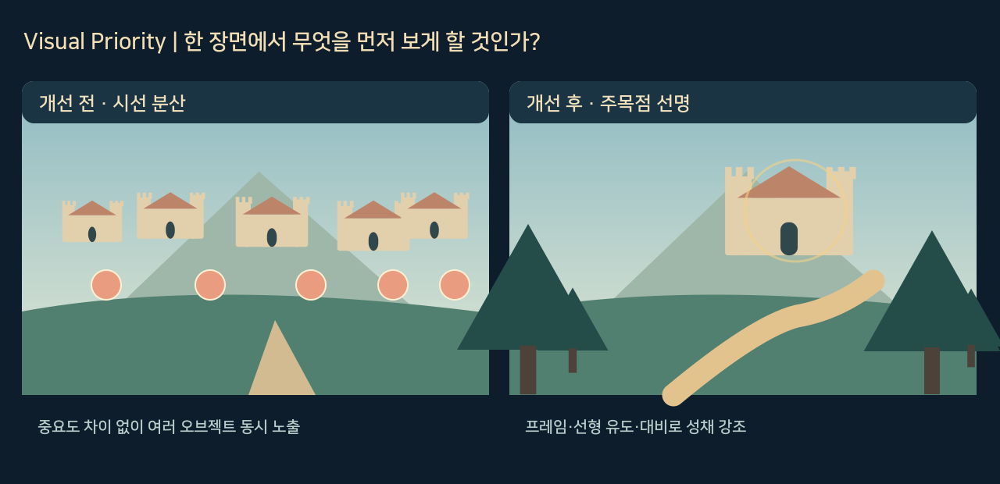
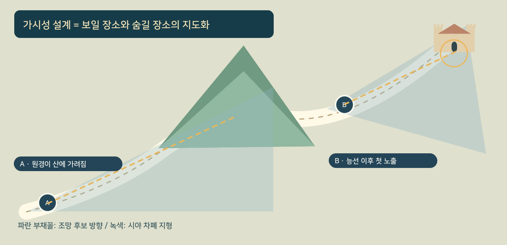
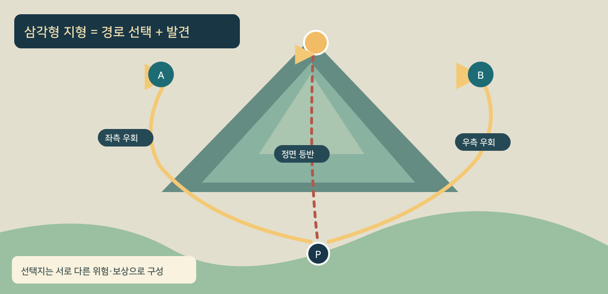
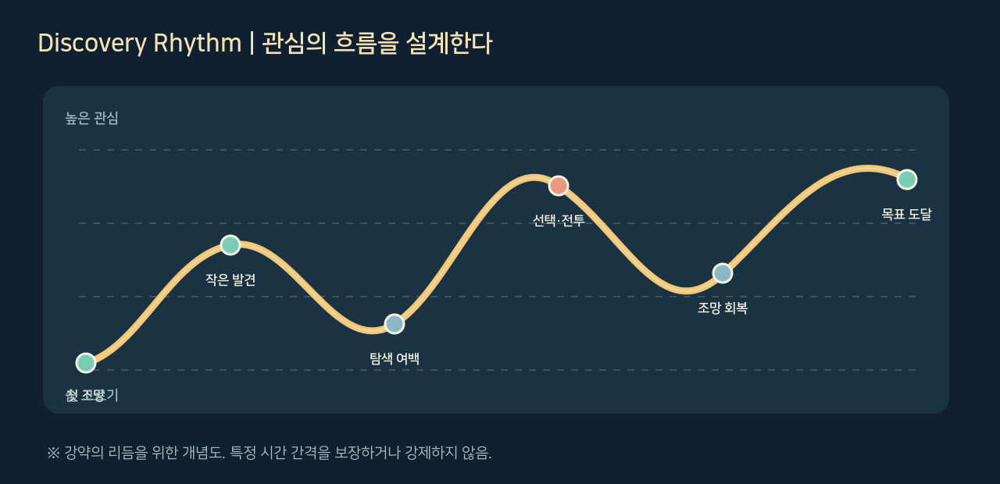
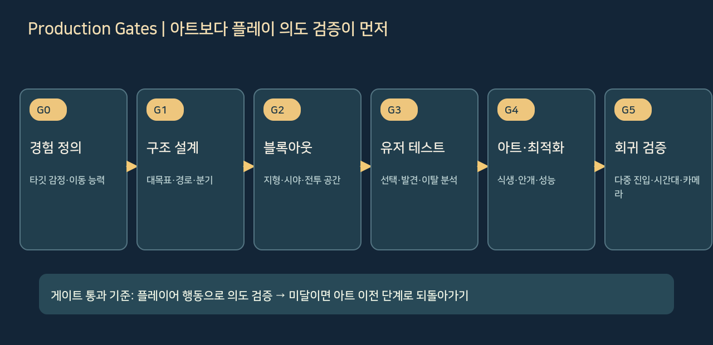
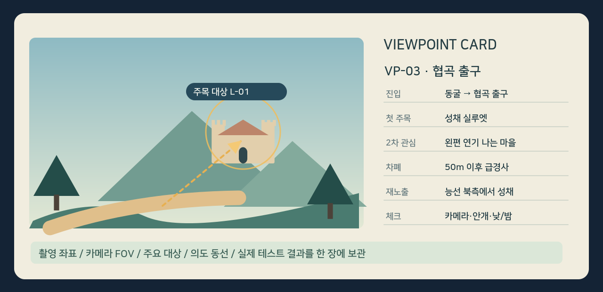

# 오픈월드 맵 제작 가이드

> **팀 작업 지침 · v1.0 / 2026-11-09**  
> 대상: 자유 탐험을 지원하는 3D 오픈월드·오픈필드 액션 게임의 기획, 레벨 디자인, 환경 아트, 카메라, 엔지니어링, QA  
> 목적: 맵을 *보기 좋은 지형*이 아니라 **플레이어의 시선·이동 선택·발견·보상을 설계하는 공간**으로 제작한다.



**핵심 명제:** 플레이어는 처음 보이는 큰 목표를 기억하고, 이동 중 가까운 단서를 따라 선택하며, 차폐와 재노출을 거쳐 새 목표를 발견해야 한다. 단, 같은 순서를 모든 구간에 강제하지 않는다.

**자료 성격:** 본 문서는 NDC·CEDEC·GDC 발표 및 개발진 인터뷰에 근거한 **관찰·원칙**과, 이를 실무로 옮기기 위한 **프로젝트 적용 제안**을 분리한다. 이미지 9장은 설명을 위해 새로 제작한 **개념 도해**이며 원작 게임 스크린샷이나 발표 원본 슬라이드가 아니다.

---

## 0. 한 페이지 운영 원칙

| ID | 팀 공통 지침 | 검증할 질문 |
|---|---|---|
| P01 | 월드 전체 크기보다 먼저 **플레이 경험**을 정의한다. | 이 지역에서 무엇을 느끼고 무엇을 발견하는가? |
| P02 | 이동의 출발·전환·도착 지점마다 **보이는 구도**를 설계한다. | 플레이어가 출구에서 실제로 무엇을 먼저 보는가? |
| P03 | 대·중·소 POI를 **목적의 계층**으로 배치한다. | 먼 목표로 가는 중간에 새 목표가 생기는가? |
| P04 | 랜드마크는 **보여주기와 차폐**를 함께 계획한다. | 가린 뒤에도 방향을 잃지 않는가? |
| P05 | 길은 유일한 답이 아니라 **의미 있는 선택**을 제시한다. | 어느 길을 택해도 흥미로운 발견이 있는가? |
| P06 | 탐험 밀도는 고정 거리 대신 **시간·속도·행동 리듬**으로 검증한다. | 아무 일 없이 이동만 하는 구간이 의도된 것인가? |
| P07 | 지형과 시각 신호가 HUD 마커보다 먼저 목적지를 설명하도록 한다. | 마커를 껐을 때 플레이어가 다음 행동을 떠올리는가? |
| P08 | 블록아웃에서 검증되지 않은 구도는 아트 패스로 덮지 않는다. | 회색 지형만으로도 의도한 흐름이 만들어지는가? |

**근거:** NDC 2025 [S1], 젤다 CEDEC 2017 [S2], 엘든 링 제작 인터뷰 [S3], GDC 2018 [S4], 고스트 오브 쓰시마 [S5].

## 1. 제작 전에 정할 것: 경험 목표와 게임 플레이 규격

### 1.1 지역 경험 정의서 (Region Intent)

지역 단위로 **주 감정 1개**, **플레이어가 스스로 발견하길 원하는 것 2~3개**, **핵심 행동 1~2개**를 적는다. 예: “황폐한 계곡 / 먼 폐성을 향하는 기대감 / 우회로의 은신처와 배회하는 강적 발견 / 탐색·선택·근접 전투”. 이는 팀 문서화를 위한 **제안 형식**이다.

각 지역 문서에는 다음 항목을 채운다.

- 진입 지점과 이동 방향: 초입, 주요 길, 역방향 진입, 고지대, 빠른 이동 도착점.
- 플레이어 능력: 걷기·달리기·대시·등반·점프·탈것과 이동 속도, 접근 불가 지형.
- 카메라 조건: 기본 FOV, 카메라 높이·거리, 락온·전투·달리기 상태, 장애물에 따른 카메라 당김.
- 월드 제약: 바이옴, 기후, 시간대, 안개, 낮·밤 시인성, 이동 불가 지역, 스트리밍 단위.
- 플레이 목표: 도달해야 할 큰 목표와 우회해도 발견 가능한 별도 목표.

### 1.2 수치보다 먼저 '측정 가능한 가정'을 세운다

| 항목 | 측정 대상 | 주의 |
|---|---|---|
| 이동 소요 시간 | 실제 플레이 조작으로 POI 사이 걸리는 시간 | 직선거리 ÷ 최고속도만으로 산정하지 않는다. |
| 가시성 | 지정 지점·카메라에서 랜드마크가 인식되는지 | 기후·LOD·카메라 FOV에 따라 달라진다. |
| 지점 선택률 | 처음 보는 플레이어가 어느 경로로 가는지 | 설계자가 의도한 단일 경로를 정답으로 취급하지 않는다. |
| 발견률 | 단서만 보고 중·소 POI를 인지하는지 | 의도적 비밀 장소는 발견률을 낮게 설계할 수 있다. |
| 전투 플레이성 | 공격, 회피, 카메라, 충돌 처리에 충분한 공간인지 | 보기 좋은 장소가 전투에 적절한 장소는 아니다. |

**금지:** “모든 POI는 40초 간격”, “모든 방향에서 성이 보여야 함”, “플레이어 100%가 같은 길을 가야 함”처럼 발표의 예시를 절대 규칙으로 해석하지 않는다.

## 2. 월드 골격: 대·중·소 POI와 경로 네트워크



### 2.1 POI별 배치 기준

| 계층 | 역할 | 배치 예시 | 설계 체크 |
|---|---|---|---|
| **L / 대목표** | 지역 정체성, 장기 방향 감각 | 성채, 거대 나무, 대도시, 거대 구조물 | 여러 주요 조망에서 실루엣 식별 / 도달 경로는 하나로 제한하지 않음 |
| **M / 중목표** | 다음 이동 결정을 유도 | 마을, 교회, 요새, 협곡, 폭포 | L로 가는 도중 또는 우회할 때 알아차릴 단서 부여 |
| **S / 소목표** | 지금 즉시 행동을 유발 | 캠프, 작은 유적, 흔적, 상호작용, 조우 | 접근 이유·행동·작은 결과를 짧은 순환으로 제공 |
| **숨은 POI** | 관찰력과 탐색 보상 | 동굴, 샛길, 고립된 전망대 | 모든 곳에서 보이지 않아도 됨. 주변 흔적·지형 논리는 필요 |

엘든 링 공개 메이킹에서는 거대 랜드마크를 대목표, 교회·요새를 중목표, 가까운 야영지 등을 소목표로 구분한다. 소목표의 ‘반경 약 100m’는 **해당 개발 사례의 설명**이지 범용 배치 규격이 아니다. [S3]

### 2.2 배치 순서

1. 월드 경계·이동 가능 영역·주요 높낮이·지역별 경험 목표를 정한다.
2. 멀리 보일 대형 랜드마크를 먼저 놓고, 각 랜드마크의 **대표 관측 지점**을 지정한다.
3. 대형 POI로 가는 구간에 중형 목표를 **직선상 또는 우회 동선상**에 놓는다.
4. 이동 중 호기심을 이어줄 소형 목표와 환경 단서를 채운다.
5. 일부 소형 POI는 보이지 않게 유지하되, 발견 가능한 흔적을 주변에 둔다.
6. **반대 방향에서 접근할 때**도 동일한 수준의 동선·시야 품질이 유지되는지 별도 확인한다.

**배치 금기:** 목적지 사이를 텅 빈 연결 도로로만 두기 / 모든 보상을 주요 도로에 일렬 배치하기 / 의미 없는 수집품으로 빈 공간을 인위적으로 메우기.

## 3. 조망(Viewpoint)과 첫 시선: '어디를 나오면 무엇이 보이는가'



### 3.1 반드시 계획할 조망 지점

- **진입 프레임:** 동굴·문·성문·숲·협곡을 빠져나오는 순간.
- **전환 프레임:** S자 도로의 굽이, 다리 진입, 언덕 능선, 계단 정상.
- **선택 프레임:** 갈림길에서 서로 다른 POI가 인지되는 장소.
- **보상 프레임:** 등반 완료, 퍼즐 해제, 보스 처치 후 시야가 열리는 장소.
- **재정향 프레임:** 긴 전투·동굴·차폐 뒤 지역 랜드마크를 다시 확인하는 장소.

### 3.2 뷰포인트 작성 절차

1. 플레이어가 **실제로 서게 되는 위치**와 일반적인 진행 방향을 기록한다.
2. 일반 조작 중 도달할 카메라 위치·높이·FOV에서 스크린샷을 찍는다.
3. 첫 2~3초에 주목시키려는 **주 대상 1개**를 지정한다. 두 번째 대상은 보조로 둔다. (*팀 권장, 절대 법칙 아님*)
4. 전경(나무·바위) / 중경(도로·마을) / 원경(성·산)의 시각적 층을 만든다.
5. 프레이밍, 길의 방향, 명암·색 대비, 움직임·빛·소리 중 필요한 수단만 사용한다.
6. 의도한 대상이 안 보일 경우 카메라를 강제로 고치기보다 **지형과 동선**을 먼저 조정한다.
7. 플레이어가 멈추지 않고 달리거나 카메라를 반대로 돌려도 장면이 읽히는지 테스트한다.

### 3.3 시각적 우선순위: '전부 보인다'와 '무엇을 먼저 본다'는 다르다



**권장:** 원거리 성채를 주목시키고 싶으면 주변 고대비 구조물의 개수·밝기를 줄인다. 길·강·건축 선형이 주 대상 쪽으로 향하도록 한다. 나무나 절벽은 화면을 둘러싸는 프레임으로 사용한다. 캐릭터가 장면을 가리는지도 확인한다.

**주의:** 미적 구도가 훌륭해도 정면 주시를 강제하면 탐험 자유도가 떨어진다. 실제 플레이어의 이동 방향과 시점 범위에서 구도를 평가한다. GDC 2018 강연은 회색 블록메시 단계에서부터 플레이어를 자연스럽게 유도하는 방법을 강조한다. [S4]

## 4. 시야의 차폐와 공개: 거절과 보상



### 4.1 핵심 규칙

- **첫 노출:** 목적지의 실루엣·위치·규모를 기억하게 한다.
- **임시 차폐:** 언덕·건물·숲·굴곡으로 목표를 일부 또는 전부 가린다.
- **차폐 중 대체 단서:** 가까운 POI, 도로의 형태, 소리·연기·식생으로 계속 행동할 이유를 준다.
- **재노출:** 새 높이·거리·각도에서 목표가 더 구체적으로 드러나게 한다.
- **방향 복구:** 오랜 차폐 후에는 독특한 실루엣·강줄기·도로 같은 기준점으로 방향 감각을 되찾게 한다.

NDC 2025는 S자 길, 지형의 높낮이, 구조물을 이용한 차폐·재공개를 **거절과 보상**으로 설명한다. [S1] 이는 모든 구간을 숨기라는 뜻이 아니라, 계속 보이는 목표만 쫓는 단조로움을 줄이는 기법이다.

### 4.2 차폐 설계가 실패하는 경우

| 현상 | 문제 | 조치 |
|---|---|---|
| 목표가 처음부터 끝까지 계속 보임 | 예측 가능한 긴 이동, 작은 체감 공간 | 중간 차폐·지형 기복·우회 POI 추가 |
| 목표가 오래 가려짐 | 방향 상실, 불필요한 맵 열람 | 재노출 지점 추가, 도로·소리 등 연결 단서 추가 |
| 가까운 POI만 과하게 빛남 | 먼 목적지의 우선순위 약화 | 발광·대비·움직임의 주목도 재조정 |
| 안개가 전체 장면을 일괄 가림 | 깊이감보다 정보 부족이 커짐 | 거리 계층별 실루엣, 시간대·날씨별 테스트 |
| 전투 직후 카메라가 바뀜 | 의도한 구도에서 랜드마크 미인지 | 전투 복귀 카메라 상태에서 다시 확인 |

**산출물:** 지역 가시성 지도 (관측 지점 A/B/C, 보이는 POI, 차폐체, 재노출 지점, 날짜·날씨·카메라 상태).

## 5. 선택을 만드는 지형: 삼각형 지형과 분기



젤다 CEDEC 2017 강연의 삼각형 지형 규칙은 **넘어가기 / 좌측 우회 / 우측 우회**라는 선택과 **뒤쪽 목적지를 점진적으로 공개하는 효과**를 함께 얻는 방법이다. 크고 작은 삼각형 지형이 각각 랜드마크·차폐·세부 탐색의 역할을 맡을 수 있다. [S2]

**적용 원칙:**

- 갈림길은 **시각적·게임플레이적 차이**가 있어야 한다. 예: 빠르지만 위험한 고개 / 안전하지만 자원 발견이 많은 우회 / 관찰력으로 찾는 숨은 통로.
- 특정 접근 방식만 정답이 되지 않게 한다. 각 경로는 정보·자원·경험 중 하나 이상의 의미 있는 결과를 제공한다.
- 고지대에서는 **이전에 안 보였던 새로운 POI**를 노출해 등반에 보답한다.
- 막다른 길이라면 최소한 풍경·서사·자원·지름길 중 하나의 보상을 고려한다.
- 자유 등반이 없는 게임에서는 '삼각형' 자체보다 **차폐 + 분기 + 재공개**의 기능을 다른 지형으로 구현한다.

**테스트 질문:** 초견 플레이어가 지형을 보고 선택 가능성을 알아차리는가? 경로 선택 결과를 스스로 설명할 수 있는가?

## 6. 탐험 밀도와 리듬: 빈 시간도 설계한다



### 6.1 40초 규칙의 올바른 취급

NDC 2025에서는 흥미 요소가 약 **40초 내** 등장하도록 하는 '40초 규칙'을 사례로 소개했다. 이것은 **참고할 경험 밀도 가설**이지, 전 지역의 수치 목표로 고정할 규격이 아니다. 실제 보행·대시·탈것 속도, 시야 거리, 전투 빈도와 콘텐츠 제작비에 따라 다시 측정해야 한다. [S1]

**팀 권장 방법:** 시간을 하나의 값으로 고정하지 않고, 이동 구간마다 아래 세 가지를 따로 기록한다.

1. **첫 단서까지의 시간:** 처음 ‘무엇인가 있다’를 인지하는 시점.
2. **첫 선택까지의 시간:** 갈림길·접근·무시 여부를 결정하는 시점.
3. **실제 상호작용까지의 시간:** 전투·탐사·수집·대화 등 행동 발생 시점.

이는 POI를 보기만 한 시간과 실제 경험한 시간을 혼동하지 않기 위한 계측 제안이다.

### 6.2 밀도를 채우는 방법

- 소형 POI를 무작정 추가하지 말고 **환경 단서 → 접근 → 관찰/선택 → 결과**로 묶는다.
- 같은 종류의 캠프나 상자를 반복하기보다 전투·풍경·위험·이야기·지름길·보급의 성격을 교차한다.
- 강한 사건 직후에는 의도적으로 조용한 조망·이동 구간을 둔다. 항상 자극이 높으면 세계의 호흡이 사라진다.
- 이동 속도가 빨라지면 시선에 들어오는 단서의 **노출 거리·크기·시간**을 다시 조정한다.

## 7. HUD가 아닌 세계 자체로 탐험을 안내하기

환경 단서는 '여기로 가라'는 화살표보다 **이유를 암시**해야 한다. 고스트 오브 쓰시마는 바람, 여우, 황금빛 새, 연기, 독특한 나무 등의 환경 신호로 POI 탐색을 돕는다. [S5]

| 단서 유형 | 플레이어가 생각하게 할 질문 | 배치할 때 확인할 것 |
|---|---|---|
| 연기·빛 | “누가 저기에 있는가?” | 멀리서 식별되고 가까이서 실제 사건이 있는가? |
| 소리·움직임 | “무슨 일이 일어나는가?” | 방향성과 거리감이 자연스러운가? |
| 지형·물길 | “따라가면 어디로 이어지는가?” | 경로 끝에 실제 발견이 존재하는가? |
| 인공 구조물 | “과거에 무엇을 위한 공간이었나?” | 도로·도시·시설의 관계가 납득되는가? |
| 위험의 흔적 | “가면 위험하지만 가치가 있는가?” | 선택·회피·준비라는 플레이가 가능한가? |

**주의:** 숨은 POI와 표면상 비슷해 보이지만 아무 결과도 없는 낚시 단서를 무분별하게 반복하지 않는다. 유저가 월드의 시각 언어를 믿을 수 있어야 한다.

## 8. 오픈월드 액션게임 추가 지침: 전투·카메라·배회 강적

탐험의 구도는 실제 **전투 플레이 규격과 양립**해야 한다. 다음은 공개 강연의 직접 규칙이 아니라, 3D 액션게임 제작에 대한 **추가 적용 제안**이다.

- **전투 진입:** 아름다운 조망 지점이 전투 공간과 겹친다면 카메라 후퇴 여유, 장애물 충돌, 락온 시야, 회피·대시 공간을 분리해 검증한다.
- **원경 오브젝트:** 멀리 보이는 성채가 진짜 도달 가능한지, 도달 불가한 배경이라면 경계와 기대 관리가 명확한지 확인한다.
- **배회 강적:** 처음부터 적의 위치를 표시하기보다 파괴 흔적·소리·도주하는 NPC·시야를 가로지르는 거대한 실루엣으로 위험을 전달할 수 있다. 단, 안전한 우회와 재접근 수단을 둔다.
- **카메라 상태별 검수:** 탐험 카메라뿐 아니라 대시, 락온, 근접 전투, 벽 충돌에 따른 카메라 당김, 협곡 진입 시점에서도 랜드마크가 읽히는지 확인한다.
- **환경 성능:** 차폐는 시선 경험을 개선할 수 있으나 성능 이득을 **자동으로 보장하지 않는다**. 지형 컬링·가시성·LOD·스트리밍 경계를 별도로 프로파일링한다.
- **날씨·시간:** 안개·비·야간·역광에서 주요 랜드마크와 위험 신호가 사라지는지 교차 검증한다. 일부 시간에만 보이는 비밀은 의도로 기록한다.

## 9. 제작 프로세스와 게이트



| 단계 | 필수 작업 | 산출물 | 통과 조건 |
|---|---|---|---|
| **G0 경험 정의** | 지역의 감정·행동·플레이 능력 정의 | Region Intent, 이동 규격 | 어떤 경험을 제공할지 팀이 설명 가능 |
| **G1 월드 골격** | 대형 POI, 주요 진입·목표·경로 연결 | POI 위계도, 경로 그래프 | 목표 및 우회 동선에 설계 의도가 있음 |
| **G2 블록아웃** | 언덕·협곡·도로·시야 차폐·전투 공간 | 플레이 가능한 회색 맵, 뷰포인트 카드 | HUD 없이도 주요 목표와 경로가 읽힘 |
| **G3 플레이 테스트** | 처음 보는 플레이어를 관찰·계측 | 동선 히트맵, 발견 기록, 문제 목록 | 유도·발견·혼란 원인을 근거로 설명 가능 |
| **G4 아트·기술** | 지형 조형, 식생, 조명, VFX, LOD | 아트 구역, 성능 프로파일 | 원래 구도와 가시성이 아트 이후에도 유지됨 |
| **G5 회귀 검증** | 다중 진입, 낮·밤, 날씨, 카메라 상태 | 최종 체크리스트, 비교 캡처 | 누락된 진입·상태가 없고 막힘/시야 문제가 관리됨 |

**작업 원칙:** G2와 G3 사이에서 지형을 자주 바꿔도 괜찮다. 시야·동선 문제가 해결되지 않은 채 식생과 디테일로 덮으면 수정 비용이 커진다. 블록아웃 조기 검증은 GDC 2018 발표의 핵심 권고이기도 하다. [S4]

## 10. 실무 예제: ‘협곡 출구 → 성채’ 구간

### 설계 의도

**장기 목표:** 멀리 있는 성채. **중기 목표:** 왼쪽 마을 또는 오른쪽 폭포. **가까운 목표:** 길가의 부서진 마차와 적의 흔적. **경험:** 기대 → 선택 → 긴장 → 재확인 → 새로운 동기.

| Beat | 장소/행동 | 플레이어에게 보여줄 것 | 숨길 것 | 기대 행동 |
|---|---|---|---|---|
| B0 | 좁은 협곡 출구 | 성채 + 연기 피어오르는 마을 + 폭포 | 후면 지역, 숨은 동굴 | 큰 목표를 인지하고 후보를 기억 |
| B1 | 내리막 S자 길 | 마차 흔적·발자국·작은 캠프 | 성채 일부 | 멈춰 관찰하거나 우회 |
| B2 | Y자 갈림길 | 마을 입구, 폭포로 이어지는 물길 | 폭포 뒤의 숨은 길 | 보상·위험을 예상하고 선택 |
| B3 | 작은 능선 | 새 유적과 성채의 새로운 측면 | 일부 산 너머 지형 | 높은 곳에 올라온 보람 인지 |
| B4 | 중형 POI 접근 | NPC·보급·강적의 흔적 | 다음 지역의 최종 목적지 전체 | 상호작용 후 다음 목적지 갱신 |

**불확실성:** 실제 Beat별 시간이나 거리, 효과는 월드 축척과 이동 속도가 정해지지 않아 여기서 고정하지 않는다. 블록아웃 테스트로 결정한다.

## 11. 뷰포인트·POI 설계 카드 템플릿



### 11.1 Viewpoint Card (하나의 대표 구도마다 작성)

```text
ID / 지역 / 월드 좌표 / 높이:
진입 경로 및 접근 방향:
카메라 상태(FOV/거리/높이/락온 여부):
첫 주목 대상 (POI ID):
보조 주목 대상 (POI ID):
전경 / 중경 / 원경 구성:
시야 차폐체와 첫 노출 지점:
이후 재노출 지점:
플레이어에게 기대하는 이동·선택:
낮 / 밤 / 안개 / 대시 / 전투 상태 확인:
블록아웃 캡처 및 테스트 영상 링크:
관찰 결과 / 수정 내역 / 담당자:
```

### 11.2 POI Card (하나의 관심 장소마다 작성)

```text
POI ID / 크기 L·M·S / 유형:
존재 이유 (세계관·시스템·탐험 목적):
접근 전 첫 단서 (시각·소리·움직임):
가장 먼저 발견 가능한 위치·거리:
도착했을 때의 행동 (전투/탐사/대화/수집):
예상 위험 / 보상 / 우회 가능 여부:
접근 경로(정면·측면·역방향):
다음으로 이어지는 POI 단서:
QA 발견률 / 카메라 이슈 / 성능 영향:
```

## 12. 플레이 테스트 방법과 합격 기준

### 12.1 테스트 진행

1. **처음 보는 테스터**에게 지역 목적을 최소한으로 알려준다. 필요하면 무마커/유마커 테스트를 분리한다.
2. 출발 시점의 화면과 첫 시선 방향, 처음 관심을 보인 대상, 실제 이동 경로를 기록한다.
3. 갈림길에서 **왜 그쪽을 선택했는지** 행동 후 인터뷰한다(플레이 도중 유도하지 않음).
4. 플레이어가 POI를 *봤는지*, *접근했는지*, *상호작용했는지*를 별개 항목으로 기록한다.
5. 문제를 정보 부족·동기 부족·지형 막힘·카메라 이슈·기술적 시인성으로 분류한다.
6. 수정 전·후의 동일 좌표 캡처, 동선 데이터, 실제 플레이 시간을 비교한다.

### 12.2 권장 계측 항목

| 지표 | 수집 방식 | 해석 시 주의 |
|---|---|---|
| 랜드마크 첫 인지 | 영상과 짧은 회고 질문 | 봤지만 목적지로 삼지 않는 경우 구분 |
| 경로 선택 분포 | 위치 샘플 기반 이동 히트맵 | 한쪽 경로 집중이 항상 실패는 아님 |
| 중·소 POI 발견·접근·완료 | POI별 3단계 이벤트 로깅 | 비밀 POI는 낮은 발견률이 정상일 수 있음 |
| 비의도적 정체 | 미이동 시간 + 카메라 회전 + 재탐색 | 감상·전투 준비 등 의도적 정지 제외 |
| 구간 소요 시간 | 입장/퇴장 타임스탬프 | 전투·수집으로 길어진 시간 분리 |
| 카메라 방해 | 장애물 충돌·줌·락온 상태 로깅 | 카메라 구현 문제와 지형 문제 분리 |

**합격 기준은 프로젝트에서 정한다.** 예를 들어 “첫 1회 진입 테스트에서 성채를 인지하는 비율 80% 이상” 같은 수치는 팀이 가설로 설정할 수 있으나, **강연에서 제시된 업계 표준은 아니다.** 정성 관찰과 함께 판단한다.

## 13. 최종 리뷰 체크리스트

### 경험 및 시야

- [ ] 각 주요 진입점의 **첫 구도**가 캡처되어 있다.
- [ ] 대표 랜드마크는 적절한 거리·높이에서 식별 가능하다.
- [ ] 목표를 가렸다가 다시 보여주는 구간에 의도가 있다.
- [ ] 차폐 중 방향 복구를 위한 단서가 존재한다.
- [ ] 대·중·소 POI가 서로 다음 행동을 제안한다.
- [ ] 높은 곳·샛길·막다른 길에 탐험 보상이 있다.
- [ ] 모든 주요 경로를 역방향에서도 테스트했다.

### 플레이 및 기술

- [ ] 이동 속도 변화와 대시 중에도 단서가 인식된다.
- [ ] 전투·락온·카메라 충돌 상태에서도 탐험 구도가 유지된다.
- [ ] 배회 강적은 회피 가능성·경고·재접근 수단이 명확하다.
- [ ] 안개·밤·비 등 환경 조건에서 주요 신호가 지나치게 약해지지 않는다.
- [ ] 스트리밍·LOD·컬링 경계에서 랜드마크의 팝인·소실을 검증했다.
- [ ] 블록아웃과 아트 이후의 시야/동선 회귀 비교를 완료했다.
- [ ] 초견 테스트의 동선·발견률·혼란 사유를 기록했다.

## 14. 공개 근거 자료와 활용 범위

| ID | 자료 | 직접 참고할 내용 | 본 문서 적용 위치 |
|---|---|---|---|
| **S1** | [NDC 2025 — 오픈 월드 레벨 디자인 시작하기 / 이용태](https://www.youtube.com/watch?v=Am3UnsgZqgo) · [취재 기사](https://www.gamechosun.co.kr/webzine/article/view.php?bid=2&no=214798) | POI 대·중·소, 경험 밀도·40초 사례, 거절과 보상, 규격 선행 | §0·2·4·6·9 |
| **S2** | [CEDEC 2017 — 젤다 BotW 필드 레벨 디자인 / 후지바야시·요네즈](https://www.famitsu.com/news/201708/31140870.html) | 유인력을 가진 목적지, 삼각형 지형, 동선 분산·히트맵 | §0·5·12 |
| **S3** | [CGWORLD 2022 — 엘든 링 오픈필드 제작](https://cgworld.jp/article/202206-cgw286-eldenring02.html) | 큰·중간·작은 목표와 실제 화이트맵·시각적 강조 조정 | §0·2·3 |
| **S4** | [GDC 2018 — Invisible Intuition / David Shaver](https://davidshaver.net/DShaver_Invisible_Intuition_GDC2018.pdf) · [세션 소개](https://www.gdcvault.com/play/1025529) | 블록메시, 프레이밍, 지형 유도와 조기 플레이 테스트 | §0·3·9 |
| **S5** | [GDC 2021 — Exploration in Ghost of Tsushima / Parker Hamilton](https://gdcvault.com/play/1027399/Exploration-in-Ghost-of-Tsushima) · [PlayStation 공식 안내](https://www.playstation.com/en-us/editorial/ghost-of-tsushima-beginners-guide/) | 바람·동물·연기 등 세계 안의 탐험 안내 | §0·7 |
| **S6** | [GDC 2011 — Motivating Players in Open Worlds / Joel Burgess](https://www.slideshare.net/slideshow/gdc2011-motivating-players-in-open-worlds/7156662) | 자발적 목표·우연한 기회·POI 밀도와 탐험 동기 | §6·7·12 |

### 적용 시 주의

- 각 강연은 **서로 다른 장르·이동 기술·제작 규모**에서 나온 사례다. 숫자와 배치법을 모든 프로젝트에 그대로 복사해서는 안 된다.
- 도해는 공개 자료의 개념을 **실무 설명을 위해 재구성한 자체 제작 이미지**이며 실제 발표 슬라이드나 특정 게임의 정확한 지도·장면을 재현하지 않는다.
- GDC·CEDEC·NDC 강연의 발언을 직접 인용하지 않았으며, 원문과 본 문서의 팀 권장 방법을 구분하기 위해 '권장', '제안', '가설'을 명시했다.

---

**문서 운영 권장:** 월드 전체 지도(POI 계층) → 지역별 Region Intent → Viewpoint Card → 실제 블록아웃 캡처 → 초견 플레이 데이터 순서로 버전 관리한다. 지형을 바꿀 때는 **먼저 어떤 플레이어 경험을 바꾸려는지**를 기록한다.
