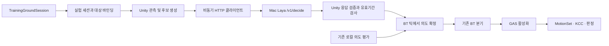

# 훈련장 Mac Laya 전투 연동 설계

상태: 설계안. 런타임 구현·Windows↔Mac 연결·Unity 전투 테스트는 아직 수행하지 않았다.

## 1. 목표와 첫 실험

Windows Unity의 훈련장 `CombatTestMap`에서 실제 몬스터 관측을 Mac Laya 서버로 보내고, 반환된 전투 의도를 기존 BT에 반영한다. Mac이 달라졌을 때 플레이어가 적의 행동 차이를 느끼는지, 지연 때문에 전투 반응성과 읽히는 공격이 손상되지 않는지 확인한다.

Mac은 원격 판단 서버다. Unity가 월드·이동·피격·공격 실행의 권한을 가진다. 서버에는 감지된 정보와 허용 후보만 전달하고, 피해량·위치·애니메이션 실행 명령을 받지 않는다.

첫 범위는 `Golem_Normal`과 `Ent_Normal`을 **각각 한 마리씩** 시험하는 Editor Play Mode 및 Windows Development 빌드다. 기존 Definition·AbilitySet·BT·MotionSet을 사용한다. **UI Toolkit 기반 인게임 디버거와 에디터 디버거 창을 모두 필수 구현**한다. 멀티플레이 동기화, 전용 서버 시뮬레이션, 학습, 다수 몬스터 추론, 일반 플레이어용 설정 UI는 후속 범위다.

구현 순서는 `기존 AI 기준선 → Shadow → RemoteIntent`로 고정한다. 최종 실험에는 RemoteIntent로 실제 행동하는 단계가 포함되어야 하며, Shadow 통신만으로 완료하지 않는다.

## 2. 확인한 근거

| 근거 | 확인 내용과 설계에 주는 제약 |
|---|---|
| [처리자 계약](README.md) · [서버 구현](laya_worker.py) | HTTP `/health`, `POST /v1/decide`, protocol v1. 후보 1~8개, observation 4096 bytes, 본문 65536 bytes. 추론은 전역 1건, 동시 추론은 503. 성공 캐시는 세션+요청 ID 기준 최근 256건이며 영속 exactly-once가 아니다. |
| [몬스터 데이터](enemy-data/README.md) · [요청 변환기](enemy_decision_request.py) | 골렘 4개·엔트 5개 공격과 Motion 연결을 내보냈다. Context 31개 및 런타임 자격을 요구한다. 기존 Python 변환기는 2~8개 후보와 모든 공격 Variant 상태를 요구한다. |
| [Mac 몬스터 보고서](output/enemy-data-review/2026-11-07-mac-02/REPORT.md) | 합성 입력 12건 추론 약 124~222ms. 실제 Unity 관측·CanActivate·Windows 연결·전투는 미검증이다. 원거리 Attack은 BT에서 접근 행동으로 해석될 수 있다. |
| [Mac 고정 평가](output/mac-evaluation-01/2026-11-07-mac-01/REPORT.md) | 기존 평가는 규칙 정책을 권고한다. 한국어 입력 손상이 있어 언어 비교에도 제한이 있다. 이 결과를 실제 몬스터 전투 정확도로 해석하지 않는다. |
| `TrainingGroundSession` · `TrainingGroundConfig.asset` | 훈련장 상대의 생성·정지·재시작을 관리한다. 현재 설정 상대는 무기별 티어와 보스이며 골렘·엔트 전용 실험 선택은 없다. sceneName은 `CombatTestMap`. |
| `EvaluateEnemyCombatIntentService` · `EnemyCombatDecisionEvaluator` | BT 서비스가 매 틱 평가 결과를 Blackboard에 기록한다. 기존 선택은 보정한 점수 상위 3개의 가중 난수다. 해당 경로를 Mac 결과와 함께 쓰면 마지막 기록자가 다른 결과를 덮는다. |
| 두 몬스터 Rules · `ExecuteEnemyAttackNode` | 선택 Intent보다 우선하는 긴급·특수 공격 분기가 있다. 실제 공격은 거리·자격·슬롯·태그 트리거 수락을 다시 검사한다. Intent 수신과 공격 시작은 서로 다른 사건이다. |

권위 기준은 프로젝트의 전투 저작·코드 저작·테스트 검증 지침과 asmdef 온보딩이다. 동봉 `enemy-data/reference/`는 조사 복사본이며 런타임 원본이 아니다.

## 3. 책임 경계



| 구성 | 위치 제안 | 책임 |
|---|---|---|
| `LayaTrainingProfileSO` | Data, `Data/AI/` | Definition 참조, 지원 Intent 목록, 폴링·유효기간·장애 정책. 설정 에셋은 `Assets/10.Datas/AI/Laya/`. Data는 Actor 구현을 참조하지 않는다. |
| `EnemyDecisionObservation` 및 의도 적용 규칙 | Actor, `GameActor/AI/CombatDecision/` | 현재 Context와 실행 자격 캡처, 후보 검사, 응답 적용 가능성 판정. Unity Object는 전송 DTO에 넣지 않는다. |
| `EnemyRemoteIntentController` | 같은 Actor 영역 | 몬스터 한 인스턴스의 pending 요청·응답·소비 여부. BT 서비스가 호출하며 개별 Update를 추가하지 않는다. |
| `LayaDecisionClient` | 같은 Actor 영역 | UnityWebRequest+기존 UniTask로 JSON HTTP 왕복, 취소·오류·크기 제한. Python 프로세스를 매 판단마다 실행하지 않는다. |
| `TrainingGroundSession` 연동 | 기존 Scene 조립 계층 | 실험 프로필로 상대 1마리 생성, 런타임 컨트롤러 주입, 종료 시 취소·해제. Actor에서 Scene 구현을 참조하지 않는다. |
| 진단 이벤트·기록 모델 | Actor의 `AI/Debugging/Laya/` | 요청부터 실제 실행까지 ID로 연결하는 제한된 저장소와 한글 표시용 데이터. Editor/Development에서 기록하며 UI 참조 없음. |
| 공유 디버거 화면 | UI의 `Debug/Laya/` | 런타임 호환 VisualElement·UXML·USS. 한글 라벨, 대상·요청 목록, 상세·시간축을 두 호스트가 공유. UnityEditor 및 UnityEditor.UIElements 참조 금지. |
| 인게임 호스트·실험 조립·파일 기록 | `Debugging/Laya/`의 런타임 코드 | UIDocument/PanelSettings, 기존 개발 UI 입력 계약 연결, Development에서도 생성·설정·진단·내보내기 가능. UnityEditor 없이 동작. |
| 에디터 호스트 | `Tool/Editor/LayaCombatDebuggerWindow.cs` | UI Toolkit EditorWindow, 동일 화면에 현재 Editor Play 세션 또는 저장 로그 주입. 준비 창은 이 창을 여는 진입점만 제공. |

첫 구현은 기존 asmdef 안에 배치한다. 신규 매니저·전역 싱글톤·공용 서비스는 만들지 않고 세션이 수명을 소유한다. 공유가 필요해질 때만 소비자 계약을 추출한다. 런타임 파일 이동과 기존 SerializeReference 타입 변경도 필요 없다.

## 4. 실험 모드와 단일 기록자

| 모드 | 실제 전투 판단 | Mac 사용 |
|---|---|---|
| Native | 기존 로컬 평가 | 요청하지 않음. 같은 시작 조건의 기준선 수집 |
| Shadow | 기존 로컬 평가 | 같은 관측에 대해 선택을 기록하고 실행하지 않음 |
| RemoteIntent | 유효한 Mac 선택 우선, 없으면 로컬 | Mac 선택을 BT에 전달하고 실제 실행까지 추적 |

`EvaluateEnemyCombatIntentService`의 **최종 평가 확정 지점 하나**에서 모드를 선택하고 Blackboard를 한 번만 기록한다. HTTP 완료 콜백은 Blackboard나 상태 머신을 직접 수정하지 않고 결과만 보관한다.

`EnemyCombatDecisionEvaluator`는 관측 구성·점수 계산과 난수 선택을 분리한다. 기존 `TryEvaluate`는 기존 동작을 보존하는 진입점으로 남긴다. Shadow 비교를 위해 로컬 난수 선택을 추가 실행하지 않는다. 같은 관측의 전체 점수·상위 후보와 실제 로컬 선택을 함께 기록하며 최고 점수 일치율을 정답률로 부르지 않는다.

RemoteIntent에서도 현재 긴급 반응·특수 공격과 GAS 검사를 유지한다. 따라서 이 모드의 뜻은 **전술 Intent를 Mac이 선택하는 혼합 제어**다. 모든 공격을 Mac이 결정한다고 표시하지 않는다. BT 우선 분기로 실행되지 않은 선택은 `preempted`로 기록한다. Mac 영향이 거의 없으면 기록을 근거로 후속 전용 Rules 실험을 설계하고, 이번에 원본 우선순위를 임의 변경하지 않는다.

## 5. 관측과 후보

### 관측 작성

실제 메인 스레드 상태를 한 번 캡처하고 로컬 평가와 전송이 공유한다. Context를 네트워크 코드에서 별도로 재계산하지 않는다.

- Context 31개, 현재 레벨·페이즈, 직전 실행 Intent·반복 횟수, 그룹 보정.
- 실제 자신/대상 태그와 필요한 Blackboard 키. `Target.Has`, `Target.Distance`, `Self.StateId`, `HasAttackSlot`, `NextActionAllowedTime`을 포함한다.
- 실제 AbilitySet 상속 결과의 모든 AI 공격 Variant ID·사거리·분류·남은 쿨다운·현재 자격·거절 사유.
- 요청 시각, 대상 인스턴스, 생성 세대, 관측 버전은 Unity의 요청 기록에 보관한다. observation에는 결정에 필요한 값만 넣는다.

`HasAvailableSkillAtDistance()`는 현재 일부 진단 버퍼를 변경하며, `CanActivateAbility()`의 bool만으로 모든 Variant 자격을 설명할 수 없다. 기존 GAS 평가·공격 정책을 공유하는 읽기 전용 캡처 API를 먼저 만든다. 조회 중 비용·쿨다운·슬롯을 소비하거나 난수를 진행하거나 진단 버퍼를 덮지 않아야 한다. 각 Variant가 현재 선택 정책상 도달 가능한지도 구분한다. 별도의 스냅샷용 가짜 CanActivate 계산을 만들지 않는다.

내보낸 정적 `actors.json`에서 현재 HP·태그·쿨다운을 채우지 않는다. 누락 필드는 0이나 true로 추정하지 않고 그 요청을 건너뛴다. 실측 출처는 `runtime_capture`로 남긴다. 플레이어의 미입력 행동·숨은 미래 판정·다음 난수를 보내지 않는다.

### 후보 생성

1. 프로필의 지원 Intent를 실제 Rules의 도달 가능한 분기와 대조한다. 점수가 높다는 이유만으로 후보에 넣지 않는다.
2. 행동 가능 상태·대상·지연·모션·공격 자격·슬롯 정책 등 공유된 실행 조건으로 걸러낸다. 후보 평가 때문에 슬롯을 선점하지 않는다.
3. `Attack`은 해당 BT가 지원하면 **접근 후 공격 시도**까지 포함한다. 현재 사거리 밖이라는 이유만으로 무조건 제거하지 않는다. 접근조차 할 수 없는 공격은 후보에서 제외한다. `Punish/Counter`의 짧은 기회는 응답 시 다시 확인한다.
4. 현재 두 몬스터에 실제 경로가 있는 Intent만 사용한다. 9종 enum 전체를 기계적으로 전송하지 않는다. 8개를 넘으면 명시된 프로필 순서로 제한하고 제외 목록을 남긴다. 로컬 상위 3개 제한은 기본으로 사용하지 않는다.
5. 후보 0개면 요청 없이 BT의 기존 유지·복구 흐름을 따른다. 후보 1개면 로컬 단일 후보 결정으로 기록하고 Mac을 호출하지 않는다. 후보 2~8개만 추론한다.

기존 `Attack` 설명은 즉시 가능한 공격처럼 읽힐 수 있다. 신규 런타임 후보 설명은 접근 가능성을 정확히 적고 `candidate_description_version`을 결과 메타데이터에 남긴다. 과거 합성 평가 입력·기본 프롬프트를 덮지 않는다. Unity 생성 JSON은 Python 변환기의 동일 실측 fixture 출력과 대조한다. 기존 변환기가 2~8개를 요구하는 계약은 유지한다.

토큰·byte 제한을 넘으면 필수 필드나 후보 설명을 조용히 자르지 않는다. 요청 불가 사유를 남기고 로컬 판단을 사용한다. `enemy-data/worker-config.json`의 몬스터 지시문으로 서버를 시작하며 모델·revision·설정 hash를 실행 기록에 보존한다.

## 6. 요청·응답 수명과 지연

### 식별자

| 값 | 용도 |
|---|---|
| `session_id` | 실험 시작·재시작마다 새 값. 씬 재진입과 이전 전투를 분리 |
| `request_id` | 세션 안에서 몬스터 생성 세대와 판단 순번을 포함하는 고유 문자열 |
| `state_seq` | **전송한 스냅샷 순번**. 응답이 원래 pending 요청과 같은지 확인. 매 프레임 현재 번호와 비교하지 않음 |
| 로컬 `actorGeneration`, `targetGeneration`, `decisionEpoch` | 풀링·대상 교체·전투 중단 등으로 요청의 의미가 사라졌는지 판정. 서버 v1 필드에 추가하지 않음 |

순번 일치만으로 적용하지 않는다. 응답 식별자는 pending 요청과 정확히 일치해야 하고, 현재 세대·상황·유효기간도 별도로 만족해야 한다.

### 흐름

1. 정상 전투 틱에서 전송 간격이 지났고 진행 중 요청이 없으면 관측을 캡처한다. 세션 전체 in-flight는 1건이다. 대기열을 쌓지 않는다.
2. 요청 대기 중에도 기존 로컬 BT·이동·긴급 반응은 진행한다. 대기 때문에 시간 배율·캐릭터·애니메이션을 멈추지 않는다.
3. 응답이 오면 제한 크기와 JSON·protocol·ID·후보 포함 여부를 검사한다. 확률은 유한한 0~1 값과 후보 키·합을 검증하고, 높다는 이유로 가드를 생략하지 않는다. 예상 모델·revision·설정 hash도 확인한다.
4. 다음 BT 서비스 틱에서 현재 상태를 다시 검사한다. 유효하면 **새 행동을 선택할 수 있는 경계에서 한 번** 소비한다. 진행 중 공격·텔레그래프·피격·캔슬 창을 응답으로 끊지 않는다.
5. 경계까지 기다리다 유효기간을 넘으면 폐기한다. 공격이 이미 시작됐으면 이전 요청은 다음 공격으로 재사용하지 않는다.
6. 결과는 `applied / expired / invalidated / rejected / preempted / cancelled` 중 하나의 최종 처리 사유를 갖는다. 같은 응답·동일 request ID 재수신으로 행동을 두 번 시작하지 않는다.

일반 거리 변화·지속적인 Chase·매 틱 Context 갱신만으로 epoch를 올리지 않는다. 현재 거리 구간·시야·공격 준비·플레이어의 노출된 행동을 다시 검사해서 해당 Intent의 의미가 유지되는지 판단한다. 반면 대상 교체, 페이즈 교체, 새 공격 시작, 피격/사망, 훈련 정지, 씬 이탈, 풀 반환은 pending 결정을 무효화한다. hitstop과 게임 일시정지 동안에는 적용하지 않으며 일시정지 진입 시 pending을 취소한다.

### 초기 실험 설정

다음 값은 **실측 전 시작값**이며 프로필에서 조정한다. 성능 보장값이 아니다.

| 설정 | 시작값 | 의미 |
|---|---:|---|
| 요청 간격 | 0.5초 | 1마리 최대 약 2회/초. 서버 1건 처리 제약 고려 |
| 관측 유효기간 | 0.75초 | 전송 시점부터 BT 적용까지 전체 시간. 응답 도착부터 새로 계산하지 않음 |
| HTTP 제한 시간 | 1.0초 | 유효기간이 지난 응답은 성공 HTTP여도 폐기 |
| 연속 일시 장애 후 중단 | 3회 | 즉시 연결 재시도 루프를 막고 로컬로 유지 |
| 중단 후 준비 확인 | 5초 간격 | health 확인 후 새 관측으로 재개. 이전 요청 재생 없음 |

HTTP 제한 시간·유효기간은 단조 증가하는 unscaled 시간으로 측정한다. 실제 BT 지연·쿨다운은 기존 게임 시간을 따른다. 서버 `inference_ms`, Windows 왕복, 관측→BT 적용 시간을 따로 기록한다.

클라이언트 취소는 서버 추론 취소를 보장하지 않는다. 취소·시간 초과 뒤에도 서버가 busy일 수 있으므로 다음 요청은 backoff를 적용한다. health는 준비·연결 확인이며 추론 슬롯이 비었다는 보장은 아니다.

## 7. 통신·장애 정책

기존 HTTP v1을 그대로 사용한다. JSON은 UTF-8, Content-Length 방식이며 리다이렉트는 거절한다. 새 중계 서버·WebSocket·프레임 스트리밍은 필요 없다.

| 상황 | 동작 |
|---|---|
| 연결 실패·timeout·503·502/5xx | 해당 결정을 실패로 기록하고 즉시 로컬 유지. 간격을 둔 새 관측 요청. 연속 장애 기준이면 원격 중단 |
| 401 | 인증 설정 오류로 원격 중단. 사용자가 설정을 고친 후 명시적 연결 재검사 |
| 400/409/413/415/422 또는 응답 계약 위반 | 입력·계약 오류로 원격 중단. 같은 잘못된 요청을 반복하지 않고 요청·오류를 보존 |
| 사망·정지·재시작·씬 이탈 | 취소, 세대 무효화, 런타임 바인딩 해제. 늦은 응답 폐기 |
| 일시 장애 복구 | health 성공 후 새 요청으로 복귀. 전환 사건과 fallback 구간을 기록 |

첫 구현은 판단 요청 자동 재전송을 하지 않는다. 재전송을 후속 도입한다면 살아 있는 요청에 한해 동일 ID·동일 본문만 가능하며 로컬 소비 가드가 필요하다. 서버 캐시를 exactly-once 실행 보장으로 취급하지 않는다.

기본 연결은 [무료·무계정 HTTPS 터널 지침](MAC_HTTPS_TUNNEL_WORK_ORDER.md)의 실제 `https://<임시주소>.trycloudflare.com` 루트이며 요청 경로는 `/v1/decide`다. Mac 서버는 `127.0.0.1:8765`를 유지하고 기존 `LAYA_WORKER_TOKEN` Bearer 인증을 반드시 적용한다. VPN·공유기·SSH 설정과 Windows 로컬 리스너는 변경하지 않는다. 토큰은 환경변수에서만 읽고 프로필·로그·세이브에 기록하지 않는다. endpoint는 개발 PC의 로컬 설정으로 관리하며 터널 재실행 후 갱신한다. Unity Editor/Player는 토큰 환경변수를 상속하는 프로세스로 새로 시작한다.

## 8. 훈련장 연결과 사용자 조작

기존 `TrainingGroundSession`에 **Definition을 지정하는 검증된 단일 상대 생성 경로**를 추가하고, 기존 지면 검사·그룹 생성·실패 시 이번 생성분 정리를 공유한다. 무기별 tiers에 골렘을 끼워 넣거나 기존 UI 인덱스를 재해석하지 않는다.

공유 UI Toolkit 디버거에 `기존 AI / 관찰 비교 / Mac 의도 적용`, 실험 프로필, 연결 검사, 시작·종료와 상세 진단을 제공한다. 에디터와 Development 빌드 모두 이 기능을 사용할 수 있어야 한다. profile의 Definition 참조로 대상을 선택하며 액터 이름·씬 이름으로 런타임 분기하지 않는다. 시작 시 씬의 TrainingGroundSession 참조·훈련 상대 여부로 범위를 제한한다.

RemoteIntent 시작은 준비 확인과 상대 데이터 검사 후 허용한다. 서버가 준비되지 않았으면 시작 실패를 알리고 사용자가 Native를 선택할 수 있다. 시작 후 장애는 명시된 로컬 fallback으로 처리한다. 모드·프로필 전환은 대련 종료 후 가능하며 전환 시 세션 ID를 새로 만든다.

훈련 정지 시 원격 요청도 취소한다. 공격 제한 연습은 첫 실험과 동시에 켜지 않도록 준비 단계에서 검사한다. 기존 상대와 실험 상대를 동시에 생성하지 않는다. 실패 시 이번 소환·바인딩만 정리하고 다른 사용자 작업을 건드리지 않는다.

사람이 반복해서 여는 `Laya 전투 디버거` 에디터 창은 `[UPlaygroundTool]`과 기존 툴 런처의 전투 진단 카테고리에 등록한다. 개발 치트 패널에도 인게임 디버거 열기 진입점을 추가한다. 결과 수집용 일회성 도구를 새 메뉴에 등록하지 않는다. 입력·표시·개발 빌드 수명은 다음 절의 명세를 따른다.

### 8.1 두 디버거의 공통 사용 경험

목적은 **어느 몬스터가, 무엇을 보내서, 무슨 답을 받았고, 실제로 어떤 동작을 했는지 한 건씩 설명하는 것**이다. 원시 JSON만 나열한 콘솔로 만들지 않는다. [화면 시안](TRAINING_GROUND_DEBUGGER_PREVIEW.html)은 가상 데이터로 배치·상세 탐색을 검토하는 브라우저 시안이며 Unity 구현·연결 결과가 아니다.

공유 화면은 런타임 UI Toolkit 기능만 사용한다. `UnityEditor.UIElements.MultiColumnListView` 같은 Editor 전용 위젯 의존을 만들지 않고 런타임 ListView와 행 템플릿을 사용한다. EditorWindow는 이 화면을 감싸며 Editor 전용 에셋 선택·로그 파일 열기만 호스트에 둔다. 별도 프로세스인 Development Player를 에디터 창이 실시간 원격 감시하는 전송 계층은 이번 범위에 넣지 않는다. Player는 인게임 창으로 관찰하고 저장 로그를 에디터에서 열 수 있다.

| 영역 | 반드시 보이는 정보 |
|---|---|
| 상단 연결·실험 바 | 연결됨/추론 중/재연결 대기/인증 오류, 서버 주소, 현재 모드, 기록 상태, 세션, 프로필. 모델·revision은 펼침 상세. 상태는 색+한글로 함께 표시 |
| 왼쪽 대상 목록 | 표시 이름+인스턴스 번호, 생존·정지 여부, 현재 상태, 현재 공격, 대상 이름·거리·HP. 선택 대상과 현재 요청 대상은 명확히 구분 |
| 중앙 요청 이력 | 시각, 대상, 요청 번호, Mac 선택, 최종 처리, 왕복/전체 지연. 대상·오류·지연 초과 필터, 검색, 최신 따라가기. 요청이 생겨도 기존 선택·스크롤을 빼앗지 않음 |
| 오른쪽 상세 | 선택된 요청의 요약, 당시 관측, 후보, 송신/응답 원문, 실행 이력. 현재 대상 상태와 과거 요청 당시 상태를 각각 표시 |
| 하단 진단 요약 | 수신/적용/실제 실행/폐기/로컬 전환 수, 관측→적용 P50/P95, 화면 갱신 상태, 버퍼/기록 손실. 분모와 측정 구간 표시 |

상세 첫 문장은 `골렘 #01 → Mac이 ‘공격’을 선택 → Unity 수락 → 강공격 ‘지면 강타’ 시작`처럼 읽히게 한다. 거절은 `응답은 도착했지만 대상이 변경되어 적용하지 않았습니다`, 우선 분기는 `Mac은 후퇴를 선택했지만 긴급 반격이 먼저 실행되었습니다`처럼 원인과 결과를 함께 쓴다. 아직 실행되지 않았으면 ‘실행 대기’, 관찰이 끝나지 않았으면 ‘미확인’으로 남긴다.

요청 수명과 실행 결과는 독립 필드다. `송신 → 수신 → 검증 → 적용 대기 → 의도 적용` 이후 `행동 시작/거절/우선 분기 개입/종료`를 연결한다. 6절의 처리 코드는 유지하되 UI에서 단일 초록색 ‘성공’으로 뭉치지 않는다. HTTP 200·모델 선택·의도 적용·공격 명중은 각각 다른 사실이다.

### 8.2 한글 상세와 패킷 검사

- **요약:** 선택 의도, 실제 행동, 판단 출처, 반영/폐기 사유, 현재 남은 응답 유효시간. 과거 기록의 유효시간은 당시 최종 처리 시점 값으로 고정.
- **관측:** ‘자신 / 상대 / 거리·시야 / 전투 리듬 / 그룹 / 공격 준비’로 묶고 `체력 62%`, `거리 3.2m`, `다음 행동까지 0.3초`처럼 단위를 표기. 현재값과 혼동하지 않도록 ‘송신 당시’를 명시. 필드 원래 키는 보조 텍스트·검색·펼침으로 접근.
- **후보:** `공격`, `빈틈 공략`, `반격`, `압박`, `추격`, `후퇴`, `거리 유지`, `방어`, `회복`의 고정 한글 매핑. 후보 설명·현재 가능 여부·제외 이유·Mac 확률·로컬 점수를 별도 열로 표시. 로컬 점수를 확률처럼 보이게 하지 않음.
- **패킷:** `보낸 내용 / 받은 내용` 탭, HTTP 메서드·경로·상태·byte 크기·Content-Type·ID, UTF-8 JSON 원문, 접기·검색·복사·내보내기. 한글 해설과 원문 키는 분리하며 원문 값을 번역해서 바꾸지 않음. 응답 없음·잘못된 JSON·오류 본문도 검사 가능.
- **실행:** 당시 선택 대상, 실제 BT 분기, 상태 전이, Ability/Variant/MotionKey, 태그 트리거 수락·슬롯 결과·취소/거절 사유, 실제 시작/종료/타격 사건. 한글 콘텐츠 이름이 없으면 원래 ID와 ‘이름 미등록’을 함께 표시하고 지어내지 않음.

Authorization 등 비밀 헤더는 캡처 시점부터 제거한다. 화면에만 마스킹하고 복사·저장에는 남기는 구조를 금지한다. 제한 내 실제 송신·수신 본문은 보존하되 큰 본문·무한 오류 스트림은 최대 크기에서 자르고 ‘일부 보관’과 원래 크기를 표시한다. wire packet은 HTTP 애플리케이션 요청/응답을 뜻하며 TCP·SSH 패킷 덤프는 아니다.

### 8.3 시간 측정과 시간축

선택한 요청 아래에 ‘관측·직렬화 → HTTP 왕복 → 적용 대기 → 행동 시작’을 가로 시간축으로 표시한다. 각 구간의 숫자·단위를 함께 읽을 수 있어야 한다. 짧은 구간도 선택해 상세를 확인할 수 있게 최소 표시 폭을 두되 실제 길이는 숫자로 제공한다.

| 한글 라벨 | 측정 경계 |
|---|---|
| 준비 | Unity 관측 캡처 시작 → HTTP 전송 시작 |
| 왕복 | 전송 시작 → 본문 수신 완료. 직렬화 준비 시간과 분리 |
| Mac 추론 | 서버가 반환한 `inference_ms`. 왕복 막대 안의 참고 값이며 더해서 전체 시간을 만들지 않음 |
| 적용 대기 | 수신 완료 → BT 적용 또는 최종 폐기 |
| 전체 반영 | 관측 캡처 → BT 의도 적용. 미적용이면 ‘미적용’ |
| 행동 대기 | BT 의도 적용 → 실제 행동 시작. 시작되지 않으면 ‘미실행’ |
| 동작 길이 | 실제 시작 → 종료. 취소·중단·진행 중 구분 |

Mac과 Windows의 절대시각을 빼서 편도 네트워크 지연을 계산하지 않는다. 측정 불가 값은 ‘측정 안 됨’으로 표시한다. 왕복·추론·전투 동작 시간은 서로 다른 축임을 유지하고 지연 초과 기준을 화면에서 확인할 수 있게 한다.

### 8.4 인게임 표시·입력·Development 수명

인게임 호스트는 `UIDocument`와 빌드에 포함된 `PanelSettings/UXML/USS/한국어 FontAsset`을 직렬화 참조로 로드한다. `AssetDatabase`, EditorPrefs, 에디터 절대경로, 파일 선택 대화상자 없이 시작할 수 있어야 한다. 공유 USS/UXML은 Editor 폴더 밖에 둔다. `UNITY_EDITOR || DEVELOPMENT_BUILD`에서 호스트·상세 기록을 활성화하고 Release에서는 진입점·기록 구독을 제외한다.

기존 `UI_Base` 개발 화면 호스트 또는 동일한 기존 UI 수명 계약에 UIDocument를 연결하여 System 입력 레이어·커서·포커스 복원을 지킨다. 실제 콘텐츠는 UI Toolkit이며 uGUI로 다시 그리지 않는다. uGUI Selectable과 UI Toolkit FocusController는 직접 호환되지 않으므로 Navigate/Submit/Cancel·탭 입력을 명시적으로 연결하고 중복 발화를 막는다. 새 전역 입력 시스템은 만들지 않는다.

- **요약 모드:** 화면 가장자리의 작은 상태·선택 대상·최근 결과. picking과 포커스를 받지 않고 게임 입력을 막지 않는다. 대상 자동 추적은 명시적 옵션이며 전투 타깃 자체를 변경하지 않는다.
- **상세 모드:** 화면 대부분을 사용하는 진단 패널. 게임 입력을 차단하고 초기 포커스를 대상 목록에 둔다. 기본은 전투가 계속되며 ‘전투는 진행 중’을 표시. 목록 조작과 공격 입력이 동시에 발화하면 실패다.
- **화면 갱신 멈춤:** 표시 스냅샷만 고정한다. 전투·추론·기록은 계속되며 버튼 이름을 ‘일시정지’로 줄이지 않는다. 추적 재개 시 선택을 유지하거나 사용자가 최신 따라가기를 선택한다.
- **전투 일시정지:** 별도 명시적 조작. 기존 일시정지 서비스 계약을 사용하고 pending 취소 정책을 따른다. 다른 메뉴가 소유한 정지를 닫기 동작이 해제하지 않도록 소유권을 보존한다.
- **게임패드:** D-Pad/스틱 목록 이동, Submit 상세 열기, Cancel 상세→요약→닫기, 숄더 주 탭·트리거 상세 탭. 포커스가 가상화 목록 밖으로 사라지지 않게 하고 선택에 맞춰 스크롤한다. 키보드·마우스도 지원하고 기존 입력 글리프를 사용한다.

Development에서도 프로필 선택·서버 연결 검사·훈련 상대 생성·모드 선택·기록 내보내기가 가능해야 한다. 기본 프로필은 빌드 참조에 포함하고 endpoint는 로컬 설정/실행 인자, 토큰은 환경변수에서 읽는다. 로그는 `Application.persistentDataPath/LayaTraining/<session-id>/`에 저장하며 실제 경로·저장 성공/실패를 표시한다. 복사는 클립보드, 내보내기는 고정 경로로 수행하므로 Editor 기능이 필요 없다.

### 8.5 미술·레이아웃 기준

‘예쁜 디버거’의 기준은 장식량이 아니라 위계·정렬·정보 밀도다. 기존 개발 치트 패널과 UI Toolkit 에디터의 어두운 중성색 배경·청록 선택색을 이어받는다. 기존 폰트 크기·여백·팔레트를 조사해 공유 USS 토큰으로 맞추고, 밝은 본문과 낮은 명도의 구분선으로 세로 열을 정렬한다. 중요 수치는 tabular 숫자, 원문 JSON은 한글 폴백이 있는 고정폭 폰트를 쓴다.

상태는 ‘연결됨 / 대기 / 지연 / 거절 / 로컬 전환’ 텍스트와 절제된 의미색을 함께 쓴다. 모든 행을 색칠하거나 카드 안에 카드를 겹치지 않는다. 패킷·실행 상세는 선택한 한 건에 집중하고, 오류는 해당 행과 상세 원인에서 강조한다. 성공·오류 아이콘은 기존 `Assets/04.Images/`·`Assets/ExternalAssets/UI/`에서 가져오며 새 이미지를 생성하지 않는다. 한국어 폰트는 실제 프로젝트 원본에서 UI Toolkit용 FontAsset을 준비하고 Player 포함·한글 glyph를 검증한다.

1920×1080에서는 대상/이력/상세 3열, 1280×720이나 좁은 에디터 창에서는 상세를 탭 또는 슬라이드 영역으로 전환한다. 창 폭에 따라 글자부터 줄이지 않으며 한글 라벨은 읽을 수 있는 크기를 유지한다. 긴 ID는 가운데 생략+전체 보기/복사, 긴 본문은 가로/세로 스크롤로 처리한다. 고해상도 UI 배율·안전 영역도 확인한다.

열기·닫기는 기존 개발 화면 타이밍, 선택 강조는 0.08~0.15초 범위를 따른다. UI Toolkit opacity/translate 트윈은 `DOTween.To(...).SetUpdate(true)`로 제어하고 detach/닫기 시 정리한다. 수치·패킷 행이 들어올 때마다 반짝이거나 움직이지 않는다. 프로파일링용 연출 끄기 옵션을 제공한다.

### 8.6 계측 오버헤드와 보존

통신/실행 이벤트를 하나의 읽기 전용 진단 저장소에 쌓고 양쪽 화면은 구독한다. 화면을 열거나 닫아도 요청 횟수·실행 순서·난수는 변하지 않아야 한다. UI가 모델·서버를 직접 호출하거나 임의 선택을 실행하지 않는다. 명시적 실험 제어만 기존 세션 명령으로 보낸다.

초기 상한은 메모리 요청 이력 512건·본문 합계 8MiB, UI 갱신 5Hz로 두고 프로필에서 조정한다. virtualized ListView, 선택 상세의 지연 JSON 포맷팅, 재사용 행/버퍼를 사용한다. 상한 도달 시 오래된 본문을 먼저 퇴출하고 남은 메타데이터에 ‘본문 보관 만료’를 표시한다. 선택 고정도 메모리 상한을 우회하지 못한다. 파일 기록 큐는 별도 상한을 두고 누락 수를 노출한다. 숨긴 화면의 UI 작업은 중단하되 활성 실험의 기록은 유지한다.

실험 종료 후 메모리 기록을 유지해 검사하고 다음 세션과 섞지 않는다. 씬 이탈·풀 반환 후에는 보존한 DTO로만 과거를 표시하며 파괴된 Unity Object를 따라가지 않는다. 디버거가 두 개 열려도 기록이 중복되지 않아야 한다.

## 9. 기록과 판정

Editor 실험 결과는 `Tools/LayaWorker/results/training/<session-id>/`에 저장한다. 이 경로는 기존 gitignore 대상이다. Development Player는 8.4절의 persistentDataPath를 사용한다. 두 환경은 동일한 schema/version으로 세션 metadata, observations/requests/responses, decisions, executions를 JSONL로 분리하고 ID로 연결한다. 실패한 HTTP도 성공 선택으로 바꾸지 않고 기록한다. 쓰기 실패·버퍼 초과는 실험 기록 불완전으로 표시한다.

- **식별:** 코드 revision과 dirty 여부, Unity 버전, Definition/AbilitySet/BT 참조와 콘텐츠 hash, 프로필·설명 버전, 모델·revision·설정 hash, 입력 장치, 훈련 보조 설정.
- **판단:** 관측, 후보와 제외 사유, 로컬 점수·실제 선택, Mac 선택과 확률, decision source, 요청·응답·적용 시각, fallback·폐기 사유.
- **실행:** 요청 ID 또는 로컬 decision ID, 실제 BT 분기, Intent 실행 여부, Ability/Variant/MotionKey, 활성화 거절, 공격 시작·종료·명중, 슬롯 결과. 긴급 분기가 끼어들면 별도 출처로 표시한다.

기존 `IntentScoreTimeline`·`EncounterReplayRecorder`·`CombatTelemetrySession`을 우선 재사용한다. 다만 현재 EncounterReplay만으로 Context 31개를 복원할 수 없으므로 실제 관측 원문은 별도 보존한다. 계측에서 행동 난수를 소비하지 않는다. 틱에서 JSON 직렬화·파일 I/O를 직접 수행하지 않고 재사용 캡처 버퍼와 제한된 기록 버퍼를 사용한다. Unity Object 조회는 메인 스레드에서 끝낸다.

다음 수치를 분리한다: 요청 성공률, 유효 응답률, RemoteIntent 적용률, 적용 후 BT 실행률, 로컬 fallback 비율, 우선 분기 개입률, 관측→적용 P50/P95, 공격 빈도·압박 간격·같은 Intent 반복·명중/피격. 단일 후보는 Laya 판단 건수에서 제외한다.

연결이 성공했어도 외부 Intent 적용 또는 실제 실행이 0이면 전투 연동 검증은 실패다. 적용률이 낮으면 지연·유효성 폐기·BT 우선 분기를 먼저 구분하며 유효기간을 무작정 늘리지 않는다. Mac이 더 강한지만 보지 않고 공격의 예측 가능성·응징 기회·멈춤·억울한 반응을 사용자 플레이로 판정한다.

## 10. 구현 순서와 완료 조건

| 단계 | 작업 | 완료 조건 |
|---|---|---|
| P1 | 관측/점수/난수 선택 분리, 읽기 전용 Variant 자격 API, 프로필·단일 상대 생성 | Native 동작과 RNG 소비 보존. 원본 데이터 저장 없음. 골렘·엔트 전체 공격 연결 검사 |
| P2 | HTTP 클라이언트·모의 서버·응답 수명 테스트 | 취소·timeout·잘못된 JSON/ID/행동·재수신·503에서 안전하고 중복 실행 없음 |
| P3 | Shadow와 관측/실행 기록 | 실측 요청이 계약·토큰 제한에 들어감. Native 실행을 계측이 바꾸지 않음 |
| P4 | BT 단일 확정 지점에서 RemoteIntent 반영 | 골렘·엔트 각각 Mac 선택이 실제 BT 행동을 일으키고 GAS 재검사를 통과함 |
| P5 | 공유 UI Toolkit 화면·에디터 창·인게임 호스트 | 같은 요청의 관측·원문·결과·실행·시간축, 한글·포커스·요약/상세·저장 로그 열기 완성 |
| P6 | Windows Development 빌드 통합과 사용자 검증 | Editor 없이 실험 시작·Mac 통신·한글 디버거·내보내기. 아래 결과 수신·실패 수정·재검증 |

관련 EditMode 검사는 후보 0/1/8개·미지원 Intent, Variant 자격 누락·조회 부수효과, ID/확률 오류, TTL 경계, 같은 응답 2회, 풀 재사용·타깃/페이즈 변경, 일시정지, 전송 제한, fallback 출처를 다룬다. 모의 서버 성공은 실제 Mac 추론·왕복 성공과 별도로 보고한다.

기존 테스트의 현재 목록을 조사한 뒤 Intent·Ability 선택·훈련 세션 회귀를 선택한다. Unity 컴파일과 관련 EditMode를 먼저 확인한다. **Development 빌드 실행은 이번 요구사항이므로 구현 완료 시 Windows Development Player 빌드·실행 검증을 포함한다.** 현재 설계 작업에서는 빌드하지 않는다. 필요한 콘텐츠 빌드 여부는 현행 프로젝트 로딩 경로를 조사해 결정하며 불필요한 Addressables 전체 재빌드는 피한다. 검증이 만든 데이터·프리팹 자동 재직렬화는 diff로 구분해 자동 변경만 복구한다.

## 11. 구현 후 사용자 테스트 명세

이 절은 구현 후 실행할 명세다. **현재는 실행 가능한 완성 기능을 뜻하지 않는다.**

준비: Unity 6000.3.21f1 이상, `Assets/01.Scenes/Test/CombatTestMap.unity`, 기존 전투 테스트 준비 창. 다른 상대가 없는 상태, 같은 캐릭터·장비·레벨·시작 거리·보조 설정을 고정한다. 게임패드로 기본 전투를 하고 실패 시 장치 종류를 기록한다. 실험 옵션은 세션 전용이며 영구 저장을 수정하지 않는다.

Mac에서 `Tools/LayaWorker`로 이동해 가상환경 활성화 후 실행:

```bash
python laya_worker.py serve --config enemy-data/worker-config.json --host 127.0.0.1 --port 8765
```

`--offline`은 모델 캐시가 준비됐을 때만 추가한다. 현재는 실행 전에 토큰을 설정하고 [HTTPS 터널 지침](MAC_HTTPS_TUNNEL_WORK_ORDER.md)에 따라 로컬/공개 인증·실제 Laya metadata를 확인한다. `Laya 준비 완료` 출력 전에는 연결 준비가 된 것이 아니다. 아래 SSH는 직접 접근 가능한 환경의 대체 경로일 뿐 현재 실행 절차가 아니다:

```powershell
ssh -N -o ExitOnForwardFailure=yes -L 18765:127.0.0.1:8765 <사용자>@<Mac주소>
```

| ID | 절차 | 기대 결과 / 실패 기준 |
|---|---|---|
| T01 준비 | 연결 검사 후 골렘 단일 상대 선택 | health 및 설정 확인, 중복 소환 없음. 잘못된 프로필·모델 설정은 시작 거절 |
| T02 기준선 | Native로 근거리·원거리·가드·공격 후딜 노출을 포함해 약 2분 전투 | Mac 요청 0. 기존 공격·피격·전조·히트스톱 정상. 새 예외 없음 |
| T03 Shadow | 같은 조건에서 Shadow 약 2분 | 실제 runtime_capture 요청·원시 응답 존재. 외부 행동 적용 0. 모델 응답과 로컬 선택을 구분 |
| T04 골렘 | 재시작 후 RemoteIntent로 같은 상황 전투 | Mac 선택→적용→실제 BT 행동 연결 사례 존재. 기존 공격을 응답으로 중단하지 않음 |
| T05 엔트 | 엔트로 T02~T04 반복 | 원거리 공격 자격을 실제로 구분. 근거 없는 제자리 공격·동결·공격 폭주 없음 |
| T06 장애 | RemoteIntent 중 서버 종료 또는 터널 해제 | 로컬 fallback과 출처 표시. 메인 스레드 멈춤·예외 폭주·무응답 대기열 없음. 복구 후 새 관측부터 재개 |
| T07 수명 | 요청 중 정지→재개, 일시정지, 몬스터 사망, 재시작, 씬 이탈 | 이전 응답으로 행동 시작 없음. 잔류 요청·바인딩·테스트 설정 없음 |
| T08 입력/감각 | 접근·회피·가드·공격과 기존 캔슬을 반복 | 전조·입력 반응·히트스톱·카메라·압박 휴지가 기준선 대비 손상되지 않음. 사람 판정 기록 |
| T09 에디터 디버거 | 새 디버거 창에서 대상·요청 선택, 관측/후보/패킷/실행 탭과 시간축 확인 | 요청 ID로 실제 송수신·실행 연결. 한글 원인과 원본 ID를 함께 확인. 창을 닫았다 열어도 실험에 영향 없음 |
| T10 인게임 조작 | 요약→상세 전환, 게임패드 목록/탭/Cancel, 마우스·키보드 전환 | 요약은 전투 입력 통과, 상세는 공격 입력 차단. 초기 포커스·선택 스크롤·Cancel 복원 정상 |
| T11 갱신 정지 | 화면 갱신 멈춤 후 전투·기록 확인, 별도로 전투 일시정지 | 표시만 고정할 때 전투/기록 지속. 전투 정지는 기존 정책대로 pending 취소. 디버거 UI는 정지 중 조작 가능 |
| T12 Development | 빌드 식별 정보 기록 후 Editor를 종료하고 Player에서 연결/프로필/실험/디버거/내보내기 수행 | UI Toolkit·한국어 폰트·패킷·실제 행동 모두 정상. Editor 경로 의존 0. persistentDataPath 로그를 에디터에서 재개방 가능 |
| T13 부하·화면 | 기록 상한까지 유지, 창 2개 열기, 1280×720/1920×1080/고해상도 배율 | 중복 요청/기록 없음. 메모리 상한·누락 표시·가상화 정상. 한글 잘림·선택 점프·원문 겹침 없음. 디버거 전후 프레임/할당 차이 기록 |
| T14 오류·보안 | 잘못된 JSON·timeout·인증 오류·보관 만료·쓰기 실패를 재현 | 원인·미수신·부분 보관 상태가 한글로 구분되고 성공으로 표시되지 않음. 복사/파일에 토큰 없음 |

각 모드의 조건과 순서를 기록하고 골렘·엔트를 따로 집계한다. 가능하면 Native/RemoteIntent 순서를 바꾸어 반복하되 동일 난수 전투 재현이라고 주장하지 않는다. Unity Console 예외·서비스 경고 여부는 전투 진행 성공과 별도 칸으로 판정한다.

회신 형식: `항목 ID / 통과·실패·미수행 / 실제 결과 / 세션 ID·로그 경로 / 필요 시 영상`. 실패 시 시작 조건·입력 장치·어느 공격/거리에서 발생했는지도 남긴다.

## 12. 현재 판정

저장소 코드·정적 데이터·기존 Mac 결과를 근거로 연동 구조와 검증 범위를 정했다. UI Toolkit 인게임/에디터 디버거와 Development Player 검증을 필수 범위로 추가했다. 문서의 초기 시간·메모리 예산과 후보 정책은 구현 후 실측·플레이 결과로 조정한다. 이번 작업에서는 런타임 코드·에셋·씬을 변경하지 않았으며 실제 연결·컴파일·EditMode·Play Mode·Player 빌드는 수행하지 않았다. 브라우저 시안은 가상 데이터이며 실제 디버거의 동작·미술 검증을 대체하지 않는다.
