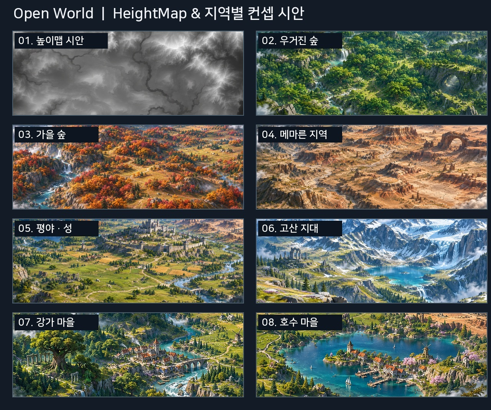
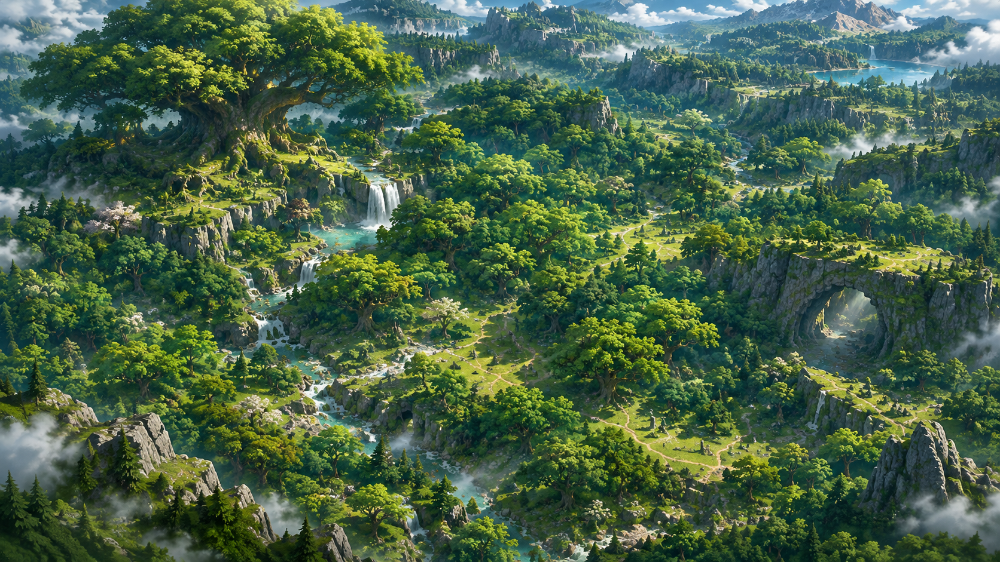
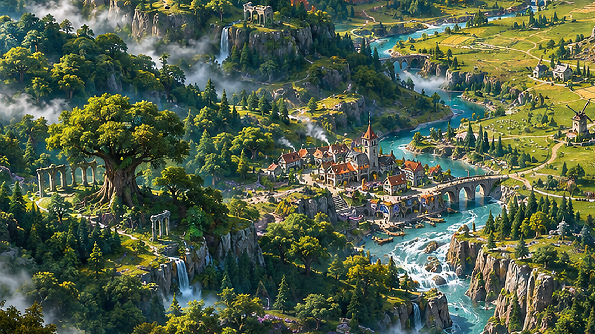
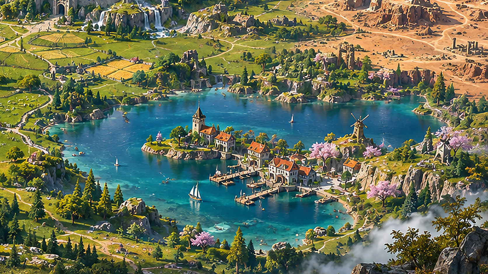

# HeightMap 기반 오픈월드 제작 시스템

확정 설계 v1.0 · 2026-11-16 · Unity 구현/실행 미수행

<a id="decisions"></a>

## 01. 확정 설계와 범위

HeightMap은 지표의 기초 데이터다. 동굴·건물·물·폭포·식생은 별도 저작 레이어로 만들고, 최종 지형 및 배치 결과만 게임에 전달한다.

| 결정 ID | 확정 사항 | 구현에서 지켜야 할 경계 |
| --- | --- | --- |
| D01 | **에디터 생성 → 수작업 튜닝 → 부분 재생성 → 검증 → Bake** | v1은 실행 중 월드 전체를 생성하지 않는다. 런타임은 검증된 Bake만 로드한다. |
| D02 | **Unity Terrain + 별도 Mesh/Prefab 혼합** | HeightMap으로 동굴·오버행·건물·수면을 표현하려 하지 않는다. |
| D03 | **저작 원본과 생성 결과 분리** | TerrainData와 Scene은 파생 결과다. 원본 HeightField·레이어 명령·배치 오버라이드가 진실의 원천이다. |
| D04 | **고정 좌표·결정론·안정적 ID** | 같은 입력/버전의 재생성과 타일 처리 순서 변경이 같은 논리 결과를 만든다. Seed/알고리즘 변경은 마이그레이션 대상이다. |
| D05 | **규칙의 값은 데이터, 새 동작은 코드** | 새 나무·건물·바이옴·프리셋은 데이터만 추가한다. 새로운 배치 알고리즘·렌더러는 코드 확장이다. |
| D06 | **16-bit RAW를 높이 교환 표준으로 사용** | 높이 이미지, 수면 높이, 지형 텍스처, Hole, 오브젝트 목록을 분리한다. PNG는 참고·외부 교환용이며 v1 Unity 입력은 RAW다. |
| D07 | **URP 물 표현은 별도 제작** | 수면 Mesh + URP 셰이더 + WaterVolume + 폭포 프리셋. HDRP Water에 의존하지 않는다. |
| D08 | **청크별 Additive Scene + Addressables 연동** | 기존 씬 로더·세이브·게임플레이 서비스를 대체하지 않고 어댑터로 연결한다. |
| D09 | **실패 시 이전 월드 보존** | 검증 실패·취소·도메인 리로드 중에는 기존 Published Bake를 교체하지 않는다. |
| D10 | **샘플 월드 2,048 × 2,048m** | 512m Terrain 4×4, 타일 높이 513², 전역 높이 2049². 같은 구조로 4,096m/8×8 확장 시험을 수행한다. |
| D11 | **자동화보다 플레이 동선 우선** | 입구·거점·랜드마크·주요 연결 경로는 저작 데이터로 고정할 수 있어야 한다. |
| D12 | **기존 에셋·타입·미커밋 작업 보존** | 기존 스크립트 일괄 이동, GUID 재발급, 패키지 무단 업그레이드, 기존 시스템 복제를 금지한다. |

### v1 완료 범위

HeightMap 생성/RAW 왕복, 레이어 기반 튜닝, 수동 편집 캡처, 선택 영역 재생성, 타일 경계 동기화, 거점·도로·오브젝트 배치, 모듈형 동굴, 강·호수·폭포, 바이옴·식생, UI Toolkit 편집기, 검증·Bake·Addressables 청크 로드, 기존 프로젝트 연결 및 회귀 테스트까지 포함한다.

### 명시적 비범위

복셀 기반 임의 굴착, 런타임 지형 파괴, 유체 시뮬레이션, 자연계 전체 수문 시뮬레이션, 상용 수준 자동 도시 설계, 건물·식생 3D 모델 자동 제작, 멀티플레이 동기화, 기존 전투·카메라·퀘스트 시스템 재작성은 제외한다. 이는 v1 완료 조건을 줄이기 위한 확정 경계이며, 해당 기능을 빈 메서드로 구현 완료 처리하지 않는다.

**문서 상태:** 구현 기준 확정안 v1.1. 이 문서는 엔진 플러그인 완성 보고서가 아니다. 본 응답에서는 Unity 컴파일·Play Mode·Player Build를 실행하지 않았다.

<a id="baseline"></a>

## 02. 프로젝트 기준과 도입 원칙

사용자 라이브러리의 `NEXT_PROJECT_REVIEW.md` §3에는 UPlayground가 **Unity 6000.3.21f1 / URP 17.3.0 / Addressables 2.9.1**로 기록되어 있다. 이전 대화의 6000.0.60f1 표기를 현재 버전으로 고정하지 않는다. 구현 시작 시 실제 저장소의 `ProjectVersion.txt`, `manifest.json`, `packages-lock.json`을 최종 기준으로 재확인한다. [P01]

| 영역 | 고정 원칙 |
| --- | --- |
| 프로젝트 검사 | Assets/02.Scripts, asmdef, 기존 맵 배치/로더/미니맵/세이브/리스폰/AI 서비스를 조사한 뒤 연결 지점을 기록한다. 저장소를 확인하기 전 기존 타입명이나 서비스 시그니처를 발명하지 않는다. |
| 엔진·패키지 | 설치된 호환 버전을 유지한다. Splines, AI Navigation, Terrain Tools 설치 여부를 검사한다. Splines/AI Navigation은 필요한 경우 호환 버전을 명시적으로 도입하며, Terrain Tools는 선택적 보조 도구다. |
| 외부 에셋 | 유료 월드 생성 에셋은 필수 의존성에서 제외한다. 기존 프로젝트의 Prefab·Shader를 우선 재사용하고, 없는 자원은 기본 Mesh로 기능 검증한다. |
| 에디터 | UI Toolkit EditorWindow + SceneView 핸들. v1에 노드 그래프 프레임워크를 새로 도입하지 않는다. |
| 런타임 | 씬 활성화/비활성화, 월드 좌표, 세이브 상태, 이동 가능 여부만 기존 시스템과 계약으로 연결한다. 전투·NPC 생성 정책은 기존 시스템 소관이다. |
| 직렬화 호환 | 기존 .meta 및 Addressables 키 보존. 불가피한 타입 이전은 기존 호환 규칙과 MovedFrom 등을 검토하고 명시적 마이그레이션 테스트를 추가한다. |
| 작업 안전 | git status와 변경 파일 목록을 먼저 기록한다. reset --hard, clean -fd, 프로젝트 전역 일괄 재저장, 무단 commit/push를 실행하지 않는다. |

이 문서의 패키지 API 근거는 Unity 공식 문서다. **공식 제공 기능**과 **새로 구현할 WorldBuilder 정책**을 구분한다. UI·마스크·배치 규칙·부분 재생성·트랜잭션은 대부분 커스텀 구현이다.

<a id="sample"></a>

## 03. 내장 HeightMap 샘플과 사용 규약

샘플은 두 종류다. **A는 생성형 이미지로 만든 지형 구성 참고**, **B는 수치로 생성하고 16-bit로 저장한 기술 샘플**이다. 두 파일은 동일 지형의 변환본이 아니며, 서로의 픽셀 위치나 수로 좌표를 혼용하지 않는다.


**A · 구성 참고**  
산맥, 분지, 하천, 해안의 공간 배치를 검토하는 시각 자료. 원본 1254×1254 RGB 이미지이며 정량 높이·수문·보행 가능성이 검증된 데이터가 아니다.


**B · 수치 샘플**  
2049×2049 R16 데이터의 화면용 축소 미리보기. 실제 높이는 ZIP의 RAW를 사용한다. 화면 캡처나 이 미리보기를 다시 높이 원본으로 쓰지 않는다.

**정밀도 주의:** A를 16-bit 파일로 저장한다고 새로운 높이 정밀도가 생기지는 않는다. A의 밝은 폭포 표현·음영은 고도로 오해될 수 있다. B는 별도 수치 필드에서 생성한 16-bit 데이터이며, 단순히 A를 확대·승격한 파일이 아니다.

### B 샘플의 고정 설정

| 항목 | 값 / 규칙 |
| --- | --- |
| 전체 규격 | 2,048m × 2,048m / 2049×2049 sample / 간격 1m |
| 타일 | 4×4개 / 각 512m × 512m / 높이 sample 513×513 |
| 수직 범위 | originY = −80m, heightRange = 480m. worldY = −80 + normalizedHeight × 480 |
| 수위 | 예시 바다 수위 0m. 호수 수위 78m. 물 표현과 물리 판정은 HeightMap과 별개다. |
| 실제 파일 | openworld\_2049\_r16le.raw / unsigned 16-bit / little-endian / 헤더 없는 행 우선 |
| RAW 원점 | 첫 행은 남쪽(z=0), 왼쪽 열은 서쪽(x=0). Unity 배열은 heights[z,x]. |
| PNG 표시 | openworld\_2049\_gray16.png의 첫 행은 북쪽. RAW와 상하 반대다. PNG→canonical decode 시 1회 뒤집는다. |
| 정밀도 | 480 / 65535 ≈ 0.007324m/단계. 이는 교환 파일의 양자화 간격이며 엔진 내부 결과의 동일 정밀도를 보장하는 값은 아니다. |
| 실측 파일 범위 | 약 −43.66m ~ 335.94m / 47,982개의 서로 다른 UInt16 값 |
| 타일 파일 | samples/tiles 아래 16개 513² RAW. 공유 경계 높이는 바이트 수준으로 동일하다. |
| 방향 검사 | orientation\_test\_33\_r16le.raw: SW=0.1, SE=0.3, NW=0.6, NE=0.8. 이 파일로 import 뒤집힘/전치를 먼저 검사한다. |


개념 배치 오버레이. 이 이미지는 색상·음영이 포함되어 있으므로 높이 입력으로 사용하지 않는다. 후보지 좌표는 sample\_manifest.json을 따른다.

### 샘플이 검증하는 것

RAW 포맷, 단위, 좌표계, 타일 분할, 경계 동일성, 고정 입력으로부터의 재생성 흐름을 검증하는 시작 데이터다.

### 샘플이 보장하지 않는 것

물의 자연스러운 흐름, 강둑의 폐합, 실제 캐릭터 이동, 동굴의 내부 공간, 건물 충돌, 게임 디자인 품질은 아직 검증하지 않았다. 모듈 구현 후 검증기로 확인해야 한다.

### 빠른 Unity 확인

Terrain 한 개를 만들고 RAW를 가져올 때 해상도 2049, Depth 16, little-endian에 해당하는 Byte Order, Terrain Size 2048 / 480 / 2048을 사용한다. Transform Y는 −80이다. Flip 옵션은 방향 검사 파일로 확인하며 무조건 켜거나 끄지 않는다.

[[S01]](#s01)

**첫 임포트 정책:** B에는 예시 하상과 거점 평탄화가 이미 포함되어 있다. 처음 불러올 때는 완성된 높이 입력으로 취급하고 같은 조형을 다시 자동 적용하지 않는다. manifest의 수계/POI는 위치 참고용이다. 비파괴 수계 생성 시연은 별도 worldGuid와 원본 procedural Base에서 수행한다.

**파일 수준 검사 결과:** RAW 바이트 수, 16-bit PNG 왕복, 높이 범위, 양자화 오차, 타일 간 24개 공유 경계 등 총 28개 검사를 수행했다. 이것은 Unity import/렌더링/충돌 검증 결과가 아니다.

<a id="worldplan"></a>

## 04. 오픈월드 공간 계획

노이즈만으로 지도 전체를 생성하지 않는다. 산맥·분지·수계·거점·동선의 큰 골격을 먼저 정하고, 그 사이를 절차적 규칙으로 채운다. **지형의 시각적 복잡도와 실제 탐험 품질을 별개로 검증한다.**

| 계획 데이터 | 저작 방식 | 검증 |
| --- | --- | --- |
| Region / Biome | 폴리곤 또는 저해상도 마스크 + seed. 초원·숲·암릉·수변 기본 프리셋 제공. | 가중치 합, 경계 블렌딩, 다른 좌표 해상도의 일관성 |
| Landmark / POI | Anchor 위치·반경·요구 공간·접근 방향·보호 영역. 사람이 배치 후 잠글 수 있다. | 높이 범위, 점유 충돌, 거점별 접근 경로 |
| Traversal Graph | 시작 거점, 주요 거점, 동굴 입구, 보스/전투 후보지 간 의도적 연결 | 주요 노드 전부 접근 가능. 경사/너비는 실제 이동 시스템 제약과 비교 |
| Hydrology Plan | 수원·수로 경유점·호수 수위·하구·폭포 후보의 유향 그래프 | 상류/하류 순서, 수면 역경사, 배수구·호수 폐합, 도로 교차 |
| Road Plan | 주요 거점 연결 + 선택적 순환 루트. 비용장 A\*로 제안하고 spline으로 편집 | 과도한 절토·성토, 급경사, 막힌 출입구, 강과 교량 연결 |
| Reservation / Exclusion | 마을, 전투장, 시야 확보, 수변, 동굴 포털, 도로 여유 폭 | 식생·바위·건물 배치 단계가 공통으로 사용 |
| Scenic Checkpoints | 실제 TPS 카메라 시점에서 보는 랜드마크·진입 장면 위치 | 스크린샷 비교는 수동 QA. 카메라 시스템 자체는 변경하지 않는다. |

### 기본 제작 시나리오

남서 저지대에 시작 거점 1개, 북부 분지에 랜드마크 1개, 중앙 완만한 지역에 전투 공간 2개, 동·북 산악에 동굴 입구 2개, 북동 호수와 남서 하구를 잇는 강 1개, 고저차 구간에 폭포 1개를 배치한다. 이 개수는 **검증용 시나리오 설정**이며 샘플 RAW에 해당 오브젝트가 이미 포함된다는 뜻이 아니다.

넓이·적 밀도·이동 시간은 게임 속도에 맞춰 조정한다. 기본 경로 폭 4m, 건물 주변 여유 2m, 보행로 최대 경사 12°는 출발값일 뿐이며, P00에서 실제 KCC/내비게이션 설정과 대조한다. 접근 불가능한 필수 POI가 하나라도 있으면 Bake를 막는다.

<a id="architecture"></a>

## 05. 전체 아키텍처

AUTHORING · 보존 대상

### WorldDefinition

원본 HeightField / 계획 그래프  
레이어 연산 / 프리셋 / 수동 Override

↓

EDITOR · 파생 계산

### WorldBuildPipeline

의존성·Dirty 영역 → 결정론 계산 → Preview  
공간 검사 → Staging → 검증

↓

PUBLISHED · 런타임 입력

### WorldBakeManifest

TerrainData / Chunk Scene / Mesh  
NavMesh / WaterVolume / 안정적 배치 ID

↓

RUNTIME · 기존 게임 연결

### WorldChunkCoordinator

기존 씬 로더 + Addressables 어댑터  
세이브·물 판정·POI·내비게이션 연결

**의존 방향:** 런타임은 Authoring 그래프·Editor API·생성용 원본 배열을 로드하지 않는다. Core 계산은 Unity 오브젝트를 직접 다루지 않는다. Editor가 입력을 숫자 스냅샷으로 변환하고, 계산 결과를 메인 스레드에서 적용한다.

### 어셈블리와 경로

```
Assets/02.Scripts/WorldBuilder/
  Core/                WorldBuilder.Core.asmdef        # 순수 수치·규칙·ID·직렬화 계약
  Data/                WorldBuilder.Data.asmdef        # ScriptableObject 저작/런타임 데이터
  Runtime/             WorldBuilder.Runtime.asmdef     # 청크/물/상태 적용
  Integration/         WorldBuilder.Integration.asmdef # 기존 프로젝트 서비스 어댑터
  Editor/              WorldBuilder.Editor.asmdef      # Window / Pipeline / Bake
  Editor/Adapters/      # Splines, AI Navigation 연결; 실제 package 참조 검사
Assets/Tests/WorldBuilder/
  EditMode/            WorldBuilder.EditModeTests.asmdef
  PlayMode/            WorldBuilder.PlayModeTests.asmdef
Assets/WorldBuilder/Worlds/<WorldGuid>/
  Authoring/           # WorldDefinition, operations, presets, override records
  Source/              # 원본 R16/Float32 .bytes 및 header JSON, 미리보기
  BakeRevisions/<BuildId>/
    Terrain/ Meshes/ Scenes/ Navigation/ Data/
  Published/           # 안정적인 manifest 에셋 1개; 성공한 revision 참조
Library/WorldBuilder/<WorldGuid>/
  Cache/ Staging/ Logs/ # 재생성 가능한 임시 파일; 저작 원본 저장 금지
```

Core는 UnityEngine/UnityEditor와 package 의존성을 갖지 않는다. Data는 Core와 UnityEngine, Runtime은 Core/Data를 참조한다. Integration은 Runtime 및 기존 프로젝트 Contracts를 참조한다. Editor는 위 계층과 UnityEditor를 참조하되 Editor 전용 플랫폼으로 제한한다. 기존 asmdef 이름이 다르면 어댑터에서 연결하고 전체 프로젝트를 새 구조로 옮기지 않는다.

<a id="contracts"></a>

## 06. 데이터 계약

저작 데이터는 ScriptableObject + 명시적 직렬화 DTO, 대용량 높이/마스크는 바이너리로 보관한다. Unity의 2차원 배열을 그대로 Inspector 직렬화에 맡기지 않는다. 파일에는 버전·규격·좌표·체크섬이 있어야 한다.

| 계약 | 필수 필드 | 역할 |
| --- | --- | --- |
| WorldDefinition | schemaVersion, worldGuid, worldSeed, generationEpoch, generatorVersion, origin, worldSize, tileCells, tileCount, verticalRange, layerOrder, presetRefs | 전체 저작 설정의 루트. worldSeed는 64-bit 값을 손실 없이 문자열/정수 바이트로 직렬화. |
| HeightFieldSource | sourceGuid, encoding, byteOrder, width, height, sampleSpacing, origin, rowOrigin, verticalScale, contentHash, payloadRef | 불변 Base. R16\_UNORM 또는 내부 Float32 meter 데이터. 파일 reimport는 Dirty 표시만 하고 자동 덮어쓰지 않는다. |
| TerrainOperation | operationGuid, type, stage, priority, bounds, enabled, parameters, maskRef, sourceRevision, sequence | AddDelta / SetAbsolute / Flatten / Smooth / RiverCarve / RoadGrade / HoleCut 등의 명령. |
| LayoutPlan | regionPolygons, poiAnchors, routeGraph, reservationMasks, waterGraph, cavePortals | 자동 후보와 확정 배치를 구분. 필수 노드/경로 플래그 포함. |
| PlacementRule | ruleGuid, ruleVersion, layerGuid, prefabEntries, densityPerM2, spacing, min/maxHeight, slopeRange, masks, anchorPolicy, collisionPolicy, seedSalt | 기존 평가기의 숫자·리소스만 바꾸는 데이터 확장 지점. |
| PrefabEntry | prefabReference, footprintPolygon, supportSamples, pivotOffset, permittedYaw, scaleRange, maxTilt, colliderPolicy, tags, sockets | Bounds를 매번 추측하지 않고 저작 메타데이터로 관리. 에디터 Prefab 참조와 runtime asset key를 분리. |
| WaterBodyDefinition | waterGuid, bodyType, boundary/spline, surfaceLevels, depth, flowSpeed, width, renderPreset, volumePolicy | 바다·호수·강·폭포의 시각/게임플레이 데이터. 높이맵의 어두운 픽셀만으로 생성하지 않는다. |
| CaveDefinition | caveGuid, portalTransform, moduleGraph, modulePrefabRefs, entranceMask, floor/roofClearance, ownedChunkIds | 입구 Hole과 내부 Mesh/Collider/장식/Navigation 소유 관계. |
| PlacementRecord | instanceId, sourceIdentity, ruleGuid, ownerChunk, generationEpoch, prefabKey, transform, anchor, bounds, tags | 자동 결과. GameObject 이름/InstanceID는 영구 식별자로 사용하지 않는다. |
| WorldOverrideRecord | overrideGuid, targetInstanceId, mode, transformOverride, anchorOverride, worldBounds, epoch, conflictPolicy | Pin / Move / ReplacePrefab / Delete / ExcludeRegion. orphan 상태를 명시한다. |
| DirtyRegion | layerFlags, boundsXZ, dependencyScope, cause, revision | 영역 + 의존 단계. 단순히 사각형 안의 GameObject만 다시 만드는 기능이 아니다. |
| WorldBakeManifest | schemaVersion, worldGuid, buildId, inputHash, chunkEntries, dependencyKeys, runtimeCatalog, validationSummary | 빌드 결과의 엔트리. 실패한 revision은 Published가 가리킬 수 없다. |
| ChunkEntry | chunkId, worldBounds, sceneKey, terrainGuid, proxyKey, neighborIds, crossChunkDependencies, contentHash | 배치 청크와 이동/로딩 범위 연결. |
| WorldRuntimeDelta | saveVersion, worldGuid, bakeBuildId, instanceStateChanges, manualDynamicObjects | 플레이 중 열린 상자·파괴된 물체 등 기존 세이브로 전달할 변경. 저작 Override와 섞지 않는다. |

**영속 ID ≠ 에셋 GUID:** Prefab의 Unity GUID는 리소스를, instanceId는 월드 안의 배치 인스턴스를 식별한다. 같은 Prefab을 1,000번 배치해도 배치 ID는 1,000개다.

### 샘플 manifest 핵심

```
{
  "schemaVersion": 1,
  "sampleId": "openworld-heightmap-20261116",
  "heightFile": "openworld_2049_r16le.raw",
  "encoding": "R16_UNORM",
  "byteOrder": "little-endian",
  "width": 2049,
  "height": 2049,
  "row0": "south (z=0)",
  "worldOriginMeters": [0, -80, 0],
  "worldSizeMeters": [2048, 480, 2048],
  "sampleSpacingMeters": 1,
  "tileCells": 512,
  "tileSamples": 513,
  "tileCount": [4, 4],
  "seaLevelMeters": 0
}
```

<a id="coordinates"></a>

## 07. 좌표·해상도·RAW 규약

**공통 원점은 남서쪽, +X는 동쪽, +Z는 북쪽, +Y는 위쪽이다.** Terrain transform은 rotation=(0,0,0), scale=(1,1,1)로 고정한다. 각 타일의 Y origin과 heightRange도 동일하다. 다른 transform을 가진 기존 Terrain은 입력 전 변환하거나 거부한다.

```
N = tileHeightSamples = 513
C = N - 1 = 512                         // 타일당 cell 수
Δ = tileSizeMeters / C = 1m
Gx = tileX * C + localX                 // localX: 0..512
Gz = tileZ * C + localZ                 // localZ: 0..512
worldX = worldOriginX + Gx * Δ
worldZ = worldOriginZ + Gz * Δ
worldY = originY + normalizedHeight * heightRange

TotalSamplesX = tileCountX * C + 1      // 4*512+1=2049
TotalSamplesZ = tileCountZ * C + 1
Array[localZ, localX]                  // Unity API의 [y,x]에서 y는 grid Z
RawOffsetBytes = 2 * (Gz * TotalSamplesX + Gx)
```

공유 경계는 동일한 전역 sample을 복사한다. 타일마다 노이즈를 독립적으로 정규화하거나 가장자리 값을 따로 계산하지 않는다. `SetNeighbors(left, top, right, bottom)`의 top은 +Z, bottom은 −Z다. 이 API는 LOD 연결용이며 서로 다른 높이를 자동 봉합하는 기능이 아니다.

[[S02]](#s02)[[S03]](#s03)[[S04]](#s04)

### 서로 다른 데이터 그리드

| 데이터 | 513 높이 타일의 기준 | 샘플 위치 / 규칙 |
| --- | --- | --- |
| Height | 513×513 | 정점 sample. 경계 한 줄을 이웃과 공유. |
| Holes | 512×512 | cell 데이터. 높이 정점과 1:1이 아니다. bool true=표면, false=구멍. |
| Biome / Reservation | 기본 256×256 또는 벡터 폴리곤 | cell 중심에서 샘플링. 이산 바이옴 ID는 nearest, 연속 가중치는 bilinear. |
| Alphamap | 기본 512×512 | 각 layer 가중치 합은 1. 높이 sample과 별개. seam strip을 공통 세계 좌표에서 계산. |
| Terrain Detail | 기본 512×512, patch 규격 별도 | 밀도 데이터. 버전·prototype에 따라 설치된 Terrain API 설정을 검증. |
| Water / Road | 세계 좌표 spline·폴리곤 | 원본 control point를 고정하고 평가 결과를 타일에 clip한다. UV 거리도 전역 누적 거리를 사용. |

[[S05]](#s05)[[S06]](#s06)

**입력 거부 조건:** byte 수 불일치, 미지원 endian, 직사각형을 단일 Terrain에 직접 넣는 요청, NaN/Infinity, metadata 불일치, 기존 월드와 다른 범위, 원점 누락. 해상도 변경은 명시적 resample 미리보기 후 새 source revision으로 저장한다.

v1 RAW 교환은 R16\_UNORM/little-endian으로 고정한다. import 시 8-bit 데이터는 경고 후 별도 변환 작업으로만 허용하고, 기본 경로에 자동 승격하지 않는다. 수치 데이터에는 sRGB 보정·JPEG 압축·mipmap 필터를 적용하지 않는다. 외부 편집기가 16-bit를 유지하는지도 검증한다.

<a id="pipeline"></a>

## 08. 생성 파이프라인과 의존성

생성 순서는 아래와 같이 고정한다. 지형을 바꾸는 단계와 배치를 확정하는 단계를 분리해 순환 의존성을 차단한다. 자동 계획을 다시 수행하는 작업은 일반적인 외형 재생성과 분리된 **Replan Layout** 명령이다.

| Stage | 읽는 데이터 | 출력 / 무효화 |
| --- | --- | --- |
| G00 입력 스냅샷 | WorldDefinition, source/preset hashes, overrides | 정렬된 불변 BuildInput. 원본 버전 및 취소 token 기록. |
| G10 BaseHeight | 수치 HeightField 또는 고정 버전의 macro generator | 고도 원본. 노이즈/산맥/침식은 이 단계에서만 수행. v1 침식 솔버 필수 아님. |
| G20 Layout / Reserve | BaseHeight + authored POI/route/water plans | 확정 또는 후보 Layout. 기본 재생성에서는 이미 확정한 anchor를 이동하지 않는다. |
| G30 Terrain Constraints | water plan → plot grading → roads → cave portal apron | 강바닥·호수분지·건물 기초·도로 높이 연산. 수계 우선, 교량은 강바닥을 덮지 않는다. |
| G40 Author Overrides | G30 결과 + 수동 Delta/Absolute/보호 마스크 | 최종 HeightField + HoleMask. 범위 밖 값은 검증 오류; 무음 clamp 금지. |
| G45 Final Geometry Validation | 최종 높이·계획 | 흐름/수위/경사/건물 기반 검사. 실패 시 Conflict. 자동 upstream 재계획을 반복하지 않는다. |
| G50 Derived Maps | 최종 Height/Holes + climate/biome 입력 | 경사·고도·수변 거리·지면 재질·밀도/배제 마스크. Biome은 고도만으로 결정하지 않는다. |
| G60 Structures / Water / Caves | 계획·최종 높이·Prefab metadata | 건물·도로/교량·동굴·수면/폭포 Mesh, colliders, volumes, 점유 공간. |
| G70 Scatter / Vegetation | 최종 환경장 + 점유 + 수동 우선 오버라이드 | 장식 오브젝트·Trees·Details. 구조물 주변을 배제한 뒤 배치. |
| G80 Navigation / Validation | 최종 지형+구조물+충돌·경로 계약 | NavMesh 또는 기존 길찾기 데이터, 링크, 필수 POI 접근성, 보고서. |
| G90 Bake / Publish | 검증된 파생 결과 | 청크 scene/data/proxy/manifest. staging 검증 성공 후 Published 참조 전환. |

### Dirty 전파 규칙

height 변경 → slope/material/water/placement/navigation/proxy; 건물 이동 → footprint/road 접속/주변 식생/navigation; 물 경로 변경 → 강바닥/수변 마스크/교량/식생/navigation; 식생 프리셋의 색상 변경 → material/bake만 갱신한다. 전체 지형을 다시 만들 필요가 없다.

연산마다 `ReadFootprint`, `WriteFootprint`, `HaloMeters`, `DependencyScope`를 선언한다. Smooth나 거리장은 영향 반경만큼 Dirty를 확장한다. 수계 연결·전역 거리장·경로 재탐색처럼 국소성이 보장되지 않는 작업은 **유역/연결 컴포넌트/월드 단위**로 범위를 승격한다. 고정된 “1타일 주변”만 갱신하면 충분하다고 가정하지 않는다.

지형 편집 경계가 타일을 넘으면 공통 전역 버퍼를 수정한 후 모든 소유 타일에 scatter한다. 해당 타일이 에디터에서 언로드되어 있어도 source/op 데이터에는 변경을 기록한다. 나중에 로드하면 동일 결과를 재구성한다.

<a id="editing"></a>

## 09. 비파괴 튜닝과 RAW 왕복

수동 수정은 파생 TerrainData를 영구 원본처럼 취급하지 않고 **저작 명령 또는 명시적 패치**로 캡처한다. 적용 순서는 Base → 수계/거점/도로 제약 → 수동 높이 보정 → Hole → 파생 맵이다. 같은 stage 안에서는 priority, sequence, operationGuid 순으로 정렬한다.

| 연산 | 정의 | 재생성 시 동작 |
| --- | --- | --- |
| AddDelta | Hnext = Hprev + deltaMeters × mask | 원본 높이에 상대적인 조형. Base가 크게 바뀌면 의미가 달라질 수 있어 conflict 검증. |
| SetAbsolute | Hnext = lerp(Hprev, targetWorldY, mask) | 건물 기초 등 절대 높이 보존. 수계·다른 보호 영역과 충돌하면 오류. |
| Flatten | 선택한 기준 평면/높이로 지정 영역을 평탄화하고 가장자리를 falloff로 연결 | 기준 높이를 명시적으로 저장. 매번 선택 영역 평균을 다시 구해 높이가 떠다니지 않게 한다. |
| Smooth | 정해진 커널/반복 횟수로 이전 stage의 이웃 높이 평가 | 입출력 버퍼 분리, halo 포함. 타일 처리 순서에 따른 누적 효과 금지. |
| HoleCut | Hole cell에 대한 hole 지시 마스크 기록 | 모든 cut operation을 합성. 동굴 삭제 시 자신의 cut만 제거해 다른 구멍을 복원하지 않는다. |
| ProtectRegion | 특정 타입의 자동 연산이 쓸 수 없는 범위를 선언 | 높이·식생·구조물 등 보호 대상별 bit flag. 최종 안전 검증을 무시하는 권한은 아니다. |

### Unity 브러시와 외부 편집을 지원하는 명령

Begin Sculpt SessionTerrain 복사본 편집Capture / Import차이 미리보기저작 Patch 저장Rebuild Dirty

`Begin Sculpt Session`은 현재 G40 결과, operation stack hash, source revision을 캡처한다. Unity 기본 브러시 또는 Terrain Tools로 편집한 뒤 `Capture Sculpt`가 `edited − capturedSnapshot`을 새 Delta patch로 저장한다. 원본 Base와 직접 차이를 계산하면 기존 수계/도로 보정이 중복 적용될 수 있으므로 금지한다.

RAW 외부 편집도 같은 원리다. ExportSession에 worldGuid, sourceRevision, operationStackHash, sample 규약, exportedHeightHash를 저장한다. 수정된 RAW를 Import할 때 해당 export 기준과 비교해 Delta 또는 Absolute Patch로 캡처한다. **Final을 Base로 조용히 바꾼 뒤 기존 연산을 다시 더하지 않는다.** 별도의 `Replace Base` 명령은 전체 재검증과 override 충돌 검토를 요구한다.

편집 세션 중 다른 레이어가 바뀌면 캡처를 중단하고 conflict를 표시한다. 모르는 외부 변경은 `UncapturedTerrainEdits`로 표시하여 Regenerate/Bake를 막는다. Unity callbacks가 잡지 못하는 편집도 bake 전 내용 hash 비교로 발견해야 한다.

### Undo/Redo 및 저장

저작 명령 생성/변경은 Unity Undo에 기록하고 파생 결과를 재생성한다. 큰 높이 patch는 region별 before/after 바이너리 snapshot과 참조 메타데이터로 관리한다. Undo가 GPU/네이티브 TerrainData의 모든 내부 버퍼를 자동 복구할 것이라고 가정하지 않는다. 이동 중 Preview만 갱신하고 마우스 종료 시 command를 확정한다.

높이 적용은 작업 중 `SetHeightsDelayLOD`, 작업 종료 후 `SyncHeightmap`을 사용한다. Hole 편집은 `SetHolesDelayLOD` 후 `SyncTexture(TerrainData.HolesTextureName)` 경로를 버전별로 검증한다. 지형/오브젝트/경로를 검사하기 전에 동기화가 끝나야 한다.

[[S03]](#s03)[[S05]](#s05)

**보존 보장의 범위:** 같은 세계 좌표와 source 의미를 유지하는 재생성에서는 수작업 명령을 재적용한다. Seed, 월드 크기, 원점, 해상도, 연산 의미가 바뀌면 “항상 원래 모습 그대로”를 보장하지 않는다. 충돌을 표시하고 Pin/재기반/Replan 중 명시적 작업을 요구한다.

<a id="identity"></a>

## 10. 결정론·배치 ID·수동 Override

한 개의 전역 난수 발생기를 모든 단계가 공유하면 실행 순서가 바뀔 때 월드가 달라진다. 규칙과 후보 위치마다 독립적인 키를 만든다. Dictionary 순회 순서, UnityEngine.Random.state, 런타임 InstanceID, string.GetHashCode를 결과의 근거로 쓰지 않는다.

```
candidateKey = CanonicalEncode(
    worldGuid, generationEpoch, layerGuid, ruleGuid,
    globalCandidateCellX, globalCandidateCellZ, slotIndex)
instanceId = First128Bits(SHA256(candidateKey))
randomKey = SHA256(candidateKey || worldSeed || ruleSeedSalt)

// 생성 루프의 for문 인덱스가 아니라 고정 전역 candidate grid를 쓴다.
// 처리 타일 순서와 Thread 수가 바뀌어도 동일 candidateKey가 나온다.
// sourceIdentity 원문도 보관하고 충돌/중복 ID는 Bake Error로 처리한다.
```

worldSeed 변경 시 generationEpoch를 올려 자동 결과의 정체성 변경을 명시한다. 같은 후보 키의 높이/회전/Prefab이 바뀌는 경우도 diff에서 검토한다. 안정적 ID는 seed를 바꾼 세계의 “같은 나무”를 자동으로 이해하는 기능이 아니다.

| Override | 우선순위 / 보존 | 충돌 처리 |
| --- | --- | --- |
| Manual Placement | 자동 배치보다 먼저 공간 예약. 사용자가 만든 UUID 유지. | 자동 지형 변경으로 떠 있거나 묻히면 Anchor 정책에 따라 재접지 또는 Error. |
| Pin Instance | 자동 인스턴스를 수동 레코드로 승격. 원래 ID lineage 기록. | 원래 rule이 없어져도 유지. 다른 고정 물체와 겹치면 Error. |
| Move / Rotate / Scale | 대상 ID가 있을 때만 transform/anchor 덮어쓰기. | 대상이 없어지면 Orphan. 가까운 새 오브젝트에 자동으로 잘못 적용하지 않는다. |
| Delete | 현재 generationEpoch 대상 ID에 tombstone 기록. | Seed 변경으로 생긴 새로운 후보에는 자동 적용하지 않는다. |
| Exclude Region | 폴리곤/체적/규칙 태그로 공간 자체를 제외. | Seed가 바뀌어도 해당 영역을 비우려면 이 기능을 사용한다. |
| Replace Prefab | 배치 ID는 유지하되 새 Prefab 메타데이터와 footprint 재검사. | 규격·collider·pivot 차이로 충돌하면 미승인 상태로 유지. |
| Terrain Anchor | 월드 XZ + 선택한 surfaceId + 높이 offset | 높이맵 지표와 동굴 바닥/교량 바닥을 구분. 무조건 Terrain.SampleHeight로 덮어쓰지 않는다. |
| Absolute Anchor | 월드 XYZ 유지 | 강·호수 수위, 구조물 socket 등에 사용. 지면 변화 때 안전 검증만 수행. |

### 단계별 난수와 경계 일관성

격자 jitter 기반 후보 → 환경 필터 → 확률/density 필터 → 최소 간격 충돌 해결 → 배치 순서로 처리한다. 간격 충돌은 전역 candidateKey의 안정된 우선순위로 해결하고 maxSpacing/footprint 이상 halo의 후보까지 비교한다. 타일별 Poisson sampling을 독립 실행하여 경계에 과밀·공백이 생기는 구현은 금지한다.

동일 버전·동일 플랫폼에서 논리 결과의 반복 재현을 보장한다. 부동소수점 계산·Unity 직렬화/압축 결과의 플랫폼 간 byte 일치까지 약속하지 않는다. 비교 대상은 정규화된 수치 결과·정렬된 PlacementRecord·입력 hash다. 파일 timestamp나 Unity 생성 asset 메타데이터를 결정론 hash에 넣지 않는다.

<a id="placement"></a>

## 11. 공통 배치 엔진

동굴·건물은 전용 생성기가 필요하지만, 후보 평가·점유·마스크·고정 객체 보존·결과 diff는 공통 모듈을 사용한다. 모든 장식물마다 개별 Raycast를 월드 전체에 무제한 실행하지 않는다.

| 순서 | 검사 | 실패 이유 코드 |
| --- | --- | --- |
| 1 후보 | 고정 전역 grid 후보 / region / layer enable | OutsideRegion / RuleDisabled |
| 2 환경 | 최종 고도, slope, biome weights, water distance, hole mask | HeightRejected / SlopeRejected / BiomeRejected / HoleOverlap |
| 3 보호 영역 | 도로·건물·포털·전투장·수변 exclusion | ReservedArea |
| 4 점유 | spatial hash broadphase → footprint polygon/OBB 검사 | FootprintOverlap / SpacingRejected |
| 5 지지면 | support sample 높이 차·단차·절벽·surfaceId | Unsupported / ExcessiveTilt / SurfaceMismatch |
| 6 물리 확인 | 필요한 중요 물체만 Physics 검사. trigger 처리/layer mask 명시 | PhysicsOverlap / EntranceBlocked |
| 7 Override | Manual / Pin / tombstone / prefab replacement 적용 | OrphanOverride / ManualConflict |
| 8 출력 | 안정 ID, transform, anchor, bounds, owner chunk 기록 | DuplicateId / MissingPrefab |

각 rule에는 rejection count와 후보 표시가 있어야 한다. “아무것도 생성되지 않음”을 조용히 성공 처리하지 않는다. mandatory placement가 목표 개수에 못 미치면 Error, 장식 밀도가 낮은 경우는 Warning으로 구분한다.

### 오브젝트별 지지 규칙

건물은 yaw만 회전하고 위쪽을 +Y로 고정한다. 지형에 기울여 놓는 대신 plot을 정지하거나 foundation으로 높이를 해결한다. 바위·고사목은 허용 maxTilt 범위에서 법선 정렬한다. 나무는 기본 수직 배치이며 식생 프리셋에서만 소폭 기울기를 허용한다. scale은 uniform을 기본으로 하며 Prefab이 지원한다고 명시한 경우만 비균일 배율을 허용한다.

### 청크 소유권

기본 owner는 anchor의 전역 XZ를 half-open cell 범위로 변환해 결정한다. 월드 최대 경계는 마지막 타일이 소유한다. owner는 저장 위치일 뿐 로딩 조건은 전체 bounds와 dependency를 사용한다. 긴 건물·교량·폭포·동굴이 이웃 청크를 걸치면 owner만 보고 unload하지 않는다.

<a id="settlement"></a>

## 12. 건물·도로·교량

### 건물 / 거점

입력은 Prefab + footprint + support points + 출입 socket + plot 여유 영역이다. footprint의 꼭짓점만이 아니라 내부 샘플도 검사하여 중앙 돌출·빈 지지면을 발견한다. 기존 고도 분포를 보고 cut/fill이 적은 기준 높이를 제안한 뒤, 확정된 worldY를 저장한다. 기본 제한은 평균 경사 8°, 최대 경사 12°, 절토/성토 3m이며 모두 preset 값이다.

평탄화 영역은 footprint보다 크게 잡고 바깥 falloff로 기존 지면과 연결한다. 제한을 넘는 후보는 foundation wall/계단 프리셋을 명시적으로 사용하거나 reject한다. 건물을 강·포털·필수 경로 위에 강제로 생성하는 fallback은 금지한다.

### 도로

거점 그래프의 연결을 비용장 A\*로 제안한다. 비용에는 거리·경사·절토/성토·수계 교차·보호 영역을 포함한다. 경로를 spline으로 변환한 뒤 곡률·경사·footprint를 다시 검사한다. Spline을 부드럽게 만든 결과가 금지 영역을 가로지르면 수용하지 않는다. 사용자 편집 경로는 고정하고, 도로 표현 폭과 식생 배제 폭을 분리한다.

도로 지형 연산은 확정된 종단 높이와 폭/falloff를 이용한다. 도로 Mesh UV는 전역 누적 거리로 계산하여 청크마다 무늬가 다시 시작하지 않게 한다. 분할 청크에서 공통 절단점의 정점 위치·접선·법선/UV를 일치시킨다. 도로 위 small props는 surface anchor로 붙인다.

### 교량 / 길의 수계 교차

도로와 강이 교차하면 도로 grade로 강바닥을 메우지 않는다. 교량 프리셋을 사용하는 crossing record를 만들고 양쪽 bridge socket의 접근 경사를 검사한다. 교량 높이는 계획 수위 + clearance를 만족해야 한다. 적합한 span 프리셋이 없으면 검증 오류로 보고한다.

Unity Splines는 경로 저작 기반으로 사용한다. 강바닥 굴착, 교량 연결, 도로 높이 최적화, 청크 분할은 WorldBuilder가 구현한다.

[[S08]](#s08)

### v1 수용 테스트

건물 이동 후 이전 plot 연산이 제거되고 새 plot이 생성되어야 한다. 출입구에서 주요 경로로 연결되어야 한다. 서로 다른 청크를 잇는 교량은 양쪽이 준비되기 전 플레이어가 빈 바닥으로 진입하지 못해야 한다. 소품/식생 재생성은 고정 건물을 움직이지 않아야 한다.

<a id="caves"></a>

## 13. 동굴과 지형 구멍

**v1은 모듈형 동굴이다.** 입구·직선·곡선·분기·방·끝막이 Prefab과 socket 연결 그래프를 사용한다. 임의의 복셀 동굴 생성기를 새로 만들지 않는다. Unity Terrain Hole은 지표를 제거할 뿐, 동굴 바닥·천장·벽·깊이를 생성하지 않는다.

[[S05]](#s05)[[S13]](#s13)

입구 후보모듈 그래프공간 검사HoleCut입구 암석/접합충돌·Nav 검증

| 구현 항목 | 확정 방식 |
| --- | --- |
| 입구 | terrain surface와 portal footprint가 교차하는 위치를 계산. 구멍 cell mask와 암석 collar Mesh를 생성한다. 수직 벽 자체는 Terrain으로 만들지 않고 암석 Mesh로 보완. |
| 내부 | socket 규격이 맞는 모듈만 연결. 굽힘/분기 시 모듈 bounds와 기존 구조물 체적을 검사. 실패 시 bounded retry 후 오류. |
| 피복 두께 | 지상에 묻혀야 하는 내부 모듈은 천장 위 Terrain/암석 피복을 검사. 노출될 구간은 별도 외부 암석 구조가 있어야 하며 조용히 떠 있게 두지 않는다. |
| 렌더링 | 동굴 안쪽 면 normal/winding, 입구 외부 시점, 그림자·빛 누출 검수. URP Terrain material의 hole 지원을 확인. 임의 커스텀 shader 호환을 가정하지 않는다. |
| 충돌 | 정적 동굴은 적절히 분할한 static MeshCollider 또는 단순 collider 조합. non-convex MeshCollider를 동적 Rigidbody와 조합하지 않는 경로로 구현. |
| 표면 식별 | 동굴 floor는 별도 surfaceId. Terrain 아래 물체를 Terrain 높이로 재접지하지 않는다. |
| 이동 경로 | 입구의 바닥 단차·agent 폭/높이 검사. 외부/내부 NavMesh를 명시적 portal link로 연결. |
| 소유권 | 입구 HoleCut, collar, 내부 module, 장식, collider, NavLink는 같은 caveGuid를 소유한다. 삭제/이동 시 한 트랜잭션으로 재계산. |
| 스트리밍 | 입구 접근 전에 interior dependency를 준비. 플레이어/AI가 내부에 있으면 동굴과 출구 청크를 pin. 깊은 동굴을 지상 XZ 거리만으로 unload하지 않는다. |

Hole 배열 초기값에 주의한다. C# `new bool[512,512]`는 모두 false이므로 그대로 SetHoles에 넣으면 전체가 구멍이 된다. 기본 표면을 true로 채운 뒤 cut cell만 false로 만든다. 여러 동굴 cut은 합집합으로 합성한다.

동굴 제거 테스트에서는 자신의 HoleCut만 없어지고 다른 동굴/수동 hole은 유지되어야 한다. 필수 동굴의 내부 연결 실패·입구 낙하·roof 노출은 Bake Error다.

<a id="water"></a>

## 14. 강·호수·바다·폭포

물은 **지형 바닥**, **수면 기하/재질**, **게임플레이 수역**의 세 데이터로 나눈다. 물 셰이더를 붙인 평면 하나로 수위·깊이·수영·흐름 판정까지 해결하려 하지 않는다. URP에는 HDRP Water와 같은 내장 Water System을 전제로 할 수 없으므로, v1 물 표현은 별도 Mesh/Shader/Volume 계층이다.

[[S07]](#s07)

### 강: 설계자가 유도하는 수계

수원·하구·필수 경유점을 받아 저해상도 비용장으로 경로를 제안한다. route 확정 후 중심선을 조밀하게 샘플링하고, 상류에서 하류로 수면 높이가 올라가지 않도록 종단 수위를 구성한다. 침식 시뮬레이션 없이도 동작해야 하며, 단순 gradient descent가 웅덩이에 갇혔을 때 무한 반복하지 않는다. 해결하지 못한 경로는 Conflict로 반환한다.

```
For regular river segment, downstream direction is increasing s:
  waterSurfaceY(s + ds) <= waterSurfaceY(s) + epsilon
  riverBedY(s) <= waterSurfaceY(s) - requiredDepth(s)
  left/rightBankY(s) >= waterSurfaceY(s) + bankClearance

Waterfall edge is a separate graph edge:
  upstreamLevel > downstreamLevel
  upperRiver -> waterfallMesh -> lowerPool/river
```

노드 간 수위를 spline cubic 보간하면 overshoot로 역경사가 생길 수 있다. v1은 arc-length 기준 piecewise-linear 또는 monotone 보간을 사용한다. 모든 샘플에서 수위·깊이·강둑·타 구조물 교차를 다시 검증한다. 실제 물 Mesh의 vertex 높이도 같은 함수에서 평가한다.

### 호수 / 바다

호수는 boundary polygon + 일정한 worldY 수위로 정의한다. 예상 수역 아래의 terrain을 낮추고 shore falloff를 만든다. 수면 높이 아래로 연결되는 외부 지형을 flood-fill/경계 검사하여 의도하지 않은 출구가 있는지 확인한다. 수위 아래인 모든 월드 픽셀을 자동으로 같은 호수로 취급하지 않는다. 바다는 지정된 해안/월드 경계 수역으로 제한한다.

### 폭포

폭포 후보는 단순 급경사 픽셀이 아니라 **강의 유향 연결 + 확정된 상/하류 수위 + 낙차/너비**를 만족해야 한다. 기본 후보 최소 낙차 6m, 하부 pool 여유를 preset으로 설정한다. upper lip socket과 lower landing socket 사이에 폭포 ribbon/curtain Mesh를 만들고, 상·하단 접합 foam, 낙수 particle, 물안개, 소리 emitter를 배치한다. 강의 일반 Mesh를 절벽 경사에 늘여 붙이는 것으로 대체하지 않는다.

| 기능 | v1 구현 | 검증 / 제한 |
| --- | --- | --- |
| 수면 Shader | URP용 scroll normal/flow UV, depth fade, shore foam. 설치된 URP Shader Graph 또는 HLSL 경로로 구현. | Depth Texture/Opaque Texture 사용 여부를 Renderer 설정과 함께 검사. 굴절/반사는 선택 품질 항목. |
| 강 Mesh | 중심선·좌우 폭·수위로 strip 생성. 급한 굽이 self-intersection 검사. | 청크 절단 vertex와 UV를 공유. 서로 다른 청크의 flow 방향이 역전되지 않음. |
| 호수 Mesh | polygon triangulation + shore mask. | 수면 worldY 일정, shoreline 밖 노출/의도치 않은 월류 검사. |
| WaterVolume | bounds broadphase 후 polygon/spline 기반 수평 포함 및 surfaceY/depth 평가. | 시각 Mesh의 투명도/파동을 물리 깊이로 사용하지 않는다. 땅속 빈 공간/동굴은 제외 volume 처리. |
| 게임 연결 | IWaterQuery → surfaceY, depth, flow, bodyId. 기존 수영/이동 시스템에서 소비. | 기존 수영 기능이 없으면 query/trigger 데모로 검증하고 수영 시스템 자체 구현 완료라고 주장하지 않는다. |
| 폭포 VFX | ParticleSystem 기반 기본 프리셋. VFX Graph는 필수 아님. | 카메라 거리별 emitter 감쇠, 가까운 소리 중복 제한, 외곽 bounds culling. |
| 겹침 우선순위 | waterPriority → containment specificity → waterGuid 정렬. | 강/호수 경계에서 흔들림 없이 body를 선택. waterfall은 일반 수영 수면으로 취급하지 않음. |

셰이더 파동은 v1에서 게임플레이 수면에 반영하지 않는다. 물리 부력·배·잠수 시스템 확장은 별도 범위다. 수동 조형이 강둑을 낮추거나 강바닥을 수면 위로 올리면 해당 수역을 Error로 표시하고 이전 Published Bake를 유지한다.

<a id="biomes"></a>

## 15. 바이옴·재질·식생

고도·경사 외에 수변 거리·저작 biome mask·습도 파라미터·점유/제외 마스크를 사용한다. 본 시스템에서 습도는 저작/절차 파라미터이며 실제 기후 시뮬레이션 결과라고 주장하지 않는다.

| 표현 대상 | v1 저장/렌더 경로 | 원칙 |
| --- | --- | --- |
| 지표 재질 | TerrainLayer + alphamap | 타일 전체에서 공통 layer index table 사용. 사용되지 않는 값은 0, 전체 weight=1. v1 기본 4개 주재질로 시작. |
| 장식 나무 | Terrain TreeInstance + prototype catalog | 모든 나무를 독립 GameObject로 만들지 않는다. 안정 ID ↔ tree instance metadata는 별도 관리. |
| 상호작용 나무 | Prefab instance + runtime state adapter | 파괴·채집·상호작용이 필요한 나무만 사용. 장식 trees에 동일 물체를 중복 생성하지 않는다. |
| 풀/작은 지피 | Terrain Details, 지원되는 mesh/detail shader | 가까운 거리에서 밀도·draw distance 조절. 개별 풀 오브젝트/Collider 금지. |
| 관목/암석 | 반복 프리팹 + LODGroup 및 렌더 경로에 맞는 batching/instancing | 무조건 “GPU Instancing 체크”만으로 최적화 완료 처리하지 않는다. 실제 material/shader/LOD 조합을 측정. |
| 추가 대규모 렌더러 | IVegetationBackend 어댑터 | 커스텀 indirect renderer는 v1 필수 아님. 데이터 계약은 교체 가능하게 유지. |

나무 위치는 최종 높이가 확정된 뒤 결정한다. Unity API `SetTreeInstances(..., true)`의 높이맵 snap 기능을 활용할 수 있지만, 도로·Hole·수역·건물과의 부적합까지 해결해 주는 것은 아니다. 각 나무는 같은 최종 마스크로 다시 검증한다.

[[S09]](#s09)

### 기본 프리셋 예시

| 프리셋 | 조건 출발값 | 배제 / 표현 |
| --- | --- | --- |
| Meadow | 고도 −5~120m, 경사 0~20°, 저작 mask | 낮은 풀, 드문 나무. 물속·도로·필수 전투 공간 제외. |
| Forest | 고도 20~220m, 경사 0~28°, 상대 습도 0.45 이상 | 나무 cluster noise × density. 가까운 거리 제한. 수동 시야 확보 영역 제외. |
| Rocky | 경사 28° 이상 또는 rocky mask | 암석 Prefab/terrain material. 붕 뜬 footprint와 통로 차단 검사. |
| Riparian | 수변 거리 2~14m, 허용 수위 이상 | 수변 풀·관목. 강/폭포 흐름과 출입 포털 내부 배제. |

위 수치는 아트·게임플레이 튜닝용 데이터이며 지리학적 분류 규칙이 아니다. 바이옴 추가, 나무 교체, 밀도 변경, 거리 규칙 변경은 코드 수정 없이 preset만으로 가능해야 한다. 새로운 “절벽에 매달리는 덩굴 생성” 같은 동작은 새 generator 코드가 필요하다.

<a id="navigation"></a>

## 16. 내비게이션·충돌·기존 게임 연결

시각적으로 지면이 이어져 있어도 실제 캐릭터가 통과할 수 있다는 뜻은 아니다. P00에서 실제 player capsule/KCC 높이·폭·step·slope, AI agent 설정을 읽고 각 검증 profile을 따로 만든다. AI NavMesh를 플레이어 이동 가능성의 완전한 대체물로 사용하지 않는다.

| 경계 | 계약 / 검증 |
| --- | --- |
| 필수 접근성 | spawn → 시작 거점 → 주요 POI → 동굴 입구 → 필수 전투 영역의 graph 연결. 실제 path query와 별도 walk test. |
| NavMesh bake | 지형과 구조물이 확정된 후 bake. chunk volume + 경계 source halo를 사용하고 agent 설정/geometry hash를 기록. |
| 청크 경계 | 명시적 portal/link 목록을 생성. 별도 Surface가 시각적으로 맞닿았다는 이유만으로 연결된다고 가정하지 않는다. |
| 동굴/교량 | 해당 agent type의 내/외부 Surface 연결. 링크 양 끝이 의도한 Surface 하나에만 snap되는지 검사. |
| 로드 상태 | 양쪽 NavMesh와 collider가 준비된 뒤 link 활성화. 한쪽 unload 전 비활성화. |
| 충돌 | 구멍, 급경사, 수면 아래 지면, 교량 밑, 건물 출입구를 테스트. 보이지 않는 collider와 시각만 있고 collider 없는 바닥은 Error. |
| 게임플레이 | POI tag/anchor와 encounter 후보 지점만 제공. NPC/몬스터 spawn과 퀘스트 활성 정책은 기존 시스템으로 전달. |
| 세이브 | instanceId 상태를 기존 저장소에 연결. Bake 버전 변경 후 orphan state를 삭제하지 않고 migration report로 남긴다. |
| 지도/미니맵 | 월드 bounds와 확정 POI, biome/height preview 데이터 제공. 기존 UI를 복제하지 않는다. |

Unity AI Navigation의 NavMeshLink는 동일 agent type의 별도 NavMesh 연결에 사용한다. 다른 NavMesh를 겹쳐 놓는 것만으로 연결되지는 않는다. 링크를 사용한 실제 경로 성공/실패를 테스트한다.

[[S12]](#s12)

### 프로젝트 어댑터

```
IWorldSceneBridge      // 기존 로딩 UI / 씬 전환 / 플레이 준비 이벤트
IWorldStateBridge      // 기존 save: stable instanceId 상태 조회·저장
IWorldNavigationBridge // 기존 AI navigation / agent profile / path 검증
IWorldPoiSink          // 기존 지도·퀘스트·encounter에 확정 POI 등록
IWaterQuery            // 물 표면/깊이/흐름 데이터 조회
ITraversalProfile     // 실제 캐릭터 이동 제약을 읽는 값 객체
```

이 이름들은 새 시스템의 계약 제안이다. 저장소의 실제 서비스 이름이 아니다. 구현자는 기존 서비스를 조사하여 어댑터를 구현하고, 동일 기능의 두 번째 전역 매니저를 추가하지 않는다.

<a id="streaming"></a>

## 17. 오픈월드 청크 로딩

v1은 **청크별 Additive Scene**을 Addressables로 읽는다. Terrain 512m 타일을 기본 저장 청크로 사용하되, 동굴 interior·초대형 구조물은 의존 청크로 분리할 수 있다. 저장 청크와 배치 후보 grid는 별개다.

```
Unloaded -> Requested -> Loading -> Initializing -> Ready -> Unloading -> Unloaded
                              \-> Failed

Ready = scene loaded/activated
     && terrain + collider ready
     && persistent state applied
     && navigation / portals ready
     && cross-chunk mandatory dependencies ready
```

최초 스폰·텔레포트는 목적지와 필수 인접 영역이 Ready인 뒤 플레이어를 이동시킨다. 실패하면 기존 안전 위치와 씬을 유지하고 재시도/오류 UI를 기존 로딩 시스템에 전달한다. “비동기 요청이 끝남”만으로 이동을 허용하지 않는다.

| 정책 | v1 기본값 / 동작 |
| --- | --- |
| 근거리 | 현재 청크와 1-ring을 Ready 대상(최대 3×3)으로 한다. 빠른 이동 방향의 look-ahead를 추가. |
| 예비 로드 | 2-ring 중 이동 방향·bounds 거리 기준 우선순위. 실제 이동 속도 × 관측 load time + 안전 여유로 선행 거리를 조정. |
| Unload | Ready 영역 밖 + hysteresis 64m + 최소 유지 5초. player/AI/quest/portal pin이 있으면 유지. |
| 동시성 | scene load 최대 2개, unload 최대 1개를 출발값으로 삼고 실측 조정. 큰 Awake/OnEnable 스파이크는 Scene 내부 구조를 나눠 해결. |
| 원경 | 최종 HeightField로 생성한 저해상도 proxy mesh(기본 65²/타일)로 지평선 제공. collider·navigation 없음. 가까운 실제 Terrain이 Ready되면 같은 프레임 정책으로 proxy를 비활성화. |
| 경계 | 새 Terrain 로드/해제 시 양쪽을 포함한 모든 영향 Terrain에 SetNeighbors 재설정. proxy/실제 Terrain의 경계가 카메라에 노출되는 경우 QA. |
| 오브젝트 | bounds와 dependency까지 로딩 여부에 반영. 소유 청크 중심만 기준으로 잘못 unload하지 않음. |
| 수면/도로 | 가능하면 geometry를 타일로 분할. global UV/수위/절단점을 유지. 대형 호수·교량은 소유자 dependency로 중복 인스턴스 방지. |
| 상태 | chunk load 후 instanceId save delta 적용 → interaction enable. unload 전 dirty runtime state를 기존 세이브 서비스에 전달. |
| 실패/취소 | 진행 중 load를 진짜 취소할 수 있다고 가정하지 않는다. 더 이상 필요 없는 요청은 완료 후 즉시 unload하는 상태로 관리. |

기본 로딩은 `Addressables.LoadSceneAsync(key, LoadSceneMode.Additive, activateOnLoad: true)`로 한다. `activateOnLoad=false`는 활성화 전까지 다른 Addressables 작업을 포함한 AsyncOperation queue를 막을 수 있으므로 일반 스트리밍의 상시 대기 방식으로 사용하지 않는다.

[[S10]](#s10)

씬 handle은 ChunkLoadTicket 한 곳이 소유한다. 정상 unload는 로드 handle에 대한 `Addressables.UnloadSceneAsync` 경로로 처리하고, 같은 소유권을 추가 Release하여 이중 해제하지 않는다. 별도로 로드한 Prefab/material handle은 각각의 소유자가 해제한다. 실패 handle도 설치된 Addressables 계약에 맞춰 정리하고, release 후 접근을 금지한다. 50회 왕복 로딩으로 handle 수와 메모리 증가를 검사한다.

[[S11]](#s11)[[S14]](#s14)

### 범위 제한

4km 검증 월드까지 v1은 고정 원점을 사용한다. 이보다 큰 월드의 부동 원점, 원점 재배치, 원격 콘텐츠 배포와 catalog update는 별도 확장이다. 본 설계의 “오픈월드”는 무한 생성·무한 시야를 의미하지 않는다.

<a id="bake"></a>

## 18. Bake·발행·복구

**저작 파일을 직접 지우고 새 월드로 교체하는 방식은 금지한다.** 한 번의 Bake는 입력 snapshot, 별도 결과 revision, 검증 보고서, Published manifest 전환으로 구성한다.

입력 잠금Staging 계산Revision 에셋 저장무결성 검사Published 전환오래된 결과 정리

| 단계 | 필수 동작 |
| --- | --- |
| Prepare | 현재 git/asset 상태 기록, source hash, 미캡처 편집/오류 검사. 같은 월드에 BuildLock을 하나만 허용. |
| Compute | 불변 숫자 입력을 작업 버퍼로 계산. revision이 변경되거나 취소되면 결과 폐기. 메인 스레드 Unity object 조작과 worker 계산 분리. |
| Stage Assets | 새 BuildId 폴더에 TerrainData, Mesh, Navigation, Scene, runtime catalog 생성. Unity .meta GUID를 손으로 만들거나 수정하지 않는다. |
| Validate | 참조 유효성, 씬 경로/Addressables key, terrain/collider 일치, 경계, 필수 경로, duplicate ID, shader/material, save mapping 검사. |
| Publish | 모든 성공 조건 이후 안정적인 Published manifest가 새 revision을 가리키게 변경. 변경 전에 이전 참조와 실패 복구 기록 저장. |
| Rollback | 발행 실패 시 이전 manifest 참조 유지/복구. 기존 revision은 삭제하지 않는다. 다음 실행에서 미완료 revision을 식별. |
| Garbage Collect | 사용 중이지 않은 과거 revision만 전용 UI에서 정리. 현재/이전 Published와 사용자가 보존한 revision은 보호. |

Unity AssetDatabase와 Scene 저장을 여러 파일에 걸쳐 완전한 ACID 트랜잭션으로 간주하지 않는다. 이 설계가 보장하는 것은 **불완전한 결과를 Published가 가리키지 않도록 하는 발행 프로토콜**이다. crash 시 남은 staging/revision은 삭제 전에 소유권·참조를 검사한다. 사용자 authoring 폴더나 다른 도구의 파일을 정리 대상으로 삼지 않는다.

Undo는 저작 작업에 적용한다. 대규모 Bake revision 자체를 Unity Undo 한 번으로 복구시키는 방식 대신, Published revision 전환 기능을 제공한다. AssetDatabase.StartAssetEditing 사용 시 try/finally로 StopAssetEditing을 보장하고, 잠금 상태에서 긴 비동기 대기를 유지하지 않는다.

### 빌드 산출물

런타임 catalog에는 source HeightField, 편집 snapshot, 배치 실패 후보, Editor script를 넣지 않는다. 청크의 TerrainData·재질·Mesh·공유 Prefab 의존성을 분석해 중복 bundle을 줄인다. shared asset과 chunk bundle을 분리하되, 정확한 bundle grouping은 실제 용량과 로딩 프로파일로 확정한다.

<a id="editor"></a>

## 19. World Builder 편집기

메뉴 경로는 `Tools / World Builder`. 선택된 WorldDefinition을 대상으로 작업하며, 현재 WorldGuid·source revision·dirty count·Published build를 항상 표시한다. 아래는 **구현할 UI의 명세**이며 실제 Unity와 연결된 화면은 아니다.

**WORLD BUILDER**World: Sample\_2048Dirty: 3 regionsPreview · Validate · Bake

World  
**Height & Layers**  
Layout  
Buildings & Caves  
Water  
Vegetation  
Overrides  
Validation  
Bake & Runtime

타일 / 높이 / 경사 / 수계  
SceneView 미리보기  
선택 영역과 Dirty 범위 표시

Warning: 수동 조형 후 강둑 높이 재검증 필요  
Error 클릭 → SceneView 위치로 이동

**Selection**

---

Type: RiverCarve  
Width: 18m  
Falloff: 22m  
Layer: Constraints  
Anchor: Absolute  

---

Preview Diff  
Pin / Lock  
Rebuild Dirty

| 화면 | 필수 기능 |
| --- | --- |
| World | 새 월드 preset, seed, bounds, tile size, source import, sample bootstrap. 예상 memory/타일 수 표시. |
| Height & Layers | 레이어 정렬/숨김/잠금, 브러시, Begin/End Sculpt, Capture, RAW export/import session, before/after diff. |
| Layout | POI/region/reservation/route graph 편집, 경사/보행 가능성 시각화, Replan과 Rebuild 구분. |
| Structures | Prefab metadata 검사, footprint/support/socket 편집, 건물/동굴 placement preview 및 reject 이유. |
| Water | 수원·하구·lake polygon·수위·강 폭·폭포 socket 편집, 종단 고도 프로파일, 역경사/overflow 표시. |
| Vegetation | biome/prefab weight/density/거리 설정, near/far preview, rule별 생성/실패 통계. |
| Overrides | Manual/Pin/Delete/Exclude, orphan/conflict 필터, 재기반 대상 diff, 삭제 복구. |
| Validation | Error/Warning/Info, rule id, 위치, 관련 object/operation, 제안 해결책. 버튼으로 해당 위치 선택. |
| Bake & Runtime | 현재 published revision, 변경 청크, staged build, 검증 요약, Publish/Rollback, 스트리밍 상태 모니터. |

### 명령의 정확한 의미

| 명령 | 결과 |
| --- | --- |
| Preview | 캐시에 계산/미리보기. published/authoring 원본 변경 없음. |
| Rebuild Dirty | 확정된 layout을 유지하고 dirty dependency만 다시 계산. |
| Replan Layout | 후보 anchor/route를 다시 제안. 고정/수동 요소를 보존하고 변경 diff 승인 후 저작 데이터 갱신. |
| Regenerate Base | Base generator만 재평가. override 재적용 가능성/충돌 검증 후 source revision 변경. |
| Capture Sculpt | 현재 편집 세션 snapshot 대비 patch 생성. 세션 hash 불일치 시 거부. |
| Validate | 미캡처 편집 포함 전수/증분 검증. 원본을 자동 수정하지 않음. |
| Bake | 검증된 결과를 새 revision으로 저장. staging 검증 전 Published 변경 금지. |
| Cancel | 취소 요청·버퍼 정리·staging 미발행. 이미 공개된 월드나 authoring 파일을 삭제하지 않음. |

SceneView 핸들에는 높이, 폭, falloff, footprint, portal, river flow arrow를 표시한다. 수동 GameObject 이동·삭제는 Record로 캡처하거나 미캡처 상태를 표시한다. 단순 hierarchy 삭제가 영구 tombstone으로 자동 저장되었다고 가정하지 않는다.

<a id="performance"></a>

## 20. 성능·메모리·작업 분할

아래 숫자는 **구현 출발 예산**이다. 실제 성능 측정 결과나 특정 PC/콘솔에서의 보장값이 아니다. P00에서 측정 PC, 해상도, Quality preset, Editor/Player 차이를 기록하고 P09에서 갱신한다.

| 항목 | 기준 / 예산 | 검증 방법 |
| --- | --- | --- |
| RAW memory | 2049²×2 = 약 8.008 MiB / 4097²×2 = 약 32.016 MiB | 파일 크기 및 샘플 수 계산. 압축 후 크기와 구분. |
| Float height | 2049²×4 = 약 16.016 MiB / 513²×4 = 약 1.004 MiB | Base/Final/임시맵/undo를 여러 장 유지하면 배수로 증가. |
| 편집 작업 메모리 | v1 생성용 working set 추가분 512MiB를 초기 경고 기준으로 설정 | Unity 전체 메모리 예산이 아님. chunk/row block 단위 처리 및 buffer 재사용. |
| 에디터 응답 | 순수 계산은 취소 가능한 작은 batch. 메인 스레드 적용은 1 update당 목표 4ms | 네이티브 Terrain/AssetDatabase 호출은 초과 가능. 측정 후 patch size/빈도를 축소. |
| 브러시 Preview | 낮은 해상도/dirty patch만 실시간 갱신; 종료 시 최종 동기화 | 전체 2049² SetHeights를 매 mouse move마다 호출하지 않음. |
| Scatter | spatial hash + 환경장 배열 조회 + 필요 물체만 physics 검사 | 모든 후보 × 모든 물체의 O(n²) 충돌 비교 금지. |
| 런타임 coordinator | 안정 상태 자체 GC Alloc 0B/frame 목표, CPU 평균 <0.5ms 출발 목표 | 새 로드·세이브·Unity 내부 할당은 별도 기록. Profiler로 코드 범위를 분리. |
| 프레임 | 목표 60fps 검증 프로파일을 만들되 게임 전체/하드웨어에 따라 판정 | 평균 FPS 외 p95/p99 frame, scene 활성화 hitch, main thread/GPU를 기록. |
| 식생 | GPU-friendly detail, 나무 LOD, 근거리 interactive collider | draw call 수만으로 판단하지 않고 overdraw·shadow·CPU culling을 함께 측정. |
| 스트리밍 | 씬 load2/unload1, hysteresis, shared handles | 50회 왕복 후 live handle 수, native/object count, RSS/Unity memory 추이 기록. |

### 실행 스레드 규칙

숫자 노이즈·마스크·거리·후보 생성은 pure C# worker에서 계산한다. TerrainData, GameObject, Mesh, Physics, AssetDatabase, Scene, UnityEngine.Object 접근은 메인 스레드에서 수행한다. Jobs/Burst 최적화는 profiler로 필요성이 확인된 계산에 한하며 첫 버전의 필수 의존성이 아니다.

OnValidate는 Dirty 표시/값 검증만 수행하고 전체 월드를 생성하지 않는다. EditorApplication.update 작업 펌프는 domain reload/PlayMode 진입/창 닫힘 시 안전하게 취소한다. NativeArray/버퍼를 사용하는 경우 소유권과 Dispose 경로를 테스트한다.

### 아트·렌더링 주의

투명 물과 안개·풀은 overdraw를 유발할 수 있으므로 거리별 품질을 둔다. 원경 폭포는 간단한 Mesh만, 근거리만 particle/audio를 활성화한다. 건물·바위 LOD와 collider LOD는 별도 정책이다. 게임플레이 필수 collider를 가시성 culling만으로 제거하지 않는다.

<a id="tests"></a>

## 21. 검증기와 수용 테스트

**Error가 하나라도 있으면 Bake Publish를 막는다.** Warning은 이름/이유/승인자를 report에 남긴 경우만 통과 가능하다. 아래 테스트는 구현자가 실제로 실행해야 할 기준이며, 본 문서 제공 시 이미 통과했다는 의미가 아니다.

| ID | 테스트 | 통과 조건 |
| --- | --- | --- |
| T01 | RAW 방향/전치 | 33² 진단 파일 네 모서리 값이 SW/SE/NW/NE와 일치. 불일치하면 import 실패. |
| T02 | RAW 왕복 | 순수 codec decode→encode의 모든 ushort가 동일. 편집 없는 파일 roundtrip checksum 동일. |
| T03 | Unity height roundtrip | Terrain 적용→GetHeights→export 오차 측정. 480m 기준 기본 허용 0.03m, 실제 backend 차이를 기록. 초과 시 원인 분석. |
| T04 | 타일 경계 | 전역 수치 필드의 공유 경계 bit 동일. Unity 월드 고도 오차 ≤0.01m. 로딩/LOD 변경 시 시각 seam 및 collider gap 없음. |
| T05 | 타일 모서리 편집 | 4개 타일이 만나는 위치 sculpt 후 각 타일의 공통 높이/마스크 일관성 유지. |
| T06 | 결정론 | 동일 입력 3회, 타일 순서 정/역순/병렬 변경에서 canonical output hash 동일. |
| T07 | 부분/전체 동등 | 고정 seed의 일련의 국소 편집 후 Dirty rebuild와 full rebuild의 최종 canonical 결과가 동일. |
| T08 | Sculpt 보존 | 브러시/RAW 외부 수정 캡처 후 식생 재생성·base 동일 재생성 시 patch 유지. 이중 적용 없음. |
| T09 | 미캡처 수정 | 외부 Terrain 편집 hash 불일치 감지 후 Bake 차단. Capture/Revert로만 해소. |
| T10 | Undo/Redo | 높이·hole·건물 이동·삭제·물 경로 편집 각 20회 왕복 후 값/참조가 동일. |
| T11 | ID / Override | 삭제 물체가 같은 epoch에서 재등장하지 않음. Pin은 유지. Seed 변경 시 orphan report 제공, 잘못된 자동 매칭 없음. |
| T12 | 공간 충돌 | 고정 건물 footprint에 자동 나무·암석 없음. 경계 양쪽 후보의 spacing 일관. |
| T13 | 건물 접근 | 기초 지지 검사 통과, 출입구에서 주요 동선으로 캐릭터/agent 이동 성공. |
| T14 | 동굴 | 입구 지면 충돌 없음, 바닥 낙하 없음, ceiling 노출/틈 없음, 삭제 시 자신의 hole만 복원. |
| T15 | 수계 | regular 강의 수위 역전 없음, 요구 깊이/강둑 확보, 호수의 비의도 출구 없음. |
| T16 | 폭포 | 상·하단 socket과 강/하부 pool 연결, 수면 self-intersection 없음, VFX bounds/culling 확인. |
| T17 | 내비게이션 | 필수 POI 모두 접근 가능. 청크/동굴 link의 로드·언로드 시 안전한 활성화. |
| T18 | 스트리밍 | 고속 경계 왕복/180° 전환/텔레포트/동굴 진입에서 void 이동 없음. 중복 씬/ID 없음. |
| T19 | 핸들/메모리 | 50회 청크 왕복 후 handle 누수 없음. 캐시 워밍업 이후 지속적 증가 추세가 없거나 정당한 유지 목록으로 설명. |
| T20 | 실패 복구 | 취소/예외/에디터 재시작/중간 load 실패 시 기존 Published 참조가 정상. 미완료 결과 발행 없음. |
| T21 | Build 분리 | Player build가 Editor assembly/source 편집 데이터를 포함하지 않음. 런타임에 AssetDatabase 접근 없음. |
| T22 | 실제 빌드 로딩 | Addressables 콘텐츠를 빌드한 standalone Player에서 청크 로딩. Editor fast mode만으로 통과 판정 금지. |
| T23 | 기존 기능 회귀 | 기존 전투·이동·카메라·퀘스트·세이브·씬 로딩 smoke test. 기존 직렬화 에셋 missing script 없음. |
| T24 | 데이터 확장 | 새 biome 1개, 나무 1개, 건물 preset 1개를 코드 변경 없이 추가해 생성 성공. |
| T25 | 스케일 | 2km 4×4와 4km 8×8에서 시간/메모리/로드/dirty rebuild 통계. 하드웨어와 quality 명시. |
| T26 | 렌더 호환 | URP Terrain Hole, trees/details, 물 셰이더가 실제 material/renderer에서 정상. 분홍 material/누락 shader 없음. |

### 오류 코드 최소 집합

```
WB100 InputEncodingMismatch       WB101 CoordinateConventionMissing
WB102 SourceRevisionConflict      WB110 TerrainSeamMismatch
WB120 UncapturedTerrainEdits       WB200 PlacementOverlap
WB201 OrphanOverride              WB210 UnsupportedBuilding
WB300 InvalidCavePortal           WB310 CaveRoofExposure
WB400 RiverUphill                 WB401 LakeOverflow
WB410 WaterfallDisconnected       WB500 RequiredRouteUnreachable
WB600 MissingChunkDependency      WB610 AddressablesHandleLeak
WB700 StagingValidationFailed     WB710 PublishedRevisionInvalid
```

ValidationIssue는 severity, code, message, worldBounds, sourceGuid, operationGuid/instanceId, fixHint를 포함한다. 수동 승인된 Warning은 해결된 Error와 구분한다. 검사 자체가 실행되지 않았으면 “미검사”이며 성공으로 간주하지 않는다.

<a id="implementation"></a>

## 22. 구현 단계와 완료 게이트

아래 순서로 실제 동작하는 수직 단위를 만든다. 초기 단계에서 모든 기능의 빈 클래스를 대량 생성하지 않는다. 각 게이트가 통과하면 다음 단계로 진행하되, 작업 환경상 실행할 수 없는 검증은 명확히 미실행으로 기록한다.

| 단계 | 작업 / 산출물 | 다음 단계 진입 기준 |
| --- | --- | --- |
| P00 · 저장소 조사 | ProjectVersion/packages/asmdef/기존 서비스/미커밋 상태 조사. INTEGRATION\_AUDIT.md, PLAN.md, 범위 확정. | 실제 연결할 경로·타입·패키지 버전 기록. 기존 변경 보존 정책 확인. |
| P01 · 수치 기반 | HeightField/RAW codec/좌표/타일 split/join/샘플 importer/기본 Terrain preview. | T01~04. 제공 RAW로 4×4 Terrain 생성·저장. 모서리 방향을 screenshot으로 확인. |
| P02 · 저작 레이어 | TerrainOperation, immutable source, Sculpt session, RAW import/export sessions, Undo/Redo, Dirty DAG. | T05~10. 수정→재생성→보존. whole/dirty 결과 비교. |
| P03 · 배치 기반 | 전역 candidate grid, 안정 ID, spatial hash, 공통 filters, Prefab catalog, overrides. | T06/07/11/12. primitive rocks/props로 경계/삭제/Pin 검증. |
| P04 · 계획/구조물 | Region/POI/Reservation, plot grade, 건물 metadata, road spline, bridge crossing. | T13 및 주 경로 연결. 필수 POI 이동/수동 편집이 보존. |
| P05 · 물/폭포 | 수계 graph, river/lake terrain ops, 수면 Mesh/URP shader/WaterVolume, 폭포 prefab generator. | T15/16. terrain 수정 충돌 검증, upper/lower 연결 확인. |
| P06 · 동굴/식생 | 모듈 동굴/holes/collider, biome/alphamap/trees/details, 통합 placement exclusion. | T14/24/26. 새 preset 데이터만으로 확장 및 동굴 제거 검증. |
| P07 · 검증/Bake | Navigation adapter, validator catalog, staged asset/scenes, revision publish/rollback, 완전한 Editor UI. | T17/20/21. 실패한 결과가 Published로 노출되지 않음. |
| P08 · 런타임 연결 | Addressables coordinator, proxies, dependency pins, 기존 load/save/POI/water integration. | T18/19/22/23. standalone Player의 실제 콘텐츠 로드 성공. |
| P09 · 통합 품질 | 전체 test suite, 2km/4km stress, profiler 기록, 제작 가이드, handoff/알려진 제한 정리. | T01~26 실행 결과·미실행 구분. 치명적 미완료 없이 v1 완료 판정. |

### 구현자 산출물

동작 코드/asmdef, data preset, 테스트 코드, demo scene, 샘플 world asset, 물 shader/material, 동굴/건물 검증용 primitive prefab, EditorWindow, migration/운용 문서, INTEGRATION\_AUDIT.md, PROGRESS.md, DECISIONS.md, TEST\_REPORT.md, PERFORMANCE\_REPORT.md를 제출한다. 상용 품질 모델이 없더라도 기능 검증은 가능해야 한다.

오류를 감추는 catch(Exception) 후 성공 반환, 플레이스홀더 메서드의 완료 처리, 모든 region을 무조건 full rebuild하는 “부분 재생성” 구현, 사용되지 않는 데이터 필드만 추가한 기능은 수용하지 않는다.

<a id="agent"></a>

## 23. Codex·Claude 전달용 작업 지시

두 도구를 동시에 같은 작업 트리의 같은 파일에 투입하지 않는다. **한 에이전트가 구현 책임자, 다른 에이전트가 독립 검토자**를 맡는 운영을 기본으로 한다. 병렬 작업이 필요하면 branch/worktree와 파일 소유권을 나누고 공통 계약 변경은 구현 책임자가 통합한다.

| 역할 | 담당 | 수정 경계 |
| --- | --- | --- |
| 구현 책임자 · Codex 또는 Claude | P00~P09 구현, compile/test, 통합, PROGRESS 갱신 | 원본 계약·Core·Data 변경을 단일 책임자로 관리. |
| 검토자 · 다른 에이전트 | 좌표/ID/Dirty/핸들/트랜잭션/기존 기능 회귀 검토 | 기본은 리뷰만. 수정이 필요하면 별도 patch/branch로 제안. |
| 사용자 | 아트 프리셋, 동선·랜드마크·전투 공간 품질 승인 | 생성 결과 자동 통과와 게임 품질 승인을 구분. |

### 통합 구현 요청문

```
UPlayground 저장소에 HeightMap 기반 비파괴 오픈월드 제작 도구 WorldBuilder v1을 구현해 주세요.

기준 문서:
- IMPLEMENTATION_SPEC.md: HTML과 같은 구현 명세의 텍스트 버전
- OpenWorld_HeightMap_Design.html: 그림·레이아웃 확인용
- samples/sample_manifest.json: 실제 기술 샘플의 좌표·포맷·파일 목록
HTML의 base64 이미지를 통째로 컨텍스트에 넣지 말고 텍스트 명세부터 읽으세요.

작업 원칙:
1. 저장소의 AGENTS.md/CLAUDE.md 등 프로젝트 지침을 먼저 읽고, 실제 ProjectVersion.txt와 manifest/packages-lock, asmdef, 기존 맵/씬 로딩/세이브/미니맵/AI 서비스를 조사하세요. 라이브러리 기록은 참고이며 실제 저장소가 우선입니다.
2. git status와 기존 미커밋 파일을 기록하고 보존하세요. 기존 전투·카메라·퀘스트·세이브 서비스를 교체하거나 스크립트를 일괄 이동하지 마세요. .meta/GUID/직렬화 타입과 기존 Addressables 키를 보존하세요. 무단 upgrade, reset/clean, commit/push를 하지 마세요.
3. 문서의 D01~D12 결정을 기본 계약으로 적용하세요. 새로운 확장은 preset 데이터로 가능하게 하고, 새로운 알고리즘만 코드 확장으로 분리하세요. 설계 재작성만 하고 끝내지 말고 실제 파일을 수정·작성하세요.
4. P00~P09를 순서대로 구현하세요. 각 단계는 작동하는 단위로 만들고 해당 T01~T26 게이트를 실행하세요. 단계가 끝날 때마다 계속할지 묻지 말고, 실행 가능한 다음 단계로 진행하세요.
5. source HeightField / 저작 operation / 수동 override / baked output을 분리하세요. 같은 입력 재생성에서 수작업이 유지되어야 합니다. Seed/좌표/알고리즘 변경 시 충돌을 명시하며 조용히 잘못 매칭하지 마세요.
6. 좌표계는 +X 동, +Z 북, RAW row0 남, heights[z,x]입니다. Height 513²와 Hole 512²를 혼동하지 마세요. SetHoles의 true는 표면, false는 구멍입니다. 샘플의 실제 import 대상은 16-bit RAW이며 AI 참고 이미지를 정량 높이 데이터로 사용하지 마세요.
7. 모든 생성은 취소/실패 안전하게 만들고, 이전 Published Bake를 보호하세요. Dirty rebuild와 full rebuild의 논리 결과 동등성을 테스트하세요.
8. 강/호수/폭포는 수면, 하상, 수역 판정을 분리하고 URP에서 구현하세요. 동굴은 Terrain Holes + 모듈 Mesh로 구현하세요. 식생은 장식/상호작용을 분리하세요.
9. Addressables 청크 로딩은 실제 Player build에서 검증하세요. activateOnLoad=false를 상시 대기 스트리밍 패턴으로 사용하지 마세요. Ready 전 이동을 막고 handle 소유권/해제를 검증하세요.
10. Unity object/AssetDatabase/Physics 조작은 메인 스레드, 순수 수치 작업만 worker로 분리하세요. 성능 목표를 측정한 사실처럼 보고하지 마세요.

작업 기록:
INTEGRATION_AUDIT.md, PLAN.md, PROGRESS.md, DECISIONS.md, TEST_REPORT.md, PERFORMANCE_REPORT.md를 유지하세요. PROGRESS에는 단계별 상태, 수정 파일, 실제 명령/테스트, 결과, 미완료 및 다음 작업을 남기세요. 코드 예시를 그대로 복사했다고 구현 완료로 처리하지 마세요.

검증 규칙:
컴파일·EditMode·PlayMode·Addressables 콘텐츠 build·Player build·프로파일링을 실제 실행한 항목만 성공으로 표시하세요. 현재 환경에서 실행할 수 없으면 미실행 사유와 필요한 검증을 구체적으로 남기세요. 유니티/아트 리소스 부재는 primitive 테스트 자원으로 기능 경로를 완성하되 상용 아트 품질을 완성했다고 주장하지 마세요. 빈 메서드, TODO, 예외 무시, 항상 성공 반환으로 완료를 가장하지 마세요.

최종 보고:
구현 단계와 완료 상태, 변경 파일, 실제 실행한 테스트, 성능 측정 조건/결과, 기존 기능 영향, 알려진 제한을 보고하세요. 핵심 기능 또는 필수 검증이 미완료이면 v1 완료라고 선언하지 마세요.
```

### 독립 검토 요청문

```
구현 결과를 IMPLEMENTATION_SPEC.md의 D01~D12, P00~P09, T01~T26과 대조해 검토하세요.
코드를 읽지 않고 PROGRESS의 완료 표시만 믿지 마세요. 특히 다음을 추적하세요.
- RAW row 방향 / [z,x] / 513 height와 512 holes / 높이 단위
- shared edge 및 dirty/full 동등성 / halo의 실제 영향 범위
- 수동 편집 이중 적용 / Seed 변경 orphan / 안정 ID 충돌
- 물의 수위/하상/강둑 / 동굴의 바닥·천장·hole 소유권
- Additive Scene Ready 조건 / handle 이중 release / 취소 중 load 정리
- 미완료 staging 발행 / 기존 파일 삭제 / 기존 시스템 중복 생성
오류는 재현 절차, 파일·라인, 영향, 최소 수정안, 회귀 테스트와 함께 보고하세요.
실행하지 않은 검증은 미실행으로 표시하세요. 같은 파일을 무단으로 동시에 수정하지 마세요.
```

### 세션 종료 시 인계 형식

```
Phase: Pxx
Status: Done | InProgress | Blocked | NotStarted
ChangedFiles: [실제 경로]
ValidationRun: [명령, 날짜, 환경, 성공/실패]
ValidationNotRun: [사유]
KnownIssues: [재현 조건]
NextConcreteStep: [다음 파일/함수/테스트]
PublishedBakeChanged: false | true (이전/이후 BuildId)
```

작업 시간이나 context 한계로 모든 단계를 마치지 못하면 실제 완료 범위와 이어갈 상태를 남긴다. “다음에 자동으로 계속하겠다”거나 아직 실행하지 않은 테스트가 통과했다고 보고하지 않는다.

<a id="reference"></a>

## 24. 구현 시작용 참조 코드

아래는 RAW codec의 참조 구현이다. **전체 WorldBuilder 구현이 아니며 본 응답에서 C# 컴파일/Unity 실행은 하지 않았다.** P01에서 실제 어셈블리에 배치하고 테스트를 먼저 추가한다. source metadata·에셋 저장·Undo·취소·샘플 split/join은 별도 구현 대상이다.

Raw16HeightmapCodec.cs · 전체 보기

```
using System;

namespace WorldBuilder.Core
{
    // Reference codec only. No Unity dependency. RAW header/metadata is external.
    // Returned/written normalized samples are canonical: row 0 = south, index = z*width+x.
    public static class Raw16HeightmapCodec
    {
        public static float[] DecodeLittleEndian(
            byte[] bytes, int width, int height, bool sourceRow0IsNorth)
        {
            if (bytes == null) throw new ArgumentNullException(nameof(bytes));
            int count = GetSampleCount(width, height);
            int expectedBytes = checked(count * 2);
            if (bytes.Length != expectedBytes)
                throw new ArgumentException("RAW byte count does not match metadata.", nameof(bytes));

            var values = new float[count];
            for (int z = 0; z < height; ++z)
            {
                int fileRow = sourceRow0IsNorth ? height - 1 - z : z;
                for (int x = 0; x < width; ++x)
                {
                    int offset = 2 * (fileRow * width + x);
                    int sample = bytes[offset] | (bytes[offset + 1] << 8);
                    values[z * width + x] = sample / 65535.0f;
                }
            }
            return values;
        }

        public static byte[] EncodeLittleEndian(
            float[] values, int width, int height, bool targetRow0IsNorth)
        {
            if (values == null) throw new ArgumentNullException(nameof(values));
            int count = GetSampleCount(width, height);
            if (values.Length != count)
                throw new ArgumentException("Sample count does not match metadata.", nameof(values));

            var bytes = new byte[checked(count * 2)];
            for (int z = 0; z < height; ++z)
            {
                int fileRow = targetRow0IsNorth ? height - 1 - z : z;
                for (int x = 0; x < width; ++x)
                {
                    float value = values[z * width + x];
                    if (float.IsNaN(value) || float.IsInfinity(value) || value < 0f || value > 1f)
                        throw new ArgumentOutOfRangeException(nameof(values),
                            "Normalized heights must be finite and within [0,1].");
                    int sample = (int)Math.Round(value * 65535.0,
                        MidpointRounding.AwayFromZero);
                    int offset = 2 * (fileRow * width + x);
                    bytes[offset] = (byte)(sample & 0xff);
                    bytes[offset + 1] = (byte)((sample >> 8) & 0xff);
                }
            }
            return bytes;
        }

        private static int GetSampleCount(int width, int height)
        {
            if (width < 2) throw new ArgumentOutOfRangeException(nameof(width));
            if (height < 2) throw new ArgumentOutOfRangeException(nameof(height));
            return checked(width * height);
        }
    }
}
```

### 메인 스레드 Terrain 적용 순서

```
// Pseudocode: isolated preview/bake TerrainData only, not the source asset.
ValidateInputMetadata();
ValidateNoUncapturedEdits();
CreateOrCloneOwnedTerrainData();
SetSameOriginAndHeightRangeForAllTiles();

foreach (affectedTile in CanonicalTileOrder)
{
    float[,] patch = ExtractCanonicalPatchAsZX(finalHeightField, affectedTile);
    terrainData.SetHeightsDelayLOD(localX, localZ, patch);
}
foreach (affectedTile in CanonicalTileOrder)
    terrainData.SyncHeightmap();

// Hole initialization must set all unchanged cells to true (surface).
ApplyComposedHolePatches();
SyncHoleTexturesWhenDelayApiIsUsed();
UpdateAllAffectedNeighborLinks();
ValidateCollidersAndStructures();
RebuildDependentMasksPlacementsAndNavigation();
```

### stage 계약 요구

각 stage는 Read/Write 데이터 종류, Dirty 영향 범위, 입력 버전/hash, 실행 cancellation, 결과 validation, commit 여부를 선언한다. 순수 계산 함수에는 Unity 오브젝트를 넘기지 않는다. preview와 bake가 서로 다른 알고리즘을 사용하지 않도록 동일 계산 코어를 재사용한다.

<a id="handoff"></a>

## 25. 전달 파일과 운용 체크

| 파일 | 용도 |
| --- | --- |
| OpenWorld\_HeightMap\_Design.html | 이 문서. 이미지·CSS·목차·요청문이 내장되어 오프라인 열람 가능. |
| IMPLEMENTATION\_SPEC.md | 그림 base64를 제외한 구현 명세. Codex/Claude가 먼저 읽을 텍스트 파일. |
| AGENT\_TASK\_PROMPT.txt | 통합 구현 요청문. 동일 내용을 문서 23장에서 복사 가능. |
| samples/heightmap\_concept\_ai.png | A 참고 이미지. 정량 RAW로 오인하지 않음. |
| samples/openworld\_2049\_r16le.raw | B 실제 수치 샘플. whole world 2049², little-endian. |
| samples/openworld\_2049\_gray16.png | B 16-bit PNG. 북쪽이 첫 행이며 RAW와 상하 방향이 다름. |
| samples/tiles/\*.raw | 513² 타일 16개. origin과 tile index는 manifest 참조. |
| samples/sample\_manifest.json | 파일 규격·좌표·SHA-256·물/POI 예시 가이드·미포함 항목. |
| samples/orientation\_test\_33\_r16le.raw | 33² 방향 검사 fixture. |
| samples/validation\_report.json | 샘플 파일 수준 28개 검사 결과. Unity 테스트 결과가 아님. |
| reference/Raw16HeightmapCodec.cs | 위 참조 코드. 프로젝트에 자동 설치되지 않음. |
| tools/generate\_sample.py | 기술 샘플 생성용 Python 보조 도구. Unity 런타임/에디터의 필수 의존성 아님. |
| DOCUMENT\_VALIDATION.json | HTML 링크·이미지·레이아웃 검수 결과. 실제 수행한 검수만 기록. |

### 전달 시 주의

에이전트에게 ZIP의 텍스트 명세·manifest·샘플 파일을 함께 제공한다. HTML은 큰 base64 이미지가 있으므로 원문 전체를 소스 코드 컨텍스트에 무조건 복사하지 않는다. 저장소에 넣을 때 authoring/source/bake 폴더를 구분하고, 대형 바이너리의 버전 관리 정책은 기존 Git LFS/에셋 정책을 따른다.

새 월드를 만들 때는 별도의 worldGuid를 발급한다. 샘플을 복제한 모든 월드가 같은 ID를 공유하지 않게 한다. 생성 시각/편집자 기록은 감사용 메타데이터이며 결정론 계산 입력에서는 제외한다.

**이 전달물로 즉시 할 수 있는 것:** 설계 검토, 작업 지시, RAW import 실험, 좌표/타일 테스트 준비.  
**구현 후 가능한 것:** 비파괴 편집기, 자동 콘텐츠 배치, 부분 재생성, 검증/발행, 런타임 스트리밍. 이 둘을 구분해 진행 상황을 보고한다.

<a id="sources"></a>

## 26. 근거 자료와 검증 범위

외부 API 근거는 Unity 공식 문서와 공식 C# 참조 소스만 사용했다. 확인일은 **2026-11-16**이다. 문서 링크가 최신 페이지로 리디렉션되더라도 실제 구현의 기준 버전은 저장소 패키지다. 아래 자료는 API 제약의 근거이며, 커스텀 WorldBuilder 구조와 성능 예산은 이 설계의 결정이다.

<a id="s01"></a>

**[S01] [Unity 6.3 · Working with Heightmaps](https://docs.unity3d.com/6000.3/Documentation/Manual/terrain-Heightmaps.html)**

RAW import/export, bit depth, byte order, flip 및 Terrain 크기 설정.

<a id="s02"></a>

**[S02] [Unity 6.3 · TerrainData](https://docs.unity3d.com/6000.3/Documentation/ScriptReference/TerrainData.html)**

TerrainData의 높이·텍스처·식생·Hole 데이터 및 API.

<a id="s03"></a>

**[S03] [Unity 6.3 · SetHeightsDelayLOD](https://docs.unity3d.com/6000.3/Documentation/ScriptReference/TerrainData.SetHeightsDelayLOD.html)**

[y,x] 배열, 편집 중 delayed LOD, 종료 후 SyncHeightmap.

<a id="s04"></a>

**[S04] [Unity 6.3 · Terrain.SetNeighbors](https://docs.unity3d.com/6000.3/Documentation/ScriptReference/Terrain.SetNeighbors.html)**

인접 LOD 연결, +Z top, 각 Terrain의 이웃을 설정.

<a id="s05"></a>

**[S05] [Unity 6.3 · TerrainData.SetHoles](https://docs.unity3d.com/6000.3/Documentation/ScriptReference/TerrainData.SetHoles.html)**

true=surface, false=hole, delayed update/SyncTexture 안내.

<a id="s06"></a>

**[S06] [Unity Technologies · TerrainData.bindings.cs](https://github.com/Unity-Technologies/UnityCsReference/blob/master/Modules/Terrain/Public/TerrainData.bindings.cs)**

공식 C# 참조 구현. holesResolution = heightmapResolution − 1. master는 변동 가능하므로 실제 설치 버전도 확인.

<a id="s07"></a>

**[S07] [Unity 6.3 · Render pipeline feature comparison](https://docs.unity3d.com/6000.3/Documentation/Manual/render-pipelines-feature-comparison.html)**

Terrain 지원과 URP/HDRP Water System 차이.

<a id="s08"></a>

**[S08] [Unity Splines 2.8 · About Splines](https://docs.unity3d.com/Packages/com.unity.splines@2.8/manual/index.html)**

경로 저작·spline 데이터/샘플. 전용 수계/지형 생성 파이프라인은 커스텀.

<a id="s09"></a>

**[S09] [Unity 6.3 · TerrainData.SetTreeInstances](https://docs.unity3d.com/6000.3/Documentation/ScriptReference/TerrainData.SetTreeInstances.html)**

TreeInstance 배열 설정 및 높이맵에 snap하는 옵션.

<a id="s10"></a>

**[S10] [Unity Addressables 2.9 · Loading Scenes](https://docs.unity3d.com/Packages/com.unity.addressables@2.9/manual/LoadingScenes.html)**

Additive Scene, activateOnLoad=false의 큐 차단 경고.

<a id="s11"></a>

**[S11] [Unity Addressables 2.9 · Managing asset memory](https://docs.unity3d.com/Packages/com.unity.addressables@2.9/manual/memory-assets.html)**

asset/bundle reference count와 load/release 소유권.

<a id="s12"></a>

**[S12] [Unity AI Navigation 2.0 · NavMeshLink](https://docs.unity3d.com/Packages/com.unity.ai.navigation@2.0/manual/NavMeshLink.html)**

같은 agent type의 별도 NavMesh 연결. overlap만으로 연결되지 않음.

<a id="s13"></a>

**[S13] [Unity 6.3 · Paint holes in the terrain](https://docs.unity3d.com/6000.3/Documentation/Manual/terrain-PaintHoles.html)**

Terrain Hole 기능의 용도와 편집.

<a id="s14"></a>

**[S14] [Unity Addressables 2.9 · UnloadSceneAsync](https://docs.unity3d.com/Packages/com.unity.addressables@2.9/api/UnityEngine.AddressableAssets.Addressables.UnloadSceneAsync.html)**

씬 unload/handle 수명과 overload 계약.

**[P01] 사용자 라이브러리 · NEXT\_PROJECT\_REVIEW.md · §3**

UPlayground의 Unity 6000.3.21f1, URP 17.3.0, Addressables 2.9.1 기록. 구현 시 실제 저장소와 다시 대조한다. 사용자 파일의 내용을 근거로 했으며, 현재 저장소 파일을 직접 열어 확인한 결과는 아니다.

### 작성 시 수행한 검증과 미수행 항목

실제 생성된 수치 샘플의 파일 크기·범위·양자화·PNG 왕복·타일 경계를 검사했다. HTML 문서의 이미지와 목차/참조를 검수한다. Unity 프로젝트의 소스 코드를 변경하거나, 이 설계를 구현한 에디터를 실행하지 않았다. C# 참조 코드 컴파일, Play Mode, 실제 지형 import, Player build, 스트리밍 성능 검증은 구현자 작업이다.

**완료의 기준은 “멋진 지형을 한 번 생성”하는 것이 아니다.**  
같은 입력으로 재현되고, 수정한 내용이 보존되며, 실패해도 기존 월드가 남고, 실제 캐릭터가 탐험할 수 있는 결과가 빌드에 실리는 것이다.


---

<a id="regional-atlas"></a>
## 27. 지역별 컨셉 아틀라스 · 개정 이미지 7종

**이 장은 기존 구현 명세에 대한 추가 구현 계약이다.** 기술 Fixture B(2km)는 유지한다. 새로운 C는 7개 지역 컨셉과 HeightMap 참고 자료로, B를 대체하거나 기존 source GUID를 변경하지 않는다.

- **5개 Biome Region:** 우거진 숲, 가을 숲, 메마른 지역, 평야·성 지대, 고산 지대
- **3개 주요 POI:** 성, 강가 마을, 호수 마을 (성은 평야 Biome 안의 Capital POI)
- **강가·호수 마을은 바이옴이 아니다.** WaterBody 및 SettlementFootprint에 종속되는 POI다.
- **이미지와 수치 구분:** AI 생성 컨셉 PNG는 높이 데이터가 아니다. 별도 16-bit HeightMap은 컨셉과 포토매칭되지 않으며 건축물·물·수목을 저장하지 않는다.



| 종류 | 파일 | 목적 |
|---|---|---|
| 시각용 HeightMap | `atlas/01_Heightmap_Visual_Concept_Reference.png` | 순수 지형 구성 참고. 실제 Import 불가 |
| 지역형 수치 PNG | `atlas/01_World_Heightmap_2049_16bit.png` | 16-bit 기술 데이터, PNG 첫 행 북쪽 |
| 지역형 canonical RAW | `atlas/01_Regional_Heightmap_2049_R16LE_SouthFirst.raw` | **Unity 통합용 정량 입력, 첫 행 남쪽** |
| 지역 배치 | `atlas/Regional_Atlas_Manifest.json` | Region ID, Anchor, 반경, 파일 무결성 |
| 지도 오버레이 | `atlas/Regional_Anchor_Schematic.jpg` | 개념 Anchor 도식. 실제 Region Mask 아님 |

### 01. 우거진 숲 (`dense_forest`)



- **유형:** Biome; **설계 앵커:** (u=0.14, v=0.47), influence radius (u=0.16, v=0.26). 모두 수정 가능한 후보값.
- **지형:** 완만한 숲 능선과 좁은 계곡, 일부 급경사 절벽은 Mesh로 보강. 1차 지형은 HeightMap에서 생성
- **배치:** 중·저고도와 높은 토양 수분, 산책로 주변 밀도 완화. 경사 및 수변 buffer로 나무 배치 필터
- **POI / 연출:** 거목 랜드마크, 암벽 폭포, 폐허, 탐험 지선
- **연계 및 배제:** 도로·전투공간·동굴 입구·폭포 포말에 식생 Exclusion
- **수용 조건:** 주요 길 2방향 확보, 수관 때문에 길·전투 시야가 과도하게 가려지지 않을 것

### 02. 가을 숲 (`autumn_forest`)


- **유형:** Biome; **설계 앵커:** (u=0.28, v=0.76), influence radius (u=0.19, v=0.16). 모두 수정 가능한 후보값.
- **지형:** 저산성 구릉·완만한 능선·짧은 계곡. 절토 없이 통과 가능한 경유 동선 우선
- **배치:** 온대 중고도 수림, 오렌지/금색/붉은 계열 분포와 부분 상록수 혼합. 색상 변경은 Terrain 높이가 아니라 식생/재질
- **POI / 연출:** 절벽 전망대, 유적, 산책로, 계절 이벤트 지점
- **연계 및 배제:** 우거진 숲·평야와 완만한 Blend. 야생 수로를 따라 배치 밀도 낮추기
- **수용 조건:** 색상만 달라지는 숲이 아니라 능선·조망·탐색 구조가 구별될 것

### 03. 메마른 지역 (`arid_badlands`)


- **유형:** Biome; **설계 앵커:** (u=0.88, v=0.48), influence radius (u=0.15, v=0.23). 모두 수정 가능한 후보값.
- **지형:** 비교적 높은 평탄 메사+협곡의 고도차. 오버행/아치는 Terrain만으로 구현 불가하여 Mesh
- **배치:** 낮은 수분, 마른 토양/암반 splat, 드문 관목. 풍식 모양은 height noise와 erosion stamp 병용
- **POI / 연출:** 건조 유적, 석조 아치, 외진 동굴, 협곡 횡단 루트
- **연계 및 배제:** 급경사 가장자리 추락 위험 분리, 하천·평야 방향에서 접근하는 통로 유지
- **수용 조건:** 간헐 하천/건천과 실제 수계 혼동 금지; 주 경로에 막다른 협곡 없을 것

### 04. 평야·성 지대 (`castle_plains`)


- **유형:** Biome + Capital POI; **설계 앵커:** (u=0.49, v=0.46), influence radius (u=0.23, v=0.21). 모두 수정 가능한 후보값.
- **지형:** 장거리 시야를 가진 평탄한 분지; 성·마을 부지는 Target-Grade 연산으로 별도 평탄화
- **배치:** 초원, 경작지 구획, 낮은 수목 밀도. 성과 성벽은 Prefab/모듈 Mesh, 논밭은 Texture/Prefab 마스크
- **POI / 연출:** 성·성문·농촌·길드 거점·교량·전투 평지
- **연계 및 배제:** 성문–강가 마을–호수 마을 길 연결 및 major sightline 보존; 성 아래 자동 암석 제거
- **수용 조건:** 성문과 모든 필수 거점의 실제 Navigation 경로 연결, 성까지 접근 지형의 최고 경사 검증

### 05. 고산 지대 (`high_alpine`)


- **유형:** Biome; **설계 앵커:** (u=0.73, v=0.87), influence radius (u=0.29, v=0.14). 모두 수정 가능한 후보값.
- **지형:** 대규모 암릉, 고산 분지, 급경사. 중간 고도의 등산 진입로와 능선 보행 동선 분리
- **배치:** 높이/경사 기준 Snow/Rock Splats, 수목은 수목한계선 아래에만. 빙하·아치는 별도 Mesh
- **POI / 연출:** 산정 전망대, 유적, 동굴, 수원지, 고개
- **연계 및 배제:** 모든 강수 출발점의 수계 그래프 연결; 고산/메마른 지대 경계는 강수 그림자 연출과 따로 분리
- **수용 조건:** 높은 산이라도 반드시 플레이어 접근 가능한 목표 루트 1개 및 비정상 지형 수직벽 검사

### 06. 강가 마을 (`riverside_village`)



- **유형:** Settlement POI; **설계 앵커:** (u=0.38, v=0.54), influence radius (u=0.055, v=0.055). 모두 수정 가능한 후보값.
- **지형:** 실제 하천 둑에서 안전거리 확보된 강변 충적지. 집터 평탄화·하천 단면 보정
- **배치:** 하천 Spline과 강둑 안전고도를 통과한 뒤 마을 Footprint 예약; 건물은 support sample·sockets 검사
- **POI / 연출:** 교량·상업 구역·주요 퀘스트 거점·수변 전망
- **연계 및 배제:** 호수 마을·성 방향 주요 도로 연결, 교량 상/하류 수위 연계, 범람 영역 건축 금지
- **수용 조건:** 수위가 건물 바닥보다 낮고 부두 접근이 가능하며 bridge end-to-end path가 연결될 것

### 07. 호수 마을 (`lakeside_village`)



- **유형:** Settlement POI; **설계 앵커:** (u=0.72, v=0.21), influence radius (u=0.065, v=0.055). 모두 수정 가능한 후보값.
- **지형:** 호반 테라스/완만한 경사, 물가에 인접하되 집터는 설계 수위 이상
- **배치:** Lake Polygon/Level 확정 뒤 부두/거리/건물/식생 순으로 배치; 수심 마스크로 부두 후보 검증
- **POI / 연출:** 호반 광장, 선착장, 어시장, 작은 섬 탐험
- **연계 및 배제:** 호수 경계·출구 수로 확보, 성–호반 도로 연결, 호수 수면과 지면 교차 방지
- **수용 조건:** 수면 결함/떠 있는 부두/잠긴 건물 없음; 필수 마을 경로 유효


<a id="regional-implementation"></a>
## 28. 지역형 월드 프로파일·생성 계약

### B/C 구분

| 항목 | 기존 B · 기술 fixture | 신규 C · 지역 계획 prototype |
|---|---|---|
| 목적 | 2km 타일/경계/배치/임포트 기능 검증 | 7개 지역의 토폴로지/배치/수계 통합 |
| 데이터 | `core/samples/openworld_2049_r16le.raw` | `atlas/01_Regional_Heightmap_2049_R16LE_SouthFirst.raw` |
| 해상도 | 2049² | 2049² |
| 실제 XZ 크기 | 2048m × 2048m | **미확정**. 플레이 속도와 해상도 예산으로 선택 |
| 고도 | originY=-80, verticalRange=480m | originY=0, verticalRange=2800m |
| 행 방향 | RAW 첫 행 남, PNG 첫 행 북 | 원본 RAW/PNG 첫 행 북, 새 canonical RAW 첫 행 남 |
| 상태 | 파일 수준 검증 완료, Unity 미검증 | 데이터 방향/내용 파일 수준 검사, Unity 미검증 |

C HeightMap의 R16 값은 `heightMeters = ushort/65535.0f * 2800m`로 해석한다. 파일별 row0 방향을 manifest에서 반드시 구분한다. 지역 영향 범위는 2D polygon/mask가 완성되기 이전의 계획용 footprint이며, 단순한 타원형 반경을 실제 Biome Mask라고 간주하지 않는다.

좌표는 `(u,v) = (x / worldSizeX, z / worldSizeZ)`를 사용하며 **u는 동쪽, v는 북쪽으로 증가**한다. Region/POI는 별도 ID와 data-driven Preset으로 소유한다.

### 지역 연결과 생성 우선순위

```
HighAlpine.Headwaters -> MainRiver -> RiversideVillage -> Lake/LakesideVillage
CastleCapital <-> RiversideVillage <-> LakesideVillage <-> CastleCapital
DenseForest / AutumnForest / AridBadlands / CastlePlains / HighAlpine
    |      biome weights / temperature / moisture / slope
    +----> Terrain material / vegetation rules / rocks

Regions & POI -> BaseHeight -> Hydrology -> Reservations -> Road/PlotGrade
  -> TerrainOperations -> Structures/CaveMesh/WaterMesh -> Vegetation
  -> Navigation/Streaming Validation -> Stage -> Publish
```

1. **지역 설계:** 5개 Biome Region의 경계·가중치를 편집 가능한 mask로 생성한다. 경계의 biome weight 총합은 1로 유지하고 hard seam을 방지한다.
2. **수계 설계:** 고산 수원을 강·폭포·호수에 유향 그래프로 연결한다. 폭포의 상하단/하상/수면/WaterVolume을 별도 검사한다. C 이미지의 어두운 선을 곧바로 수문 그래프로 간주하지 않는다.
3. **거점 확보:** 성, 강가, 호수 마을의 footprint와 경관 뷰·연결 동선을 먼저 예약한다. 강가 건물은 설계 홍수 고도 이상, 호수 건물은 목표 수위 이상에 배치한다.
4. **지형 재형성:** RiverCarve / RoadGrade / PlotGrade / HoleCut 작업을 TerrainOperation으로 기록하고 순서 및 mask를 보존한다.
5. **건축/도로:** 각 POI의 진입점, 교량 소켓, 부두 수심, 건물 지지점을 검증한다. 강과 교량 교차는 도로망 생성 전에 예약한다.
6. **식생/자연물:** 저고도 습윤 수림, 단풍림, 황무지 관목, 평야 농지, 설산 수목한계선 기준으로 분류한다. 도로/거점/동굴/수계 제외 영역은 공통 정책 사용.
7. **비파괴 수정:** Pin/Delete/Move/Lock을 유지. Region 경계 변경과 Anchor 이동은 영향을 받은 청크·수계·Navigation dependency까지 Dirty 전파한다.
8. **검증과 발행:** 필수 성/강가/호수의 경로 연결, 메모리/LOD, Save ID, Additive streaming 검사 후에만 Publish한다. 기존 Published는 실패 시 유지.

### 추가 테스트 T27~T35

| ID | 필수 판정 |
|---|---|
| T27 | 7개 이미지가 Profile 참조로만 로드되고, Terrain RAW로 오인되지 않음 |
| T28 | C RAW 방향/행 뒤집기와 16bit 해상도, SHA 검사 |
| T29 | 5개 바이옴 가중치 합=1, 경계 경사/식생 하드 컷 없음 |
| T30 | 성/강가/호수의 지지·경사·침수·예약 부지 정상 |
| T31 | 고산 수원→강가→호수 수계, 역경사/누수 오류 없음 |
| T32 | 성–강가–호수–성 루프 및 교량/로드 경계의 nav 연결 |
| T33 | 지역 Dirty/Full 결과 동등 + 고정 POI 불변 |
| T34 | 7개 지역 수동 삭제/고정/이동 Override 보존과 충돌 보고 |
| T35 | 실제 TPS 시점에서 7개 지역 경관 및 주 경로 확인 (인간 승인) |

<a id="regional-agent"></a>
## 29. P10 통합 구현 단계 / Codex·Claude 인계

기존 P00~P09의 구현과 T01~T26 요구는 **전부 유지**한다. 신규 단계는 **P10-A 자료 계약 / P10-B 월드 계획 / P10-C 지역 자동 배치 / P10-D 실제 플레이 검증**이다. 상세 게이트는 T27~T35 및 기존 T17~T26의 회귀 테스트다.

- 단순 이미지 복사 또는 RegionPreset 빈 에셋만 생성하는 것으로 P10 완료 처리 금지.
- 새로운 지형 수치 샘플과 기존 기술 샘플의 WorldGuid, XZ 스케일, Y 범위, RAW 행 방향을 반드시 구별할 것.
- 한 에이전트가 구현, 다른 에이전트는 독립 검토가 기본. 동시 작성 시 branch/worktree로 분리.
- Unity 컴파일/실제 Player Build/성능 측정을 실행하지 않았으면 성공했다고 주장하지 않는다.
- 구현 보고서에는 각 지역별 원본 에셋, 마스크, 배치 제약, 샘플 결과 스크린샷, 실패/보류 사유를 기록한다.
