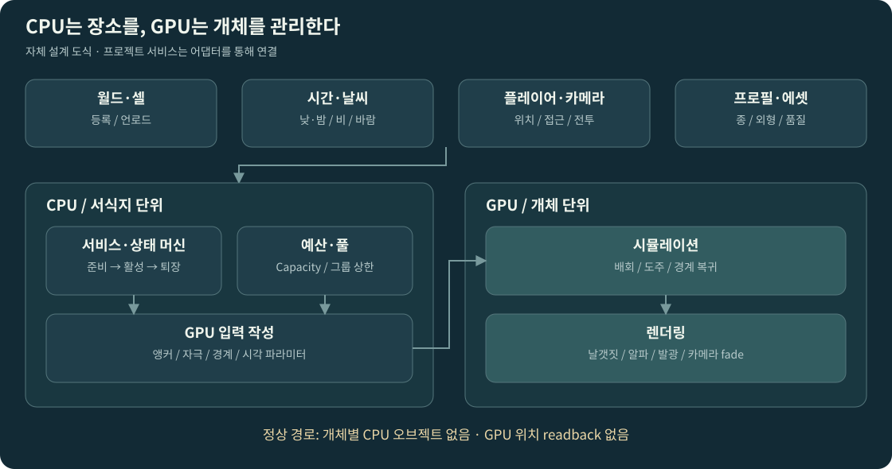
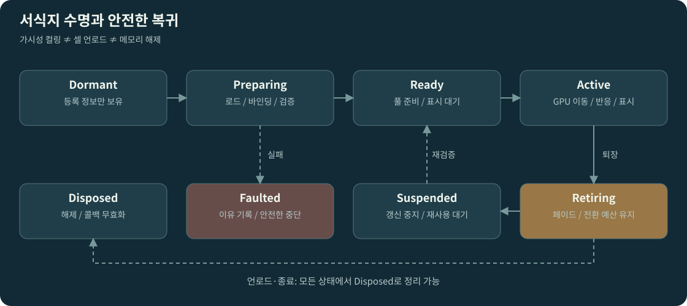
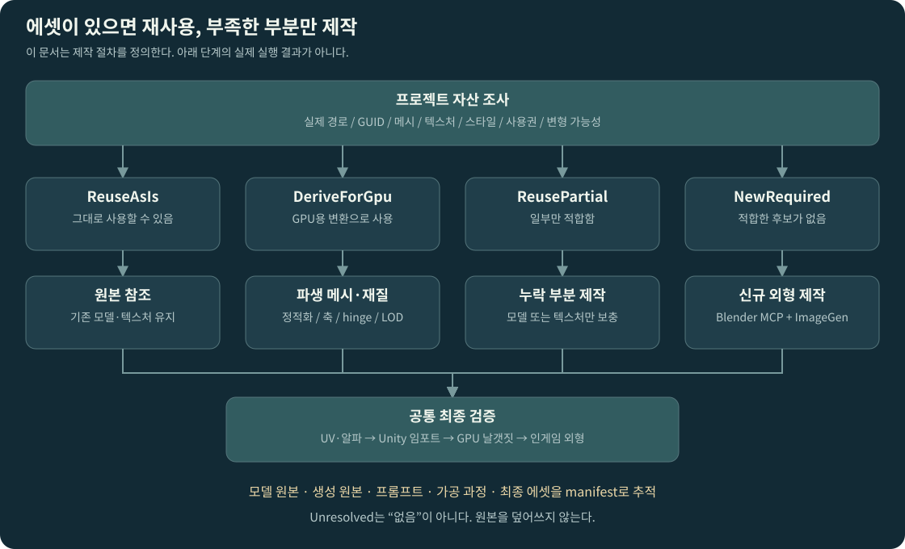
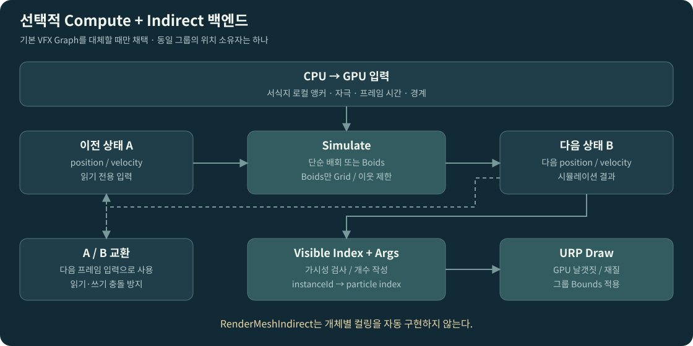

# GPU 환경 생물 시스템 정규 설계

프로젝트 연결: [분석·작업 상태](../../work-status/ambient-fauna.md) · [설계 3종 연결](../README.md). 현재 진행·검증 결과는 상태 문서에서 관리한다.

프로젝트 적용 경계: [기존 CPU 야생 생물과 GPU 장식 군집의 역할 분리](../../../Assets/docs/design/world-art/environment/AMBIENT_FAUNA_ROLE_SEPARATION.md). 기존 CPU 생물의 사냥·행동 계약을 보존하고 GPU 장식 경로를 별도로 연결한다.

> **Ambient Fauna System · 설계 기준 v1.0 · 2026-11-12**  
> 대상: UPlayground 계열 Unity 6 / URP 오픈월드 액션 프로젝트  
> 목적: 벌레·나비·반딧불·부유 입자로 세계의 생동감을 높이되, 개체별 CPU 오브젝트와 불필요한 GPU 비용을 만들지 않는다.  
> 상태: **설계 완료 / 실제 저장소 점검·에셋 제작·Unity 실행 검증 미수행**. 이 문서는 실행 결과 보고서가 아니다.

## 00. 핵심 결정과 적용 순서

**CPU는 서식지·시간대·날씨·예산을 관리하고, GPU는 개체의 이동·반응·날갯짓·표시를 처리한다. 기존 에셋을 먼저 조사하고, 적합한 자산이 없을 때만 Blender MCP로 메시를 제작하고 ImageGen으로 외형 텍스처를 제작한다.**

| 결정 ID | 채택한 결정 | 구현자가 지켜야 할 경계 |
|---|---|---|
| ADR-01 | v1 기본 백엔드는 VFX Graph | 단순 배회·나비·반딧불에 전면 Boids를 적용하지 않는다. |
| ADR-02 | 생물 개체가 아닌 `Habitat × Species × RenderVariant`가 관리 단위 | 개체별 GameObject, Animator, Rigidbody, NavMeshAgent를 만들지 않는다. |
| ADR-03 | 기존 에셋 우선, 파생 변환 다음, 신규 제작 마지막 | 검색 실패와 자산 부재를 동일시하지 않는다. 사용 불가 근거를 남긴다. |
| ADR-04 | 신규 외형은 Blender MCP + ImageGen 생산 파이프라인 | 모델·텍스처·UV·셰이더 연결·Unity 검수까지 끝나야 아트 완료다. |
| ADR-05 | 핵심 서식 영역은 월드 고정 | 카메라 추종을 나비 서식지 구현의 기본으로 사용하지 않는다. |
| ADR-06 | GPU→CPU 개체 읽기 없이 동작하는 장식 계층 | 포획·보상·퀘스트 개체는 CPU 권위의 별도 시스템으로 둔다. |
| ADR-07 | 데이터로 종·서식지·밀도·시간·외형 추가 | 새 행동 알고리즘과 새 렌더 백엔드만 코드 확장 대상으로 본다. |
| ADR-08 | 활성 용량·그룹 수·화면 점유율을 함께 제한 | 보이지 않게 만드는 것만으로 시뮬레이션 비용이 줄었다고 판정하지 않는다. |

이 결정은 조사 자료를 바탕으로 한 **프로젝트 설계안**이다. 엔진이 자동 제공하는 기능과 자체 구현 기능은 뒤에서 구분한다. VFX Graph가 GPU 파티클을 시뮬레이션한다는 근거는 [S01], 파티클 용량·컬링의 구체적 동작은 [S02][S03]을 따른다.

### 문서 세트 사용법

정식 요구사항과 계약은 이 문서를 기준으로 한다. `02_Codex_Claude_구현지침.md`는 단계별 실행 지시, `03_BlenderMCP_ImageGen_아트제작.md`는 모델·텍스처 제작 규약, `04_검증_인수기준.md`는 완료 판정 기준이다. `templates/`의 JSON은 **기록 양식 및 제안 스키마**이며 Unity에 바로 임포트되는 완성 에셋이 아니다.

`MUST`는 필수, `SHOULD`는 특별한 이유가 없으면 준수, `MAY`는 확장이다. 수치 표의 초기값은 성능 실측이나 생물학적 사실이 아닌 **시각 연출·성능 검증을 시작하기 위한 가설**이다.

## 01. 프로젝트 기준과 사실의 확실성

### 1.1 현재 확보한 근거

| 항목 | 확보한 정보 | 적용 방침 |
|---|---|---|
| Unity / URP | 이전 대화의 6000.0.60f1 기록과 별도로, 프로젝트 검토 문서에는 Unity 6000.3.21f1 / URP 17.3.0이 기록됨 [P02] | `ProjectVersion.txt`, `manifest.json`, `packages-lock.json` 및 Package Manager의 실제 해석 결과를 최우선으로 한다. |
| 폴더·조립 구조 | 온보딩 문서는 `Assets/02.Scripts`, `10.Datas`, `docs`, `ExternalAssets`와 Manager 조립 계층을 설명 [P01] | 임의의 `Assets/Game` 트리를 새로 강제하지 않고 기존 규약에 통합한다. |
| 코드 언어 | 주석·문서·커밋 메시지는 한국어 [P01] | 공개 API 식별자와 파일 이름은 현행 프로젝트 관례를 따른다. |
| 외형 스타일 | 현재 요청은 기존 프로젝트 자산 활용 | 실제 환경·식생·캐릭터 재질을 캡처해 스타일 기준을 추출한다. 툰 셰이더 호환을 추정하지 않는다. |
| 모델 보유 여부 | 이번 작성에서 실제 `Assets` 폴더·FBX·텍스처는 열람하지 못함 | 모델이 있다고도, 없다고도 단정하지 않는다. G0 에셋 조사에서 확정한다. |
| Blender MCP / ImageGen | 사용자가 신규 제작 경로로 지정 | 각 구현 세션에서 실제 연결·권한·파일 경로·도구 기능을 조회한다. 이미 연결됐다고 가정하지 않는다. |

### 1.2 버전·도구 검증 규칙

VFX Graph·Shader Graph·URP는 실제 프로젝트와 맞는 버전을 사용한다. 이 설계를 위해 Unity나 렌더 파이프라인을 무단 업그레이드하지 않는다. 본문에 인용한 Unity 6.0 / VFX 17.0 문서는 API·동작의 참고 근거이며, 17.3의 모든 동작이 같다는 보증이 아니다. 17.3 공개 문서 일부는 이번 조사에서 열람되지 않아 **설치된 패키지 문서·소스·컴파일 결과**로 최종 확인하도록 한다.

G0 보고서에는 GPU API, Color Space, SRP Batcher, Render Graph 설정, 목표 디바이스, 해상도, VFX 패키지 유무와 버전을 기록한다. Compute 지원만으로 모든 VFX 기능의 정상 작동이 보장된다고 판단하지 않는다. URP의 VFX 지원·셰이더 요구는 해당 버전 자료와 타깃 빌드에서 확인한다. [S01][S04]

## 02. 경험 목표와 범위

### 2.1 플레이어가 느껴야 하는 변화

꽃밭에 들어서면 나비의 작은 움직임이 보이고, 플레이어가 지나간 자리에서는 일부가 흩어졌다가 다시 돌아온다. 물가의 날벌레는 제한된 공간에 머물며, 밤에는 지정된 서식지에 반딧불이 나타난다. 빛을 받는 부유 입자는 공기의 깊이를 보완하지만 락온 대상과 공격 경고를 가리지 않는다.

환경 생물은 이동을 강요하는 마커가 아니다. 평범한 서식지와 탐험 단서용 서식지를 구분하고, 단서용 군집에는 실제로 연결되는 장소·보상이 있어야 한다. 이는 기존 맵 가이드의 환경 단서·시각적 우선순위·전투 시야 규칙에 맞춘 적용안이다. [P03]

### 2.2 포함·제외

| 범위 | v1 포함 | v1 제외 / 이후 확장 |
|---|---|---|
| 종 | 나비, 작은 날벌레, 반딧불, 일반 부유 입자 | 새·물고기 대규모 Boids, 고유 NPC, 생태 먹이사슬 |
| 이동 | 연속 노이즈 배회, 서식 중심 복귀, 높이 제한, 단순 위협 회피 | 정밀 길찾기, 개체별 EQS/BT, 잎사귀별 정확한 충돌 |
| 배치 | Box/Sphere 볼륨, 베이크된 표면 앵커, 제외 볼륨 | 임의 동적 표면 착지, 개체별 점유 경쟁, 지형 자동 의미 분석 |
| 반응 | 플레이어 접근·달리기·공격 자극·지역 억제 | 개체별 피격·체력·드롭·포획·GPU 개체의 즉시 CPU 승격 |
| 월드 | 셀 등록/해제, 낮·밤·날씨 연동, 품질 단계 | 자체 월드 스트리밍·날씨 시스템 재개발 |
| 아트 | 재사용 조사, GPU용 파생 메시, 신규 Blender/ImageGen 제작 | 외부 유료 모델 구매, 외부 생성 서비스 임의 가입 |
| 도구 | 서식지 편집·앵커 베이크·검증·미리보기·예산 표시 | 범용 생태계 노드 에디터 |

꽃에 내려앉는 표현은 v1.1 후보로 둔다. v1의 나비는 꽃 주변 배회와 정지에 가까운 호버까지 검증한다. 정밀한 착지를 v1 완료 조건에 몰래 추가하지 않는다.

## 03. 기능·품질 요구사항

| ID | 필수 요구사항 | 검증 근거 |
|---|---|---|
| FR-01 | 기존 메시·텍스처·셰이더·VFX 후보를 조사하고 재사용 결정을 기록한다. | 에셋 조사 보고서, 실제 경로/GUID, 미리보기 |
| FR-02 | 새 종의 외형·속도·시간대·반응은 프로필로 추가한다. | 코드 변경 없는 나비 색상 변형 1종 추가 |
| FR-03 | 생물이 서식 범위·높이·제외 공간을 준수한다. | 경사·실내·동굴 테스트 |
| FR-04 | 접근·대시·공격 자극에 GPU가 직접 반응한다. | 읽기 반환 없이 반응하는 플레이 영상 |
| FR-05 | 월드 셀의 준비·활성·퇴장·해제에 연결한다. | 반복 로드/언로드 검증 |
| FR-06 | 시간·날씨·품질 변화 시 밀도가 점진적으로 변한다. | 낮→밤, 비 시작·종료 비교 |
| FR-07 | 작업자는 배치·밀도·금지 공간·예상 비용을 에디터에서 확인한다. | Editor 도구, 저장/Undo/Redo |
| FR-08 | 자산 부재 시 지정된 Blender MCP/ImageGen 제작 경로를 사용한다. | 원본·프롬프트·제작 기록·최종 임포트 |
| NFR-01 | 개체별 GameObject/Animator/Physics 사용 0, 정상 경로 CPU 개체 readback 0 | Hierarchy, Profiler, 코드 검사 |
| NFR-02 | 런타임 안정 구간의 자체 hot path GC Alloc은 0 B/frame을 목표로 한다. | 대상 플레이어 빌드 캡처 |
| NFR-03 | 활성 capacity와 시스템 수가 품질 프로필 상한을 넘지 않는다. | Debug Overlay와 부하 테스트 |
| NFR-04 | 원본 에셋·기존 GUID·전역 렌더 설정을 보존한다. | 버전 관리 diff |
| NFR-05 | 실제 측정하지 않은 결과는 `NOT_RUN` 또는 `REVIEW_NA`로 기록한다. | 최종 검증 보고서 |

## 04. 시스템 아키텍처



### 4.1 계층별 책임

| 구성요소 | 책임 | 금지 |
|---|---|---|
| `AmbientFaunaService` | 등록된 서식지, 갱신 시점, 예산·상태 조정 | 월드 전체 씬 검색을 매 프레임 수행 |
| `FaunaWorldAdapter` | 기존 시간·날씨·플레이어·공격·셀 이벤트 연결 | 하위 모듈이 프로젝트 Manager를 직접 참조 |
| `FaunaHabitatAuthoring` | 볼륨, 종 슬롯, 밀도, 앵커·제외 공간 저작 | 개체별 런타임 컴포넌트 생성 |
| `FaunaBudgetScheduler` | 그룹 우선순위·허용 용량·품질 전환 결정 | GPU 개체 위치를 CPU로 읽어 우선순위 계산 |
| `FaunaInfluenceCollector` | 근처 플레이어·공격 자극을 제한된 목록으로 모음 | 모든 공격 이펙트가 새 VFX 인스턴스를 추가 |
| `IFaunaBackend` | 그룹 준비·시작·억제·퇴장·리소스 해제 | 게임플레이 권위 상태·보상 관리 |
| `VfxFaunaBackend` | VFX 프로퍼티·버퍼 바인딩과 풀 관리 | VFX와 별도 Compute가 동일 위치를 이중 적분 |
| `FaunaAssetResolver` | 기존 로딩/Addressables 경로를 이용한 참조 확보 | 런타임 `AssetDatabase` 사용 |
| Editor 도구 | 조사, 베이크, 파생 생성, 검증, 미리보기 | 원본 판매 에셋 덮어쓰기 |

위 이름은 **신규 제안 API**이며 이미 저장소에 존재한다고 주장하는 것이 아니다. 기존 기능이 있으면 어댑터·별칭으로 연결하고 중복 매니저를 만들지 않는다.

### 4.2 의존 방향과 권장 배치

```text
Assets/02.Scripts/
  AmbientFauna/
    Core/           핸들·예산 계산·상태 전이·기하 연산
    Data/           종·행동·품질·서식지 데이터 타입
    Runtime/        서비스·스케줄러·등록부
    VFX/            VFX Graph 백엔드와 프로퍼티 계약
    Editor/         조사·베이크·검증·미리보기
    Tests/          기존 테스트 폴더 규칙이 있으면 그쪽에 둠
  Manager/
    AmbientFauna/   프로젝트 전용 조립·기존 서비스 어댑터
Assets/10.Datas/AmbientFauna/     SO 에셋
Assets/01.Scenes/               전용 검증 씬(기존 폴더 규약 우선)
Assets/docs/AmbientFauna/        실행·검증·에셋 보고서
<기존 자체 아트 루트>/AmbientFauna/  최종 메시·재질·VFX·텍스처
<프로젝트 제작 원본 루트>/AmbientFauna/  .blend·원본 PNG·프롬프트
```

폴더 경로 중 `<...>`는 G0에서 확정하는 슬롯이다. 생성 자산을 `ExternalAssets`에 섞지 않는다. 새 asmdef는 기존 경계와 순환 참조를 검증한 뒤 최소 단위로 만든다. 독립 모듈 asmdef에서 `Assembly-CSharp` 매니저를 참조하는 구성을 금지한다. 기존 온보딩의 조립 방향을 유지한다. [P01]

일반 GPU 장식 생물은 Animancer/MotionSet에 의존하지 않는다. 기존 스킨 메시가 발견되면 런타임 Animator를 복제하는 대신 파생 정적 메시·날개 마스크로 변환 가능한지 판단한다.

### 4.3 런타임 소유권

하나의 `FaunaWorldScope`가 풀·등록부·버퍼를 소유한다. Habitat 컴포넌트는 등록 핸들만 보유한다. 셀 언로드는 등록 해제와 비동기 로드 취소를 발생시키고, 늦게 도착한 완료 콜백은 `generation` 검증으로 무시한다. GPU 버퍼는 사용 중인 렌더링·명령이 끝나기 전에 재사용하지 않는다. Dispose는 두 번 호출되어도 안전한 방어를 둔다.

## 05. 데이터 모델과 계약

### 5.1 저작 데이터

| 자산/레코드 | 주요 필드 | 규칙 |
|---|---|---|
| `FaunaSpeciesProfile` | stableId, displayName, behaviorProfile, visualProfile, scaleRange, timeCurve, weatherResponse, priority | 종 ID는 안정적·고유. 표시명 변경과 저장 식별자를 분리 |
| `FaunaBehaviorProfile` | kind, min/maxSpeed, maxAcceleration, wanderScale, centerSpring, verticalRange, fleeStrength, recoveryTime | 상태·좌표·개체별 타이머를 SO에 기록하지 않음 |
| `FaunaVisualProfile` | mesh, textures, VFX variants, material/shader refs, flap settings, alpha mode, camera fade | 모든 런타임 참조의 준비 여부 검증 |
| `FaunaHabitatData` | habitatId, cellId, shape, local bounds, species slots, densityUnit, seed, masks, baked anchors | 단위·공간계·버전·베이크 해시 저장 |
| `FaunaSpeciesSlot` | speciesRef, baseDensity, densityMode, maxNominalCount, weight | 한 서식지의 종별 목표 수 정의 |
| `FaunaQualityProfile` | globalCapacity, maxGroups, distanceBands, pool classes, influenceCap, uploadCap | 동시에 활성화되는 실측 비용과 함께 검증 |
| `FaunaBakeData` | geometryHash, settingsHash, seed, anchorRecords, validArea/volume, toolVersion | 지형/설정 변경 시 stale 경고 |
| `FaunaAssetManifest` | reuse/generated decision, provenance, mesh/UV contract, source/output refs, QA status | 제작 원본과 런타임 결과 추적 |

활동 시간은 `[0,24)` 시간으로 입력하되 GPU에는 `[0,1)` 정규화 값 또는 CPU 계산 밀도만 전달한다. 기본 구현은 CPU에서 하루 밀도 곡선과 날씨 계수를 계산한다. GPU에서 시간대 로직을 중복 판단하지 않는다. 예제 곡선은 생물학적 데이터가 아니라 게임 연출값이다.

### 5.2 개체 수의 정의

`N_nominal = clamp(density × validMeasure × timeFactor × weatherFactor × gameplayFactor, 0, habitatMax)`로 목표를 구한다. `validMeasure`는 Surface 모드에서 유효 면적(m²), Volume 모드에서 유효 부피(m³)다. 두 단위를 혼합하지 않는다. ManualCount 모드에서는 밀도 대신 직접 입력된 개체 수를 사용한다.

CPU가 다루는 수치는 네 가지로 분리한다.

| 수치 | 의미 |
|---|---|
| `Capacity` | 해당 VFX/버퍼에 할당된 최대 개체 슬롯. 메모리·갱신 비용 평가 기준 |
| `SpawnedCount` | 활성화 시 한 번 생성한 개체 수. v1에서는 CPU가 알고 있음 |
| `NominalVisibleCount` | 거리·시간·날씨에 따른 원하는 표시 규모 |
| `RenderedCountEstimate` | 카메라 가시성·가림 등에 영향을 받는 표시 추정값. 정확한 GPU 개수로 표시하지 않음 |

VFX의 Capacity는 고정 설정으로 메모리 할당에 영향을 준다. `SetInt("Capacity", ...)`로 엔진 Capacity를 임의 변경할 수 있다고 가정하지 않는다. [S02]

### 5.3 좌표와 단위

런타임 표준은 **미터·초·라디안·Unity 로컬 +Y 위 / +Z 전진 / +X 오른쪽**이다. 날갯짓 각도는 저작 UI에서 도를 허용하되 업로드 시 라디안으로 통일한다. VFX는 고정된 서식지 로컬 공간에서 시뮬레이션하고, 플레이어/자극/앵커를 같은 공간으로 변환한다. 셀 부모가 바뀌면 상태를 보존해 변환하거나 숨긴 뒤 재초기화한다. 둘을 혼용하지 않는다.

v1 Habitat Transform은 회전과 위치만 허용하고, 볼륨 크기는 별도 Size/Radius로 지정한다. 비균등·음수 scale은 검증 오류다. 이는 반경·속도·거리 계산의 모호성을 없애기 위한 자체 제약이다.

### 5.4 CPU → GPU 전송 레코드

아래는 **신규 메모리 계약 제안**이다. 실제 C#/HLSL 선언은 크기 테스트와 백엔드 검증 후 확정한다. Structured buffer의 stride와 선언 구조가 맞아야 하고, VFX Sample Buffer는 지원되는 blittable 타입을 요구한다. [S05][S06]

```text
GpuSpawnAnchor (48 bytes)
  float4 positionWeight    // xyz: habitat-local 위치, w: 샘플링 가중치
  float4 normalClearance   // xyz: 법선, w: 보장된 비행 여유 반경(m)
  uint4  metadata          // anchorId, tagBits, regionId, reserved

GpuInfluence (64 bytes)
  float4 startRadius      // xyz: 로컬 캡슐 선분 시작, w: 반경(m)
  float4 endStrength      // xyz: 선분 끝, w: 강도
  float4 timingFalloff     // startTime, duration, falloffExponent, recovery
  uint4  metadata          // kind, sourceId, sequence, reserved
```

C#과 셰이더 모두 16-byte 묶음으로 표현하고 bool·managed reference를 넣지 않는다. C#의 uint4 묶음은 지원되는 4개의 uint 필드 등으로 명시하며 존재하지 않는 UnityEngine 타입을 만들었다고 가정하지 않는다. v1 앵커 샘플링은 균등 분포(weight=1)로 제한한다. 가중치 샘플링을 추가하면 CDF/alias 데이터와 검증을 별도로 구현한다. 레이아웃 테스트는 `sizeof/Marshal.SizeOf`만이 아니라 GPU에 특징적인 패턴을 올려 읽은 스모크 테스트까지 포함한다. 마지막 reserved 값도 초기화한다. 새 버퍼를 만들면 반드시 VFX에 다시 바인딩한다. `SetGraphicsBuffer`의 참조는 직렬화되지 않는다는 점도 수명 설계에 반영한다. [S07]

## 06. 서식지·월드 스트리밍·상태 전이



### 6.1 상태

| 상태 | 처리 | 전이 조건 |
|---|---|---|
| Dormant | 등록 메타데이터만 보유 | 준비 거리 진입, 셀 준비 |
| Preparing | 에셋 확보·버퍼 준비·프로퍼티 검증 | 성공 시 Ready / 실패 시 Faulted |
| Ready | 풀 인스턴스·참조 준비, 아직 표시 안 함 | 표시 거리·예산 만족 |
| Active | GPU 이동·반응·표시 | 거리 이탈·날씨 억제·예산 축소 |
| Retiring | 새 활성화 금지, 표시 페이드·리소스 유지 | 페이드 완료 뒤 Suspended 또는 Dormant |
| Suspended | 시뮬레이션 중지, 재사용 대기 | 재진입 시 재검증·재초기화 |
| Faulted | 비활성 안전 상태, 이유 1회 경고 | 데이터 수정/명시적 재시도 |
| Disposed | 참조 해제·버퍼 반환, 콜백 무효화 | 최종 상태 |

가시성 컬링은 상태 머신과 별개다. VFX Bounds가 화면 밖이면 정책에 따라 시뮬레이션이 멈출 수 있으나, 이것을 셀 언로드·메모리 해제와 동일시하지 않는다. [S03]

### 6.2 활성화·복귀 정책

준비 거리는 표시 거리보다 크게 둔다. 예: 표시 시작 35m, 완전 퇴장 45m, 준비 55m. 종과 화면 크기에 맞춘 조정값이지 전 종 공통 기준이 아니다. AABB/볼륨 표면까지의 거리로 평가하고 거대한 서식지 중심만 사용하지 않는다.

퇴장과 재진입에는 히스테리시스와 최소 유지 시간을 둔다. 예산 갱신은 5Hz, 보조 상태 갱신은 2Hz를 초기값으로 삼되 플레이어 자극 업로드는 매 렌더 프레임 최신 값으로 한다. **CPU 스케줄러를 5Hz로 돌린다고 VFX 시뮬레이션이 5Hz가 되는 것은 아니다.** v1 VFX는 엔진 갱신을 사용하고 비용은 활성 그룹·Capacity·표시 범위를 줄여 통제한다.

카메라가 다시 돌아왔을 때 오래 정지한 생물이 보이면 기존 상태를 잠깐 유지하거나 숨긴 상태에서 reseed한다. 비활성 시간 전체를 한 프레임에 따라잡는 대규모 prewarm은 금지한다. 텔레포트에서는 이전 위치 그룹을 즉시 격리하고 새 위치에 순차 준비·페이드 인한다. 에셋 미준비 상태에서는 빈 효과가 허용되며 오류나 프레임 정지는 허용되지 않는다.

### 6.3 저장·재현

개별 GPU 개체 좌표는 저장하지 않는다. 저장이 필요하면 Habitat stableId, seed, 지역 억제 상태와 콘텐츠 버전만 보존한다. 같은 seed는 초기 분포와 파라미터 재현에 사용하며, 다른 GPU·프레임률에서 비트 단위 궤적 결정성을 보장하지 않는다. 네트워크 동기화는 v1 범위 밖이다.

## 07. GPU 이동·반응 알고리즘

### 7.1 기본 힘과 적분

배회·복귀·도주를 가속도 단위로 통합한다.

```text
a = ClampLength(wW * ContinuousNoise(p, t, seed)
              + wH * HomeSpring(p, v, home)
              + wB * SoftBoundary(p)
              + wF * InfluenceFlee(p, influences), maxAcceleration)
v = ClampSpeed(v + a * dt, maxSpeed)
p = p + v * dt
p, v = ResolveGroundAndExclusion(p, v)
```

`HomeSpring = k(home - p) - damping*v`처럼 복귀 시 감쇠를 넣는다. 매 프레임 독립 난수 방향을 선택하지 않고 연속 노이즈를 이용한다. 최소 속도는 비행 상태에서만 적용하며 느린 호버·회복 상태에 강제로 적용하지 않는다. `dt` 상한은 순간 프레임 지연의 폭주를 막는 방어로 두고, 정상 시뮬레이션 시간을 임의로 두 번 적분하지 않는다. 엔진 자동 위치 적분과 커스텀 `p += v*dt`는 하나만 활성화한다.

### 7.2 종별 기본 행동

| 종류 | 시뮬레이션 | 시각 표현 | 필수 변주 |
|---|---|---|---|
| Butterfly | 꽃 앵커 주변 배회, 약한 높이 진동, 도주 후 복귀 | 저폴리 메시, 좌우 날개 회전 | 속도·위상·크기·색의 작은 차이 |
| Gnat | 안전 반경 내 고주파 호버, 군집 중심 감쇠 | 작은 Quad 또는 간단 메시 | 궤적 위상·밀도 변주 |
| Firefly | 느린 배회, 높이 제한 | Emissive Quad/근거리 간단 몸체 | 개체별 점멸 위상·밝기; 실시간 Light 미생성 |
| AirMote | 바람 드리프트, 완만한 난류, 수명/재배치 | 작은 투명 Quad | 크기·알파·회전 차이, 카메라 근접 억제 |

v1 Gnat의 ‘군집’은 공유 중심 주변에 모여 보이는 표현이지, 실제 이웃 정렬을 계산하는 Boids가 아니다. 약한 분리력이 필요하면 확장으로 명시하고 비용을 측정한다.

### 7.3 위협 반응

CPU는 플레이어의 몸체를 캡슐 선분으로, 공격·폭발을 구형/캡슐형 자극으로 보낸다. GPU는 각 개체에서 선분의 최근접 점까지의 거리와 부드러운 감쇠를 계산한다. 거리가 0이거나 캡슐 길이가 0인 경우 hash 기반 안전 방향으로 처리해 NaN을 막는다.

단발 공격의 수명은 `FaunaClock` 기준이며 일시정지 시 멈춘다. 지속 접근 자극은 매 프레임 덮어쓰고, 한 공격의 중복 이벤트는 sourceId+sequence로 제거한다. 초기 상한은 그룹당 8개, 최댓값은 품질 데이터로 제한한다. 초과 자극은 거리·강도·남은 수명으로 선택하고 dropped count를 표시한다. 이벤트 수만큼 새 버퍼나 VFX 오브젝트를 할당하지 않는다.

회복은 flee 계수를 즉시 0으로 만들기보다 완만히 감쇠시킨다. 종별로 도주 반경·가속도·회복 시간이 다르다. 전투 카메라 주변에는 최소 거리 fade와 중요 HUD/공격 경고를 방해하지 않는 밀도 억제 규칙을 적용한다.

### 7.4 선택적 GPU Boids 확장

새·물고기처럼 개체 간 반응이 필요한 종에만 `GpuBoidsBackend`를 추가한다. 전체 쌍 비교는 O(N²)이므로 대규모에서는 인접 셀 구조를 검토한다. 한 프레임의 이전 상태를 읽고 다음 상태에 쓰는 ping-pong 버퍼를 사용한다. 셀 버킷 초과·이웃 최대 수·해시 충돌·경계 셀을 명시적으로 처리한다.

공간 분할을 도입해도 밀집 지역에서 비용이 항상 O(N)이라고 보장하지 않는다. 프레임당 비교 수를 제한하고 overflow를 계측한다. 이 확장은 v1 완료를 지연시키지 않는다.

## 08. 배치 베이크와 충돌 근사

### 8.1 베이크 절차

Editor에서 선택한 Habitat의 후보 위치를 deterministic seed로 만들고, 지정된 환경 레이어에만 Raycast한다. 경사·표면 태그·높이·실내 제외 볼륨을 통과한 점을 저장한다. 거리 기반 thinning 또는 Poisson-disc 유사 샘플링으로 한 점에 쏠리는 현상을 줄인다. 런타임에 모든 개체의 Physics Raycast를 수행하지 않는다.

**생성 위치가 안전하다는 사실만으로 이후 비행 궤적이 안전해지는 것은 아니다.** v1 GPU 앵커의 position은 Raycast 표면 hit 그 자체가 아니라 높이 오프셋을 적용한 **안전 비행 중심**이다. 주변 검사로 확보한 `normalClearance.w` 범위 안에서만 이동하도록 제한한다. 위쪽·아래쪽·옆쪽 여유가 부족하면 앵커를 줄이거나 폐기한다. 넓은 이동이 필요하면 height field와 제외 볼륨을 함께 제공한다. 앵커가 0개이면 `SpawnCount=0`, 상태는 InvalidHabitat이며 원점으로 대체하지 않는다.

베이크는 Undo가 필요한 저작 변경과 생성 결과 파일 저장을 구분한다. 지형 메시·Collider·Transform·베이크 옵션의 해시가 바뀌면 재베이크 경고를 내고, 이전 데이터를 몰래 최신으로 취급하지 않는다. 신규 지형 파괴로 유효성이 깨지면 해당 Habitat를 억제하고 재계산은 별도 작업으로 넘긴다.

### 8.2 충돌 수준

| 단계 | 적용 | 한계 및 정책 |
|---|---|---|
| C0 안전 앵커 반경 | v1 기본 | 앵커 주변 안전 공간 안에서만 배회 |
| C1 단순 제외 볼륨 | 큰 벽·기둥·플레이어 | Sphere/Box/Capsule의 거리·법선 근사; 최대 개수 제한 |
| C2 Height field | 지표면 위 이동 확장 | 동굴·다층 건물·오버행 표현 불가, 하부 공간과 분리 |
| C3 SDF | 필요한 정적 복잡 공간만 | 텍스처 메모리·해상도·스트리밍 비용 별도 예산 |
| C4 Camera Depth | 시각 보조용 선택 기능 | 카메라에 보이는 깊이만 반영. 월드 충돌의 권위 소스로 사용 금지 |

Unity에는 Depth Buffer와 SDF 충돌 블록이 공개되어 있으나, 프로젝트에 올바른 버퍼·필드를 공급하는 과정까지 자동 해결되는 것은 아니다. [S08][S09] 가는 풀·작은 잎은 통과 가능 대상으로 허용하고, 큰 벽을 반복 관통하는 것은 실패로 판정한다.

## 09. VFX Graph 구현 계약

### 9.1 그래프 자산

최소 그래프는 `AF_Butterfly`, `AF_Gnat`, `AF_Firefly`, `AF_AirMote`다. 공통 Subgraph는 노이즈 배회·경계 복귀·위협 반응·fade·색 변주로 분리한다. 용량 클래스는 예를 들어 128 / 512 / 2048로 시작하며 실제 종별 요구에 따라 줄인다. 공통 Subgraph를 공유해 용량 변형 사이의 로직 드리프트를 막는다.

| 단계 | 그래프 계약 |
|---|---|
| Spawn | 명시적 `OnFaunaActivate` 이벤트의 Single Burst. 기본 OnPlay에 의한 이중 생성 금지 |
| Initialize | spawnCount개 생성, 앵커 선택, seed·size·phase·visibilityRank·home 저장 |
| Update | 이동·위협·경계·전환 fade, finite 검증, invalid 상태 재배치 |
| Output | Mesh 또는 Quad, 지원되는 Shader Graph, 개체별 시각 파라미터 연결 |
| Retire | Spawn 중지 + `GroupFade` 감소. Stop만으로 기존 입자가 사라진다고 가정 금지 |

v1 개체는 그룹 활성 기간 동안 유지한다. 자동 age/reap로 소멸시키지 않는 구성을 설치 버전에서 검증하고, 궤적 초기화는 입자를 재발행하기보다 내부 상태를 재설정한다. 생물과 달리 AirMote에 수명 순환을 쓰는 경우에는 별도 그래프 계약으로 둔다.

### 9.2 초기화 순서

```text
풀에서 그룹 획득 → 이전 generation 무효화 → 그래프/용량 변형 지정
→ 자동 생성 없는 초기 상태로 Reinit
→ seed·bounds·앵커/자극 버퍼·노출 프로퍼티 바인딩
→ 타입·필수 참조·수량 검증 → SpawnCount 고정 → OnFaunaActivate 1회
→ 짧은 fade-in → Active
```

`Reinit`이 기본 이벤트를 발생시키는지 실제 버전에서 확인하고, 해당 이벤트에 생성이 연결되지 않도록 만든다. OnEnable이 먼저 실행되어도 원점에서 생물이 발사되지 않아야 한다. 활성 그래프가 이전 서식지 버퍼를 잠시 참조하는 재사용 버그를 막는다.

### 9.3 최소 노출 프로퍼티

| 이름 | 타입/공간 | 갱신 시점 |
|---|---|---|
| `AF_SpawnCount` | uint 또는 그래프가 지원하는 정수 타입 | 활성화 시 |
| `AF_Seed` | uint | 활성화 시 |
| `AF_AnchorBuffer`, `AF_AnchorCount` | Structured GraphicsBuffer / uint | 베이크·로드 변경 시 |
| `AF_InfluenceBuffer`, `AF_InfluenceCount` | Structured GraphicsBuffer / uint | 프레임별 제한된 업로드 |
| `AF_HabitatBounds` | 그래프가 지원하는 Bounds 표현 | 활성화·영역 변경 시 |
| `AF_GroupFade`, `AF_VisibilityFraction` | float [0,1] | 전환 중 |
| `AF_Time`, `AF_FrameDelta` | seconds | 기존 일시정지·슬로모션 시간 규칙에 맞춤 |
| `AF_WindLocal` | Vector3 | 바람 변경 시 |
| `AF_CameraLocal`, `AF_NearFade` | Vector3 / Vector2 | 렌더 프레임 |
| `AF_SpeedRange`, `AF_FlapParams` | Vector2 / Vector4 | 프로필 바인딩 시 |

이 이름은 엔진 기본 프로퍼티가 아니라 **우리 그래프가 노출해야 할 계약**이다. `Shader.PropertyToID` 캐싱, `Has*` 검증, 잘못된 타입·미바인딩 경고를 구현한다. 그룹마다 dirty 값만 갱신하되 시각 반응 입력은 지연시키지 않는다.

### 9.4 표시 개체 수 변경의 실제 의미

활성화 시 `SpawnedCount ≤ Capacity`를 정한다. 각 입자의 seed에서 안정적인 `visibilityRank ∈ [0,1)`를 만들고, `VisibilityFraction`으로 표시 여부를 점진적으로 조절한다. 이는 기대 표시 수를 조절하며 **정확한 N개 선별이나 시뮬레이션 연산량 절감 기능이 아니다**.

활성화 시의 `SpawnedCount`는 현재 순간 밀도가 아니라, 해당 준비 구간에서 예산으로 허용한 `PopulationCeiling`을 기준으로 정한다. `VisibilityFraction = clamp(N_nominal / SpawnedCount, 0, 1)`이며, SpawnedCount가 0이면 활성화하지 않는다. 이후 목표가 상한을 넘으면 예산을 다시 예약하고 안전한 경계에서 더 큰 변형으로 재시작한다. 단순히 fraction을 1보다 크게 만드는 것으로 개체를 늘리지 않는다.

낮은 수량이 오래 지속되면 화면 밖이나 퇴장 단계에서 작은 Capacity 변형으로 재초기화한다. 즉시 예산을 줄여야 하면 낮은 우선순위 그룹 전체를 fade-out한 뒤 시뮬레이션을 중지한다. 새/기존 그룹의 교차 fade는 전환 중 합산 capacity를 예산에 포함한다. 예산이 없으면 교차 fade 대신 짧은 숨김 재시작을 선택한다.

### 9.5 그래프 제작 자동화 제한

기존 정상 동작 템플릿을 복제하고, 설치 버전에 맞는 Unity Editor 조작 또는 검증된 도구를 통해 수정한다. 임의의 `.vfx`·`.shadergraph` YAML을 지어내거나 패키지 내부 Editor API를 안정적 공개 API처럼 취급하지 않는다. 자동화가 불가능하면 생성 가능한 C#·HLSL·데이터 도구는 계속 구현하되 그래프 작업은 `BLOCKED_TOOL`로 정확히 기록한다.

텍스트 중심 자동화 때문에 Compute+Indirect로 전환할 필요가 생기면 ADR에 이유·영향·검증 범위를 남긴다. 동일 그룹에서 VFX와 Compute를 동시에 소유자로 두지 않는다. 대체 경로도 실제 빌드·시각 검증을 마쳐야 완료다.

## 10. 렌더링·날갯짓·머티리얼

### 10.1 GPU용 외형 계약

Unity 임포트 후 전진 +Z, 위 +Y, 오른쪽 +X, 기본 날개 평면 XZ를 기준으로 한다. 몸체 원점과 날개 hinge 위치를 metadata에 기록한다. Blender의 좌표·FBX 변환은 Unity 임포트 결과로 검증하고 파일 옵션만으로 성공을 주장하지 않는다. [S13]

| 채널 | 사용 목적 | 보존 조건 |
|---|---|---|
| Position / Normal | 정적 원형 메시·조명 | 음수 scale 금지, normal 방향 확인 |
| UV0 (`Mesh.uv`) | 컬러·알파 아틀라스 | island·padding 계약 준수 |
| UV1 (`Mesh.uv2`, TEXCOORD1) | x=wingSide(-1/0/+1), y=flapWeight(0..1) | importer가 덮어쓰지 않도록 설정 |
| UV2 (`Mesh.uv3`, TEXCOORD2) | xy=로컬 hinge의 x,z | y 높이는 별도 공통값 또는 규격상 0 |
| 선택 색상 채널 | 몸체·날개·발광 구역 ID | 기존 색상 용도와 충돌 시 파생 규격으로 분리 |

모든 기존 모델에 이 채널이 있을 것이라고 가정하지 않는다. 변환기가 검증 가능한 파생 메시를 생성하거나 `NewRequired` 결정을 내린다. 정확한 UV lightmap 자동 생성이 UV1을 덮어쓰지 않게 한다.

### 10.2 날갯짓

개체별 위상 φ와 빈도 f를 이용하여 `angle = amplitude × sin(2πft + φ)`를 계산한다. wingSide를 곱한 각도로 각 날개를 로컬 Z hinge 축 기준 회전시킨다. 몸체는 flapWeight 0, 날개 뿌리는 0에서 1로 완만히 변화시킨다. 위치뿐 아니라 normal/tangent도 같은 변형을 적용하거나 해당 백엔드에 맞는 조명 전략을 사용한다.

VFX 파티클의 `phase/frequency`를 Shader Graph 입력에 실제로 연결해야 한다. 머티리얼 공통 시간만 사용해 전 개체가 같은 위상으로 날갯짓하는 상태는 실패다. Unity URP Shader Graph에는 VFX 지원 설정과 버텍스 위치/법선 입력이 공개되어 있으나, 기존 커스텀 툰 셰이더를 그대로 꽂을 수 있다는 뜻은 아니다. [S10]

### 10.3 표현·패스 정책

나비는 Opaque/Alpha Clip 기반을 우선하고 날개는 필요 시 양면 렌더링한다. 날개 뒷면 조명과 silhouette를 확인한다. 반딧불은 Emission과 작은 halo로 표현하며 개체별 Point Light는 생성하지 않는다. 그림자는 기본 비활성화하고 중요한 근거리 연출에만 별도 비용으로 검토한다.

카메라 가까이에서 날개가 큰 사각형으로 화면을 가리지 않도록 near fade를 넣는다. Cutout fade는 clipping threshold 또는 dithering 중 프로젝트 스타일에 맞춰 선택하고 실제 해상도·TAA/MSAA 조합에서 확인한다. 움직이는 날개에 Motion Vector/Depth pass를 사용할 경우 forward와 다른 포즈가 출력되지 않게 검증한다. 먼 거리의 작은 개체는 메시 교체보다 안정적인 density fade-out을 v1 기본으로 한다.

일반 Shuriken의 GPU instancing은 렌더링 최적화와 시뮬레이션 위치를 구분해 평가한다. 이 프로젝트에서 ‘GPU 생물 구현 완료’는 **이동·반응의 개체 루프가 GPU에서 실행됨**을 의미한다.

## 11. 기존 에셋 조사와 재사용 판정



### 11.1 조사 범위

파일명 검색과 Unity 자산 메타데이터 조사를 함께 수행한다. 검색어는 `butterfly, moth, insect, bug, firefly, bee, fly, fauna, particle, swarm, 나비, 나방, 벌레, 반딧불` 등을 시작점으로 삼는다. Prefab, FBX, OBJ, Mesh sub-asset, Material, Texture, VFX, Shader Graph, 애니메이션을 조사한다. 이름이 일반적인 `SM_001`일 수도 있으므로 기존 환경 팩의 내용과 미리보기도 확인한다.

`Library`, `Temp`, `Obj`, 빌드 출력은 검색 결과에서 제외한다. Unity `AssetDatabase`를 이용할 수 있으면 GUID·subAsset localId·의존성을 함께 기록한다. 프로젝트 `.meta`를 삭제하거나 기존 파일을 제자리 재작성하지 않는다.

### 11.2 판정

| 판정 | 조건 | 실행 |
|---|---|---|
| ReuseAsIs | 메시·스타일·비용·UV·날갯짓 데이터가 충족됨 | 원본을 참조, 필요한 런타임 프로필만 추가 |
| DeriveForGpu | 스킨 메시·축·재질·LOD·마스크 일부 변환으로 충족 가능 | 원본 보존, 파생 FBX/Mesh/Material 생성 |
| ReusePartial | 메시 또는 텍스처 일부만 적합 | 적합 부분 유지, 누락 부분만 Blender/ImageGen 제작 |
| NewRequired | 후보 없음 또는 변환 비용/권리/구조 문제로 사용 불가 | 근거 기록 후 신규 제작 파이프라인 진입 |
| Unresolved | 실제 파일·사용권·임포트 상태 확인 불가 | 확정하지 말고 조사/검증 항목으로 남김 |

외부 판매 에셋의 라이선스는 보유·사용 범위를 확인하고 외부 AI 도구에 원본 업로드 권한을 별도로 검토한다. 문서에 원본이 포함되어 있지 않다는 이유만으로 ‘프로젝트에 없음’으로 처리하지 않는다.

### 11.3 파생 모델 처리

SkinnedMeshRenderer가 존재하면 가능한 정적 rest pose를 Editor에서 추출하고, 좌우 날개를 식별해 hinge·weight 데이터를 작성한다. 자동 분류가 틀릴 수 있는 비대칭·붙은 날개·얽힌 토폴로지는 수동 표식 도구로 보정한다. 기존 재질을 분석해 스타일 참조로 활용하되 VFX 호환 재질이 필요하면 파생 재질을 만든다. 원본 Rig·애니메이션·텍스처는 지우지 않는다.

원본 텍스처가 충분하면 ImageGen을 불필요하게 재호출하지 않는다. 필요한 것은 ‘생성 도구 사용 실적’이 아니라 프로젝트 스타일과 성능에 맞는 재사용 가능한 자산이다.

## 12. Blender MCP + ImageGen 신규 제작

### 12.1 생산 순서

`요구 규격 → Blender 블록아웃 → Unity 축·스케일 확인 → UV 고정 → ImageGen 외형 원본 → UV용 가공/패킹 → 머티리얼 연결 → GPU 날갯짓 → 인게임 검수` 순서다. 처음부터 완성 곤충 그림을 만든 뒤 억지로 3D 모델에 붙이지 않는다.

Blender MCP는 연결된 구현이 제공하는 도구 목록을 먼저 조회한다. 공개 구현에는 Blender 코드 실행 기능이 존재하지만 모든 MCP 서버가 동일한 이름·기능을 제공하는 것은 아니다. 코드 실행 권한과 파일 접근 범위를 제한하고, 신뢰되지 않은 모델·스크립트는 검토 없이 실행하지 않는다. [S14]

### 12.2 신규 메시 최소 규격

| 종 | LOD0 초안 | 원본 규격 | 텍스처 |
|---|---|---|---|
| Butterfly | 80~240 triangles, 1 material 우선 | 몸체+좌우 날개, 뿌리 hinge, 변형 채널, 정적 메시 | 날개 BaseColor+Alpha, 몸체 색 또는 작은 atlas |
| Gnat | 16~80 triangles 또는 1~2 Quad | 작은 실루엣, 별도 Rig 없음 | 작은 불투명/마스크 형태 |
| Firefly | 32~120 triangles 또는 Quad | 근거리 몸체 필요 여부부터 확인 | 몸체 컬러, emission 구역 마스크 |
| AirMote | Quad | 별도 모델 제작 불필요 | 부유 입자 컬러·알파; 기술 마스크는 절차적으로 가공 가능 |

삼각형 수는 초기 상한 가설이다. 실루엣과 실제 화면 크기가 더 중요하며, 작은 개체에 읽히지 않는 디테일을 추가하지 않는다. UV/normal 분리 때문에 GPU vertex count가 triangle count와 달라질 수 있으므로 둘 다 기록한다.

### 12.3 텍스처 생산 원칙

ImageGen은 **컬러·무늬·실루엣 원본**을 제작한다. 정확한 UV 배치나 물리적으로 올바른 tangent-space normal을 자동 보장하는 도구로 취급하지 않는다. OpenAI 문서도 정밀 배치·일관성에 한계를 명시하므로, 결과는 승인 가능한 원본 후보로 다룬다. [S15]

좌우 날개 전체를 한 장에 정확하게 정렬시키기보다 **단일 half-wing 원본**을 생성하고, 승인된 마스크·UV 메타데이터에 맞춰 좌우 변형·패킹한다. 외형상 좌우 차이가 필요하면 색·패턴 변주만 의도적으로 추가한다. 반딧불 emission, flapWeight, region mask는 승인된 메시/마스크에서 결정론적으로 파생한다. RGB 그림을 Normal Map importer로만 바꿔 normal map이 됐다고 주장하지 않는다.

투명 결과가 필요한 자산은 사용 가능한 ImageGen의 alpha 출력 기능을 확인하고, PNG 등 alpha 보존 형식을 사용한다. 실제 픽셀 alpha·테두리 halo·배경 격자 유무를 검사한다. 생성 원본에 투명이 없으면 별도 마스크 제작·검증 단계로 넘기고 투명으로 표기하지 않는다. [S15]

### 12.4 패킹·임포트

최종 atlas는 deterministic packer로 만들고 UV rectangle을 JSON에 저장한다. 1024px 텍스처라면 기본 8px edge dilation을 시작점으로 하되 실제 사용 mip의 bleed를 검사한다. 나비 컬러는 sRGB, 마스크·벡터·수치 데이터는 Linear로 가져온다. `alphaIsTransparency`는 색 가장자리 가공에 도움이 되지만 잘못 생성된 alpha 자체를 고치는 기능은 아니다. [S16]

Unity에는 FBX와 완성 텍스처를 임포트한다. `.blend`는 제작 원본으로 보관하고 런타임 프로젝트의 Blender 설치에 의존하는 임포트 경로는 피한다. FBX 축·단위·normal·material slot·UV·scale을 실제 임포트해서 확인한다. 상세 프롬프트·세부 계약은 아트 제작 문서를 따른다.

### 12.5 도구가 없을 때

Blender MCP 또는 ImageGen에 접근할 수 없으면 서버를 무단 설치하거나 API 키를 추측하지 않는다. 영향을 받는 아트 작업을 `BLOCKED_TOOL`로 남기고 모델 제작 명세·프롬프트·출력 경로·남은 검증을 저장한다. 동시에 시스템은 승인된 기존 에셋 또는 명확히 `DEBUG_PLACEHOLDER`라 표시된 임시 메시로 계속 개발한다. 임시 도형을 ImageGen/Blender 제작 결과라고 표시하지 않는다.

## 13. 성능 예산과 LOD

### 13.1 제안 초기값

다음은 PC/콘솔 지향 검증 프로필의 예시다. 디바이스가 확정되지 않았으므로 성능 달성값이 아니다. G0에서 목표 장치·그래픽 API·해상도·프레임 목표를 기록한 뒤 조정한다. QHD(2560×1440) 60fps와 1080p 비교를 시작점으로 사용할 수 있다.

| 항목 | Low | Medium | High |
|---|---:|---:|---:|
| 총 활성 할당 Capacity | 4,096 | 8,192 | 16,384 |
| 동시 활성 VFX 그룹 | 12 | 24 | 48 |
| 그룹별 최대 자극 수 | 4 | 8 | 8 |
| 나비 표시 거리 예시 | 20m | 35m | 45m |
| 예산 재평가 | 5Hz | 5Hz | 5Hz |
| 개체별 실시간 Light | 0 | 0 | 0 |
| 기본 개체별 그림자 | Off | Off | Off |

상한은 생성 희망 수의 합이 아니라 **활성 Capacity의 합**으로 강제한다. Retiring 그룹과 교차 fade 그룹도 포함한다. 대기 풀은 별도 GPU/CPU 메모리 상한을 갖는다. 새 그룹을 켜기 전에 예산 예약을 성공시켜 순간 초과를 막는다.

초기 성능 검증 목표 예시: 해당 시스템 CPU 자체 비용 평균 0.3ms 이하, GPU simulation+draw 합계 평균 1.0ms 이하, 안정 구간 GC 0B/frame. 이는 **가설**이며 하드웨어 미지정 상태에서 합격 보장으로 사용하지 않는다. p95/p99·카메라 회전·셀 전환의 스파이크를 평균과 함께 기록한다.

### 13.2 비용 감소 순서

중요도가 낮은 배경 그룹의 생성/표시 목표를 먼저 줄이고, 근거리 과대 파티클·투명 overdraw·불필요한 그림자를 억제한다. 지속적으로 필요 없는 그룹은 퇴장시켜 시뮬레이션을 멈춘다. Capacity 변형은 안전한 전환 지점에서만 바꾼다. 완전한 Boids 도입이나 전체 월드 하나의 그래프로 통합하는 것은 초기 최적화 수단이 아니다.

많은 VFX 인스턴스는 CPU 관리·디스패치 부담을 만들 수 있고, 너무 큰 통합 Bounds는 컬링을 불리하게 만든다. 그룹 병합은 같은 종·머티리얼·근접 셀에서 측정 후 결정하며, ‘무조건 하나의 그래프’ 또는 ‘무조건 서식지마다 하나’의 규칙으로 고정하지 않는다.

### 13.3 Bounds와 일시정지

Bounds에는 서식지 크기, 최대 도주 거리, 메시 크기, 날개 변형 여유를 포함한다. 무한 도주 대신 경계 반응으로 범위를 제한한다. 작은 Bounds 때문에 보이는 나비가 사라지는 것과, 월드 전체 Bounds 때문에 비가시 작업이 남는 것을 모두 검사한다. VFX의 가시성 기반 갱신·Fixed Time·prewarm 정책은 엔진 기능이며 정확한 조합을 선택해야 한다. [S03]

멈춤 메뉴·시간 배속은 기존 게임 시간 정책을 따른다. 셰이더 날갯짓만 real time으로 계속 움직여 정지된 개체와 어긋나지 않도록 `FaunaClock`을 일치시킨다. Editor 미리보기 시간은 플레이 런타임과 분리한다.

### 13.4 프로파일링 절차

동일 씬·카메라 경로에서 시스템 Off/On을 번갈아 측정한다. 빈 씬 최대 개체 테스트와 실제 전투 장면 최악 테스트를 분리한다. CPU marker는 Register/Select/Budget/Upload/Bind/Release, GPU는 가능한 범위에서 Sim/Draw/Depth/Shadow/Transparency로 나눠 기록한다. 통계용 readback이 필요해도 진단 모드의 낮은 빈도 집계로 한정하고 프레임별 개체 위치 복사는 금지한다. 비동기 readback에도 수 프레임 지연이 존재한다. [S11]

## 14. 직접 Compute + Indirect 대체 경로



VFX Graph 자동화 제약 또는 검증된 성능 요구가 있을 때 채택 가능한 대안이다. 버퍼 소유권·서비스·저작 데이터는 유지하고 backend만 교체한다. v1과 동시에 모든 기능을 두 번 만들지 않는다.

```text
CPU: Habitat/Influence 업로드
GPU: Init → [Grid build: Boids 전용] → Simulate(Read A / Write B)
   → Frustum/Distance cull → VisibleIndexBuffer → Indirect arguments
Draw: instanceId → visible particle index → state B → vertex flap → URP shader
다음 프레임: A/B 교환
```

`Graphics.RenderMeshIndirect`는 GPU 인스턴스 렌더링 API이며 개체별 컬링이나 가시 인덱스 버퍼를 자동으로 만들어주지 않는다. `worldBounds`는 해당 호출의 묶음을 컬링·정렬하는 경계다. 인자 레이아웃은 `GraphicsBuffer.IndirectDrawIndexedArgs`를 사용하고 플랫폼별 임의 int 배열 가정을 피한다. [S12]

그룹 카메라별 draw와 simulation을 분리해 보조 카메라가 생길 때 한 프레임에 두 번 움직이지 않게 한다. draw instanceId는 반드시 VisibleIndexBuffer를 통해 원래 개체 인덱스로 매핑한다. append counter 초기화·alive/visible count·max capacity를 검증한다. Custom shader는 URP의 depth/fog·필요한 pass·SRP 설정과 실제 빌드에서 검증한다. Render Graph에 직접 자원을 붙일 때는 읽기/쓰기·생명주기·큐 동기화를 명시한다.

## 15. 에디터 워크플로와 디버깅

### 15.1 Habitat 작업 화면

`UPlayGround/AmbientFauna/...` 메뉴 깊이와 CreateAssetMenu 이름은 실제 프로젝트 규약에 맞춘다. 온보딩 기준으로 무분별한 루트 메뉴와 타입 기반 SO 분류를 추가하지 않는다. [P01]

| 화면 | 필수 기능 |
|---|---|
| Asset Audit | 후보 경로·thumbnail·mesh/texture 상태·예산·재사용 판정 |
| Habitat Inspector | 종 슬롯·밀도 단위·시간/날씨·경계·exclude·seed·priority |
| Scene Gizmo | 서식 범위·안전 앵커·제외 영역·준비/퇴장 거리·Bounds |
| Bake Panel | Bake/Validate/Clear Generated, stale 이유, 유효 면적/포인트 수 |
| Preview | 낮/밤·비·자극 위치·시간 정지, 실제 게임 상태와 분리 |
| Performance | 활성/퇴장 그룹, capacity/visible estimate, 상한, 업로드량, overflow |

버튼을 눌렀을 때 파괴되는 파일을 미리 보여주고, 작업 범위를 선택된 Habitat와 생성 폴더로 제한한다. 에디터 비활성화·도메인 리로드 시 임시 VFX·버퍼를 정리한다. Play Mode 종료 후 프리뷰 오브젝트가 씬에 남으면 실패다.

### 15.2 오류 처리

잘못된 프로필은 조용히 통과시키지 않는다. missing mesh, zero anchors, invalid scale, incompatible shader, stale bake, budget exhausted, buffer mismatch를 구별한다. 동일 오류를 프레임마다 출력하지 않고 상태 변화 시 1회와 디버그 카운터로 표시한다. 오류가 난 서식지만 비활성화하고 전체 게임 루프를 중단하지 않는다.

## 16. 제작·구현 단계와 인수 게이트

| 단계 | 결과물 | 다음 단계 진입 조건 |
|---|---|---|
| G0 저장소·기능·에셋 조사 | Preflight, API map, Asset inventory, 도구 가용성 | 실제 버전·재사용 후보·미확인 항목 구분 |
| G1 최소 GPU 통합 구현 | 검증 씬, 나비 1종, 접근 회피, 날갯짓 | 실제 GPU 이동, 플레이 영상, 컴파일 증거 |
| G2 공통 데이터·월드 연결 | 프로필·서식지·베이크·기존 시간/날씨/셀 어댑터 | 코드 없이 종 변형 추가, 지형 경계 테스트 |
| G3 아트 생산 | 재사용/파생/신규 자산, texture/UV, manifest | 축·alpha·날개·스타일·권리 확인 |
| G4 최적화·수명 관리 | 예산·풀·LOD·전환·도메인 리로드 처리 | 실제 장면 비용·메모리 반복 검증 |
| G5 빌드·인수 | 테스트 보고서, 영상, 프로파일, 알려진 제한 | 필수 테스트 통과 또는 미완료 명시 |

아트 G3는 G1에서 정한 메시/셰이더 채널 계약 이후 병행 가능하다. 병행 작업자는 같은 `.unity`, `.prefab`, `.vfx`, `.shadergraph`, `.meta`를 동시에 편집하지 않는다. 파일 소유자를 정하고 구조 계약 변경을 기록한다.

## 17. 완료 정의와 금지 사항

**완료**란 코드가 생성된 상태가 아니다. 프로젝트에서 임포트·컴파일·실행되고, 최소 3종 생물과 부유 입자가 지정 서식지에 배치되며, 실제 반응·날갯짓·시간/날씨·셀 전환·예산 제한·아트 검수가 입증된 상태다. 자세한 케이스는 검증 문서를 따른다.

다음은 완료로 인정하지 않는다: Missing Script가 남은 prefab, 임의 GUID가 든 JSON, 텍스트만 존재하는 VFX graph, 날갯짓 채널 없이 완성됐다고 한 FBX, 배경 격자가 남은 ‘투명 PNG’, Editor 캡처만으로 Player Build 성공을 주장하는 보고서, 빈 성능 표에 임의 숫자를 채우는 행위.

실제 도구·프로젝트 접근이 없으면 해당 항목은 `BLOCKED_TOOL` 또는 `REVIEW_NA`로 남긴다. 구현 가능한 순수 로직·테스트·문서 작업은 진행하되 검증되지 않은 결과를 덮어쓰지 않는다. 중요한 기능의 생략은 ADR 또는 상태 보고에 남기고, 원래 범위를 구현한 것처럼 표시하지 않는다.

## 18. 근거·출처와 활용 범위

웹 재확인일: **2026-11-12**. 아래 자료는 기술적 기능·제약의 근거다. 이 문서의 클래스명·수치·에셋 생산 규약·단계 구성은 프로젝트 제안이며 출처의 직접 구현을 복제한 것이 아니다.

| ID | 자료 | 이 문서에서 사용하는 근거 |
|---|---|---|
| S01 | [Unity — Visual Effect Graph](https://docs.unity3d.com/kr/current/Manual/VFXGraph.html) | GPU 파티클 시뮬레이션 |
| S02 | [VFX 17.0 — Initialize](https://docs.unity3d.com/Packages/com.unity.visualeffectgraph@17.0/manual/Context-Initialize.html) | 고정 Capacity, 메모리, 생성 흐름 |
| S03 | [VFX 17.0 — Visual Effect Graph Assets](https://docs.unity3d.com/Packages/com.unity.visualeffectgraph@17.0/manual/VisualEffectGraphAsset.html) | 컬링·Fixed Time·prewarm·초기 이벤트 |
| S04 | [Unity — Render pipeline feature comparison](https://docs.unity3d.com/kr/current/Manual/render-pipelines-feature-comparison.html) · [VFX requirements](https://docs.unity3d.com/Packages/com.unity.visualeffectgraph@17.0/manual/System-Requirements.html) | URP VFX·하드웨어·색 공간 확인 항목; 오래된 표는 설치 버전으로 재검증 |
| S05 | [VFX 17.0 — Sample Buffer](https://docs.unity3d.com/Packages/com.unity.visualeffectgraph@17.0/manual/Operator-SampleBuffer.html) | Structured buffer·타입·stride |
| S06 | [Unity — GraphicsBuffer.Target.Structured](https://docs.unity3d.com/6000.0/Documentation/ScriptReference/GraphicsBuffer.Target.Structured.html) | C#/HLSL buffer 레이아웃 주의 |
| S07 | [Unity — VisualEffect.SetGraphicsBuffer](https://docs.unity3d.com/ja/current/ScriptReference/VFX.VisualEffect.SetGraphicsBuffer.html) | 직렬화되지 않는 GPU 버퍼 바인딩 |
| S08 | [Unity — Depth Buffer collision](https://docs.unity3d.com/kr/Packages/com.unity.visualeffectgraph@10.8/manual/Block-CollideWithDepthBuffer.html) | 카메라 깊이 기반 충돌의 성격; 10.8 설명은 개념 참고 |
| S09 | [Unity — SDF collision](https://docs.unity3d.com/kr/Packages/com.unity.visualeffectgraph@10.8/manual/Block-CollideWithSignedDistanceField.html) | SDF 필드·transform·충돌 방식; 10.8 설명은 개념 참고 |
| S10 | [Unity 6 — URP Lit Shader Graph](https://docs.unity3d.com/6000.0/Documentation/Manual/urp/prebuilt-shader-graphs-urp-lit.html) | Support VFX Graph·버텍스 입력·normal |
| S11 | [Unity — AsyncGPUReadback](https://docs.unity3d.com/6000.0/Documentation/ScriptReference/Rendering.AsyncGPUReadback.html) | 비동기 readback의 지연 |
| S12 | [Unity — RenderMeshIndirect](https://docs.unity3d.com/ja/current/ScriptReference/Graphics.RenderMeshIndirect.html) | 간접 인자 구조·draw·worldBounds |
| S13 | [Blender 5.0 — FBX](https://docs.blender.org/manual/en/5.0/addons/import_export/scene_fbx.html) | 좌표 변환·FBX 임포트/익스포트. 검색 결과를 통해 확인, 본문 열람은 제한됨 |
| S14 | [MCP for Blender — 제작자 README](https://github.com/ahujasid/mcp-for-blender) | Blender 제어·Python 실행·보안. 실제 설치 구현과 기능은 별도 확인 |
| S15 | [OpenAI — Image generation](https://developers.openai.com/api/docs/guides/image-generation) · [Prompting guide](https://developers.openai.com/cookbook/examples/multimodal/image-gen-models-prompting-guide) | 이미지 생성·투명 출력·구도/일관성 한계 |
| S16 | [Unity — TextureImporter](https://docs.unity3d.com/cn/current/ScriptReference/TextureImporter.html) | alphaIsTransparency·임포트 설정 |
| S17 | [Unity — VisualEffectGraph Samples](https://github.com/Unity-Technologies/VisualEffectGraph-Samples) | 절차적 Butterfly 샘플. 저장소는 HDRP 기반 이력 포함; URP 완성품으로 오인 금지 |

| 프로젝트 근거 | 참조한 자료 | 한계 |
|---|---|---|
| P01 | `PROJECT_ONBOARDING_GUIDE.html` — 폴더·asmdef·언어·CreateAssetMenu 규칙 | Library에서 열람한 문서이며 현재 저장소와 대조 필요 |
| P02 | `NEXT_PROJECT_REVIEW.md` — Unity 6000.3.21f1 / URP 17.3.0 기록 | 문서 기록이지 이번 세션의 직접 프로젝트 실행 결과가 아님 |
| P03 | `오픈월드_맵_제작_가이드.md` — §3·§7·§8 | 이번 프로젝트에 제공된 문서; 환경 생물은 이 원칙의 적용 제안 |

기존 상용 Boids 에셋은 기능 범위를 참고하는 사례일 뿐 종속성으로 채택하지 않는다. 앞선 조사에 등장한 에셋의 최대 개체 수·가격·호환 버전은 이 설계의 사실 또는 성능 보장으로 재사용하지 않았다.
