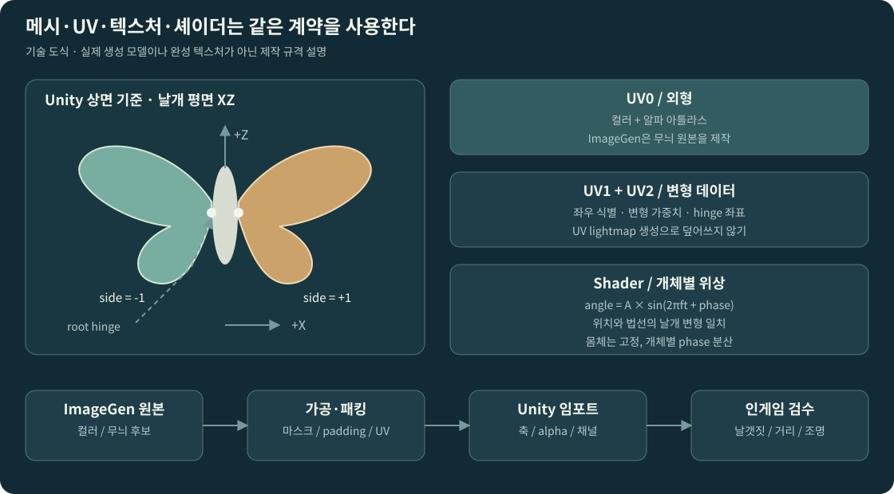

# Blender MCP · ImageGen 아트 제작 규약

> **버전 1.0 · 2026-11-12**  
> 목표: 기존 프로젝트의 외형을 최대한 재사용하고, 부족한 메시·텍스처만 제작해 GPU 환경 생물에 연결한다.  
> 이 문서는 제작 지시서다. 실제 .blend, FBX, PNG 또는 제작 완료 결과를 포함하지 않는다.

## 01. 재사용 우선 원칙

‘기존 모델이 있다’는 것은 이름만 비슷한 파일이 있다는 뜻이 아니라, 프로젝트에서 참조 가능한 모델이 있고 사용권·스타일·비용·변형 구조를 확인했다는 뜻이다. 재사용 적합성은 메시와 텍스처를 따로 판단한다.

| 입력 | 우선 선택 | 새 제작 |
|---|---|---|
| 적합한 모델+텍스처 | 원본 참조, 필요 시 GPU 재질만 파생 | 없음 |
| 적합한 스킨 모델 | rest pose 정적 파생, hinge·날개 weight·LOD 추가 | 기존 모델로 해결 못 하는 부분만 |
| 적합한 모델+부적합 텍스처 | 모델 유지 | ImageGen 컬러 원본·UV용 가공 |
| 적합한 텍스처만 존재 | 텍스처 기준 UV | Blender MCP 메시 |
| 양쪽 부재 | 규격 신규 제작 | Blender MCP + ImageGen |

후보별 이름·경로·GUID·스크린샷·판정 이유를 `asset_inventory.md`에 남긴다. 어떤 후보를 제외했는지 기록하지 않은 ‘없음’ 보고는 불충분하다. 라이선스가 확인되지 않은 원본을 외부 도구로 보내지 않는다.

## 02. 도구 준비와 작업 격리

실제 세션에서 제공되는 Blender MCP 목록과 실행 가능한 동작을 조회한다. 도구 이름이 `execute_blender_code`라고 추정해 호출하지 않는다. 연결된 Blender 버전, 현재 파일, 오브젝트 목록, 저장 가능한 작업 루트를 먼저 확인한다. 공개 MCP 구현에 코드 실행 기능이 존재한다는 사실과 현재 세션의 가용성은 다르다. 정규 설계 [S14] 참고.

새 작업은 별도 `.blend` 또는 전용 collection `AF_Work_<AssetId>`에 만든다. 현재 씬 전체 삭제, 다른 collection 수정, 원본 모델 제자리 저장은 금지다. 파일 생성·익스포트가 허용되는 경로를 좁히고, 재실행 시 자신이 만든 오브젝트만 갱신하도록 idempotent 작업을 구성한다. 보안 모드를 우회하거나 임의 패키지를 설치하지 않는다.

ImageGen은 사용할 수 있는 생성/편집 기능, reference 이미지 접근, alpha 출력 지원, 결과 파일 경로를 확인한다. 사용자의 원본 모델·텍스처를 사용할 때는 해당 자료의 외부 업로드 권한을 확인한다. 이번 문서는 제작을 요청한 것이지, 외부 유료 구독·결제까지 승인한 것으로 간주하지 않는다.

## 03. 표준 메시 계약



### 3.1 Unity에 임포트된 결과 기준

| 항목 | 계약 |
|---|---|
| 좌표 | +Y Up / +Z Forward / +X Right |
| 원점 | 몸통 중심, 양 날개 hinge 정의의 기준 |
| 기본 포즈 | 날개가 좌우 X 방향으로 펼쳐진 XZ 평면 rest pose |
| 단위 | 미터. 신규 표준 메시는 wingspan=1.0m로 정규화 후 종 프로필에서 실제 크기 지정 |
| 기존 자산 | 원본 단위 유지 가능. 파생본의 normalization factor를 metadata에 기록 |
| Transform | 파생 런타임 메시 기준 회전 0, scale 1. 음수 scale 없음 |
| 메시 | static Mesh. 개체별 Armature·Animator 없음 |
| material slot | 1개 우선, 분리 시 draw 비용과 이유 기록 |
| UV0 | BaseColor+Alpha |
| UV1 | Mesh.uv2 / TEXCOORD1: x=wingSide(-1,0,+1), y=flapWeight(0..1) |
| UV2 | Mesh.uv3 / TEXCOORD2: xy=hinge local x,z; hinge y=0 기본 |
| normal/tangent | 실제 GPU 회전과 일치. 뒷면 조명 확인 |

FBX export는 Blender 버전·프리셋에 따라 좌표 변환을 확인한다. `Forward=-Z`, `Up=Y` 같은 옵션 조합을 만능 정답으로 고정하지 않는다. Unity에서 1m 기준 오브젝트와 축 표시로 결과를 검증한다. Blender FBX 공식 자료는 정규 설계 [S13] 참고.

### 3.2 Butterfly 형상

몸통은 단순 캡슐형 실루엣으로 만들고, 좌우 날개는 root에서 tip까지 날갯짓 가능한 구조로 분리한다. 앞·뒤 날개 무늬는 하나의 half-wing 그룹으로 묶어도 된다. 가는 더듬이는 카메라 거리에서 실제로 보이는 경우만 남긴다. 아주 작은 디테일을 위해 재질·드로우 콜을 추가하지 않는다.

정면·상면·측면에서 몸체와 날개의 크기 비율을 검사한다. 좌우 wingSide와 hinge를 반대로 배정하면 한쪽만 아래로 접힐 수 있으므로, ±30도 정지 포즈를 만들어 테스트한다. 몸통과 날개 root는 분리되지 않아야 한다.

### 3.3 단순 벌레·반딧불

Gnat는 작은 실루엣이 우선이며 근거리 형태가 필요 없으면 Quad로 충분하다. Firefly는 발광 부위만 명확하게 분리하고, 몸체 모델이 꼭 필요한 카메라 거리인지 먼저 판단한다. 다리·날개를 사실적으로 다 만들 필요는 없다. 발광을 나타내려고 Point Light를 개체별로 생성하지 않는다.

## 04. Blender MCP 제작 요청문

```text
프로젝트의 GPU 환경 생물용 나비 정적 메시를 제작해줘.
먼저 현재 Blender 파일과 사용 가능한 MCP 동작을 확인하고,
기존 씬 전체를 삭제하지 말고 전용 AF_Work_<AssetId> collection에서 작업해.

입력:
- asset_inventory에서 NewRequired 또는 DeriveForGpu로 확정한 항목만 작업
- style_reference: 허가된 프로젝트 환경/기존 모델 캡처
- 최종 Unity 좌표: +Y 위, +Z 전진, +X 오른쪽
- 신규 표준 메시의 펼친 날개 폭: 1.0m
- LOD0: 80~240 triangles 초안, 1 material 우선, static mesh

요구:
1. 몸통과 좌우 날개를 만들고 XZ 평면 rest pose로 정리해.
2. hinge 위치, 좌우 식별, root→tip 변형 weight를 정의해.
3. UV0은 컬러 아틀라스, UV1은 wingSide와 flapWeight,
   UV2는 hinge x,z 데이터를 넣는 최종 Unity 계약에 맞춰.
   Blender에서 해당 데이터가 FBX/Unity로 그대로 안 넘어가면
   별도 metadata를 출력하고 Unity Editor 변환기에서 재작성하도록 해.
4. UV 확정 뒤 template/mask PNG와 UV rectangle metadata를 출력해.
5. 잘못된 normal, 퇴화 면, 예기치 않은 중복/음수 scale을 확인해.
6. source .blend, runtime FBX, 상면/측면/정면 검수 이미지,
   triangle/vertex/material 통계와 export 설정 기록을 저장해.
7. 재실행해도 이전 다른 작업물을 삭제하지 않도록 해.

이미지 생성으로 텍스처가 완성되기 전에는 중립색 프리뷰 재질만 사용해.
Blender render 성공을 Unity 축·UV·날갯짓 검증 완료로 대신하지 마.
```

UV1/UV2 채널이 수치 데이터라는 점을 특히 주의한다. 모델 임포터의 lightmap UV 생성·mesh optimization·vertex color 변환이 필요한 정보를 훼손하면 설정을 조정하거나 Editor 후처리로 다시 작성한다. 임포트 설정의 전역 적용은 금지하고 해당 파생 자산에만 적용한다.

## 05. UV와 이미지 생성의 연결

### 5.1 템플릿을 먼저 고정하는 이유

정밀한 아틀라스 배치를 자연어 요청만으로 보장할 수 없다. ImageGen은 색·패턴을 제작하고, 최종 UV 배치는 Blender/후처리 도구가 책임지는 구조로 한다. 생성 모델의 layout·일관성 한계는 정규 설계 [S15]에 근거한다.

기본 경로는 한쪽 날개 원본 → crop/align → 승인된 silhouette mask → 좌우 mirror/변주 → deterministic atlas pack → UV remap이다. 복잡한 모델에는 UV island별 texture patch를 생성해 Blender에서 project/bake하는 경로를 사용할 수 있다.

### 5.2 파일 구분

```text
Source/
  <AssetId>_source.blend
  <AssetId>_uv_template.png        // 픽셀 가이드, 게임에 직접 사용 금지
  <AssetId>_silhouette_mask.png    // 승인된 경계
  <AssetId>_uv_metadata.json
  ImageGen/
    <AssetId>_prompt.md
    <AssetId>_raw_<revision>.png   // 실제 생성 결과 원본
    generation_record.json       // 도구·일시·허가된 reference·선택 이유
  Processing/
    <AssetId>_processing_record.json
Runtime/
  <AssetId>.fbx
  <AssetId>_BaseColorAlpha.png
  <AssetId>_Mask.png              // 필요한 경우만
  <AssetId>_Emission.png          // 필요한 경우만
  <AssetId>_Material.mat
```

이 경로는 제안이다. 프로젝트의 실제 아트 루트에서 같은 역할이 유지되도록 배치한다. 생성 파일의 실재 경로·hash를 manifest에 기록하고, 예정 이름을 실제 생성된 경로로 혼동하지 않는다.

## 06. ImageGen 제작 요청문

### 6.1 나비 날개 컬러 원본

```text
게임의 GPU 나비 메시용 텍스처 원본을 제작해줘.
이것은 완성 곤충 일러스트나 배경 이미지가 아니라 날개 표면에 사용할 색과 무늬야.

참조:
- 제공한 프로젝트 스타일 캡처의 색감과 단순한 형태를 따를 것.
- 제공한 한쪽 날개 마스크는 root가 왼쪽, tip이 오른쪽인 방향 기준이야.
- 마스크가 편집 입력으로 제공되었다면 경계를 최대한 유지하되,
  정밀 픽셀 배치는 후처리 단계에서 검증할 것이므로 배경 요소를 추가하지 말 것.

그림 조건:
- 상면 직교 투영처럼 평평하게 보이는 한쪽 날개 한 세트만.
- 앞날개와 뒷날개가 함께 있는 하나의 half-wing silhouette.
- 몸체, 다리, 더듬이, 꽃, 풀, 손, 텍스트, 라벨, 워터마크, 프레임 없음.
- 프로젝트에 맞는 단순한 색면과 읽히는 무늬.
- 사실적인 광택, 드리운 그림자, 강한 입체 조명, 배경 그라데이션 없음.
- 투명이 지원되는 작업 환경에서는 진짜 alpha 투명 배경을 사용할 것.
- 체크무늬를 그려서 투명 배경처럼 보이게 하지 말 것.
- 경계가 잘리거나 화면 가장자리에 붙지 않도록 여유 영역을 둘 것.
- 비슷한 여러 날개를 한 캔버스에 반복 배치하지 말 것.

이번 요청의 팔레트: <실제 프로젝트에서 선택한 팔레트>
세부 무늬: <승인된 종별 특징>
```

프롬프트의 `<...>` 항목은 실제 시각 기준에서 채운다. 연결된 생성 도구가 별도 프롬프트 인자를 받지 않는 방식이면 해당 내용을 대화/편집 지시로 전달하며 가상의 API 파라미터를 만들지 않는다.

### 6.2 몸체 컬러 또는 나방 변형

```text
승인된 <AssetId> 원본과 프로젝트 스타일을 참고해서
같은 명암 단계와 재질감의 단순 몸체 컬러 패치를 제작해줘.
표면 색·미세한 무늬만 필요하며 3D 렌더, 원근, 하이라이트, 드리운 그림자는 넣지 마.
테두리나 글자 없이 지정된 표면을 채우고, 날개나 배경 풍경을 추가하지 마.
기존 UV가 요구하는 방향을 유지해줘.
```

나방 변형은 승인된 나비 원본을 reference로 쓰되 무늬·팔레트·날개 가장자리만 바꾸도록 요청한다. 기존 UV에 맞지 않을 정도로 silhouette가 바뀌면 텍스처 수정으로 숨기지 않고 모델·UV 버전을 올린다.

### 6.3 반딧불 halo/부유 입자 원본

```text
게임 VFX에 사용할 작은 빛/부유 입자의 컬러·알파 원본을 제작해줘.
한 캔버스에 단일 중심 형태만, 진짜 투명 배경이 지원되면 alpha를 유지해줘.
별 모양 광선, 렌즈 플레어, 글자, 장면, 곤충 사진, 흰 사각 배경은 넣지 마.
프로젝트의 환경 이펙트와 어울리는 부드러운 가장자리와 간결한 내부 밀도를 사용해줘.
최종 emission 강도와 falloff는 게임 셰이더에서 제어하므로 과도한 bloom을 굽지 마.
```

완전한 방사형 마스크 등 단순한 수치 텍스처가 필요한 경우에는 검증된 절차식으로 생성·파생할 수 있다. 이 경우 manifest에 `ProceduralDerived`로 기록한다. ImageGen을 호출하지 않고 코드로 만든 결과를 ImageGen 결과로 표시하지 않는다.

## 07. 후처리·텍스처 임포트 계약

| 항목 | 수행 | 실패 조건 |
|---|---|---|
| 투명 | 실제 alpha min/max·투명 픽셀 비율·체커 배경 검수 | RGB에 격자가 그려졌거나 alpha가 전부 1 |
| 배치 | mask와 날개 root/tip 방향 일치, deterministic crop/resize | silhouette 잘림, 다른 wing 조각 포함 |
| seam | 바깥쪽 색 확장, atlas padding, mip별 비교 | 흰/검은 halo, 옆 island 번짐 |
| 색 | BaseColor는 sRGB, 기술 마스크는 Linear | 마스크 값이 gamma 변환되어 수치 의미 훼손 |
| Normal | 필요 시 메시/검증된 height에서 bake | 생성 RGB를 normal로 태그만 변경 |
| Emission | 승인된 영역 mask와 셰이더 강도 | 컬러 전체를 무조건 발광시켜 형태 소실 |
| 형식 | alpha 보존 PNG 등 원본 보관, 타깃 압축 테스트 | JPEG에 alpha 저장했다고 주장 |
| 임포트 | runtime readable 복사 필요 여부 검토, mip 설정·alpha clip 검사 | 100m에서 bleed, 근거리 테두리 사각형 |

`Alpha Is Transparency`는 invisible texel의 색 확장 등 필터링 보조 설정이며 alpha 추출을 자동 수행하는 기능은 아니다. 공식 TextureImporter 자료는 정규 설계 [S16]을 참고한다.

1024px 원본과 2048px 아틀라스는 시작 예시다. 생성 모델의 실제 출력 크기를 기록하고, 요청한 크기와 반환 크기를 구분한다. 게임용 최종 크기 변환은 별도 가공 단계로 기록한다.

## 08. Unity 외형 검수

최소 검수는 실제 나비가 화면에서 보일 거리에서 수행한다. 모델 뷰어의 확대 사진만으로 완료하지 않는다.

| 시나리오 | 확인 |
|---|---|
| 0도/상하 30도 정지 날개 | pivot 이탈 없음, 몸체 고정, 좌우 구분 |
| 슬로모션 군집 | 개체별 phase 분산, 날개가 모두 동시에 움직이지 않음 |
| 정면·상면·측면·뒷면 | 실루엣·양면 normal·alpha clip |
| 실제 탐험 카메라 | 지나치게 큰 나비·보이지 않는 디테일·화면 점유 |
| 낮/그늘/해질녘/밤 | 프로젝트 툰 명암과 어울림, 반딧불 과노출 억제 |
| 흰/검은/초록 배경 | 경계 halo·압축 자국·잘린 alpha |
| 가까이→멀리 | mip bleed·계단 현상·density fade |
| 최종 Player Build | 셰이더 variant 누락·핑크·텍스처 참조 누락 없음 |

최종 상태는 `READY`, `REWORK`, `BLOCKED_TOOL`, `REVIEW_NA` 중 하나로 기록한다. source만 있고 Unity 검수가 없으면 READY가 아니다. 신규 프롬프트를 다시 요청하기 전에 어느 기준에서 실패했는지 한 가지 수정 목표로 좁힌다.
